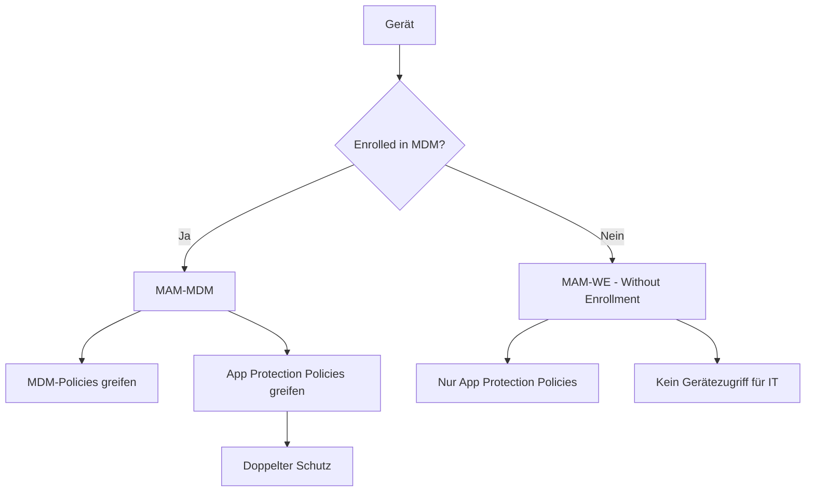
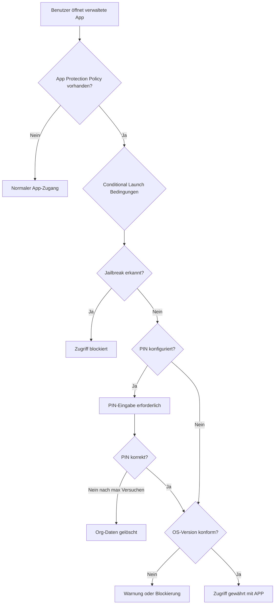
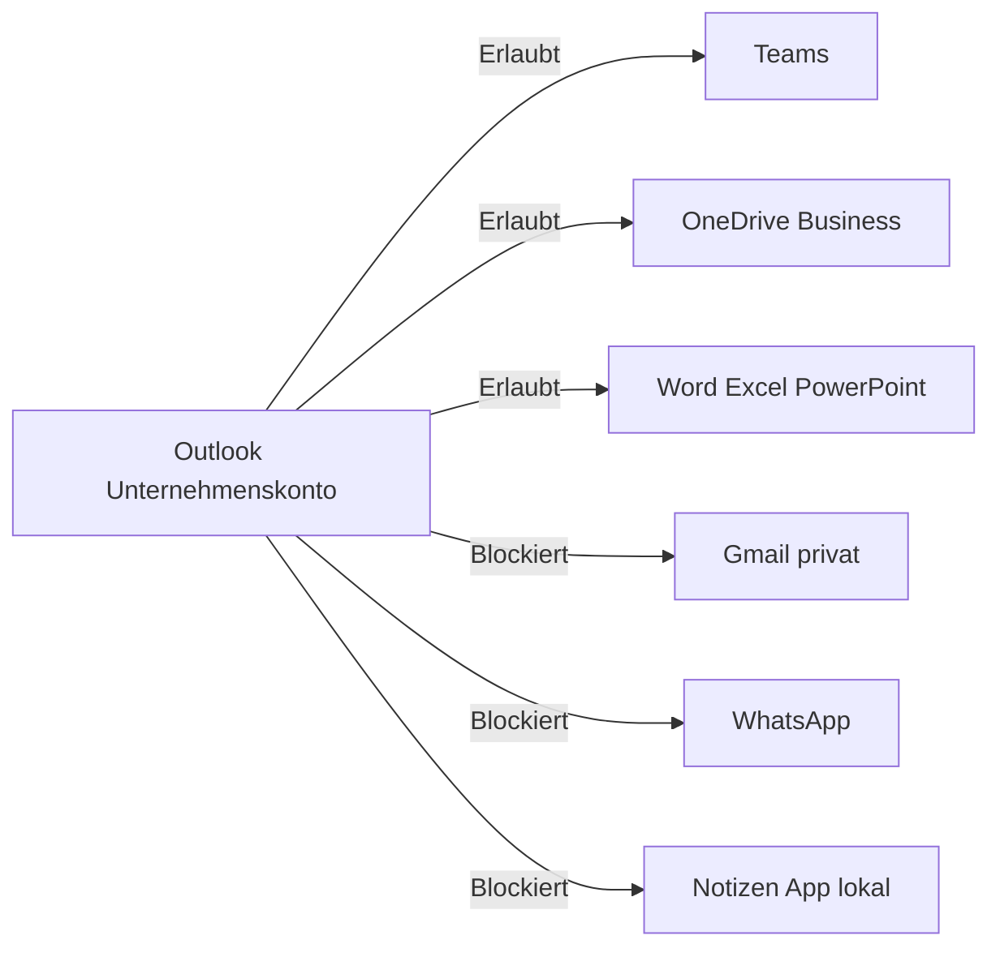

# App Management MAM

> [!ABSTRACT]
> Mobile Application Management (MAM) in Microsoft Intune schützt Unternehmensdaten auf App-Ebene, auch ohne vollständiges Gerätemanagement (MDM). App Protection Policies (APP) steuern Datentransfer, Copy/Paste, Datei-Speicherung und Zugriffsbedingungen für Apps wie Microsoft 365. Dieser Artikel erklärt MAM-WE vs. MAM-MDM, App-Deployment für alle Plattformen, iOS/Android App Protection Policies, Conditional Launch und LOB-App-Deployment.

---

## MAM vs. MDM

Intune bietet zwei Verwaltungsebenen, die kombiniert oder einzeln eingesetzt werden können:

| Aspekt | MDM (Mobile Device Management) | MAM (Mobile Application Management) |
|---|---|---|
| Verwaltungsebene | Gesamtes Gerät | Nur spezifische Apps |
| Enrollment erforderlich | Ja | Nein (MAM-WE) |
| Geeignet für | Unternehmenseigene Geräte | BYOD, Partner-Geräte |
| Kontrolle | Vollständig | Nur App-Daten |
| Datenschutz | Weniger Privatsphäre | Hohe Privatsphäre |
| Daten löschen | Alle Gerätedaten | Nur Unternehmensdaten in verwalteten Apps |

### MAM-WE vs. MAM-MDM



> [!IMPORTANT]
> **MAM-WE (Without Enrollment)** ist der häufigste Anwendungsfall für BYOD. Der Benutzer enrollt sein privates Gerät **nicht** in Intune, bekommt aber trotzdem App Protection Policies auf die Microsoft 365 Apps angewendet. Die IT hat keinen Zugriff auf das Gerät, nur auf Unternehmensdaten in den verwalteten Apps.

---

## App Protection Policies (APP)

App Protection Policies definieren, wie Unternehmensdaten innerhalb von verwalteten Apps geschützt werden.

### Unterstützte App-Typen

| Typ | Beschreibung | Beispiele |
|---|---|---|
| Intune SDK-integriert | App wurde mit Intune SDK gebaut | Alle Microsoft 365 Apps |
| App Wrapping Tool | Bestehende App nachträglich gewrappt | Interne LOB-Apps |
| Policy Managed Apps | Apps mit MAM-Unterstützung aus dem Store | Outlook, Teams, Edge, Adobe Acrobat |

### Intune SDK vs. App Wrapping Tool

| Aspekt | Intune SDK | App Wrapping Tool |
|---|---|---|
| Integration | In App-Code integriert | Post-Build-Prozess |
| Aufwand | Hoher Entwicklungsaufwand | Einfacher, kein Sourcecode nötig |
| Flexibilität | Maximale Kontrolle | Eingeschränkte Konfigurierbarkeit |
| Plattform | iOS und Android | iOS und Android |
| Empfehlung | Neue Entwicklungen | Bestehende LOB-Apps |

---

## iOS App Protection Policy

### Profil erstellen

```
Intune > Apps > App-Schutzrichtlinien > Erstellen > iOS/iPadOS
```

### Datenschutzeinstellungen (Data Protection)

| Einstellung | Empfehlung | Beschreibung |
|---|---|---|
| Daten sichern | Blockieren | iCloud-Backup von Unternehmensdaten verhindern |
| Daten an andere Apps senden | Nur richtlinienverwaltete Apps | Verhindert Daten-Leak an unverwaltete Apps |
| Daten von anderen Apps empfangen | Nur richtlinienverwaltete Apps | Verhindert Dateneinfuhr aus unverwalteten Apps |
| Kopieren/Einfügen zwischen Apps | Richtlinienverwaltete Apps mit Einfügen | Eingeschränktes Copy/Paste |
| Bildschirmaufnahme | Blockieren | Screenshots in Unternehmens-Apps verhindern |
| Drittanbieter-Tastaturen | Blockieren | Keylogger durch Drittanbieter-Tastaturen verhindern |
| Org-Daten auf verwalteten Speicherorten speichern | Erforderlich | OneDrive/SharePoint statt lokaler Speicher |
| Contact Sync | Deaktivieren | Kontakte aus Outlook nicht in Adressbuch |
| Printing | Blockieren | Unerwünschten Druck verhindern |

### Zugriffsanforderungen (Access Requirements)

| Einstellung | Empfehlung |
|---|---|
| PIN für Zugriff | Erforderlich |
| PIN-Typ | Numerisch (6 Stellen) oder Alphanumerisch |
| Biometrie statt PIN | Zulassen |
| PIN-Timeout (Minuten) | 30 Minuten |
| Einfache PINs blockieren | Ja |
| PIN nach Ablauf zurücksetzen | 90 Tage |
| Unternehmensanmeldeinformationen | Optional als Alternative |

---

## Android App Protection Policy

### Arbeitsprofil vs. MAM-WE auf Android

| Szenario | Methode | Beschreibung |
|---|---|---|
| Unternehmensgerät | Android Enterprise Fully Managed | Vollständige MDM-Verwaltung |
| BYOD mit Trennung | Android Enterprise Work Profile | Arbeitsprofil + MAM |
| BYOD ohne Enrollment | MAM-WE | Nur App Protection Policies |

### Android-spezifische Einstellungen

| Einstellung | Android-Besonderheit |
|---|---|
| Play Integrity Verification | Ersatz für Jailbreak-Erkennung auf Android |
| SafetyNet Attestation | Gerätezertifizierung durch Google |
| Threat Scan | Google Play Protect aktivieren |
| Minimum Patch Level | Sicherheitspatch-Level als Mindestanforderung |
| Min Play Services Version | Google Play Services mindest Version |

---

## Conditional Launch

Conditional Launch definiert Bedingungen, unter denen Zugriff auf verwaltete Apps gewährt oder verweigert wird:

### Conditional Launch Einstellungen

| Bedingung | Aktion | Beispielwert |
|---|---|---|
| Minimum PIN-Versuche | Unternehmens-Daten löschen | 5 Versuche |
| Offline Toleranzperiode | Zugriff blockieren | 720 Stunden |
| Offline Toleranzperiode | Unternehmens-Daten löschen | 90 Tage |
| Jailbroken/Rooted Gerät | Zugriff blockieren | — |
| Min. OS-Version | Zugriff blockieren | iOS 16.0 / Android 12 |
| Max. OS-Version | Warnung | Neueste +1 |
| Min. App-Version | Zugriff blockieren | Je App definiert |
| Gerätesperre | Zugriff blockieren | Erforderlich |
| Min. Sicherheitspatch-Level | Zugriff blockieren | 2023-01-01 |
| Bedrohungsstufe | Zugriff blockieren | Mittel |

### Conditional Launch Ablauf



---

## Data Transfer Policies

### Erlaubte App-Daten-Transfer-Szenarien



### Open-In / Share-Einschränkungen (iOS)

| Einstellung | Wert | Auswirkung |
|---|---|---|
| Daten an andere Apps senden | Nur richtlinienverwaltete Apps | "Teilen"-Menü zeigt nur verwaltete Apps |
| Eingehende Org-Daten aus anderen Apps | Alle Apps / Nur richtlinienverwaltete | Was darf in Outlook geöffnet werden? |
| Kopieren und Einfügen | Richtlinienverwaltete Apps mit Einfügen | Unternehmensdaten dürfen nicht in private Apps eingefügt werden |

---

## App-Deployment

Intune unterstützt verschiedene Deployment-Typen:

| Deployment-Typ | Beschreibung | Benutzerauswirkung |
|---|---|---|
| Erforderlich | App wird automatisch installiert | Kein Eingriff des Benutzers |
| Verfügbar | App im Company Portal angeboten | Benutzer installiert nach Wunsch |
| Deinstallieren | App wird automatisch entfernt | Keine Benutzerinteraktion |
| Verfügbar ohne Enrollment | Für MAM-WE Szenarien | Über Company Portal Website |

---

## Windows Store Apps (Microsoft Store)

### Neue Microsoft Store Integration (WinGet-basiert)

```
Intune > Apps > Windows > Hinzufügen > Microsoft Store App (neu)
```

Die neue Integration basiert auf WinGet und ermöglicht:
- Einfaches Suchen und Hinzufügen von Store-Apps
- Automatische Updates
- Keine Abhängigkeit von der alten Windows Package Manager Store-Integration

```powershell
# WinGet zur App-Suche nutzen
winget search "Microsoft Teams"
winget search "Visual Studio Code"

# App-ID für Intune identifizieren
winget show Microsoft.Teams
# → Im Intune-Portal nach dieser ID suchen
```

> [!NOTE]
> Die **alte Microsoft Store for Business**-Integration wurde von Microsoft eingestellt. Nutze ausschließlich die neue "Microsoft Store App (neu)"-Integration, die auf dem öffentlichen Microsoft Store und WinGet basiert.

---

## Android Managed Google Play Apps

Android Enterprise erfordert Google Play für App-Deployment auf Work Profile und Fully Managed Geräten:

```
Intune > Apps > Android > Hinzufügen > Verwaltete Google Play App
```

### Google Play verbinden

```
Intune > Mandantenverwaltung > Connectors und Token > Verwaltetes Google Play
→ Mit Google-Konto anmelden und Intune genehmigen
```

### App-Typen für Android Enterprise

| App-Typ | Beschreibung | Deployment |
|---|---|---|
| Managed Google Play Store App | Öffentliche Apps aus Google Play | Direkt in Intune zuweisen |
| Managed Google Play Private App | Interne Android-Apps | Via Google Play für Arbeit hochladen |
| Android Enterprise System App | Vorinstallierte System-Apps | Aktivieren/Deaktivieren |
| LOB App (APK) | Direkt hochgeladene APK-Datei | In Intune hochladen |

```powershell
# Via Graph API: Managed Google Play Apps auflisten
$uri = "https://graph.microsoft.com/v1.0/deviceAppManagement/mobileApps?`$filter=isOf('microsoft.graph.androidForWorkApp')"
$apps = Invoke-MgGraphRequest -Method GET -Uri $uri
$apps.value | Select-Object displayName, publisher, packageId | Format-Table
```

---

## iOS VPP Apps (Volume Purchase Program)

VPP ermöglicht den Massenkauf und das Deployment von iOS-Apps:

```
Intune > Mandantenverwaltung > Connectors und Token > Apple VPP-Token
```

### VPP-Token einrichten

1. In Apple Business Manager einen VPP-Token erstellen
2. Token in Intune hochladen
3. Apps in ABM kaufen (kostenlos oder kostenpflichtig)
4. Apps erscheinen automatisch in Intune

> [!IMPORTANT]
> VPP-Lizenzen sind **pro Gerät** oder **pro Benutzer** zuweisbar. Gerätelizenzen erfordern kein Apple-ID-Login, Benutzerlizenzen schon. Für vollständig verwaltete Unternehmensgeräte sind Gerätelizenzen empfohlen.

### App-Lizenz-Status überwachen

```powershell
# VPP-App-Lizenzen via Graph API
$uri = "https://graph.microsoft.com/v1.0/deviceAppManagement/mobileApps?`$filter=isOf('microsoft.graph.iosVppApp')"
$vppApps = Invoke-MgGraphRequest -Method GET -Uri $uri

$vppApps.value | Select-Object `
    displayName,
    @{N='TotalLicenses'; E={$_.totalLicenseCount}},
    @{N='UsedLicenses'; E={$_.usedLicenseCount}},
    @{N='AvailableLicenses'; E={$_.totalLicenseCount - $_.usedLicenseCount}} |
    Format-Table
```

---

## Line-of-Business (LOB) Apps

LOB-Apps sind intern entwickelte Apps, die direkt in Intune hochgeladen werden:

### iOS LOB App (.ipa)

```
Intune > Apps > iOS/iPadOS > Hinzufügen > Branchen-App (iOS)
```

**Anforderungen:**
- App muss mit Enterprise Distribution Certificate signiert sein
- Provisioning Profile muss hinterlegt sein (in Intune hochladen)
- `.ipa`-Datei (max. 2 GB)

### Android LOB App (.apk)

```
Intune > Apps > Android > Hinzufügen > Branchen-App (Android)
```

**Für Android Enterprise Work Profile:**
- APK muss via Managed Google Play hochgeladen werden (nicht direkt in Intune)
- Via Google Play für Arbeit: Play Console > Interne Tests

### Windows LOB App

```
Intune > Apps > Windows > Hinzufügen > Branchen-App (Windows)
```

| Format | Beschreibung | Empfehlung |
|---|---|---|
| .msi | Windows Installer | Legacy, funktioniert |
| .msix / .msixbundle | Modernes Windows-Paketformat | Empfohlen für neue Apps |
| .appx / .appxbundle | UWP-Apps | Für UWP/Store-Apps |
| .intunewin | Win32 App-Wrapper | Für komplexe Installationen |

### Win32 App (.intunewin)

Win32 Apps sind das flexibelste Deployment-Format für Windows:

```powershell
# Microsoft Win32 Content Prep Tool herunterladen
# https://github.com/microsoft/Microsoft-Win32-Content-Prep-Tool

# App zu .intunewin konvertieren
.\IntuneWinAppUtil.exe `
    -c "C:\Apps\MeineApp" `
    -s "setup.exe" `
    -o "C:\IntuneApps" `
    -q

# Ergebnis: MeineApp.intunewin → In Intune hochladen
```

**Win32 App Einstellungen:**

```
Install Command:   setup.exe /S /v"/qn"
Uninstall Command: msiexec /x {GUID} /qn
Return Codes:      0 (Erfolg), 1707 (Erfolg), 3010 (Neustart erforderlich)

Detection Rule:
  Typ: Registry
  Pfad: HKLM\SOFTWARE\Contoso\MeineApp
  Wert: Version
  Operator: Größer oder gleich
  Wert: 2.0.0
```

> [!TIP]
> Nutze **Supersedence** in Win32 Apps, um ältere Versionen automatisch durch neue zu ersetzen. Und **Dependencies**, um sicherzustellen, dass Voraussetzungen (z.B. Visual C++ Redistributable) zuerst installiert werden.

---

## App-Kategorien und App-Reporting

### App-Kategorien

App-Kategorien helfen beim Strukturieren des Company Portals:

```
Intune > Apps > App-Kategorien > Erstellen
Beispiele: Produktivität, Sicherheit, IT-Tools, Kommunikation
```

### App-Installationsstatus überwachen

```powershell
# App-Installationsstatus für alle Geräte
$appId = "APP-ID"
$uri = "https://graph.microsoft.com/v1.0/deviceAppManagement/mobileApps/$appId/deviceStatuses"
$deviceStatuses = Invoke-MgGraphRequest -Method GET -Uri $uri

$deviceStatuses.value | Select-Object `
    deviceName, userName, installState, errorCode, lastSyncDateTime |
    Group-Object installState |
    ForEach-Object {
        [PSCustomObject]@{
            Status = $_.Name
            Count = $_.Count
        }
    } | Format-Table
```

```powershell
# App Protection Policy Status auswerten
$uri = "https://graph.microsoft.com/beta/deviceAppManagement/managedAppStatuses('appregistrationssummary')"
$appStatus = Invoke-MgGraphRequest -Method GET -Uri $uri
$appStatus | ConvertTo-Json -Depth 5
```

### Company Portal anpassen

```
Intune > Mandantenverwaltung > Anpassung

Konfigurierbare Elemente:
- Unternehmensname und -logo
- Support-Kontaktinformationen (E-Mail, Telefon, URL)
- Datenschutzlink
- Farbschema (Primär- und Akzentfarbe)
- Featured Apps (Empfohlene Apps auf der Startseite)
```

> [!TIP]
> Konfiguriere das Company Portal mit dem Unternehmenslogo und Support-Kontakten. Nutzer erhalten so einen direkten Support-Kanal, wenn App-Probleme auftreten — das reduziert Helpdesk-Tickets erheblich.

---

## App Protection Policy Reporting

### App-Schutzstatus je Benutzer

```
Intune > Apps > App-Schutzstatus > Benutzer-Status
```

Zeigt:
- Welche Apps auf dem Gerät unter App Protection Policy stehen
- Letzter Policy-Check-Zeitpunkt
- SDK-Version der App
- Geräte-Compliance im MAM-Kontext

### Graph API: MAM-Status abrufen

```powershell
# Alle Benutzer mit App Protection Status
$uri = "https://graph.microsoft.com/beta/deviceAppManagement/managedAppRegistrations"
$registrations = Invoke-MgGraphRequest -Method GET -Uri $uri

$registrations.value | Select-Object `
    @{N='Benutzer'; E={$_.userId}},
    @{N='App'; E={$_.appIdentifier.bundleId -join ', '}},
    @{N='Plattform'; E={$_.deviceType}},
    @{N='Letzter Check'; E={$_.lastSyncDateTime}},
    @{N='Flags'; E={$_.flaggedReasons}} |
    Format-Table -AutoSize
```

---

## Verwandte Notizen

- [[Compliance Policies]]
- [[Konfigurationsprofile]]
- [[macOS Enrollment]]
