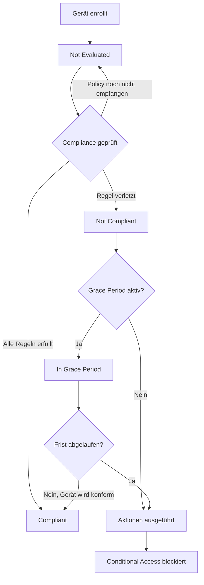
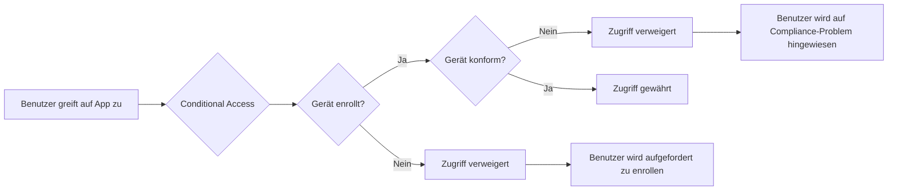

# Compliance Policies

> [!ABSTRACT]
> Compliance Policies in Microsoft Intune definieren Mindestanforderungen für Geräte (z.B. Verschlüsselung, OS-Version, PIN). Nicht-konforme Geräte können über Aktionen wie Benachrichtigungen, Sperrungen oder Conditional Access blockiert werden. Dieser Artikel erklärt die Einstellungen pro Plattform, den Compliance-Status-Lebenszyklus, Grace Periods, Custom Compliance mit PowerShell und die Integration mit Conditional Access.

---

## Was sind Compliance Policies?

Compliance Policies sind Regelwerke in Intune, die definieren, welche Mindestanforderungen ein Gerät erfüllen muss, um als **konform** zu gelten. Sie unterscheiden sich von Konfigurationsprofilen: Konfigurationsprofile *erzwingen* Einstellungen direkt, während Compliance Policies den Zustand *bewerten* und bei Nicht-Konformität Aktionen auslösen.

### Compliance vs. Konfiguration

| Aspekt | Compliance Policy | Konfigurationsprofil |
|---|---|---|
| Zweck | Gerätezustand bewerten | Einstellungen konfigurieren |
| Reaktion bei Verstoß | Aktion (Benachrichtigung, Sperre) | Einstellung wird erzwungen |
| Conditional Access | Kann blockieren | Kein direkter CA-Einfluss |
| Berichterstattung | Compliance-Status je Gerät | Profil-Anwendungsstatus |

### Compliance-Status-Lebenszyklus



> [!NOTE]
> Der Status **Not Evaluated** tritt auf, wenn ein Gerät enrollt wurde, aber noch keine Compliance Policy zugewiesen ist. Standardmäßig gilt ein Gerät ohne Policy als **konform** — dies kann in den Intune-Einstellungen geändert werden.

### Standardverhalten ohne Policy

```
Intune > Gerätecompliance > Compliance-Richtlinieneinstellungen
→ "Geräte ohne Compliance-Richtlinie als konform markieren": Konform / Nicht Konform
```

> [!DANGER]
> Der Standard ist **Konform**. Das bedeutet: Geräte ohne zugewiesene Policy haben freien Zugang! Ändere dies auf **Nicht konform** für eine sicherheitsorientierende Zero-Trust-Umgebung.

---

## Compliance-Einstellungen pro Plattform

### Windows 10/11

| Kategorie | Einstellung | Empfehlung |
|---|---|---|
| Gerätezustand | BitLocker erforderlich | Ja |
| Gerätezustand | Sicherer Start erforderlich | Ja |
| Gerätezustand | Codeintegrität erforderlich | Ja |
| Gerätezustand | Microsoft Defender Antimalware | Erforderlich |
| Gerätezustand | Echtzeit-Schutz | Aktiviert |
| Geräteeigenschaften | Min. Betriebssystemversion | 10.0.19041 (20H1) |
| Geräteeigenschaften | Max. Betriebssystemversion | Leer lassen |
| Systemsicherheit | Passwort erforderlich | Ja |
| Systemsicherheit | Minimale Passwortlänge | 8 |
| Systemsicherheit | Passworttyp | Alphanumerisch |
| Systemsicherheit | Bildschirmsperre | 5 Minuten |
| Microsoft Defender ATP | Geräterisikobewertung | Mittel oder Niedrig |

### iOS/iPadOS

| Kategorie | Einstellung | Empfehlung |
|---|---|---|
| Gerätezustand | Jailbroken Geräte | Blockieren |
| Gerätezustand | Mobile Threat Defense | Aktiviert |
| Geräteeigenschaften | Min. Betriebssystemversion | 16.0 |
| Systemsicherheit | Passcode erforderlich | Ja |
| Systemsicherheit | Einfache Passcodes | Blockieren |
| Systemsicherheit | Minimale Länge | 6 |
| Systemsicherheit | Bildschirmsperre (Minuten) | 5 |

### Android (Android Enterprise)

| Kategorie | Einstellung | Empfehlung |
|---|---|---|
| Gerätezustand | Geräteverwaltungstyp | Fully Managed oder Work Profile |
| Gerätezustand | Gerootete Geräte | Blockieren |
| Gerätezustand | Bedrohungsstufe | Mittel |
| Geräteeigenschaften | Min. Betriebssystemversion | 12.0 |
| Systemsicherheit | Passwort erforderlich | Ja |
| Systemsicherheit | Passworttyp | Alphanumerisch |
| Systemsicherheit | Minimale Länge | 6 |
| Systemsicherheit | Verschlüsselung | Ja |

### macOS

| Kategorie | Einstellung | Empfehlung |
|---|---|---|
| Gerätezustand | Systemintegrität | Erforderlich |
| Geräteeigenschaften | Min. Betriebssystemversion | 13.0 |
| Systemsicherheit | Firewall | Aktiviert |
| Systemsicherheit | FileVault | Erforderlich |
| Systemsicherheit | Gatekeeper | App Store und identifizierte Entwickler |
| Systemsicherheit | Passwort erforderlich | Ja |
| Systemsicherheit | Minimale Länge | 8 |

---

## Compliance-Aktionen bei Nicht-Konformität

Wenn ein Gerät nicht-konform wird, löst Intune konfigurierte Aktionen aus. Diese Aktionen können zeitverzögert konfiguriert werden.

### Verfügbare Aktionen

| Aktion | Beschreibung | Anwendungsfall |
|---|---|---|
| E-Mail an Benutzer | Benachrichtigung mit Compliance-Details | Erste Warnung |
| Gerät als nicht konform markieren | Startet den Nicht-Konformitäts-Timer | Immer erste Aktion |
| Push-Benachrichtigung | App-Benachrichtigung via Company Portal | Mobile Geräte |
| Remotely lock | Gerät wird gesperrt | Sicherheitskritisch |
| Retire | MDM-Profil wird entfernt | Letztes Mittel |

### Aktions-Zeitplan konfigurieren

```
Intune > Geräte > Compliance Policies > [Policy] > Aktionen für Nicht-Konformität
```

**Empfohlener Zeitplan:**

| Tag | Aktion |
|---|---|
| 0 (sofort) | Gerät als nicht konform markieren |
| 1 Tag | E-Mail an Benutzer |
| 3 Tage | Push-Benachrichtigung |
| 7 Tage | Erneute E-Mail-Benachrichtigung |
| 14 Tage | Remotely Lock (bei weiterhin nicht-konformem Gerät) |
| 30 Tage | Retire (MDM-Entfernung) |

> [!TIP]
> Die **E-Mail-Benachrichtigungsvorlage** kann unter `Intune > Gerätecompliance > Benachrichtigungen` angepasst werden. Füge das Unternehmenslogo und hilfreiche Links zur Problembehebung hinzu.

### E-Mail-Benachrichtigungsvorlage

```
Intune > Gerätecompliance > Benachrichtigungen > Erstellen

Betreff: Ihr Gerät {DeviceName} entspricht nicht den Unternehmensrichtlinien
Nachricht:
Hallo {UserName},

Ihr Gerät {DeviceName} (OS: {OSAndVersion}) entspricht nicht mehr
den Sicherheitsrichtlinien von {CompanyName}.

Nicht-konforme Einstellungen:
{NonComplianceDetails}

Bitte beheben Sie die Probleme innerhalb von 7 Tagen, um den
Zugriff auf Unternehmensressourcen aufrechtzuerhalten.

Für Hilfe wenden Sie sich an: helpdesk@contoso.com

Mit freundlichen Grüßen,
IT-Abteilung
```

---

## Grace Period konfigurieren

Die Grace Period gibt Benutzern Zeit, Compliance-Probleme zu beheben, bevor Conditional Access den Zugriff sperrt.

### Grace Period einstellen

```
Intune > Gerätecompliance > Compliance-Richtlinieneinstellungen
→ "Grace Period (Tage)": 0–14 Tage
```

> [!IMPORTANT]
> Die Grace Period gilt **global** für alle Compliance Policies in Intune, nicht pro Policy. Standard ist 0 Tage (kein Puffer). Empfehlung: 7–14 Tage für eine realistischere Implementierung.

### Grace Period vs. Aktionsverzögerung

| Mechanismus | Wirkung | Konfigurationsort |
|---|---|---|
| Grace Period | Verzögert Nicht-Konformitäts-Markierung | Globale Einstellungen |
| Aktionsverzögerung | Verzögert eine spezifische Aktion | Pro Policy / Aktion |
| Conditional Access | Blockiert Zugriff nach Nicht-Konformität | Conditional Access Policy |

---

## Conditional Access und Compliance

Die Integration von Compliance Policies mit Conditional Access ist der stärkste Mechanismus zur Durchsetzung von Geräteanforderungen.

### Conditional Access Policy mit Compliance



### Conditional Access Policy erstellen

```
Entra ID > Sicherheit > Bedingter Zugriff > Neue Richtlinie

Zuweisungen:
  Benutzer: Alle Benutzer (oder spezifische Gruppe)
  Cloud-Apps: Office 365 / Exchange Online / SharePoint
  Bedingungen: Geräteplattformen (Windows, iOS, Android, macOS)

Zugriffssteuerung:
  Gewähren:
    ✅ Konformes Gerät erfordern
    ✅ In Microsoft Entra ID eingebundenes Gerät erfordern (für Windows)
  Alle ausgewählten Steuerungen erforderlich: JA
```

> [!WARNING]
> Stelle sicher, dass eine **Notfallzugriffsgruppe** (Break-Glass-Konten) von Conditional Access ausgeschlossen ist. Sonst kannst du dich bei einem Fehler selbst aussperren.

---

## Device Compliance Berichte

### Intune Compliance-Dashboard

```
Intune > Gerätecompliance > Übersicht
```

Das Dashboard zeigt:
- Gesamt-Compliance-Rate aller Geräte
- Compliance nach Plattform
- Top nicht-konforme Einstellungen
- Geräte nach Compliance-Status

### Compliance-Berichte exportieren

```powershell
# Graph API: Alle nicht-konformen Geräte abrufen
Connect-MgGraph -Scopes "DeviceManagementManagedDevices.Read.All"

$uri = "https://graph.microsoft.com/v1.0/deviceManagement/managedDevices?`$filter=complianceState eq 'noncompliant'"
$noncompliantDevices = Invoke-MgGraphRequest -Method GET -Uri $uri

# Ergebnisse in CSV exportieren
$noncompliantDevices.value | Select-Object `
    deviceName, userDisplayName, operatingSystem, 
    osVersion, complianceState, lastSyncDateTime |
    Export-Csv -Path "C:\Reports\NonCompliantDevices.csv" -NoTypeInformation -Encoding UTF8

Write-Host "Nicht-konforme Geräte: $($noncompliantDevices.value.Count)"
```

```powershell
# Compliance-Status nach Plattform
$allDevices = @()
$uri = "https://graph.microsoft.com/v1.0/deviceManagement/managedDevices"

do {
    $response = Invoke-MgGraphRequest -Method GET -Uri $uri
    $allDevices += $response.value
    $uri = $response.'@odata.nextLink'
} while ($uri)

$allDevices | Group-Object operatingSystem | ForEach-Object {
    $compliant = ($_.Group | Where-Object complianceState -eq 'compliant').Count
    [PSCustomObject]@{
        Platform = $_.Name
        Total = $_.Count
        Compliant = $compliant
        NonCompliant = $_.Count - $compliant
        ComplianceRate = [math]::Round(($compliant / $_.Count) * 100, 1)
    }
} | Format-Table -AutoSize
```

---

## Custom Compliance Settings (Windows)

Custom Compliance ermöglicht es, eigene PowerShell-Scripts zur Compliance-Prüfung zu verwenden. Das Script gibt ein JSON-Objekt zurück, das von Intune ausgewertet wird.

### Custom Compliance Script erstellen

```powershell
# CustomCompliance_Check.ps1
# Gibt JSON mit Compliance-Daten zurück

$result = @{}

# Prüfung 1: Bitlocker-Status
$bitlockerVolumes = Get-BitLockerVolume | Where-Object { $_.VolumeType -eq 'OperatingSystem' }
$result['BitLockerEnabled'] = ($bitlockerVolumes.ProtectionStatus -eq 'On')

# Prüfung 2: Antivirus-Signatur-Alter
$avStatus = Get-MpComputerStatus
$signatureAge = (Get-Date) - $avStatus.AntivirusSignatureLastUpdated
$result['AVSignatureAgeInDays'] = [math]::Round($signatureAge.TotalDays, 0)

# Prüfung 3: Letzter Windows Update
$lastUpdate = (Get-HotFix | Sort-Object InstalledOn -Descending | Select-Object -First 1).InstalledOn
$daysSinceUpdate = ((Get-Date) - $lastUpdate).Days
$result['DaysSinceLastWindowsUpdate'] = $daysSinceUpdate

# Prüfung 4: Lokale Administratoren (nur erlaubte)
$localAdmins = (Get-LocalGroupMember -Group "Administrators").Name
$allowedAdmins = @("DOMAIN\Admin", "DOMAIN\IntuneAdmin")
$unauthorizedAdmins = $localAdmins | Where-Object { $_ -notin $allowedAdmins -and $_ -notlike "NT AUTHORITY\*" }
$result['UnauthorizedLocalAdmins'] = $unauthorizedAdmins.Count

return $result | ConvertTo-Json -Compress
```

### Custom Compliance Discovery Script in Intune hochladen

```
Intune > Gerätecompliance > Scripts > Hinzufügen > Windows
```

### JSON-Schema für Custom Compliance definieren

```json
{
    "Rules": [
        {
            "SettingName": "BitLockerEnabled",
            "Operator": "IsEquals",
            "DataType": "Boolean",
            "Operand": true,
            "MoreInfoUrl": "https://contoso.sharepoint.com/it/bitlocker",
            "RemediationStrings": [
                {
                    "Language": "de_DE",
                    "Title": "BitLocker nicht aktiviert",
                    "Description": "Bitte aktivieren Sie BitLocker über die Systemsteuerung oder wenden Sie sich an den IT-Support."
                }
            ]
        },
        {
            "SettingName": "AVSignatureAgeInDays",
            "Operator": "IsLess",
            "DataType": "Int64",
            "Operand": 3,
            "MoreInfoUrl": "https://contoso.sharepoint.com/it/antivirus",
            "RemediationStrings": [
                {
                    "Language": "de_DE",
                    "Title": "Antivirus-Signaturen veraltet",
                    "Description": "Die Antivirus-Signaturen sind älter als 3 Tage. Verbinden Sie das Gerät mit dem Internet für automatische Updates."
                }
            ]
        },
        {
            "SettingName": "UnauthorizedLocalAdmins",
            "Operator": "IsEquals",
            "DataType": "Int64",
            "Operand": 0,
            "MoreInfoUrl": "https://contoso.sharepoint.com/it/localadmin",
            "RemediationStrings": [
                {
                    "Language": "de_DE",
                    "Title": "Nicht autorisierte lokale Administratoren",
                    "Description": "Auf diesem Gerät befinden sich nicht autorisierte lokale Administrator-Konten."
                }
            ]
        }
    ]
}
```

> [!IMPORTANT]
> Custom Compliance Scripts laufen im **System**-Kontext. Das Script muss innerhalb von **30 Sekunden** abgeschlossen sein und darf maximal **10 Custom Settings** zurückgeben.

---

## Troubleshooting Compliance-Probleme

### Compliance-Status nicht aktuell

```powershell
# Gerät zur Synchronisierung zwingen (via Graph API)
$deviceId = "DEVICE-ID"
$uri = "https://graph.microsoft.com/v1.0/deviceManagement/managedDevices/$deviceId/syncDevice"
Invoke-MgGraphRequest -Method POST -Uri $uri
Write-Host "Synchronisierungsanforderung gesendet"
```

```powershell
# Compliance-Auswertung erzwingen
$uri = "https://graph.microsoft.com/v1.0/deviceManagement/managedDevices/$deviceId/triggerComplianceCheck"
Invoke-MgGraphRequest -Method POST -Uri $uri
```

### Diagnose auf Windows-Gerät

```powershell
# MDM-Diagnosebericht auf Windows-Gerät erstellen
Start-Process "ms-settings:workplace"

# Oder via Kommandozeile (MDM-Enrollment-Status)
dsregcmd /status

# Intune Management Extension Logs
Get-Content "C:\ProgramData\Microsoft\IntuneManagementExtension\Logs\IntuneManagementExtension.log" -Tail 50
```

### Häufige Compliance-Probleme

| Problem | Mögliche Ursache | Lösung |
|---|---|---|
| BitLocker nicht erkannt | TPM-Problem, kein Escrow | TPM-Status prüfen, Recovery Key in Intune hinterlegen |
| macOS FileVault nicht konform | Bootstrap Token fehlt | Bootstrap Token in Intune prüfen |
| Antivirus nicht konform | Defender deaktiviert / 3rd Party AV | Defender aktivieren oder in Ausnahmen aufnehmen |
| OS-Version nicht konform | Ausstehende Updates | Windows Update / Software Update erzwingen |
| Always Not Evaluated | Keine Policy zugewiesen | Policy-Zuweisung prüfen, Gerät synchronisieren |
| Conditional Access sperrt trotz konformem Gerät | CA-Cache | Browser-Cache leeren, neu anmelden |

> [!TIP]
> Das **Intune Troubleshooting**-Portal (`Intune > Problembehandlung + Support > Problembehandlung`) ermöglicht es, einen Benutzer oder ein Gerät auszuwählen und alle zugewiesenen Policies und deren Status auf einen Blick zu sehen.

---

## Verwandte Notizen

- [[macOS Enrollment]]
- [[Konfigurationsprofile]]
- [[App Management MAM]]
