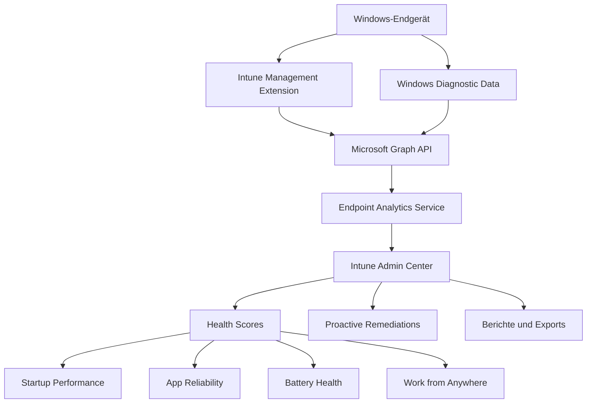
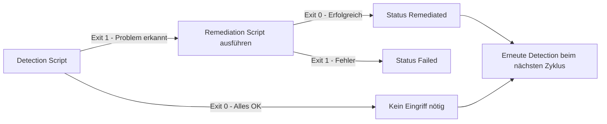
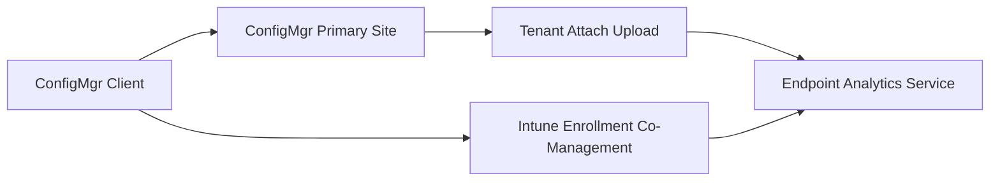

---
tags:
  - microsoft365
  - intune
  - endpoint-analytics
  - proactive-remediations
aliases:
  - Endpoint Analytics
  - Intune Analytics
---

# Endpoint Analytics

> [!ABSTRACT]
> Endpoint Analytics ist ein cloudbasierter Dienst in Microsoft Intune, der Einblicke in die Leistung und Gesundheit von Endgeräten liefert. Er misst Startup-Zeiten, App-Zuverlässigkeit, Akkulaufzeit und mehr – und ermöglicht proaktives Eingreifen mit automatisierten Skripten, bevor Probleme eskalieren.

---

## Übersicht und Architektur

Endpoint Analytics ist Teil der **Microsoft Intune Suite** und sammelt Telemetriedaten direkt von verwalteten Endgeräten. Die Daten werden in der Microsoft Cloud verarbeitet und im Intune Admin Center unter **Reports → Endpoint Analytics** angezeigt.

### Unterstützte Verwaltungsmethoden

| Verwaltungstyp | Unterstützt | Voraussetzungen |
|---|---|---|
| Intune-verwaltet (Cloud-managed) | ✅ | Intune-Enrollment, Windows 10/11 |
| Co-managed (ConfigMgr + Intune) | ✅ | ConfigMgr 2006+, Workload zu Intune |
| Tenant Attach | ✅ | ConfigMgr 2006+, Upload zu MEM |
| GPO-verwaltet (nur AD) | ❌ | Nicht unterstützt |



---

## Health Score

Der **Endpoint Analytics Score** ist ein zusammengesetzter Wert (0–100), der die allgemeine Gesundheit der Geräteflotte widerspiegelt.

### Score-Kategorien im Überblick

| Kategorie | Max-Punkte | Beschreibung |
|---|---|---|
| Startup Performance | 100 | Boot- und Login-Zeiten der Geräte |
| Work from Anywhere | 100 | Cloud-Verwaltung und Remote-Bereitschaft |
| App Reliability | 100 | App-Abstürze und Hänger |
| Battery Health | 100 | Akkukapazität und Laufzeit (Laptops) |
| Recommended Software | 100 | Empfohlene Konfigurationen und Tools |
| Resource Performance | 100 | CPU- und RAM-Auslastung |

### Baseline-Vergleich

- **Organisationswert:** Durchschnitt aller gemeldeten Geräte in deinem Tenant
- **Baseline (Median):** Vergleichswert aus ähnlichen Organisationen weltweit
- Werte **über** der Baseline = bessere Performance als Branchendurchschnitt
- Zielwert: Score ≥ 80 gilt als gut; ≥ 90 als exzellent

> [!TIP]
> Der Median-Baseline wird von Microsoft monatlich aktualisiert. Filtere nach Gerätekategorien (z. B. Laptops vs. Desktops) für präzisere Vergleiche, da Desktops bei Akku-Scores naturgemäß nicht bewertet werden.

---

## Startup Performance

### Startup Score

Misst die Zeit von Einschalten des Geräts bis zur vollständigen Einsatzbereitschaft des Benutzers. Zwei Hauptkomponenten:

- **Boot Time:** Zeit von BIOS bis zum Windows-Anmeldebildschirm
- **Login Time:** Zeit von Anmeldeeingabe bis zur vollständig nutzbaren Desktop-Umgebung

### Core Boot vs. Full Boot

| Metrik | Beschreibung |
|---|---|
| Core Boot Time | Bereinigt um GP-Verarbeitung und Startup-Apps |
| Full Boot Time | Gesamte Boot-Dauer inkl. aller Verzögerungen |
| Core Login Time | Login ohne Startup-Apps und GP-Skripte |
| Full Login Time | Gesamte Login-Dauer |

### Top Startup Processes

Endpoint Analytics identifiziert automatisch die Prozesse, die den Login am stärksten verzögern:

| Spalte | Bedeutung |
|---|---|
| Prozessname | Name des verzögernden Prozesses |
| Mittlere Verzögerung | Durchschnittliche Verzögerung in Sekunden |
| Betroffene Geräte | Anzahl der Geräte mit diesem Prozess |
| Publisher | Herausgeber der Anwendung |

> [!NOTE]
> Startup-Prozesse mit hoher mittlerer Verzögerung sind ideale Kandidaten für Proactive Remediations – z. B. Deaktivierung nicht benötigter Autostart-Einträge via Skript.

### Geräte-Einflussfaktoren

| Faktor | Einfluss auf Score |
|---|---|
| SSD vs. HDD | SSD drastisch schneller (häufig +30 Punkte) |
| RAM-Menge | Weniger als 8 GB verschlechtert Login-Zeit |
| Anzahl Startup-Apps | Mehr Apps = längere Login-Zeit |
| Gruppenrichtlinien | Viele GP-Skripte erhöhen Boot/Login-Zeit |
| Festplattenauslastung | Volle Festplatten verlangsamen Boot |

---

## Work from Anywhere Score

Misst die Fähigkeit der Organisation, moderne Remote-Arbeit zu unterstützen:

| Komponente | Beschreibung |
|---|---|
| Cloud-Management | Prozentsatz der Intune-verwalteten Geräte |
| Cloud Identity | Anteil Entra ID Joined oder Hybrid Joined |
| Cloud-Provisioning | Anteil Autopilot-provisionierter Geräte |
| Compliant | Anteil der complianten Geräte |

> [!IMPORTANT]
> Für einen optimalen Work from Anywhere Score sollten Geräte vollständig cloud-managed sein. Rein GPO-verwaltete Geräte senken diesen Score erheblich, auch wenn sie physisch remote genutzt werden.

---

## App Reliability Score

Misst die Stabilität von Anwendungen über alle verwalteten Endgeräte hinweg.

### Kernmetriken

- **Mean Time to Failure (MTTF):** Durchschnittliche Zeit zwischen App-Abstürzen je Gerät
- **App Crash Rate:** Abstürze pro Gerät und Stunde
- **App Hang Rate:** Hänger ("Nicht reagierend") pro Gerät und Stunde
- **No-Crash Percentage:** Prozentsatz der Gerät-App-Kombinationen ohne Absturz im Berichtszeitraum

### App Reliability Ansichten

| Ansicht | Inhalt |
|---|---|
| App-Übersicht | Alle Apps sortiert nach Crash-/Hang-Rate |
| Geräteansicht | Geräte mit den meisten App-Problemen |
| Versionsansicht | Vergleich verschiedener App-Versionen |
| Modellansicht | Abstürze nach Gerätehersteller und Modell |

> [!TIP]
> Nutze die Versionsansicht, um zu erkennen, ob ein App-Update Abstürze reduziert oder verursacht hat. Dies hilft beim Steuern von Software-Deployments.

---

## Battery Health Score

Überwacht die Akkugesundheit von Laptops und mobilen Geräten in der Flotte.

| Metrik | Beschreibung |
|---|---|
| Mittlere Maximalkapazität | Aktuell nutzbare Kapazität vs. Design-Kapazität in Prozent |
| Geräte mit gesundem Akku | Anteil Geräte mit Kapazität ≥ 80 % |
| Akku-Laufzeit-Schätzung | Prognostizierte Laufzeit unter typischer Last |
| Kritische Geräte | Geräte mit Akkukapazität unter 50 % |

> [!WARNING]
> Akkus unter 50 % Kapazität sollten zeitnah ausgetauscht werden. Ein geschwächter Akku führt zu erzwungenen Neustarts und Datenverlust und senkt die Produktivität erheblich.

---

## Resource Performance

Misst die CPU- und RAM-Auslastung über die Zeit auf allen verwalteten Geräten.

### Erfasste Metriken

- **CPU-Auslastung (p95):** 95. Perzentil der CPU-Last über 14 Tage
- **RAM-Auslastung (p95):** 95. Perzentil der RAM-Nutzung über 14 Tage
- **Geräte mit hoher CPU-Last:** Geräte, die regelmäßig über 75 % CPU-Auslastung zeigen
- **Geräte mit hoher RAM-Last:** Geräte, die regelmäßig über 80 % RAM-Auslastung zeigen

> [!NOTE]
> Resource Performance ist ein Feature der **Intune Suite** (Advanced Endpoint Analytics) und nicht im Standard-Intune-Plan enthalten.

---

## Recommended Software Score

Bewertet, ob Geräte empfohlene Software-Konfigurationen und -versionen verwenden:

| Empfehlung | Beschreibung | Punkte |
|---|---|---|
| Windows 11 | Upgrade auf aktuellstes OS | 20 |
| Microsoft 365 Apps | Aktuelle, unterstützte Office-Version | 20 |
| Autopilot Registered | Gerät in Autopilot registriert | 20 |
| Microsoft Defender for Endpoint | ATP-Sensor aktiv und reportend | 20 |
| Kein VHD-Boot | Kein Boot von virtueller Festplatte | 20 |

---

## Via Microsoft Intune Admin Center (UI)

### Endpoint Analytics aktivieren und Berichte einsehen

1. Öffne das **Microsoft Intune Admin Center** unter [intune.microsoft.com](https://intune.microsoft.com)
2. Navigiere zu **Berichte → Endpoint Analytics**

#### Endpoint Analytics aktivieren

3. Klicke auf **Einstellungen** (Zahnradsymbol) → **Endpoint Analytics-Einstellungen**
4. Aktiviere **Endpoint Analytics** für:
   - **Zielbereich:** `Alle Geräte` oder ausgewählte Gerätegruppen
   - **Intune-Datensammlung:** `Aktiviert`
5. Klicke auf **Speichern**

#### Health Scores einsehen

6. Navigiere zu **Berichte → Endpoint Analytics → Übersicht**
   - Sieh den Gesamt-Score (0–100) und die Kategoriescores auf einen Blick
   - Vergleiche mit der **Baseline (Branchenmedian)**
7. Für Details navigiere zu den Unterberichten:
   - **Startleistung** → Boot- und Login-Zeiten, Top-Prozesse mit Verzögerungen
   - **App-Zuverlässigkeit** → Absturz- und Hänger-Raten nach App
   - **Akkuintegrität** → Akkukapazitäten der Laptop-Flotte
   - **Überall arbeiten** → Cloud-Management und Autopilot-Score

#### Berichte exportieren

8. In jedem Unterbericht: Klicke auf **Exportieren** um die Daten als CSV herunterzuladen
9. Nutze den **Filter** oben im Bericht um nach Gerätekategorie, Betriebssystem oder Zeitraum zu filtern

#### Proactive Remediations (Wartungsskripte) im Admin Center überwachen

10. Navigiere zu **Berichte → Endpoint Analytics → Wartungen** (Proactive Remediations)
11. Sieh den Status aller konfigurierten Skript-Pakete:
    - **Erkannt (ohne Wartung):** Skript hat Problem gefunden, Wartung noch nicht erfolgt
    - **Wartung erfolgreich:** Skript hat Problem behoben
    - **Fehlgeschlagen:** Wartungsskript ist fehlgeschlagen
12. Klicke auf ein Paket → **Gerätestatus** für Detailinfos je Gerät

> [!TIP]
> Filtere den **Startup Performance**-Bericht nach Gerätemodell um schlechte Hardware-Klassen zu identifizieren — ein gezielter Hardware-Refresh der schlechtesten 10 % der Geräte kann den Gesamtscore erheblich verbessern.

---

## Proactive Remediations

Proactive Remediations (in neueren Versionen: **Remediations**) erlauben das Ausführen von PowerShell-Skript-Paaren auf Endgeräten – automatisiert und wiederholbar.

### Funktionsweise



### Konfigurationsoptionen

| Eigenschaft | Optionen |
|---|---|
| Ausführungskontext | System oder User |
| Skript-Signierung | Optional (empfohlen für Produktion) |
| Max. Ausführungszeit | 30 Minuten |
| 64-Bit-PowerShell | Ja/Nein |
| Wiederholungsintervall | Stündlich, täglich, wöchentlich |
| Ausgabe | Wird in Intune-Logs und Admin Center gespeichert |

### Beispiel: Autostart-Bereinigung

**Detection Script:**

```powershell
# Erkennt ob nicht benötigte Autostart-Einträge im User-Kontext aktiv sind
$unwantedApps = @("OneDriveSetup", "Spotify", "EpicGamesLauncher")

$startupRegPath = "HKCU:\SOFTWARE\Microsoft\Windows\CurrentVersion\Run"
$foundItems = @()

foreach ($app in $unwantedApps) {
    if (Get-ItemProperty -Path $startupRegPath -Name $app -ErrorAction SilentlyContinue) {
        $foundItems += $app
    }
}

if ($foundItems.Count -gt 0) {
    Write-Output "Unerwünschte Autostart-Einträge gefunden: $($foundItems -join ', ')"
    exit 1  # Problem erkannt – Remediation wird ausgeführt
} else {
    Write-Output "Keine unerwünschten Autostart-Einträge vorhanden"
    exit 0  # Alles in Ordnung
}
```

**Remediation Script:**

```powershell
# Entfernt nicht benötigte Autostart-Einträge aus der Registry
$unwantedApps = @("OneDriveSetup", "Spotify", "EpicGamesLauncher")
$startupRegPath = "HKCU:\SOFTWARE\Microsoft\Windows\CurrentVersion\Run"
$removed = @()

foreach ($app in $unwantedApps) {
    if (Get-ItemProperty -Path $startupRegPath -Name $app -ErrorAction SilentlyContinue) {
        try {
            Remove-ItemProperty -Path $startupRegPath -Name $app -ErrorAction Stop
            $removed += $app
            Write-Output "Erfolgreich entfernt: $app"
        } catch {
            Write-Error "Fehler beim Entfernen von $app: $_"
        }
    }
}

if ($removed.Count -gt 0) {
    Write-Output "Remediation abgeschlossen. Entfernt: $($removed -join ', ')"
    exit 0
} else {
    Write-Output "Keine Einträge zum Entfernen gefunden"
    exit 0
}
```

### Beispiel: Windows Update Service Reparatur

**Detection Script:**

```powershell
# Prüft ob Windows Update Service aktiv und korrekt konfiguriert ist
$wuService = Get-Service -Name wuauserv -ErrorAction SilentlyContinue

if ($null -eq $wuService) {
    Write-Output "Windows Update Service nicht gefunden"
    exit 1
}

if ($wuService.Status -ne 'Running') {
    Write-Output "Windows Update Service ist gestoppt (Status: $($wuService.Status))"
    exit 1
}

if ($wuService.StartType -eq 'Disabled') {
    Write-Output "Windows Update Service ist deaktiviert"
    exit 1
}

Write-Output "Windows Update Service läuft korrekt"
exit 0
```

**Remediation Script:**

```powershell
# Aktiviert und startet den Windows Update Service
try {
    $service = Get-Service -Name wuauserv -ErrorAction Stop

    if ($service.StartType -eq 'Disabled') {
        Set-Service -Name wuauserv -StartupType Manual -ErrorAction Stop
        Write-Output "Starttyp auf Manual geändert"
    }

    if ($service.Status -ne 'Running') {
        Start-Service -Name wuauserv -ErrorAction Stop
        Write-Output "Windows Update Service erfolgreich gestartet"
    }

    # Optionale Weitergabe an BITSTransfer für Download-Unterstützung
    $bits = Get-Service -Name BITS -ErrorAction SilentlyContinue
    if ($bits -and $bits.Status -ne 'Running') {
        Start-Service -Name BITS -ErrorAction SilentlyContinue
    }

    exit 0
} catch {
    Write-Error "Remediation fehlgeschlagen: $_"
    exit 1
}
```

> [!IMPORTANT]
> Proactive Remediations erfordern eine **Intune P2-Lizenz** (Microsoft 365 E3/E5, Intune Plan 2 oder Intune Suite). Im Standard-Intune-Plan 1 ist diese Funktion nicht verfügbar.

---

## Anomaly Detection

**Anomaly Detection** erkennt ungewöhnliche Muster in den Gerätedaten mithilfe von Machine Learning:

- Plötzlicher Anstieg von App-Abstürzen nach einem Update
- Ungewöhnlich lange Boot-Zeiten nach einem Windows-Update
- Massenhafte Änderungen im Ressourcenverbrauch bei einer Gerätegruppe
- Unerwartete Verschlechterungen des Startup Scores

> [!NOTE]
> Anomaly Detection ist Teil der **Advanced Endpoint Analytics** und erfordert die **Intune Suite**-Lizenz. Die erkannten Anomalien werden mit Severity (Low/Medium/High) und betroffenen Geräten angezeigt.

---

## Advanced Endpoint Analytics (Intune Suite)

| Feature | Beschreibung | Verfügbarkeit |
|---|---|---|
| Anomaly Detection | KI-basierte Erkennung von Leistungsanomalien | Intune Suite |
| Enhanced Device Timeline | Detaillierte Ereignishistorie je Gerät | Intune Suite |
| Resource Performance | CPU/RAM-Monitoring mit p95-Auswertung | Intune Suite |
| Custom Baselines | Eigene Baseline-Gruppen definieren | Intune Suite |
| Proactive Remediations | Automatisierte Skript-Remediations | M365 E3 / Intune P2 |
| Startup Performance | Boot/Login-Analyse | Standard Intune |
| App Reliability | Absturz- und Hänger-Analyse | Standard Intune |
| Battery Health | Akku-Überwachung für Laptops | Standard Intune |

---

## Daten-Collection

### Cloud-managed Geräte

Daten werden automatisch gesammelt, wenn folgende Voraussetzungen erfüllt sind:
1. Gerät ist bei Intune enrolliert
2. Intune Management Extension (IME) ist installiert
3. Windows 10 Version 1903 oder höher, oder Windows 11
4. Windows Diagnostic Data Level ist auf **Enhanced** (Level 2) oder höher gesetzt

### Co-managed Geräte (ConfigMgr)



- ConfigMgr **2006** oder neuer erforderlich
- Tenant Attach muss konfiguriert sein
- Workload **Endpoint Analytics** kann wahlweise zu Intune oder ConfigMgr zugewiesen sein

### Datenverzögerung nach Enrollment

| Datentyp | Typische Verzögerung |
|---|---|
| Startup Performance | 24–48 Stunden |
| App Reliability | 24–48 Stunden |
| Battery Health | 24–48 Stunden |
| Resource Performance | 24–48 Stunden |
| Proactive Remediations | Ca. 1 Stunde nach Ausführung |

---

## Berichte und Exportmöglichkeiten

### Integrierte Berichte im Admin Center

| Bericht | Pfad im Admin Center |
|---|---|
| Übersicht (Score-Dashboard) | Reports → Endpoint Analytics → Overview |
| Startup Performance | Reports → Endpoint Analytics → Startup performance |
| App Reliability | Reports → Endpoint Analytics → App reliability |
| Battery Health | Reports → Endpoint Analytics → Battery health |
| Work from Anywhere | Reports → Endpoint Analytics → Work from anywhere |
| Resource Performance | Reports → Endpoint Analytics → Resource performance |
| Remediations | Reports → Endpoint Analytics → Remediations |
| Anomaly Detection | Reports → Endpoint Analytics → Anomaly detection |

### Export- und Integrationsmöglichkeiten

- **CSV-Export:** Direkt aus jedem Bericht über den Export-Button verfügbar
- **Microsoft Graph API:** Programmatischer Zugriff auf Scores und Gerätedaten
- **Log Analytics / Azure Monitor Workspace:** Datenweiterleitung für Custom Dashboards
- **Power BI:** Intune Data Warehouse Connector für erweiterte Visualisierungen

---

## Fehlerbehebung bei fehlenden Daten

### Häufige Probleme und Lösungen

| Problem | Mögliche Ursache | Lösung |
|---|---|---|
| Gerät erscheint nicht in Analytics | Enrollment-Fehler oder IME fehlt | Enrollment-Status prüfen, IME neu installieren |
| Score ist dauerhaft 0 | Diagnosedaten blockiert (Level 0 oder 1) | Windows Diagnostic Data Level auf Enhanced setzen |
| Daten älter als 48 Stunden | Konnektivitätsproblem zur Microsoft Cloud | Internetzugang prüfen, Proxy und Firewall-Einstellungen |
| Remediation läuft nicht an | Fehlende Lizenz oder falsche Zuweisung | Intune P2-Lizenz und Gruppenreinung prüfen |
| Co-managed Gerät fehlt | Tenant Attach nicht konfiguriert | ConfigMgr Tenant Attach einrichten |
| Immer gleiches Ergebnis | Skript-Fehler im Detection Script | Exit Codes und Skript-Logik debuggen |

### Diagnose-Befehle auf dem Endgerät

```powershell
# IME-Logs auf Fehler prüfen
$imePath = "C:\ProgramData\Microsoft\IntuneManagementExtension\Logs\IntuneManagementExtension.log"
if (Test-Path $imePath) {
    Select-String -Path $imePath -Pattern "HealthStatus|Analytics|Remediation|Error" |
        Select-Object -Last 30
} else {
    Write-Warning "IME-Log nicht gefunden – Intune Management Extension installiert?"
}

# IME-Dienst Status prüfen
Get-Service -Name IntuneManagementExtension | Select-Object Name, Status, StartType

# Windows Diagnostic Data Level prüfen (muss >= 2 für Enhanced sein)
$telemetryPath = "HKLM:\SOFTWARE\Policies\Microsoft\Windows\DataCollection"
$level = (Get-ItemProperty -Path $telemetryPath -ErrorAction SilentlyContinue).AllowTelemetry
Write-Output "Diagnostic Data Level: $level (2 = Enhanced, 3 = Full)"

# Netzwerkkonnektivität zu Endpoint Analytics prüfen
$endpoints = @(
    "mobile.events.data.microsoft.com",
    "settings-win.data.microsoft.com",
    "eu-v20.events.data.microsoft.com"
)
foreach ($ep in $endpoints) {
    $result = Test-NetConnection -ComputerName $ep -Port 443 -InformationLevel Quiet
    Write-Output "$ep : $(if ($result) { 'Erreichbar' } else { 'NICHT erreichbar' })"
}
```

> [!TIP]
> Das **Microsoft Intune Diagnostic Tool** (IMEDiagnosticsTool.exe unter `C:\Program Files (x86)\Microsoft Intune Management Extension\`) liefert umfassende Diagnosedaten inklusive Log-Bundle und kann per Remoteaktion im Admin Center angefordert werden.

---

## Verwandte Notizen

- [[Intune Grundlagen]]
- [[Windows Update for Business]]
- [[Endpoint Security]]
