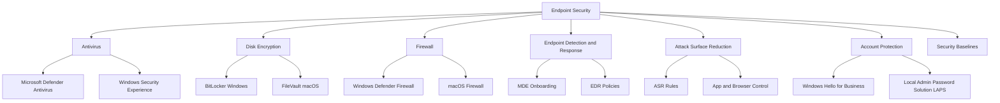
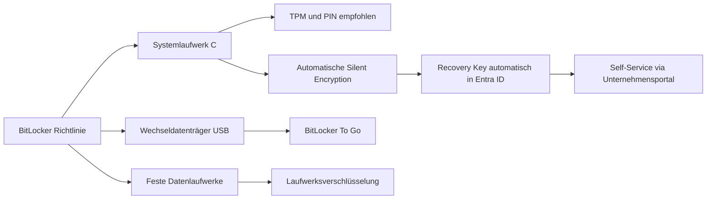
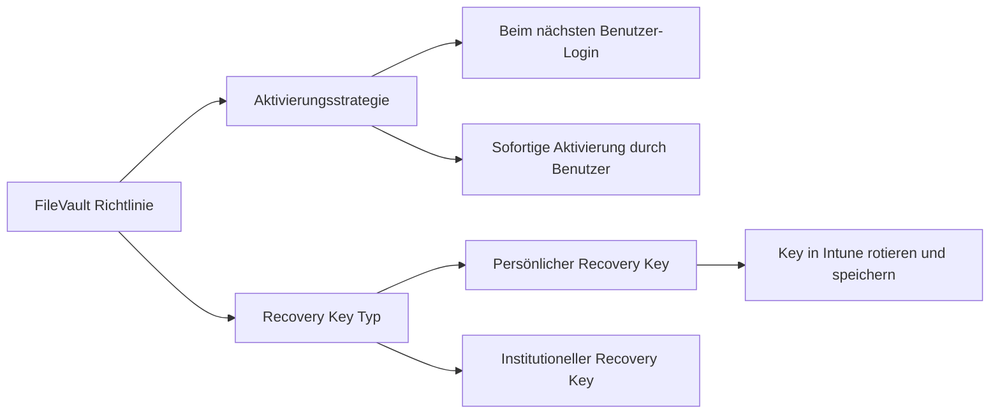
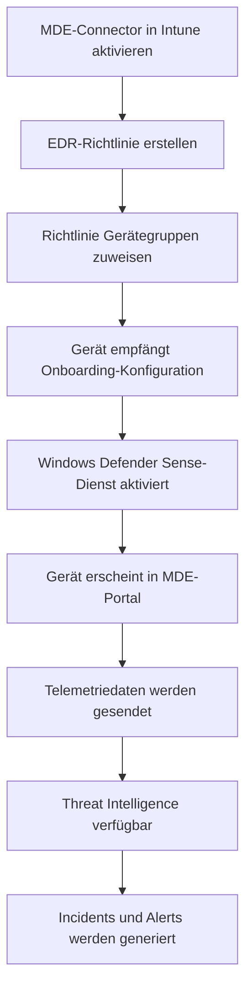
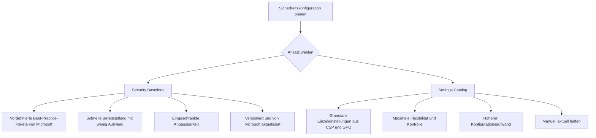
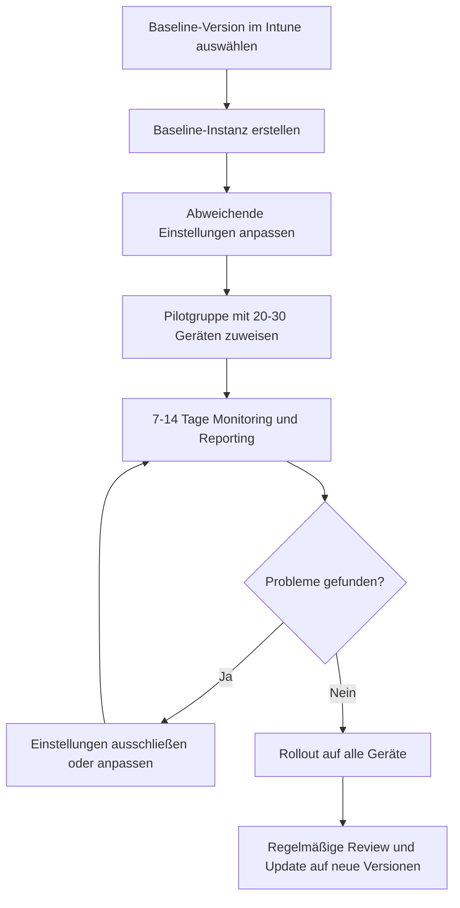
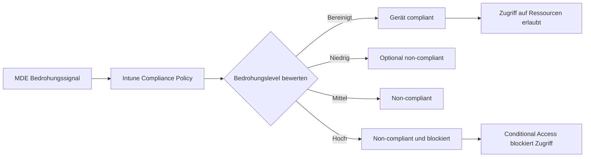

# Endpoint Security

> [!ABSTRACT]
> Der Endpoint Security-Bereich in Microsoft Intune bündelt alle sicherheitsrelevanten Richtlinien für Antivirus, Disk Encryption, Firewall, EDR, ASR-Regeln und Account Protection. Durch die enge Integration mit Microsoft Defender for Endpoint (MDE) entsteht eine vollständige XDR-Lösung. Dieser Artikel beschreibt alle Komponenten, Security Baselines, die MDE-Integration sowie PowerShell-Beispiele für die Verwaltung.

---

## Endpoint Security in Intune — Übersicht

Der Bereich **Endpoint Security** im Intune Admin Center (`endpoint.microsoft.com`) bündelt sicherheitsrelevante Richtlinien und ist bewusst vom allgemeinen Geräteverwaltungsbereich getrennt, um Security-Teams einen fokussierten Arbeitsbereich zu bieten.



### Intune vs Defender-Portal

| Funktion | Intune Admin Center | Microsoft Defender Portal |
|---------|--------------------|-----------------------------|
| Antivirus-Richtlinien | Ja | Ja (via MDE-Integration) |
| BitLocker Verwaltung | Ja | Nein |
| ASR-Regeln konfigurieren | Ja | Ja |
| EDR-Onboarding | Ja | Ja |
| Vulnerability Management | Eingeschränkt | Vollständig (MDVM) |
| Threat Intelligence | Nein | Ja |
| Incidents und Alerts | Nein | Ja |
| Live Response | Nein | Ja |
| Advanced Hunting (KQL) | Nein | Ja |
| Security Score | Nein | Ja (Secure Score) |

> [!NOTE]
> Richtlinien aus Intune und dem Defender-Portal können auf demselben Gerät gleichzeitig aktiv sein. Bei Konflikten gilt in der Regel die restriktivere Einstellung. Konflikte sollten aktiv im Intune-Reporting überwacht werden.

---

## Antivirus (Microsoft Defender Antivirus)

**Konfigurationspfad:** Endpoint Security → Antivirus

### Antivirus-Richtlinie — Empfohlene Einstellungen

| Einstellung | Empfohlener Wert | Beschreibung |
|------------|-----------------|-------------|
| Cloud-Schutz (MAPS-Level) | Hoch | Cloud-basierte Echtzeiterkennung |
| Automatische Beispielübermittlung | Sicher senden | Malware-Samples an Microsoft |
| Echtzeitschutz | Aktiviert | On-Access Malwareschutz |
| Verhaltensüberwachung | Aktiviert | Verhaltensbasierte Bedrohungserkennung |
| PUA-Schutz | Blockieren | Potenziell unerwünschte Anwendungen |
| Netzwerkschutz | Aktiviert (Block) | Schädliche URLs und IPs blockieren |
| Geplanter Schnellscan | Täglich 2 Uhr | Regelmäßige Schnellprüfung |
| Geplanter Vollscan | Wöchentlich Samstag | Gründliche Prüfung |
| Signaturaktualisierung | Alle 4 Stunden | Aktuelle Signaturdatenbank |
| Tamper Protection | Aktiviert | Defender vor Deaktivierung schützen |

```powershell
# Defender-Status und Konfiguration abfragen
Get-MpComputerStatus

# Signatur-Aktualität prüfen
Get-MpComputerStatus | Select-Object `
    AntivirusSignatureLastUpdated,
    AntivirusSignatureVersion,
    RealTimeProtectionEnabled,
    TamperProtectionSource

# Manuelle Scans starten
Start-MpScan -ScanType QuickScan
Start-MpScan -ScanType FullScan
Start-MpScan -ScanType CustomScan -ScanPath "C:\Temp"

# Signaturen manuell aktualisieren
Update-MpSignature

# Erkannte Bedrohungen anzeigen
Get-MpThreatDetection | Select-Object ThreatName, ActionSuccess, DetectionSourceTypeID, ProcessName

# Defender-Ausnahmen anzeigen (Verwaltung besser über Intune)
Get-MpPreference | Select-Object ExclusionPath, ExclusionExtension, ExclusionProcess

# Quarantäne-Elemente anzeigen
Get-MpThreat | Where-Object { $_.IsActive -eq $false }
```

### Windows Security Experience

Steuert, welche Bereiche der Windows Security App Endbenutzer sehen und verändern können.

| Option | Beschreibung |
|--------|-------------|
| Viren- und Bedrohungsschutzbereich ausblenden | Verhindert Benutzereingriffe |
| Konto-Schutzbereich ausblenden | Einheitliche Konfiguration |
| Firewall-Bereich ausblenden | Nur für erfahrene Teams freigeben |
| IT-Kontaktinformationen anzeigen | Helpdesk-Kontakt für Benutzer konfigurieren |
| Benachrichtigungen | Kritische Benachrichtigungen beibehalten |

---

## Disk Encryption

### BitLocker für Windows

**Konfigurationspfad:** Endpoint Security → Disk Encryption → BitLocker



**Empfohlene BitLocker-Einstellungen:**

| Einstellung | Empfehlung | Beschreibung |
|------------|-----------|-------------|
| Verschlüsselungsmethode Systemlaufwerk | XTS-AES 256-Bit | Stärkste verfügbare Methode |
| Startup-Authentifizierung | TPM + PIN | Sicherste Kombination |
| Mindest-PIN-Länge | 8 Zeichen | Ausreichende Sicherheit |
| Recovery-Key-Sicherung | Entra ID (Azure AD) | Zentrale und zugängliche Speicherung |
| Recovery-Key-Rotation | Nach jeder Nutzung | Einmaliger Recovery Key |
| Silent Encryption | Aktiviert für Entra-Joined Geräte | Keine Benutzerinteraktion nötig |
| Wechseldatenträger | Schreibzugriff nur mit BitLocker | DLP-Schutz |

```powershell
# BitLocker-Status aller Laufwerke abfragen
Get-BitLockerVolume | Select-Object MountPoint, VolumeStatus, EncryptionPercentage, ProtectionStatus, EncryptionMethod

# Recovery Key des aktuellen Systems anzeigen
(Get-BitLockerVolume -MountPoint "C:").KeyProtector |
    Where-Object { $_.KeyProtectorType -eq "RecoveryPassword" } |
    Select-Object KeyProtectorId, RecoveryPassword

# BitLocker aktivieren (falls Policy vorhanden, aber noch nicht aktiv)
Enable-BitLocker -MountPoint "C:" -TpmProtector

# Recovery Key in Entra ID hochladen
$keyProtectorId = (Get-BitLockerVolume -MountPoint "C:").KeyProtector |
    Where-Object { $_.KeyProtectorType -eq "RecoveryPassword" } |
    Select-Object -ExpandProperty KeyProtectorId
BackupToAAD-BitLockerKeyProtector -MountPoint "C:" -KeyProtectorId $keyProtectorId

# BitLocker-Entschlüsselung (nur bei berechtigtem Bedarf)
Disable-BitLocker -MountPoint "C:"

# Prüfen ob Recovery Key in Entra ID gespeichert wurde
# (Im Intune Admin Center: Geräte → [Gerätename] → Recovery Keys)
```

> [!IMPORTANT]
> Der Recovery Key muss zwingend in Entra ID gesichert sein, bevor BitLocker aktiviert wird. Bei Silent Encryption erfolgt die Sicherung automatisch. Ohne gespeicherten Recovery Key droht bei Hardware-Problemen dauerhafter Datenverlust.

### FileVault für macOS

**Konfigurationspfad:** Endpoint Security → Disk Encryption → FileVault



**Wichtige FileVault-Einstellungen:**

| Einstellung | Beschreibung |
|------------|-------------|
| FileVault aktivieren | Verschlüsselung erzwingen |
| Persönlicher Recovery Key | Benutzer-spezifischer Schlüssel, in Intune gespeichert |
| Institutioneller Recovery Key | Unternehmens-Hauptschlüssel via Zertifikat |
| Anzahl erlaubter Bypässe | Wie oft kann Benutzer FileVault-Aktivierung verschieben |
| Recovery Key rotieren | Regelmäßige Rotation für Sicherheit |

---

## Firewall

### Windows Defender Firewall

**Konfigurationspfad:** Endpoint Security → Firewall

| Profil | Beschreibung | Empfehlung |
|--------|-------------|-----------|
| Domain | Gerät im Domänennetzwerk verbunden | Standardregeln erlaubt |
| Private | Heimnetzwerk oder privates WLAN | Strenger als Domain |
| Public | Öffentliches WLAN, Hotel, Café | Am restriktivsten |

```powershell
# Firewall-Status für alle Profile abfragen
Get-NetFirewallProfile | Select-Object Name, Enabled, DefaultInboundAction, DefaultOutboundAction, LogFileName

# Aktive eingehende Firewall-Regeln anzeigen
Get-NetFirewallRule | Where-Object {
    $_.Direction -eq "Inbound" -and $_.Enabled -eq "True"
} | Select-Object DisplayName, Action, Profile, LocalPort -First 20

# Firewall-Regel testen
Test-NetConnection -ComputerName "server.contoso.com" -Port 443

# Spezifische Regel aktivieren
Enable-NetFirewallRule -DisplayName "Datei- und Druckerfreigabe (Echoanforderung - ICMPv4 eingehend)"

# Blockierte Verbindungen im Firewall-Log prüfen
Get-Content "C:\Windows\System32\LogFiles\Firewall\pfirewall.log" -Tail 50 |
    Where-Object { $_ -match "DROP" }
```

### macOS Firewall

**Konfigurationspfad:** Endpoint Security → Firewall → macOS

Wichtige Einstellungen für macOS:
- Firewall aktivieren: Eingehende Verbindungen blockieren
- Stealth Mode: Auf Sondierungs-Requests nicht antworten
- Signierte Software: Eingehende Verbindungen für signierte Apps erlauben

---

## Endpoint Detection and Response (EDR)

EDR integriert Windows-Geräte in Microsoft Defender for Endpoint (MDE) für erweiterte Bedrohungserkennung, forensische Analyse und automatische Reaktion auf Incidents.

### MDE-Onboarding via Intune

**Konfigurationspfad:** Endpoint Security → Endpoint Detection and Response

**Voraussetzungen:**
- Microsoft Defender for Endpoint Plan 1 oder Plan 2 Lizenz
- MDE-Connector in Intune aktiviert
- Geräte in Intune enrolled (MDM-managed)



### EDR-Onboarding Schritt für Schritt

**Schritt 1 — MDE-Connector aktivieren:**
- Intune Admin Center → Tenant Administration → Connectors and Tokens → Microsoft Defender for Endpoint
- "Connect Microsoft Defender for Endpoint to Microsoft Intune" aktivieren
- Im MDE-Portal (security.microsoft.com): Einstellungen → Endpoints → Advanced Features → Intune Connection = Ein

**Schritt 2 — Compliance-Policy mit MDE verknüpfen:**
- Compliance-Policy erstellen mit Bedingung "Device Threat Level" (z.B. max. Medium)
- Geräte mit aktivem Threat über dieser Schwelle werden automatisch non-compliant

**Schritt 3 — EDR-Richtlinie erstellen:**
- Endpoint Security → Endpoint Detection and Response → Richtlinie erstellen
- Plattform: Windows 10, Windows 11, and Windows Server
- Onboarding-Blob und Sample Sharing konfigurieren

**Schritt 4 — Ergebnis validieren:**
- Im MDE-Portal: Assets → Devices → Gerät in der Liste suchen
- Onboarding-Status sollte auf "Onboarded" stehen

```powershell
# MDE Sense-Dienst Status prüfen
Get-Service -Name "Sense" | Select-Object Name, Status, StartType

# Onboarding-Status via Registry prüfen
$reg = Get-ItemProperty -Path "HKLM:\SOFTWARE\Microsoft\Windows Advanced Threat Protection\Status" -ErrorAction SilentlyContinue
if ($reg) {
    Write-Output "Onboarding State: $($reg.OnboardingState)"
    Write-Output "Sense GUID: $($reg.SenseGuid)"
} else {
    Write-Output "MDE nicht installiert oder nicht ongeboardet"
}

# MDE-Dienste-Status prüfen
Get-Service -Name "WdNisSvc", "WinDefend", "Sense" |
    Select-Object Name, Status, StartType

# MDE-Version prüfen
Get-ItemProperty -Path "HKLM:\SOFTWARE\Microsoft\Windows Defender" |
    Select-Object ProductVersion
```

---

## Attack Surface Reduction (ASR)

ASR-Regeln reduzieren die Angriffsfläche durch Blockierung von häufig durch Angreifer missbrauchten Verhaltensweisen und Funktionen.

**Konfigurationspfad:** Endpoint Security → Attack Surface Reduction

### ASR-Regeln Übersicht

| Regelname | Empfohlener Modus | Schutzbereich |
|-----------|-------------------|---------------|
| Block executable content from email and webmail client | Block | E-Mail-Anhänge (exe, dll) |
| Block all Office applications from creating child processes | Block | Office-Makro-Schutz |
| Block Office applications from creating executable content | Block | Dateilose Malware |
| Block JavaScript or VBScript from launching downloaded executables | Block | Script-basierte Angriffe |
| Block execution of potentially obfuscated scripts | Block | Verschleierte PowerShell |
| Block Win32 API calls from Office macros | Block | Makro-Missbrauch |
| Block credential stealing from Windows LSASS process | Block | Mimikatz und Credential Dumping |
| Block process creations from PSExec and WMI commands | Audit zuerst | Laterale Bewegung |
| Block untrusted and unsigned processes from USB | Block | Schädliche USB-Devices |
| Block Adobe Reader from creating child processes | Block | Adobe-Exploit-Schutz |
| Block Office communication application from creating child processes | Block | Outlook-basierte Angriffe |
| Use advanced protection against ransomware | Block | Ransomware-Abwehr |

> [!WARNING]
> Aktiviere ASR-Regeln zunächst für 2-4 Wochen im **Audit**-Modus und analysiere die Ereignisse im MDE-Portal oder Event Viewer, bevor du auf **Block** wechselst. Besonders "Block process creations from PSExec and WMI" kann legitime Admin-Tools beeinflussen.

```powershell
# Aktuelle ASR-Konfiguration abfragen
$prefs = Get-MpPreference
$prefs.AttackSurfaceReductionRules_Ids
$prefs.AttackSurfaceReductionRules_Actions

# ASR-Ereignisse aus Event Viewer auslesen (1121=Block, 1122=Audit)
Get-WinEvent -LogName "Microsoft-Windows-Windows Defender/Operational" |
    Where-Object { $_.Id -in @(1121, 1122, 1126, 1131) } |
    Select-Object TimeCreated, Id, Message -First 30

# ASR-Status für ein spezifisches Gerät prüfen
Get-MpPreference | Select-Object AttackSurfaceReductionRules_Ids, AttackSurfaceReductionRules_Actions |
    ForEach-Object {
        for ($i = 0; $i -lt $_.AttackSurfaceReductionRules_Ids.Count; $i++) {
            [PSCustomObject]@{
                RuleId = $_.AttackSurfaceReductionRules_Ids[$i]
                Action = $_.AttackSurfaceReductionRules_Actions[$i]
            }
        }
    }
```

### ASR-Ausnahmen konfigurieren

Bestimmte Anwendungen können von einzelnen ASR-Regeln ausgenommen werden.

```powershell
# Ausnahme für spezifische Anwendung hinzufügen (Testweise — Verwaltung über Intune)
Add-MpPreference -AttackSurfaceReductionOnlyExclusions "C:\Program Files\LegacyApp\legacy.exe"

# Aktuelle Ausnahmen anzeigen
Get-MpPreference | Select-Object -ExpandProperty AttackSurfaceReductionOnlyExclusions
```

---

## Account Protection

### Windows Hello for Business (WHfB)

**Konfigurationspfad:** Endpoint Security → Account Protection → Windows Hello for Business

Windows Hello for Business ersetzt Passwörter durch sichere, hardwaregebundene Authentifizierung via PIN, Fingerabdruck oder Gesichtserkennung.

| Einstellung | Empfehlung | Beschreibung |
|------------|-----------|-------------|
| Windows Hello for Business aktivieren | Ja | Passwortlose Authentifizierung erzwingen |
| PIN-Mindestlänge | 8 Zeichen | Ausreichende PIN-Sicherheit |
| PIN-Höchstlänge | 127 Zeichen | Maximale PIN-Länge |
| Klein- und Großbuchstaben in PIN | Erlaubt | Erhöhte PIN-Komplexität |
| Sonderzeichen in PIN | Erlaubt | Weitere Komplexität |
| Biometrische Authentifizierung | Erlaubt | Fingerabdruck und Gesicht |
| Enhanced Anti-Spoofing | Aktiviert (wenn Hardware unterstützt) | Erweiterte biometrische Sicherheit |
| Certificate Trust | Hybrid-Umgebungen mit AD-Zertifikatsdiensten | Für Hybrid Entra Join |

### Local Administrator Password Solution (LAPS)

Windows LAPS (ab Windows 2022 und Windows 11 22H2 nativ integriert) verwaltet lokale Administrator-Passwörter zentral und rotiert sie automatisch.

**Konfigurationspfad:** Endpoint Security → Account Protection → Local Administrator Password Solution (Windows LAPS)


| LAPS-Einstellung | Empfehlung | Beschreibung |
|-----------------|-----------|-------------|
| Backup-Ziel | Azure Active Directory (Entra ID) | Passwörter zentral in Entra ID speichern |
| Passwort-Alter (Tage) | 30 Tage | Regelmäßige Rotation |
| Administrator-Konto | Integriertes Administrator-Konto | Oder benutzerdefiniertes Konto |
| Passwort-Komplexität | Groß, Klein, Zahlen und Sonderzeichen | Maximale Komplexität |
| Passwort-Länge | 20 Zeichen | Ausreichende Länge |
| Nach Authentifizierung rotieren | Aktiviert | Sofortrotation nach Nutzung |

```powershell
# LAPS-Modul für Entra ID importieren
Import-Module Microsoft.Graph.Identity.DirectoryManagement

# LAPS-Passwort für ein Gerät abrufen (benötigt DeviceLocalCredential.Read.All)
Connect-MgGraph -Scopes "DeviceLocalCredential.Read.All"

$deviceId = (Get-MgDevice -Filter "displayName eq 'PC-Vertrieb-01'").Id
$credential = Get-MgDeviceLocalCredential -DeviceId $deviceId
Write-Output "Passwort: $($credential.Credentials[0].PasswordBase64 | ConvertFrom-SecureString -AsPlainText)"

# Passwort-Ablaufzeit für ein Gerät prüfen
Get-MgDeviceLocalCredential -DeviceId $deviceId | Select-Object BackupDateTime

# LAPS Passwort-Rotation manuell auslösen (lokal auf dem Gerät)
Invoke-LapsPolicyProcessing
```

> [!TIP]
> Mit Windows LAPS (ab Windows Server 2022 und Windows 11 22H2) ist keine separate LAPS-Client-Installation mehr erforderlich. Das Feature ist direkt in Windows integriert und unterstützt Entra ID als Backup-Ziel.

---

## Security Baselines

Security Baselines sind von Microsoft vordefinierte Sicherheitskonfigurationen basierend auf Best Practices von Microsoft-Sicherheitsteams und Branchenstandards.

**Konfigurationspfad:** Endpoint Security → Security Baselines

### Verfügbare Baselines

| Baseline | Aktuellste Version | Einstellungsanzahl | Zielgruppe |
|---------|-------------------|--------------------|-----------|
| MDM Security Baseline | Windows 11 24H2 | ~400 Einstellungen | Alle Windows-Geräte |
| Microsoft 365 Apps for Enterprise | Aktuell | ~100 Einstellungen | Geräte mit M365 Apps |
| Microsoft Edge Baseline | Chromium-basiert | ~180 Einstellungen | Edge-Browser |
| Microsoft Defender for Endpoint Baseline | Aktuell | ~200 Einstellungen | MDE-integrierte Geräte |
| Windows 365 Cloud PC Baseline | Aktuell | Angepasst für Cloud PC | Windows 365 |

### Security Baselines vs Settings Catalog



| Kriterium | Security Baselines | Settings Catalog |
|-----------|-------------------|--------------------|
| Konfigurationsaufwand | Gering | Hoch |
| Flexibilität | Gering bis mittel | Sehr hoch |
| Microsoft-Empfehlung | Ja — als Ausgangspunkt | Ergänzend für Spezialanforderungen |
| Versionierung | Automatisch (neue Windows-Versionen) | Manuell |
| Konfliktrisiko | Mittel | Hoch bei schlechter Planung |
| Transparenz | Mittel | Sehr hoch |
| Empfehlung | Einstieg und Basis | Feinabstimmung |

> [!IMPORTANT]
> Security Baselines können mit anderen Intune-Richtlinien in Konflikt geraten, da viele Einstellungen auch im Settings Catalog oder durch Konfigurationsprofile gesetzt werden können. Prüfe Konflikte regelmäßig im Compliance-Reporting und im Einstellungs-Reporting pro Gerät.

### Baseline-Deployment-Strategie



---

## Defender for Endpoint Integration (MDE-Connector)

### Connector-Konfiguration

**Konfigurationspfad:** Intune Admin Center → Tenant Administration → Connectors and Tokens → Microsoft Defender for Endpoint

**Konfigurationsschritte:**
1. Im MDE-Portal (security.microsoft.com): Einstellungen → Endpoints → Advanced Features → Microsoft Intune connection = Ein
2. Im Intune Admin Center: MDE-Connector-Seite öffnen und Verbindung bestätigen
3. Compliance-Policy mit MDE-Signal aktivieren (optional aber empfohlen)
4. EDR-Richtlinien und Onboarding-Pakete erstellen

### Compliance-Integration mit MDE



| Bedrohungslevel | MDE-Signal | Empfohlene Compliance-Aktion |
|----------------|-----------|------------------------------|
| Bereinigt | Keine aktive Bedrohung | Compliant |
| Informational | Telemetrie, kein aktiver Angriff | Compliant |
| Niedrig | Geringe Bedrohung | Optional: Warnung |
| Mittel | Aktive mittlere Bedrohung | Non-compliant |
| Hoch | Aktiver schwerwiegender Angriff | Non-compliant und Block via CA |

---

## Vulnerability Management via Intune

**Konfigurationspfad:** Intune Admin Center → Reports → Microsoft Defender Vulnerability Management

Das Defender Vulnerability Management (MDVM) bietet in Kombination mit Intune:

- **Software-Inventar:** Alle installierten Anwendungen mit bekannten CVEs
- **Sicherheitsempfehlungen:** Priorisierte Empfehlungen nach CVSS-Score und Geräte-Exposition
- **Remediation Tasks:** Direkte Patch-Bereitstellung oder Konfigurationsänderung über Intune
- **Exponierte Geräte:** Übersicht der am stärksten gefährdeten Geräte

```powershell
# Installierte Software mit Schwachstellen lokal prüfen (als Stichprobe)
Get-ItemProperty -Path "HKLM:\SOFTWARE\Microsoft\Windows\CurrentVersion\Uninstall\*",
                       "HKLM:\SOFTWARE\WOW6432Node\Microsoft\Windows\CurrentVersion\Uninstall\*" |
    Where-Object { $_.DisplayName -ne $null } |
    Select-Object DisplayName, DisplayVersion, Publisher |
    Sort-Object DisplayName

# Windows Update Compliance Status prüfen
Get-HotFix | Sort-Object InstalledOn -Descending | Select-Object -First 10

# Fehlende Updates abfragen
$updateSession = New-Object -ComObject Microsoft.Update.Session
$updateSearcher = $updateSession.CreateUpdateSearcher()
$searchResult = $updateSearcher.Search("IsInstalled=0 and Type='Software'")
Write-Output "Fehlende Updates: $($searchResult.Updates.Count)"
```

> [!TIP]
> Priorisiere Schwachstellen mit CVSS-Score 7.0 oder höher und hoher Geräte-Exposition. Das MDVM-Dashboard zeigt einen Exposure Score, der die Priorisierung erleichtert. Nutze Remediation Tasks um Patches direkt über Intune als Windows Update-Ring bereitzustellen.

---

## Verwandte Notizen

- [[Intune Grundlagen]]
- [[Compliance Policies]]
- [[Windows Update for Business]]
- [[Endpoint Analytics]]
