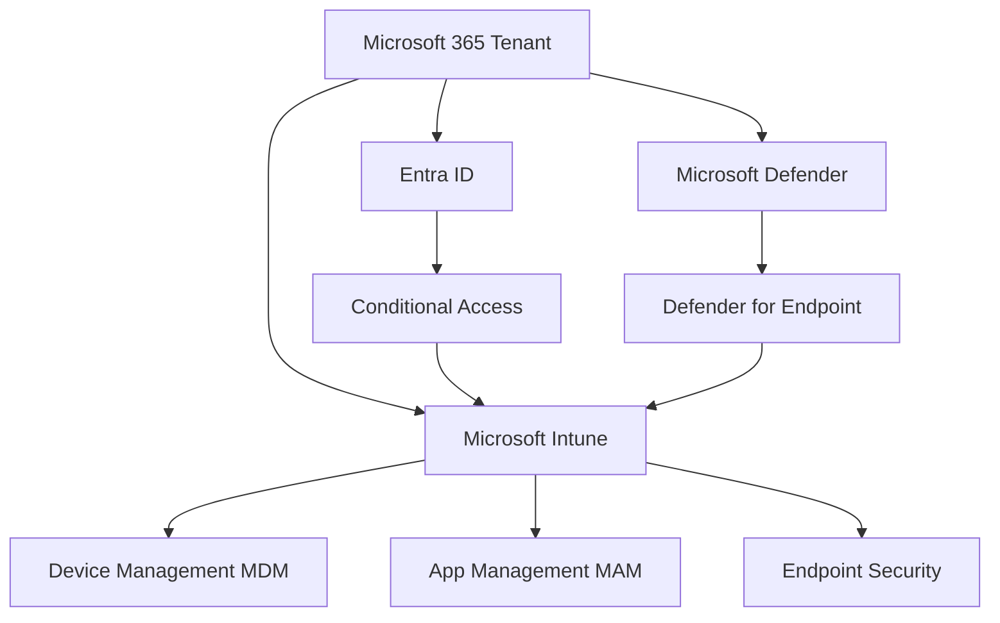
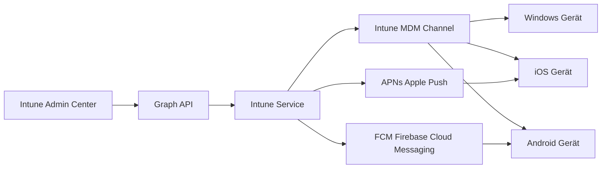
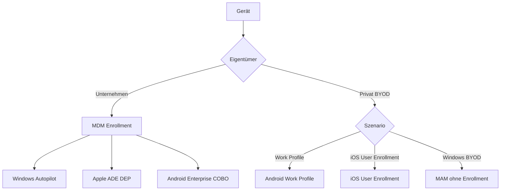
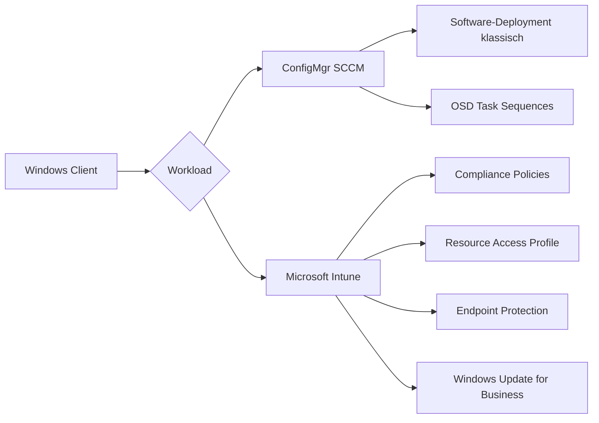
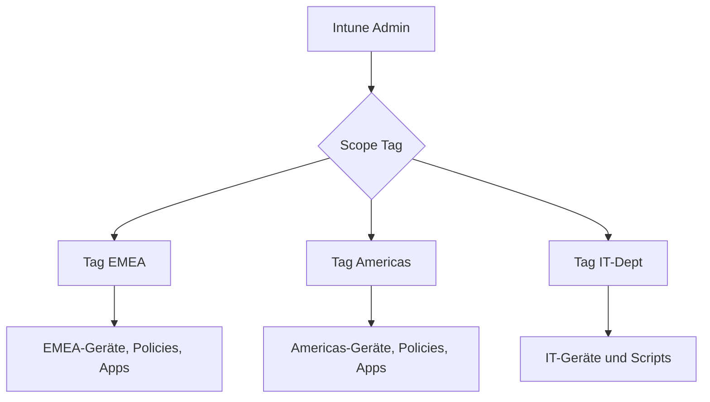

---
tags:
  - microsoft365
  - intune
  - endpoint-management
  - grundlagen
aliases:
  - Intune Basics
  - MDM MAM Grundlagen
---

# Intune Grundlagen

> [!ABSTRACT] TL;DR
> Microsoft Intune ist die cloudbasierte Unified Endpoint Management (UEM) Plattform in Microsoft 365. Sie verwaltet Geräte über MDM (Mobile Device Management) und Apps über MAM (Mobile Application Management) — auf Windows, iOS, Android, macOS und Linux. Intune ist tief mit Entra ID integriert und bildet die Basis für Zero Trust Endpoint Security.

---

## Was ist Microsoft Intune?

Microsoft Intune ist ein cloudbasierter Dienst für **Unified Endpoint Management (UEM)**, der im Microsoft 365- und EMS (Enterprise Mobility + Security)-Portfolio enthalten ist. Er ermöglicht IT-Admins, Geräte und Anwendungen zentral zu verwalten, zu sichern und zu überwachen.

### Kernfunktionen

| Funktion | Beschreibung |
|----------|-------------|
| **Geräteverwaltung (MDM)** | Richtlinien, Compliance, Wipe, Inventory |
| **App-Verwaltung (MAM)** | App Protection Policies, App-Deployment |
| **Endpoint Security** | Defender-Integration, BitLocker, Firewall |
| **Compliance** | Regeln + Conditional Access Integration |
| **Endpoint Analytics** | Gesundheitsbewertung, Proactive Remediations |
| **Software-Deployment** | Win32, Store, LOB, Scripts |

### Intune im Microsoft 365 Ökosystem



---

## Architektur

Intune basiert auf **Microsoft Azure** und kommuniziert über die **Microsoft Graph API** mit verwalteten Geräten.

### Kommunikationsfluss



### Komponenten

| Komponente | Beschreibung |
|-----------|-------------|
| **Intune Service** | Cloud-Backend, gehostet auf Azure |
| **Microsoft Graph API** | REST-API für alle Intune-Operationen |
| **Intune Management Extension (IME)** | Windows-Agent für Scripts und Win32 Apps |
| **Company Portal** | Endbenutzer-App für Enrollment und App-Downloads |
| **Intune Admin Center** | Web-Konsole unter intune.microsoft.com |
| **Entra ID** | Identitätsprovider, Gruppen, Conditional Access |

> [!NOTE]
> Intune benötigt keinen eigenen On-Premises-Server. Alle Daten werden in der Microsoft-Cloud gespeichert und verarbeitet.

---

## MDM vs. MAM

### Mobile Device Management (MDM)

MDM ermöglicht die **vollständige Geräteverwaltung**. Das Gerät wird bei Intune registriert (enrolled) und erhält danach Konfigurationsprofile, Compliance-Richtlinien und App-Deployments.

**Typische Szenarien:**
- Firmeneigene Geräte (COBO, COPE)
- Windows-Laptops und -Desktops
- Shared Devices (Kiosk-Modus)

**MDM-Fähigkeiten:**
- Gerätekonfiguration (WLAN, VPN, E-Mail, Zertifikate)
- Compliance prüfen und erzwingen
- Remote Wipe (vollständiges Löschen)
- Software-Deployment
- Inventory und Reporting

### Mobile Application Management (MAM)

MAM ermöglicht die **App-level Verwaltung** ohne vollständiges Geräte-Enrollment. Ideal für BYOD-Szenarien, wo Benutzer ihr persönliches Gerät nutzen.

**Typische Szenarien:**
- BYOD (Bring Your Own Device)
- Persönliche Smartphones
- Externe Mitarbeiter / Auftragnehmer

**MAM-Fähigkeiten:**
- App Protection Policies (Copy/Paste, PIN, Wipe)
- Verwaltete Apps schützen
- Nur Corporate Data löschen (Selective Wipe)
- Kein Zugriff auf private Daten

### Vergleich MDM vs. MAM

| Merkmal | MDM | MAM (ohne Enrollment) |
|---------|-----|----------------------|
| Enrollment erforderlich | Ja | Nein |
| Gerätesteuerung | Vollständig | Keine |
| App-Schutz | Ja (+ App Config) | Ja |
| Remote Wipe | Vollständig | Nur Corporate Data |
| Geeignet für | Firmeneigene Geräte | BYOD / Personal |
| Inventar | Vollständig | Nur App-Ebene |
| Konfigurationsprofile | Ja | Nein |

> [!TIP]
> **MAM-WE** (MAM Without Enrollment) ist besonders für Microsoft 365 Apps (Outlook, Teams, Word) auf persönlichen Geräten geeignet — kein vollständiges MDM-Enrollment notwendig.

---

## Enrollment-Typen

### Übersicht der Enrollment-Szenarien



| Enrollment-Typ | Plattform | Eigentümer | Verwaltungstiefe |
|---------------|-----------|-----------|-----------------|
| **Windows Autopilot** | Windows | Unternehmen | Vollständig |
| **MDM Enrollment manuell** | Alle | Beide | Vollständig |
| **Apple ADE DEP** | iOS/macOS | Unternehmen | Vollständig Supervised |
| **Android Enterprise COBO** | Android | Unternehmen | Vollständig |
| **Android Work Profile** | Android | Privat | Work Container |
| **iOS User Enrollment** | iOS | Privat | Eingeschränkt |
| **MAM-WE** | iOS/Android/Win | Privat | Nur Apps |
| **Co-Management** | Windows | Unternehmen | Geteilt mit SCCM |

---

## Co-Management

Co-Management ermöglicht die **gleichzeitige Verwaltung** von Windows-Geräten durch **Configuration Manager (SCCM)** und **Microsoft Intune**.

### Co-Management Workloads



| Workload | Standard | Kann zu Intune verschoben werden |
|---------|---------|--------------------------------|
| Compliance Policies | ConfigMgr | ✅ |
| Resource Access Profiles | ConfigMgr | ✅ |
| Endpoint Protection | ConfigMgr | ✅ |
| Device Configuration | ConfigMgr | ✅ |
| Click-to-Run Office | ConfigMgr | ✅ |
| Client Apps | ConfigMgr | ✅ |
| Windows Update Policies | ConfigMgr | ✅ |
| OSD Betriebssystem-Deployment | ConfigMgr | ❌ |

> [!IMPORTANT]
> Co-Management erfordert einen **Cloud Management Gateway (CMG)** oder **direkten Internetzugang** für die SCCM-Clients, damit diese vom Cloud-Service erreichbar sind.

---

## Intune Admin Center Navigation

Das Admin Center ist unter **https://intune.microsoft.com** erreichbar.

### Hauptbereiche

| Bereich | Inhalt |
|---------|--------|
| **Dashboard** | Überblick, Tenant Health |
| **Devices** | Geräteliste, Enrollment, Compliance, Configuration, Scripts |
| **Apps** | App-Verwaltung, MAM-Policies, App-Reporting |
| **Endpoint Security** | Antivirus, Firewall, Disk Encryption, EDR, ASR |
| **Reports** | Device Compliance, App Reports, Endpoint Analytics |
| **Users** | Benutzerverwaltung (verlinkt zu Entra ID) |
| **Groups** | Gruppen (verlinkt zu Entra ID) |
| **Tenant Administration** | Connectors, Rollen, Scope Tags, Diagnose |

> [!NOTE]
> Das Intune Admin Center ist Teil des **Microsoft Intune Admin Center** (früher Microsoft Endpoint Manager Admin Center). Die URL bleibt intune.microsoft.com.

---

## Lizenzierung

### Intune-Lizenzoptionen

| Lizenz | Enthält Intune | Intune Plan |
|--------|---------------|-------------|
| **Microsoft Intune Plan 1** | ✅ Standalone | Plan 1 |
| **Microsoft 365 Business Premium** | ✅ | Plan 1 |
| **Microsoft 365 E3** | ✅ | Plan 1 |
| **Microsoft 365 E5** | ✅ | Plan 1 + Defender |
| **EMS E3** | ✅ | Plan 1 |
| **EMS E5** | ✅ | Plan 1 + Advanced |
| **Microsoft Intune Plan 2** | ✅ Add-on | Plan 2 |
| **Microsoft Intune Suite** | ✅ Add-on | Plan 1 + Suite |

### Intune Suite Add-ons

| Feature | Plan 1 | Plan 2 | Suite |
|---------|--------|--------|-------|
| Core MDM/MAM | ✅ | ✅ | ✅ |
| Endpoint Analytics | ✅ | ✅ | ✅ |
| Advanced Endpoint Analytics | ❌ | ✅ | ✅ |
| Microsoft Tunnel for MAM | ❌ | ✅ | ✅ |
| Specialized Devices Management | ❌ | ✅ | ✅ |
| Remote Help | ❌ | ❌ | ✅ |
| Microsoft Cloud PKI | ❌ | ❌ | ✅ |
| Endpoint Privilege Management | ❌ | ❌ | ✅ |
| Advanced App Management | ❌ | ❌ | ✅ |

> [!TIP]
> **Intune Plan 1** ist in den meisten Microsoft 365 Business/Enterprise-Lizenzen enthalten. Die **Intune Suite** ist ein kostenpflichtiges Add-on für erweiterte Funktionen.

---

## Unterstützte Plattformen

| Plattform | MDM | MAM | Enrollment-Methoden |
|-----------|-----|-----|-------------------|
| **Windows 10/11** | ✅ | ✅ | Autopilot, MDM, Bulk, Group Policy |
| **iOS / iPadOS** | ✅ | ✅ | ADE, User Enrollment, Device Enrollment |
| **Android** | ✅ | ✅ | Work Profile, COBO, COPE, Dedicated |
| **macOS** | ✅ | Eingeschränkt | ADE, Manual MDM |
| **Linux Ubuntu** | Eingeschränkt | ❌ | Compliance nur |
| **ChromeOS** | Eingeschränkt | ❌ | Via Google Admin |

---

## Rollenverwaltung (RBAC)

Intune nutzt **Role-Based Access Control (RBAC)** um Zugriffsrechte zu steuern.

### Integrierte Rollen

| Rolle | Berechtigungen |
|-------|---------------|
| **Intune Service Administrator** | Vollzugriff auf alle Intune-Funktionen |
| **Endpoint Security Manager** | Endpoint Security Policies verwalten |
| **Read Only Operator** | Nur lesen, keine Änderungen |
| **Help Desk Operator** | Geräteaktionen (Wipe, Reset PW), kein Konfigurieren |
| **Policy and Profile Manager** | Policies und Profile erstellen/ändern |
| **Application Manager** | Apps und MAM-Policies verwalten |
| **School Administrator** | Für Education-Szenarien |

### Scope Tags

Scope Tags ermöglichen die **Segmentierung** der Intune-Verwaltung — z.B. nach Region, Abteilung oder Team.



> [!NOTE]
> Scope Tags funktionieren wie Filter — ein Admin mit dem Scope Tag "EMEA" sieht und verwaltet nur Objekte, die ebenfalls mit "EMEA" getaggt sind.

---

## Intune vs. SCCM / ConfigMgr

| Merkmal | Microsoft Intune | SCCM / ConfigMgr |
|---------|-----------------|-----------------|
| **Deployment** | Cloud (SaaS) | On-Premises / Hybrid |
| **Wartung** | Microsoft (automatisch) | IT-Team |
| **Internet-Clients** | Nativ | CMG erforderlich |
| **Plattformen** | Windows, iOS, Android, macOS, Linux | Primär Windows |
| **Betriebssystem-Deployment** | Nur via Autopilot | Vollständige OSD/PXE |
| **Software-Deployment** | Win32, Store, Scripts | Alle App-Typen, SCCM Packages |
| **Patch Management** | WUfB, Update Rings | WSUS-Integration |
| **Kosten** | Lizenzbasiert | Infrastrukturkosten |
| **Legacy-Support** | Windows 10+ | Windows 7+ (EOL) |

> [!TIP]
> **Empfehlung:** Neue Deployments → Intune. Bestehende SCCM-Umgebungen → Co-Management einrichten und schrittweise zu Intune migrieren.

---

## Via Microsoft Intune Admin Center (UI)

### Initiale Tenant-Konfiguration durchführen

1. Öffne das **Microsoft Intune Admin Center** unter [intune.microsoft.com](https://intune.microsoft.com)
2. Prüfe den Tenant-Status: **Mandantenverwaltung → Mandantenstatus**
3. Überprüfe die MDM-Authority: **Geräte → Übersicht** → der Bereich „MDM-Authority" muss auf **Microsoft Intune** zeigen
4. Richte das **Apple MDM Push Certificate** ein: **Geräte → iOS/iPadOS → Enrollment → Apple MDM Push Certificate**
5. Verbinde **Android Enterprise** (Managed Google Play): **Geräte → Android → Android Enrollment → Verwaltetes Google Play**
6. Konfiguriere **Enrollment Restrictions**: **Geräte → Enrollment → Geräteregistrierungseinschränkungen**
7. Richte **RBAC-Rollen** ein: **Mandantenverwaltung → Rollen → Alle Rollen → Zuweisungen**
8. Verwalte **Scope Tags**: **Mandantenverwaltung → Scope-Tags → Erstellen**
9. Passe das **Company Portal** an: **Mandantenverwaltung → Anpassung**

> [!TIP]
> Beginne mit **Mandantenverwaltung → Mandantenstatus** — dort siehst du die Gesamtgesundheit deines Tenants, aktive Lizenzen, Connector-Status und aktuelle Microsoft-Servicehinweise auf einen Blick.

> [!NOTE]
> Die MDM-Authority lässt sich im Admin Center nicht mehr direkt ändern. Neue Tenants haben automatisch „Intune" als MDM-Authority gesetzt. Bei Migration von SCCM ist Co-Management über den ConfigMgr-Assistenten einzurichten.

---

## Tenant-Einrichtung (Erste Schritte)

### Checkliste für die initiale Konfiguration

- [ ] MDM-Authority auf "Intune" setzen (nicht SCCM)
- [ ] Auto-Enrollment für Windows konfigurieren (Entra ID > Mobility > MDM User Scope)
- [ ] Apple MDM Push Certificate erstellen (für iOS/macOS)
- [ ] Android Enterprise verbinden (Managed Google Play)
- [ ] Enrollment-Restrictions konfigurieren (welche Plattformen/Limits)
- [ ] Compliance-Standard konfigurieren ("Mark as non-compliant" für Geräte ohne Policy)
- [ ] RBAC-Rollen und Scope Tags einrichten
- [ ] Conditional Access Policy für Compliance erstellen

```powershell
# Prüfen ob MDM-Authority korrekt gesetzt ist
Connect-MgGraph -Scopes "DeviceManagementServiceConfig.Read.All"
$config = Invoke-MgGraphRequest -Method GET -Uri "https://graph.microsoft.com/v1.0/deviceManagement"
$config.mdmAuthority
# Erwartete Ausgabe: intune
```

---

## Verwandte Notizen

- [[Windows Enrollment]]
- [[iOS und iPadOS Enrollment]]
- [[Android Enrollment]]
- [[Windows Autopilot]]
- [[Compliance Policies]]
- [[Konfigurationsprofile]]
- [[App Management MAM]]
- [[Endpoint Security]]
- [[Intune PowerShell und Graph]]
