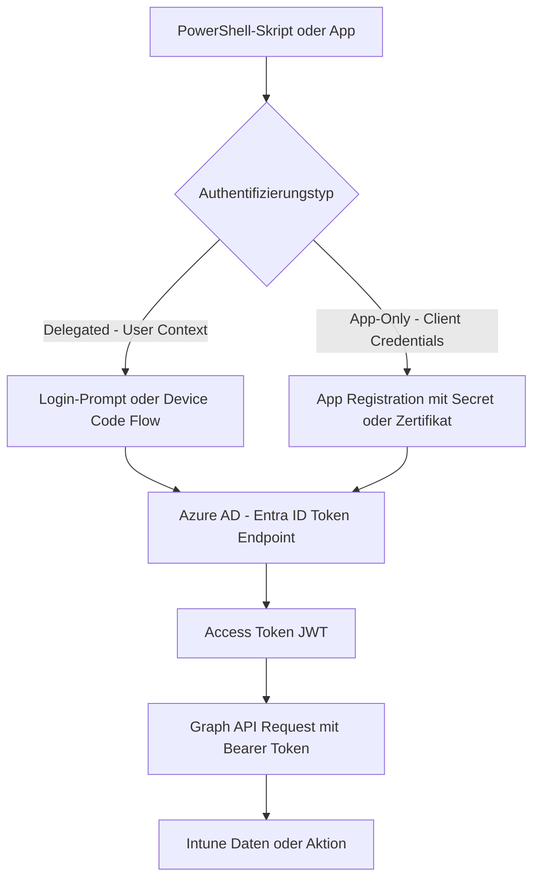

---
tags:
  - microsoft365
  - intune
  - powershell
  - graph-api
  - automation
aliases:
  - Intune Graph API
  - Intune Automation
  - Intune PowerShell
---

# Intune PowerShell und Graph

> [!ABSTRACT]
> Microsoft Graph ist die zentrale API für alle Intune-Operationen. Mit dem Microsoft Graph PowerShell SDK lassen sich Geräte, Compliance Policies, Configuration Profiles und Apps programmatisch verwalten. Dieses Dokument deckt Authentifizierung, wichtige Endpunkte und praxisnahe Automatisierungsskripte ab.

---

## Microsoft Graph API – Grundlagen

Die **Microsoft Graph API** ist der einheitliche Endpunkt für alle Microsoft 365-Dienste, einschließlich Intune. Intune-spezifische Daten und Operationen sind unter dem Namespace `deviceManagement` verfügbar.

### Basis-URL und Versionen

| Version | Endpunkt | Beschreibung |
|---|---|---|
| v1.0 | `https://graph.microsoft.com/v1.0/` | Stable, Production-ready |
| beta | `https://graph.microsoft.com/beta/` | Preview-Features, kann sich ändern |

> [!WARNING]
> Der `beta`-Endpunkt enthält viele Intune-Features, die in v1.0 noch fehlen, ist aber nicht für Produktionssysteme empfohlen. In Skripten den Endpunkt dokumentieren und bei Änderungen anpassen.

### Wichtige Intune Graph-Endpunkte

| Ressource | Endpunkt | Beschreibung |
|---|---|---|
| Verwaltete Geräte | `deviceManagement/managedDevices` | Alle enrollierten Geräte |
| Compliance Policies | `deviceManagement/deviceCompliancePolicies` | Compliance-Richtlinien |
| Configuration Profiles | `deviceManagement/deviceConfigurations` | Konfigurationsprofile |
| Apps | `deviceAppManagement/mobileApps` | Verwaltete Apps |
| Autopilot Geräte | `deviceManagement/windowsAutopilotDeviceIdentities` | Autopilot-Registrierungen |
| Enrollment Profiles | `deviceManagement/deviceEnrollmentConfigurations` | Enrollment-Konfigurationen |
| Groups | `groups` | Entra ID Gruppen |
| Users | `users` | Entra ID Benutzer |
| Assignments | `deviceManagement/deviceCompliancePolicies/{id}/assignments` | Policy-Zuweisungen |
| Device Categories | `deviceManagement/deviceCategories` | Gerätekategorien |
| Scripts | `deviceManagement/deviceManagementScripts` | PowerShell-Skripte |
| Remediations | `deviceManagement/deviceHealthScripts` | Proactive Remediations |

---

## Authentifizierung

### Authentifizierungsfluss



### App Registration erstellen (für App-Only-Auth)

1. **Entra ID → App registrations → New registration**
2. Name: `Intune-Automation`, Single tenant
3. **API permissions → Add permission → Microsoft Graph → Application permissions**
   - `DeviceManagementManagedDevices.ReadWrite.All`
   - `DeviceManagementConfiguration.ReadWrite.All`
   - `DeviceManagementApps.ReadWrite.All`
   - `DeviceManagementServiceConfig.ReadWrite.All`
4. **Grant admin consent**
5. **Certificates & Secrets → New client secret** (für Client Credentials Flow)

> [!IMPORTANT]
> Verwende für Produktionsskripte ein **Zertifikat** statt eines Client Secrets. Secrets haben ein Ablaufdatum und können versehentlich exposen. Zertifikate sind sicherer und können einfacher rotiert werden.

---

## Microsoft Graph PowerShell SDK

### Installation und Einrichtung

```powershell
# Microsoft Graph PowerShell SDK installieren
Install-Module Microsoft.Graph -Scope CurrentUser -Repository PSGallery -Force

# Für nur benötigte Submodule (schneller, weniger Abhängigkeiten)
Install-Module Microsoft.Graph.DeviceManagement -Scope CurrentUser -Force
Install-Module Microsoft.Graph.Groups -Scope CurrentUser -Force
Install-Module Microsoft.Graph.Users -Scope CurrentUser -Force
Install-Module Microsoft.Graph.Identity.DirectoryManagement -Scope CurrentUser -Force

# Installierte Version prüfen
Get-Module Microsoft.Graph* -ListAvailable | Select-Object Name, Version | Sort-Object Name
```

> [!NOTE]
> Das ältere Modul **Microsoft.Graph.Intune** (früher "Intune PowerShell SDK") ist veraltet und wird nicht mehr weiterentwickelt. Alle neuen Skripte sollten das **Microsoft.Graph** SDK verwenden.

---

## Verbindung herstellen

### Delegated Auth (interaktiv – für Entwicklung und Tests)

```powershell
# Interaktiver Login mit Browser-Authentifizierung
Connect-MgGraph -Scopes @(
    "DeviceManagementManagedDevices.ReadWrite.All",
    "DeviceManagementConfiguration.ReadWrite.All",
    "DeviceManagementApps.Read.All",
    "Group.Read.All",
    "User.Read.All"
)

# Aktuellen Verbindungsstatus anzeigen
Get-MgContext | Select-Object Account, TenantId, Scopes, AuthType

# Verbindung trennen
Disconnect-MgGraph
```

### App-Only Auth mit Client Secret

```powershell
# App-Only Authentifizierung (für Automatisierung / unattended)
$tenantId     = "xxxxxxxx-xxxx-xxxx-xxxx-xxxxxxxxxxxx"
$clientId     = "xxxxxxxx-xxxx-xxxx-xxxx-xxxxxxxxxxxx"
$clientSecret = "IhrClientSecret"  # In Produktion: aus Key Vault oder Env-Variable

$secureSecret = ConvertTo-SecureString $clientSecret -AsPlainText -Force
$credential   = New-Object System.Management.Automation.PSCredential($clientId, $secureSecret)

Connect-MgGraph -TenantId $tenantId -ClientSecretCredential $credential

Write-Output "Verbunden als App: $(Get-MgContext | Select-Object -ExpandProperty AppName)"
```

### App-Only Auth mit Zertifikat (empfohlen)

```powershell
# Zertifikat-basierte App-Authentifizierung (sicherer als Client Secret)
$tenantId    = "xxxxxxxx-xxxx-xxxx-xxxx-xxxxxxxxxxxx"
$clientId    = "xxxxxxxx-xxxx-xxxx-xxxx-xxxxxxxxxxxx"
$thumbprint  = "ABCDEF1234567890ABCDEF1234567890ABCDEF12"

Connect-MgGraph -TenantId $tenantId -ClientId $clientId -CertificateThumbprint $thumbprint

# Alternativ: Zertifikat-Datei direkt laden
$certPath = "C:\Certs\intune-automation.pfx"
$certPass = Read-Host "Zertifikat-Passwort" -AsSecureString
$cert = New-Object System.Security.Cryptography.X509Certificates.X509Certificate2($certPath, $certPass)

Connect-MgGraph -TenantId $tenantId -ClientId $clientId -Certificate $cert
```

---

## Praxis-Skript: Alle Geräte abrufen

```powershell
# Alle Windows-Geräte aus Intune abrufen mit wichtigen Attributen
Connect-MgGraph -Scopes "DeviceManagementManagedDevices.Read.All"

$devices = Get-MgDeviceManagementManagedDevice -All -Filter "operatingSystem eq 'Windows'" -Select @(
    "deviceName",
    "id",
    "operatingSystem",
    "osVersion",
    "complianceState",
    "managementState",
    "enrolledDateTime",
    "lastSyncDateTime",
    "userDisplayName",
    "userPrincipalName",
    "model",
    "manufacturer",
    "serialNumber"
)

Write-Output "Gefundene Windows-Geräte: $($devices.Count)"

# Übersicht ausgeben
$devices | Select-Object DeviceName, OsVersion, ComplianceState, LastSyncDateTime, UserPrincipalName |
    Sort-Object ComplianceState, DeviceName |
    Format-Table -AutoSize

# Als CSV exportieren
$exportPath = "$env:TEMP\Intune_Devices_$(Get-Date -Format 'yyyyMMdd').csv"
$devices | Export-Csv -Path $exportPath -NoTypeInformation -Encoding UTF8
Write-Output "Export gespeichert: $exportPath"
```

---

## Praxis-Skript: Non-Compliant Device Report

```powershell
# Vollständiger Bericht aller nicht-complianten Geräte mit Ursache
Connect-MgGraph -Scopes "DeviceManagementManagedDevices.Read.All", "DeviceManagementConfiguration.Read.All"

# Alle non-compliant Geräte abrufen
$nonCompliant = Get-MgDeviceManagementManagedDevice -All -Filter "complianceState eq 'noncompliant'" -Select @(
    "deviceName",
    "id",
    "osVersion",
    "userDisplayName",
    "userPrincipalName",
    "lastSyncDateTime",
    "manufacturer",
    "model",
    "serialNumber",
    "complianceGracePeriodExpirationDateTime"
)

Write-Output "Nicht-compliant Geräte: $($nonCompliant.Count)"

$report = foreach ($device in $nonCompliant) {
    # Compliance-Status-Details je Gerät abrufen
    $states = Get-MgDeviceManagementManagedDeviceDeviceCompliancePolicyState -ManagedDeviceId $device.Id -All

    foreach ($state in $states) {
        [PSCustomObject]@{
            Gerätename       = $device.DeviceName
            Benutzer         = $device.UserPrincipalName
            OS_Version       = $device.OsVersion
            Hersteller       = $device.Manufacturer
            Modell           = $device.Model
            Seriennummer     = $device.SerialNumber
            Letzter_Sync     = $device.LastSyncDateTime
            Policy_Name      = $state.DisplayName
            Policy_Status    = $state.State
            Grace_Expiry     = $device.ComplianceGracePeriodExpirationDateTime
        }
    }
}

# Bericht ausgeben und exportieren
$report | Format-Table -AutoSize
$reportPath = "$env:TEMP\NonCompliant_Devices_$(Get-Date -Format 'yyyyMMdd_HHmm').csv"
$report | Export-Csv -Path $reportPath -NoTypeInformation -Encoding UTF8
Write-Output "Non-Compliant Report exportiert: $reportPath"
```

---

## Praxis-Skript: App-Installationsstatus

```powershell
# Status einer spezifischen App auf allen Geräten prüfen
Connect-MgGraph -Scopes "DeviceManagementApps.Read.All", "DeviceManagementManagedDevices.Read.All"

# Alle Apps abrufen
$apps = Get-MgDeviceAppManagementMobileApp -All -Select "id,displayName,publishingState"
Write-Output "Verfügbare Apps:"
$apps | Where-Object { $_.PublishingState -eq "published" } |
    Select-Object Id, DisplayName | Format-Table

# App-ID für Ziel-App ermitteln (Beispiel: Microsoft Teams)
$targetAppName = "Microsoft Teams"
$targetApp = $apps | Where-Object { $_.DisplayName -like "*$targetAppName*" } | Select-Object -First 1

if ($null -eq $targetApp) {
    Write-Error "App '$targetAppName' nicht gefunden"
    return
}

Write-Output "App gefunden: $($targetApp.DisplayName) (ID: $($targetApp.Id))"

# Installationsstatus abrufen
$installStates = Get-MgDeviceAppManagementMobileAppDeviceStatuses -MobileAppId $targetApp.Id -All

$statusReport = $installStates | Select-Object @{N="Gerätename";E={$_.DeviceName}},
    @{N="Benutzer";E={$_.UserPrincipalName}},
    @{N="Status";E={$_.InstallState}},
    @{N="Fehlermeldung";E={$_.ErrorCode}},
    @{N="Letztes Update";E={$_.LastSyncDateTime}}

$statusReport | Sort-Object Status | Format-Table -AutoSize

# Zusammenfassung
$grouped = $installStates | Group-Object InstallState
foreach ($group in $grouped) {
    Write-Output "$($group.Name): $($group.Count) Geräte"
}
```

---

## Praxis-Skript: Autopilot-Geräte registrieren

```powershell
# Autopilot-Gerät über Graph API registrieren
Connect-MgGraph -Scopes "DeviceManagementServiceConfig.ReadWrite.All"

function Register-AutopilotDevice {
    param(
        [string]$SerialNumber,
        [string]$HardwareHash,
        [string]$ProductKey = "",
        [string]$GroupTag = ""
    )

    $body = @{
        "@odata.type"        = "#microsoft.graph.importedWindowsAutopilotDeviceIdentity"
        serialNumber         = $SerialNumber
        hardwareIdentifier   = $HardwareHash
        productKey           = $ProductKey
        assignedUserPrincipalName = ""
        state = @{
            "@odata.type"        = "microsoft.graph.importedWindowsAutopilotDeviceIdentityState"
            deviceImportStatus   = "pending"
            deviceRegistrationId = ""
            deviceErrorCode      = 0
            deviceErrorName      = ""
        }
    }

    if ($GroupTag -ne "") {
        $body["groupTag"] = $GroupTag
    }

    try {
        $result = New-MgDeviceManagementImportedWindowsAutopilotDeviceIdentity -BodyParameter $body
        Write-Output "Gerät registriert: $SerialNumber (ID: $($result.Id))"
        return $result
    } catch {
        Write-Error "Fehler bei Registrierung von $SerialNumber : $_"
        return $null
    }
}

# Beispiel-Registrierung (Hardware-Hash aus Get-WindowsAutoPilotInfo)
Register-AutopilotDevice -SerialNumber "PC12345678" -HardwareHash "AABBCC..." -GroupTag "Finance"

# Bulk-Import aus CSV
# CSV-Format: SerialNumber,HardwareHash,GroupTag
$csvPath = "C:\Autopilot\devices.csv"
if (Test-Path $csvPath) {
    $csvData = Import-Csv -Path $csvPath
    foreach ($row in $csvData) {
        Register-AutopilotDevice -SerialNumber $row.SerialNumber -HardwareHash $row.HardwareHash -GroupTag $row.GroupTag
        Start-Sleep -Milliseconds 500  # Rate-Limiting einhalten
    }
}
```

---

## Praxis-Skript: Compliance Policy Bulk-Assignment

```powershell
# Eine Compliance Policy mehreren Gruppen zuweisen
Connect-MgGraph -Scopes "DeviceManagementConfiguration.ReadWrite.All", "Group.Read.All"

function Set-CompliancePolicyAssignment {
    param(
        [string]$PolicyDisplayName,
        [string[]]$GroupNames,
        [string]$AssignmentType = "include"  # include oder exclude
    )

    # Policy anhand des Namens suchen
    $policies = Get-MgDeviceManagementDeviceCompliancePolicy -All -Filter "displayName eq '$PolicyDisplayName'"
    if ($policies.Count -eq 0) {
        Write-Error "Policy '$PolicyDisplayName' nicht gefunden"
        return
    }
    $policy = $policies | Select-Object -First 1
    Write-Output "Policy gefunden: $($policy.DisplayName) (ID: $($policy.Id))"

    # Aktuelle Zuweisungen abrufen
    $currentAssignments = Get-MgDeviceManagementDeviceCompliancePolicyAssignment -DeviceCompliancePolicyId $policy.Id

    # Neue Assignments zusammenstellen
    $newAssignments = [System.Collections.Generic.List[hashtable]]::new()

    # Bestehende Zuweisungen übernehmen
    foreach ($existing in $currentAssignments) {
        $newAssignments.Add(@{
            target = $existing.Target.AdditionalProperties
        })
    }

    # Neue Gruppen hinzufügen
    foreach ($groupName in $GroupNames) {
        $group = Get-MgGroup -Filter "displayName eq '$groupName'" -ErrorAction SilentlyContinue
        if ($null -eq $group) {
            Write-Warning "Gruppe '$groupName' nicht gefunden – übersprungen"
            continue
        }

        $odataType = if ($AssignmentType -eq "include") {
            "#microsoft.graph.groupAssignmentTarget"
        } else {
            "#microsoft.graph.exclusionGroupAssignmentTarget"
        }

        $newAssignments.Add(@{
            target = @{
                "@odata.type" = $odataType
                groupId       = $group.Id
            }
        })
        Write-Output "Gruppe hinzugefügt: $groupName ($($group.Id))"
    }

    # Assignments anwenden
    $body = @{ assignments = $newAssignments }
    Invoke-MgGraphRequest -Method POST `
        -Uri "https://graph.microsoft.com/v1.0/deviceManagement/deviceCompliancePolicies/$($policy.Id)/assign" `
        -Body ($body | ConvertTo-Json -Depth 10)

    Write-Output "Assignments erfolgreich aktualisiert für: $PolicyDisplayName"
}

# Nutzungsbeispiel
Set-CompliancePolicyAssignment -PolicyDisplayName "Windows 10 Compliance" -GroupNames @(
    "SG-Intune-Pilot",
    "SG-Intune-UAT",
    "SG-Intune-Production"
) -AssignmentType "include"
```

---

## Praxis-Skript: Configuration Profiles abrufen und exportieren

```powershell
# Alle Configuration Profiles abrufen und Details exportieren
Connect-MgGraph -Scopes "DeviceManagementConfiguration.Read.All"

$profiles = Get-MgDeviceManagementDeviceConfiguration -All -Select @(
    "id", "displayName", "description", "platformType", "lastModifiedDateTime", "createdDateTime"
)

Write-Output "Gefundene Configuration Profiles: $($profiles.Count)"

$profileReport = foreach ($profile in $profiles) {
    # Zuweisungen je Profil abrufen
    $assignments = Get-MgDeviceManagementDeviceConfigurationAssignment -DeviceConfigurationId $profile.Id -All
    $assignedGroups = ($assignments | ForEach-Object { $_.Target.AdditionalProperties.groupId }) -join ";"

    [PSCustomObject]@{
        Name             = $profile.DisplayName
        Beschreibung     = $profile.Description
        Plattform        = $profile.AdditionalProperties.platformType
        Erstellt         = $profile.CreatedDateTime
        Zuletzt_geändert = $profile.LastModifiedDateTime
        Zuweisungen      = $assignments.Count
        Gruppen_IDs      = $assignedGroups
    }
}

$profileReport | Format-Table Name, Plattform, Zuweisungen, Zuletzt_geändert -AutoSize

# Export
$profileReport | Export-Csv "$env:TEMP\ConfigProfiles_$(Get-Date -Format 'yyyyMMdd').csv" -NoTypeInformation -Encoding UTF8
```

---

## Praxis-Skript: Direkter Graph API Aufruf (Invoke-MgGraphRequest)

Für Endpunkte, die noch kein dediziertes Cmdlet haben, kann `Invoke-MgGraphRequest` direkt verwendet werden:

```powershell
Connect-MgGraph -Scopes "DeviceManagementManagedDevices.ReadWrite.All"

# Beispiel: Remote Lock auf ein Gerät anwenden
$deviceId = "xxxxxxxx-xxxx-xxxx-xxxx-xxxxxxxxxxxx"

$response = Invoke-MgGraphRequest -Method POST `
    -Uri "https://graph.microsoft.com/v1.0/deviceManagement/managedDevices/$deviceId/remoteLock"

Write-Output "Remote Lock ausgelöst für Gerät: $deviceId"

# Beispiel: Gerätenutzerkategorie setzen
$categoryBody = @{
    deviceCategoryId = "xxxxxxxx-xxxx-xxxx-xxxx-xxxxxxxxxxxx"
} | ConvertTo-Json

Invoke-MgGraphRequest -Method PATCH `
    -Uri "https://graph.microsoft.com/v1.0/deviceManagement/managedDevices/$deviceId" `
    -Body $categoryBody `
    -ContentType "application/json"

# Beispiel: OData-Abfrage mit Filter, Select und OrderBy
$uri = "https://graph.microsoft.com/v1.0/deviceManagement/managedDevices?`$filter=complianceState eq 'noncompliant'&`$select=deviceName,osVersion,userPrincipalName&`$orderby=deviceName asc&`$top=100"

$result = Invoke-MgGraphRequest -Method GET -Uri $uri
$result.value | Format-Table
```

---

## Praxis-Skript: Intune Data Warehouse (OData)

Das Intune Data Warehouse bietet historische Daten für Reporting und Analytics.

```powershell
# Intune Data Warehouse via OData abfragen
Connect-MgGraph -Scopes "DeviceManagementApps.Read.All"

# Data Warehouse URL aus Intune abrufen
$warehouseUrl = Invoke-MgGraphRequest -Method GET `
    -Uri "https://graph.microsoft.com/v1.0/deviceManagement/reports/exportJobs" |
    Select-Object -ExpandProperty value

# Alternativ: Direkt auf Data Warehouse OData zugreifen
$odataBaseUrl = "https://fef.msua01.manage.microsoft.com/ReportingService/DataWarehouseFEService"

# Authentifizierungs-Token für Data Warehouse abrufen
$token = (Get-MgContext).AccessToken
$headers = @{
    Authorization = "Bearer $token"
    Accept        = "application/json"
}

# Geräte-Entität abrufen
$devicesUrl = "$odataBaseUrl/devices?`$top=100"
$response = Invoke-RestMethod -Uri $devicesUrl -Headers $headers -Method GET

Write-Output "Data Warehouse Geräte-Datensätze: $($response.value.Count)"
$response.value | Select-Object deviceName, osVersion, enrolledDateTime | Format-Table -AutoSize

# Verfügbare Entitäten anzeigen (Metadata)
$metadataUrl = "$odataBaseUrl/`$metadata"
Write-Output "Metadata-URL: $metadataUrl"
```

---

## Fehlerbehandlung

Robuste Fehlerbehandlung ist essenziell für Produktionsskripte:

```powershell
# Vollständiges Fehlerbehandlungs-Template für Intune-Automatisierung
function Invoke-IntuneOperation {
    param(
        [Parameter(Mandatory)]
        [string]$OperationName,
        [Parameter(Mandatory)]
        [scriptblock]$ScriptBlock,
        [int]$MaxRetries = 3,
        [int]$RetryDelaySeconds = 5
    )

    $attempt = 0
    $success = $false

    while (-not $success -and $attempt -lt $MaxRetries) {
        $attempt++
        try {
            Write-Verbose "[$OperationName] Versuch $attempt von $MaxRetries"
            $result = & $ScriptBlock
            $success = $true
            return $result

        } catch [Microsoft.Graph.PowerShell.Authentication.Helpers.AuthenticationException] {
            Write-Error "[$OperationName] Authentifizierungsfehler: $_"
            Write-Output "Versuche erneute Verbindung..."
            Connect-MgGraph
            break  # Nach Auth-Fehler nicht wiederholen

        } catch {
            $errorCode = $_.Exception.Response.StatusCode.value__
            $errorMessage = $_.Exception.Message

            switch ($errorCode) {
                429 {
                    # Rate Limiting – Throttling
                    $retryAfter = $_.Exception.Response.Headers["Retry-After"]
                    $waitTime = if ($retryAfter) { [int]$retryAfter } else { 30 }
                    Write-Warning "[$OperationName] Rate Limit erreicht. Warte $waitTime Sekunden..."
                    Start-Sleep -Seconds $waitTime
                }
                404 {
                    Write-Error "[$OperationName] Ressource nicht gefunden: $errorMessage"
                    break  # Nicht wiederholen bei 404
                }
                403 {
                    Write-Error "[$OperationName] Keine Berechtigung: $errorMessage"
                    Write-Output "Benötigte Scopes prüfen: $(Get-MgContext | Select-Object -ExpandProperty Scopes)"
                    break
                }
                default {
                    Write-Warning "[$OperationName] Fehler (HTTP $errorCode): $errorMessage"
                    if ($attempt -lt $MaxRetries) {
                        Write-Output "Nächster Versuch in $RetryDelaySeconds Sekunden..."
                        Start-Sleep -Seconds $RetryDelaySeconds
                    }
                }
            }
        }
    }

    if (-not $success) {
        Write-Error "[$OperationName] Alle $MaxRetries Versuche fehlgeschlagen"
        return $null
    }
}

# Verwendungsbeispiel
$devices = Invoke-IntuneOperation -OperationName "GeräteAbruf" -ScriptBlock {
    Get-MgDeviceManagementManagedDevice -All -Filter "operatingSystem eq 'Windows'"
}

if ($null -ne $devices) {
    Write-Output "Erfolgreich $($devices.Count) Geräte abgerufen"
}
```

### Logging für Automatisierungs-Skripte

```powershell
# Einfaches Logging-Framework für Intune-Skripte
function Write-IntuneLog {
    param(
        [ValidateSet("INFO", "WARNING", "ERROR", "SUCCESS")]
        [string]$Level = "INFO",
        [string]$Message,
        [string]$LogPath = "$env:TEMP\IntunePowerShell.log"
    )

    $timestamp = Get-Date -Format "yyyy-MM-dd HH:mm:ss"
    $logEntry  = "[$timestamp] [$Level] $Message"

    # Konsole mit Farbe ausgeben
    switch ($Level) {
        "INFO"    { Write-Host $logEntry -ForegroundColor Cyan }
        "WARNING" { Write-Host $logEntry -ForegroundColor Yellow }
        "ERROR"   { Write-Host $logEntry -ForegroundColor Red }
        "SUCCESS" { Write-Host $logEntry -ForegroundColor Green }
    }

    # In Datei schreiben
    Add-Content -Path $LogPath -Value $logEntry -Encoding UTF8
}

# Verwendung:
Write-IntuneLog -Level "INFO"    -Message "Skript gestartet"
Write-IntuneLog -Level "SUCCESS" -Message "12 Geräte exportiert"
Write-IntuneLog -Level "WARNING" -Message "Gerät XY nicht erreichbar"
Write-IntuneLog -Level "ERROR"   -Message "Policy-Assignment fehlgeschlagen"
```

---

## Paging und große Datensätze

Graph API liefert standardmäßig max. 100–1000 Einträge pro Request. Für große Tenants muss Paging implementiert werden:

```powershell
# Paging manuell verwalten (für sehr große Datensätze mit Invoke-MgGraphRequest)
function Get-AllGraphPages {
    param([string]$Uri)

    $allResults = [System.Collections.Generic.List[object]]::new()
    $nextLink   = $Uri

    do {
        try {
            $response = Invoke-MgGraphRequest -Method GET -Uri $nextLink
            if ($response.value) {
                $allResults.AddRange($response.value)
            }
            $nextLink = $response."@odata.nextLink"
            Write-Verbose "Bisher abgerufen: $($allResults.Count) Einträge"
        } catch {
            Write-Error "Fehler beim Abrufen: $_"
            break
        }
    } while ($nextLink)

    return $allResults
}

# Verwendung mit direkter URI
$allDevices = Get-AllGraphPages -Uri "https://graph.microsoft.com/v1.0/deviceManagement/managedDevices?`$select=deviceName,osVersion,complianceState"
Write-Output "Gesamte Geräteanzahl: $($allDevices.Count)"

# Alternativ: Mit Cmdlets das -All Flag nutzen (automatisches Paging)
$allDevicesCmdlet = Get-MgDeviceManagementManagedDevice -All
Write-Output "Geräte via Cmdlet: $($allDevicesCmdlet.Count)"
```

---

## Community-Tools

Für komplexere Aufgaben gibt es bewährte Community-Tools:

| Tool | Beschreibung | Quelle |
|---|---|---|
| IntuneManagement | GUI-Tool für Export/Import aller Intune-Konfigurationen | GitHub: Micke-K/IntuneManagement |
| Get-WindowsAutoPilotInfo | Autopilot Hardware-Hash per PowerShell erfassen | PowerShell Gallery |
| MSIntuneGraph | Wrapper-Modul für Graph API | Community |
| Intune Debug Toolkit | Diagnoseskripte für Endgeräte | GitHub |
| MEMCM/SCCM CM PowerShell | ConfigMgr-Integration | Microsoft |

### IntuneManagement – Backup und Restore

```powershell
# IntuneManagement-Tool für vollständiges Intune-Backup nutzen
# GitHub: https://github.com/Micke-K/IntuneManagement

# Alle Konfigurationen exportieren (Export-Funktion des Tools)
# Das Tool läuft als WPF-App oder im unattended Modus:

# Unattended Export via Kommandozeile
& "C:\Tools\IntuneManagement\Start-IntuneManagement.ps1" `
    -Mode "Export" `
    -OutputFolder "C:\IntuneBackup\$(Get-Date -Format 'yyyyMMdd')" `
    -TenantId "xxxxxxxx-xxxx-xxxx-xxxx-xxxxxxxxxxxx" `
    -ClientId "xxxxxxxx-xxxx-xxxx-xxxx-xxxxxxxxxxxx" `
    -ClientSecret "IhrClientSecret"
```

---

## Nützliche Filter-Beispiele (OData)

```powershell
# Geräte nach verschiedenen Kriterien filtern

# Alle iOS-Geräte
Get-MgDeviceManagementManagedDevice -Filter "operatingSystem eq 'iOS'" -All

# Geräte eines bestimmten Benutzers
Get-MgDeviceManagementManagedDevice -Filter "userPrincipalName eq 'user@contoso.com'" -All

# Geräte die seit mehr als 30 Tagen nicht synchronisiert wurden
$threshold = (Get-Date).AddDays(-30).ToUniversalTime().ToString("yyyy-MM-ddTHH:mm:ssZ")
Get-MgDeviceManagementManagedDevice -Filter "lastSyncDateTime le $threshold" -All

# Nicht-compliant Geräte mit Windows OS
Get-MgDeviceManagementManagedDevice -Filter "complianceState eq 'noncompliant' and operatingSystem eq 'Windows'" -All

# Suche nach Gerätename (contains geht nicht direkt – startsWith verwenden)
Get-MgDeviceManagementManagedDevice -Filter "startsWith(deviceName,'PC-')" -All

# Geräte mit einer bestimmten OS-Version
Get-MgDeviceManagementManagedDevice -Filter "osVersion eq '10.0.22631.3447'" -All
```

---

## Verwandte Notizen

- [[Intune Grundlagen]]
- [[Compliance Policies]]
- [[Windows Autopilot]]
- [[Software-Deployment]]
