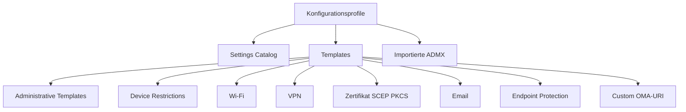
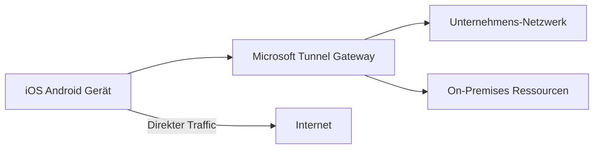
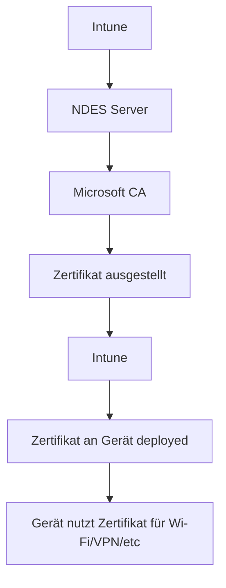
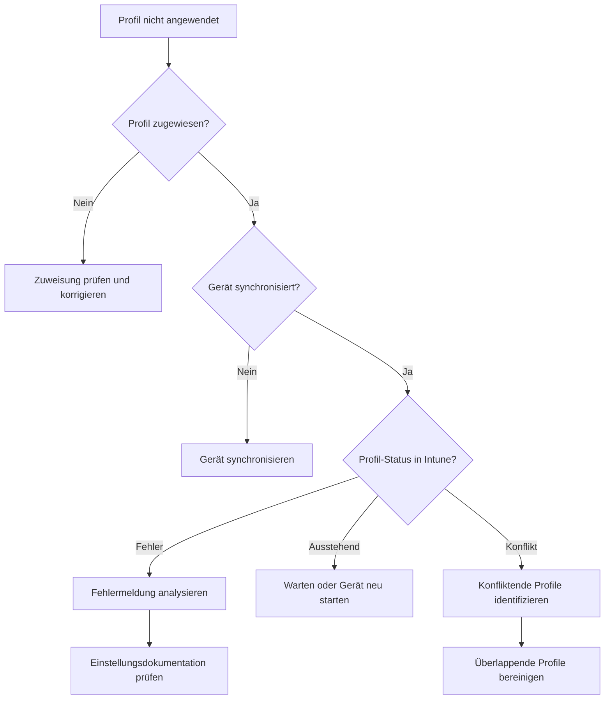

# Konfigurationsprofile

> [!ABSTRACT]
> Konfigurationsprofile in Microsoft Intune ermöglichen die zentrale Verwaltung von Geräteeinstellungen ohne Gruppenrichtlinien. Der Settings Catalog bietet Zugriff auf über 5.000 Einstellungen für Windows und macOS. Dieser Artikel erklärt alle Profiltypen, wann welcher Typ verwendet werden sollte, OMA-URI-Konfiguration, Zertifikatprofile, Konfliktauflösung und Troubleshooting.

---

## Konfigurationsprofile Übersicht

Konfigurationsprofile sind der zentrale Mechanismus in Intune, um Geräte zu konfigurieren. Im Gegensatz zu Compliance Policies, die Einstellungen *bewerten*, *erzwingen* Konfigurationsprofile direkte Einstellungen auf dem Gerät.

### Profiltypen im Überblick



### Wann welcher Profiltyp?

| Profiltyp | Plattform | Verwendung |
|---|---|---|
| Settings Catalog | Windows, macOS | Erste Wahl für alle neuen Profile |
| Administrative Templates | Windows | Gruppenrichtlinien-äquivalente Einstellungen |
| Device Restrictions | Alle | Schnelle Einschränkungen ohne tiefes Wissen |
| Wi-Fi | Alle | WLAN-Profile mit WPA2/WPA3 |
| VPN | Alle | VPN-Konfiguration |
| SCEP-Zertifikat | Alle | Automatische Zertifikatausstellung |
| PKCS-Zertifikat | Alle | Zertifikate aus PKI-Infrastruktur |
| Email | iOS, Android, Windows | E-Mail-Account-Konfiguration |
| Endpoint Protection | Windows | Defender, BitLocker, Firewall |
| Custom (OMA-URI) | Alle | Einstellungen ohne nativen Profiltyp |
| Custom (Mobileconfig) | macOS | Apple-spezifische Konfigurationen |

---

## Settings Catalog

Der Settings Catalog ist die moderne, empfohlene Methode zur Gerätekonfiguration in Intune. Er wird kontinuierlich erweitert und bietet:

- **Windows**: Über 5.000 Einstellungen (CSP-basiert)
- **macOS**: Über 1.000 Einstellungen (MDM-Payload-basiert)
- **iOS/iPadOS**: Über 300 Einstellungen
- **Vollständige Dokumentation**: Jede Einstellung hat einen direkten Link zur Microsoft-Dokumentation

### Settings Catalog Profil erstellen

```
Intune > Geräte > Konfigurationsprofile > Erstellen > [Plattform] > Settings Catalog
```

### Häufig genutzte Windows-Kategorien

| Kategorie | Einstellungsbeispiele |
|---|---|
| Microsoft Defender Antivirus | Echtzeit-Schutz, Ausnahmen, Scan-Zeitplan |
| BitLocker | Verschlüsselungsalgorithmus, Recovery Key Escrow |
| Windows Update for Business | Deferral-Perioden, Feature-Update-Ziel |
| Microsoft Edge | Homepage, Passwort-Manager, Extensions |
| Windows Firewall | Profile, Regeln, Benachrichtigungen |
| Experience | Start-Menü, Taskleiste, Action Center |
| Privacy | Telemetrie-Level, App-Berechtigungen |
| Local Security Authority | LSA-Schutz, Credential Guard |

### Beispiel: Defender Antivirus via Settings Catalog

```
Settings Catalog > Microsoft Defender Antivirus

Aktivieren:
✅ Allow On Access Protection (Echtzeit-Schutz)
✅ Enable Network Protection (Netzwerkschutz)
✅ PUA Protection (Potentially Unwanted Apps blockieren)

Scan-Einstellungen:
✅ Scan Removable Drives During Full Scan
Scan Schedule Day: Samstag
Scan Schedule Time: 02:00

Cloud-Schutz:
Cloud Block Level: High
Cloud Extended Timeout: 50 Sekunden
```

---

## Administrative Templates (ADMX-basiert)

Administrative Templates bilden klassische Windows-Gruppenrichtlinien in Intune ab. Sie basieren auf ADMX-Dateien und ermöglichen die Konfiguration von Windows-Komponenten und Office-Anwendungen.

> [!NOTE]
> Administrative Templates in Intune sind **User-Scope** und **Device-Scope** getrennt — genau wie in klassischen Gruppenrichtlinien (Benutzerkonfiguration vs. Computerkonfiguration).

### Administrative Templates vs Settings Catalog

| Aspekt | Administrative Templates | Settings Catalog |
|---|---|---|
| Basis | ADMX-Dateien (statisch) | CSP-Dokumentation (dynamisch) |
| Updates | Manuell bei Windows-Updates | Automatisch durch Intune |
| Suche | Eingeschränkt | Volltext-Suche |
| Umfang | Windows + Office | Windows, macOS, iOS, Android |
| Empfehlung | Legacy / Spezialfälle | Erste Wahl |

### Gängige ADMX-Einstellungen

```
Administrative Templates > Windows Components > Windows Update
→ "Configure Automatic Updates": Enabled, Option 4 (Auto download and schedule install)
→ "Specify Intranet Microsoft Update Service Location": Enabled, WSUS-Server-URL

Administrative Templates > Windows Components > Windows Defender SmartScreen
→ "Configure Windows Defender SmartScreen for Microsoft Edge": Enabled, Warn

Administrative Templates > Microsoft Office 2016 > Security Settings
→ "Macro Notification Settings": Disable all macros without notification
```

---

## Device Restrictions Profile

Device Restrictions Profile bieten eine vereinfachte Oberfläche für häufig genutzte Einschränkungen ohne tiefes CSP-Wissen:

### Windows Device Restrictions

```
Intune > Geräte > Konfigurationsprofile > Erstellen > Windows 10/11 > Vorlagen > Geräteeinschränkungen
```

| Einstellung | Empfehlung |
|---|---|
| Camera | Blockieren (sicherheitskritische Umgebungen) |
| Bluetooth | Zulassen |
| Cortana | Blockieren |
| Windows Spotlight | Blockieren |
| Microsoft Store | Blockieren oder auf private Store begrenzen |
| Game DVR | Blockieren |
| USB-Verbindung | Erlauben (oder blockieren nach Bedarf) |

### iOS/iPadOS Device Restrictions

```
Intune > Geräte > Konfigurationsprofile > Erstellen > iOS/iPadOS > Vorlagen > Geräteeinschränkungen
```

| Einstellung | Empfehlung |
|---|---|
| iCloud-Backup | Blockieren (Firmendaten in iCloud verhindern) |
| App Store | Blockieren (für vollständig verwaltete Geräte) |
| AirDrop | Blockieren |
| Siri | Zulassen |
| Screenshots | Kontextabhängig |
| Facetime | Zulassen |

---

## Wi-Fi Profile

Wi-Fi Profile ermöglichen das automatische Verbinden von Geräten mit Unternehmens-WLANs ohne manuelle Eingabe:

```
Intune > Geräte > Konfigurationsprofile > Erstellen > [Plattform] > Vorlagen > WLAN
```

### WPA2-Enterprise mit Zertifikat (empfohlen)

```json
{
  "wifiConfiguration": {
    "ssid": "Contoso-Corp",
    "connectAutomatically": true,
    "wifiSecurityType": "wpaEnterprise",
    "eapType": "eapTls",
    "authenticationMethod": "certificate",
    "rootCertificateForServerValidation": "TRUSTED-CERT-PROFILE-ID",
    "clientCertificateForAuthentication": "SCEP-CERT-PROFILE-ID",
    "hiddenNetwork": false
  }
}
```

> [!TIP]
> Für WPA2-Enterprise mit Zertifikaten müssen zuerst das **Vertrauenswürdige Zertifikatsprofil** (Root CA) und das **SCEP-Zertifikatsprofil** erstellt und zugewiesen werden. Erst dann kann das Wi-Fi-Profil auf diese Zertifikate verweisen.

---

## VPN Profile

VPN Profile konfigurieren automatisch VPN-Verbindungen auf Endgeräten:

```
Intune > Geräte > Konfigurationsprofile > Erstellen > [Plattform] > Vorlagen > VPN
```

### Always-On VPN (Windows)

| Einstellung | Wert |
|---|---|
| VPN-Verbindungsname | Contoso VPN |
| VPN-Server | vpn.contoso.com |
| Verbindungstyp | IKEv2 oder Microsoft Tunnel |
| Always-On | Aktiviert |
| Authentication | Maschinenzertifikat |
| Split Tunneling | Konfiguriert (nur Unternehmenstraffic durch VPN) |

### Microsoft Tunnel

Microsoft Tunnel ist die integrierte Intune-VPN-Lösung für iOS/Android/Linux:



---

## Zertifikatprofile

### SCEP (Simple Certificate Enrollment Protocol)

SCEP ermöglicht die automatische Ausstellung von Gerätezertifikaten aus einer unternehmenseigenen PKI:



**SCEP-Profil konfigurieren:**

```
Intune > Geräte > Konfigurationsprofile > Erstellen > [Plattform] > Vorlagen > SCEP-Zertifikat

Einstellungen:
- Zertifikattyp: Gerät oder Benutzer
- Subject Name Format: CN={{DeviceName}},O=Contoso,C=DE
- Subject Alternative Name: DNS={{DeviceName}}.contoso.com
- Zertifikatgültigkeitsdauer: 1 Jahr
- Key Storage Provider: TPM (empfohlen)
- Key Usage: Digitale Signatur, Schlüsselverschlüsselung
- Erweiterte Key Usage: Clientauthentifizierung (1.3.6.1.5.5.7.3.2)
- Root Certificate: [Vertrauenswürdiges Zertifikatsprofil]
- SCEP-Server-URL: https://ndes.contoso.com/certsrv/mscep/mscep.dll
```

### PKCS (Public Key Cryptography Standards)

PKCS-Zertifikate werden direkt von Intune via Intune Certificate Connector aus einer CA ausgestellt, ohne NDES:

| Aspekt | SCEP | PKCS |
|---|---|---|
| Infrastruktur | NDES-Server erforderlich | Nur Intune Certificate Connector |
| Zertifikatgenerierung | Auf dem Gerät (privater Key verlässt Gerät nicht) | Auf dem Server |
| Sicherheit | Höher (privater Key bleibt auf Gerät) | Geringer (privater Key auf Server) |
| Verwendung | Bevorzugt | Wenn NDES nicht verfügbar |

### Vertrauenswürdiges Zertifikatsprofil (Trusted Certificate)

Muss vor SCEP/PKCS-Profilen deployt werden:

```
Intune > Geräte > Konfigurationsprofile > Erstellen > [Plattform] > Vorlagen > Vertrauenswürdiges Zertifikat

- Zertifikatdatei: Root-CA-Zertifikat (.cer) hochladen
- Zielort: Computerzertifikatspeicher / Stamm (für Gerätezertifikate)
```

---

## Email Profile

Email Profile konfigurieren automatisch E-Mail-Konten auf mobilen Geräten:

```
Intune > Geräte > Konfigurationsprofile > Erstellen > [Plattform] > Vorlagen > E-Mail
```

| Einstellung | Wert |
|---|---|
| E-Mail-Server | outlook.office365.com |
| Kontoname | Unternehmens-E-Mail |
| Benutzername-Attribut | UPN |
| E-Mail-Adress-Attribut | Primäre SMTP-Adresse |
| Authentifizierungsmethode | Benutzername und Kennwort |
| SSL/TLS | Aktiviert |
| Synchronisierungszeitraum | 1 Monat |

> [!NOTE]
> Bei iOS/iPadOS wird ein natives E-Mail-Profil für die Mail-App erstellt. Für **Outlook** ist ein separates App-Konfigurationsprofil empfohlen, da Outlook eigene MDM-Kanäle für die Kontokonfiguration hat.

---

## Endpoint Protection Profile

Endpoint Protection Profile konfigurieren sicherheitsrelevante Windows-Komponenten:

```
Intune > Geräte > Konfigurationsprofile > Erstellen > Windows 10/11 > Vorlagen > Endpoint Protection
```

### BitLocker-Einstellungen

| Einstellung | Empfehlung |
|---|---|
| Verschlüsselungsalgorithmus OS-Laufwerk | XTS-AES 256-Bit |
| Startauthentifizierungsmethode | TPM und PIN |
| Minimale PIN-Länge | 6 Zeichen |
| Recovery Key | In Azure AD sichern (Pflicht) |
| Recovery Key Rotation | Nach Verwendung |
| Datenlaufwerke verschlüsseln | Ja |

### Windows Defender Firewall

| Einstellung | Empfehlung |
|---|---|
| Firewall aktivieren | Alle Profile (Domain, Private, Public) |
| Eingehende Verbindungen | Blockieren (Public-Profil) |
| Ausgehende Verbindungen | Zulassen |
| Benachrichtigungen | Aktiviert |
| Stealth-Modus | Aktiviert (Public-Profil) |

---

## Via Microsoft Intune Admin Center (UI)

### Konfigurationsprofil erstellen (Settings Catalog — empfohlen)

1. Öffne das **Microsoft Intune Admin Center** unter [intune.microsoft.com](https://intune.microsoft.com)
2. Navigiere zu **Geräte → Konfigurationsprofile → + Profil erstellen**
3. Wähle die **Plattform** (z. B. Windows 10 und höher)
4. Wähle **Profiltyp: Einstellungskatalog** → **Erstellen**
5. Vergib einen **Namen** nach Namenskonvention (z. B. `WIN-SEC-Defender-v1`) → **Weiter**

#### Einstellungen hinzufügen

6. Klicke auf **+ Einstellungen hinzufügen**
7. Suche nach Kategorien oder Einstellungsnamen (z. B. „BitLocker", „Defender", „Firewall")
8. Aktiviere die gewünschten Einstellungen mit der Checkbox → klicke auf **Schließen**
9. Konfiguriere die Werte der ausgewählten Einstellungen im rechten Bereich
10. Klicke auf **Weiter**

#### Profil zuweisen

11. Unter **Zuweisungen**: Wähle **+ Gruppen hinzufügen** für Einschließen und ggf. Ausschließen
12. Optional: Klicke auf **Filter bearbeiten** um Assignment Filters anzuwenden (z. B. nur Windows 11)
13. Klicke auf **Weiter → Erstellen**

#### Administrative Vorlagen (ADMX) erstellen

14. Navigiere zu **Geräte → Konfigurationsprofile → + Profil erstellen**
15. Wähle **Plattform: Windows 10 und höher**, **Profiltyp: Vorlagen → Administrative Vorlagen**
16. Suche im linken Bereich nach dem gewünschten Richtlinienbereich (z. B. **Windows-Komponenten → Windows Update**)
17. Konfiguriere die Einstellungen und weise das Profil zu → **Weiter → Erstellen**

> [!TIP]
> Nutze den **Einstellungskatalog** als erste Wahl — er wird kontinuierlich erweitert und bietet Volltextsuche, direkten Link zur Microsoft-Dokumentation und bessere Konflikt-Transparenz als ältere Vorlagen.

> [!NOTE]
> Für Einstellungen ohne nativen Profiltyp im Settings Catalog existiert das **Custom OMA-URI**-Profil (siehe folgender Abschnitt). Prüfe zuerst den Settings Catalog, bevor du OMA-URI nutzt.

---

## Custom Profile (OMA-URI)

Custom Profile ermöglichen die direkte Konfiguration von MDM-Einstellungen via OMA-URI, wenn kein nativer Profiltyp verfügbar ist.

### OMA-URI Syntax

```
./Device/Vendor/MSFT/[CSP-Name]/[Pfad]
./User/Vendor/MSFT/[CSP-Name]/[Pfad]
```

### Häufig genutzte OMA-URI-Einstellungen

**Windows LAPS (Local Administrator Password Solution):**

```
OMA-URI: ./Device/Vendor/MSFT/LAPS/Policies/BackupDirectory
Datentyp: Integer
Wert: 2 (Azure Active Directory)

OMA-URI: ./Device/Vendor/MSFT/LAPS/Policies/PasswordLength
Datentyp: Integer
Wert: 14

OMA-URI: ./Device/Vendor/MSFT/LAPS/Policies/PasswordAge
Datentyp: Integer
Wert: 30
```

**USB-Speicher blockieren:**

```
OMA-URI: ./Device/Vendor/MSFT/Policy/Config/Storage/RemovableDiskDenyWriteAccess
Datentyp: Integer
Wert: 1 (Schreibzugriff verweigern)
```

**Windows Hello for Business deaktivieren:**

```
OMA-URI: ./Device/Vendor/MSFT/PassportForWork/TenantId/{TenantId}/Policies/UsePassportForWork
Datentyp: Boolean
Wert: false
```

**Credential Guard aktivieren:**

```
OMA-URI: ./Device/Vendor/MSFT/Policy/Config/DeviceGuard/EnableVirtualizationBasedSecurity
Datentyp: Integer
Wert: 1

OMA-URI: ./Device/Vendor/MSFT/Policy/Config/DeviceGuard/LsaCfgFlags
Datentyp: Integer
Wert: 1 (Credential Guard aktivieren)
```

---

## Importierte ADMX-Vorlagen

Für Software von Drittanbietern (Google Chrome, Mozilla Firefox, Zoom etc.) können benutzerdefinierte ADMX-Dateien in Intune importiert werden:

```
Intune > Geräte > Konfigurationsprofile > Importierte Administrative Vorlagen (Vorschau) > Importieren
```

### Google Chrome ADMX importieren

```powershell
# Chrome ADMX herunterladen (aus Chrome Enterprise Bundle)
# https://chromeenterprise.google/browser/download/

# Dateien: chrome.admx + chrome.adml (Sprachdatei)
# In Intune importieren:
# 1. chrome.admx hochladen
# 2. chrome.adml (de-DE) hochladen
```

Nach dem Import können Chrome-Richtlinien wie native Windows-Einstellungen konfiguriert werden.

---

## macOS Custom Profile (Mobileconfig)

Für macOS-Einstellungen, die nicht im Settings Catalog verfügbar sind:

```
Intune > Geräte > Konfigurationsprofile > Erstellen > macOS > Vorlagen > Custom
```

### Mobileconfig mit Apple Configurator 2 erstellen

```bash
# Apple Configurator 2 aus dem App Store installieren
# Datei > Neues Profil > Einstellungen konfigurieren > Exportieren als .mobileconfig

# Profil signieren (optional aber empfohlen)
security cms -S -N "Zertifikatname" -i unsigned.mobileconfig -o signed.mobileconfig
```

### Beispiel: Login Window konfigurieren

```xml
<?xml version="1.0" encoding="UTF-8"?>
<!DOCTYPE plist PUBLIC "-//Apple//DTD PLIST 1.0//EN"
  "http://www.apple.com/DTDs/PropertyList-1.0.dtd">
<plist version="1.0">
<dict>
    <key>PayloadContent</key>
    <array>
        <dict>
            <key>PayloadType</key>
            <string>com.apple.loginwindow</string>
            <key>PayloadVersion</key>
            <integer>1</integer>
            <key>PayloadIdentifier</key>
            <string>com.contoso.loginwindow</string>
            <key>PayloadUUID</key>
            <string>C3D4E5F6-A7B8-9012-CDEF-123456789012</string>
            <key>SHOWFULLNAME</key>
            <true/>
            <key>HideAdminUsers</key>
            <false/>
            <key>DisableConsoleAccess</key>
            <true/>
            <key>LoginwindowText</key>
            <string>Dieses Gerät gehört Contoso GmbH. Unbefugter Zugriff ist untersagt.</string>
        </dict>
    </array>
    <key>PayloadDisplayName</key>
    <string>Login Window Konfiguration</string>
    <key>PayloadIdentifier</key>
    <string>com.contoso.loginwindow.profile</string>
    <key>PayloadType</key>
    <string>Configuration</string>
    <key>PayloadUUID</key>
    <string>D4E5F6A7-B8C9-0123-DEF0-234567890123</string>
    <key>PayloadVersion</key>
    <integer>1</integer>
    <key>PayloadScope</key>
    <string>System</string>
</dict>
</plist>
```

---

## Profil-Zuweisung

### Zuweisung via Gruppen

Profile werden **Entra ID-Gruppen** zugewiesen:

```
Profil > Zuweisung > Einschließen > Gruppe auswählen
                   > Ausschließen > Gruppe auswählen
```

| Zuweisungstyp | Verwendung |
|---|---|
| Alle Geräte | Basis-Konfigurationen für alle |
| Alle Benutzer | Benutzerspezifische Einstellungen |
| Dynamische Gerätegruppe | Zuweisung nach Geräteeigenschaften |
| Dynamische Benutzergruppe | Zuweisung nach Benutzerattributen |
| Statische Gruppe | Spezifische Geräte oder Benutzer |

### Assignment Filters

Filter ermöglichen eine granulare Steuerung der Profilzuweisung innerhalb einer Gruppe:

```
Intune > Mandantenverwaltung > Filter > Erstellen

Beispiel-Filter: "Nur Windows 11 Geräte"
Regel: (device.osVersion -startsWith "10.0.22")

Beispiel-Filter: "Nur Surface-Geräte"
Regel: (device.deviceModel -contains "Surface")
```

> [!TIP]
> Verwende Filter statt vieler kleiner Gruppen. Filter sind performanter und einfacher zu verwalten. Ein Filter kann auf jede Zuweisung angewendet werden, ohne die Gruppenstruktur zu ändern.

---

## Profil-Konflikt-Auflösung

Wenn mehrere Profile dieselbe Einstellung konfigurieren, entsteht ein Konflikt:

### Konflikt-Verhalten nach Profiltyp

| Profiltyp | Konfliktverhalten |
|---|---|
| Settings Catalog | Letzter Schreiber gewinnt (nicht vorhersehbar) |
| Administrative Templates | Restriktivster Wert gewinnt |
| Endpoint Protection | Merge (sofern möglich) |
| Custom OMA-URI | Letzter Schreiber gewinnt |

### Konflikt-Erkennung

```
Intune > Geräte > [Gerät] > Gerätekonfiguration
→ Profile mit Status "Konflikt" sind rot markiert
→ "Konflikt" anklicken zeigt, welche Profile in Konflikt stehen
```

```powershell
# Via Graph API: Konfliktende Konfigurationsprofile abrufen
$deviceId = "DEVICE-ID"
$uri = "https://graph.microsoft.com/beta/deviceManagement/managedDevices/$deviceId/deviceConfigurationStates"
$states = Invoke-MgGraphRequest -Method GET -Uri $uri
$states.value | Where-Object { $_.state -eq 'error' -or $_.state -eq 'conflict' } |
    Select-Object displayName, state, errorDescription
```

> [!WARNING]
> Konflikte bei kritischen Einstellungen (BitLocker, Firewall) können dazu führen, dass die Einstellung **nicht angewendet** wird. Überprüfe regelmäßig den Profil-Status im Intune-Portal.

### Best Practices zur Konfliktvermeidung

1. **Ein Profil pro Thema** — Nicht alles in ein Mega-Profil
2. **Klare Namenskonvention** — z.B. `WIN-SEC-BitLocker-v1`, `iOS-WIFI-Corporate-v2`
3. **Dokumentation** — Welche Gruppen welche Profile erhalten
4. **Scope Tags** — Trennung nach Team/Region/Mandant
5. **Testing** — Erst auf Testgruppe deployen, dann auf Produktion

---

## Troubleshooting Konfigurationsprofile

### Profil wird nicht angewendet

```powershell
# Windows: Alle MDM-Policies auf dem Gerät anzeigen
Get-ChildItem HKLM:\SOFTWARE\Microsoft\PolicyManager\current\device\
Get-ChildItem HKLM:\SOFTWARE\Microsoft\PolicyManager\current\user\

# Intune Management Extension Logs
$logPath = "C:\ProgramData\Microsoft\IntuneManagementExtension\Logs"
Get-Content "$logPath\IntuneManagementExtension.log" | Select-String "error|fail|conflict" | Select-Object -Last 30
```

```bash
# macOS: Installierte Profile anzeigen
sudo profiles list -all

# Detaillierter Profil-Status
sudo profiles show -all

# MDM-Logs (letzte Stunde)
log show --predicate 'subsystem == "com.apple.ManagedClient"' --last 1h | grep -i "error\|fail\|install"
```

### Diagnose-Workflow



### Häufige Fehler

| Fehlercode | Bedeutung | Lösung |
|---|---|---|
| 0x87D1FDE8 | Remediation fehlgeschlagen | Einstellungswert prüfen |
| 0x87D101F4 | Gerät nicht unterstützt | Plattform-Kompatibilität prüfen |
| 0x87D13B96 | Konflikt mit anderer Policy | Konfliktierende Profile bereinigen |
| 65000 | Allgemeiner Fehler | Gerät neu enrollen |
| 2016345552 | Ungültige OMA-URI | OMA-URI-Syntax prüfen |

---

## Verwandte Notizen

- [[Compliance Policies]]
- [[macOS Enrollment]]
- [[App Management MAM]]
