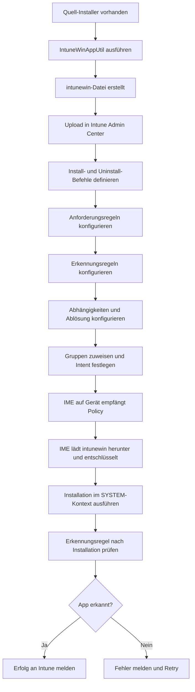
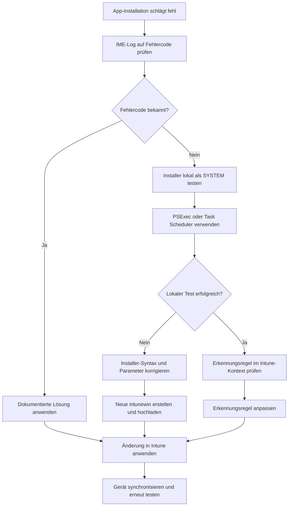

# Software-Deployment

> [!ABSTRACT]
> Microsoft Intune ermöglicht die zentrale Bereitstellung von Anwendungen auf verwalteten Geräten. Von Win32-Apps über Microsoft Store bis hin zu LOB-Apps bietet Intune flexible Deployment-Optionen mit granularer Kontrolle über Erkennungsregeln, Abhängigkeiten und Deployment-Intent. Dieser Artikel beschreibt alle App-Typen, das Win32-Packaging mit IntuneWinAppUtil, Erkennungsregeln, Fehlercodes sowie die Fehlerbehebung.

---

## App-Typen in Intune

Intune unterstützt verschiedene App-Typen mit unterschiedlichen Möglichkeiten und Einschränkungen. Die Wahl des richtigen App-Typs ist entscheidend für eine effiziente Bereitstellung.

| App-Typ | Dateiformat | Plattform | Vorteile | Nachteile |
|---------|------------|-----------|----------|-----------|
| Win32 App | .intunewin | Windows | Vollständige Kontrolle, Abhängigkeiten, Erkennung | Packaging-Aufwand |
| MSI Line-of-Business | .msi | Windows | Einfaches Upload, kein Tool nötig | Eingeschränkte Optionen |
| MSIX / APPX | .msix / .appx | Windows | Modernes Format, Sandboxing | Signierung erforderlich |
| Microsoft Store (neu) | WinGet-ID | Windows | Kein Packaging, große Auswahl | Internetverbindung nötig |
| Microsoft 365 Apps | Cloud-basiert | Win / macOS | Direkt konfigurierbar, ODT-ähnlich | Nur M365-Produkte |
| Web App | URL | Alle | Keine Installation | Browser-abhängig |
| iOS/iPadOS Store App | App Store ID | iOS/iPadOS | Zentral verwaltbar | App Store Abhängigkeit |
| Android Managed Google Play | Play Store ID | Android | Vollständige Kontrolle | Google-Konto nötig |
| macOS DMG / PKG | .pkg / .dmg | macOS | Flexibel für alle macOS-Apps | Signierung empfohlen |
| PowerShell-Skript | .ps1 | Windows | Beliebige Aktionen | Kein Reporting-Status |

---

## Win32 App Packaging

Win32-Apps sind das leistungsfähigste App-Format in Intune. Nahezu jede Windows-Anwendung kann als Win32 App bereitgestellt werden, unabhängig vom Installationsformat.

### IntuneWinAppUtil.exe

Das Microsoft Win32 Content Prep Tool konvertiert Installer-Dateien und alle benötigten Abhängigkeiten in das verschlüsselte `.intunewin`-Format.

```powershell
# Tool direkt von GitHub herunterladen
Invoke-WebRequest `
    -Uri "https://github.com/microsoft/Microsoft-Win32-Content-Prep-Tool/raw/master/IntuneWinAppUtil.exe" `
    -OutFile "C:\Tools\IntuneWinAppUtil.exe"
```

```cmd
REM Syntax
IntuneWinAppUtil.exe -c <SourceFolder> -s <SetupFile> -o <OutputFolder> [-q]

REM Beispiel: MSI-Paket (7-Zip)
IntuneWinAppUtil.exe -c "C:\Apps\7zip" -s "7z2301-x64.msi" -o "C:\Output"

REM Beispiel: EXE-Installer mit Unterordnern
IntuneWinAppUtil.exe -c "C:\Apps\NotepadPP" -s "npp.8.6.Installer.x64.exe" -o "C:\Output"

REM Beispiel: PowerShell-Skript als Wrapper
IntuneWinAppUtil.exe -c "C:\Apps\MyApp" -s "install.ps1" -o "C:\Output"

REM Quiet-Modus ohne Benutzereingaben (CI/CD-Integration)
IntuneWinAppUtil.exe -c "C:\Apps\App" -s "setup.exe" -o "C:\Output" -q
```

> [!NOTE]
> Der Source-Ordner (`-c`) muss alle für die Installation benötigten Dateien enthalten, inklusive Abhängigkeiten, Konfigurationsdateien und Lizenzen. Die Setup-Datei (`-s`) muss sich direkt im Source-Ordner befinden.

### Win32 App Deployment Flow



---

## Win32 App Konfiguration

### Install- und Uninstall-Befehle

```cmd
REM MSI Silent Install
msiexec /i "app.msi" /qn /norestart ALLUSERS=1

REM MSI Silent Uninstall via Produktcode
msiexec /x "{PRODUKTCODE-GUID-HIER}" /qn /norestart

REM EXE Silent Install (Beispiel: 7-Zip)
7z2301-x64.exe /S

REM EXE Silent Uninstall (Beispiel: 7-Zip)
"%ProgramFiles%\7-Zip\Uninstall.exe" /S

REM Inno Setup Silent Install
setup.exe /VERYSILENT /SUPPRESSMSGBOXES /NORESTART

REM NSIS Silent Install
setup.exe /S

REM PowerShell-Wrapper aufrufen
powershell.exe -ExecutionPolicy Bypass -NoProfile -NonInteractive -File "install.ps1"
```

### Anforderungsregeln (Requirements)

Anforderungsregeln steuern, ob eine App auf einem bestimmten Gerät installiert werden soll. Werden sie nicht erfüllt, wird die App als "nicht zutreffend" markiert.

| Anforderungstyp | Beschreibung | Beispiel |
|----------------|-------------|---------|
| Betriebssystem | Mindest-Windows-Version | Windows 10 21H2 oder höher |
| Datenträger | Mindest freier Speicherplatz | 500 MB frei auf C: |
| RAM | Mindest-Arbeitsspeicher | 4 GB RAM |
| Prozessorarchitektur | 32-Bit oder 64-Bit | Nur x64 |
| Benutzerdefiniert (PowerShell) | Beliebiges PowerShell-Skript | Domainmitgliedschaft, Softwareversion |

```powershell
# Beispiel: Benutzerdefiniertes Anforderungsskript
# Prüft ob .NET 6 Runtime installiert ist
$dotnet = Get-Command dotnet -ErrorAction SilentlyContinue
if ($dotnet) {
    $version = & dotnet --list-runtimes | Where-Object { $_ -match "Microsoft.NETCore.App 6" }
    if ($version) {
        Write-Output "Anforderung erfüllt"
        exit 0
    }
}
exit 1
```

### Erkennungsregeln (Detection Rules)

Erkennungsregeln bestimmen, ob eine App auf einem Gerät bereits installiert ist. Fehlerhafte Erkennungsregeln sind die häufigste Ursache für falsche Deployment-Status.

#### Registry-Erkennung

```
Hive:               HKEY_LOCAL_MACHINE
Schlüsselpfad:      SOFTWARE\7-Zip
Wertname:           Path
Erkennungsmethode:  Schlüssel existiert
```

Für versionsbasierte Erkennung:
```
Hive:               HKEY_LOCAL_MACHINE
Schlüsselpfad:      SOFTWARE\Microsoft\Windows\CurrentVersion\Uninstall\{GUID}
Wertname:           DisplayVersion
Erkennungsmethode:  String-Gleichheit
Wert:               23.01
```

#### Datei/Ordner-Erkennung

```
Pfad:               %ProgramFiles%\7-Zip
Datei oder Ordner:  7z.exe
Erkennungsmethode:  Datei existiert
```

Für versionsbasierte Datei-Erkennung:
```
Pfad:               %ProgramFiles%\7-Zip
Datei oder Ordner:  7z.exe
Erkennungsmethode:  Dateiversion größer oder gleich
Version:            23.1.0.0
```

#### PowerShell-Erkennungsskript

```powershell
# Erkennungsskript — Exit 0 und Write-Output = erkannt, Exit 1 = nicht erkannt
$appName = "7-Zip"
$minVersion = [Version]"23.1"

$installed = Get-ItemProperty -Path "HKLM:\SOFTWARE\Microsoft\Windows\CurrentVersion\Uninstall\*",
                                    "HKLM:\SOFTWARE\WOW6432Node\Microsoft\Windows\CurrentVersion\Uninstall\*" `
             -ErrorAction SilentlyContinue |
             Where-Object { $_.DisplayName -like "*$appName*" }

if ($installed) {
    $installedVersion = [Version]$installed.DisplayVersion
    if ($installedVersion -ge $minVersion) {
        Write-Output "Erkannt: $appName $installedVersion"
        exit 0
    }
}
exit 1
```

> [!IMPORTANT]
> PowerShell-Erkennungsskripte dürfen nur bei erfolgreicher Erkennung eine Ausgabe mit `Write-Output` erzeugen. Fehlerausgaben oder `Write-Error` führen dazu, dass die App als nicht erkannt gilt, auch wenn Exit Code 0 zurückgegeben wird.

---

## Microsoft 365 Apps Deployment

M365-Apps werden direkt über Intune ohne lokales Packaging bereitgestellt. Intune verwendet intern das Office Deployment Tool (ODT).

**Konfigurationspfad:** Intune Admin Center → Apps → Windows → Hinzufügen → Microsoft 365 Apps

### Konfigurationsoptionen

| Option | Beschreibung | Empfehlung |
|--------|-------------|-----------|
| App Suite konfigurieren | Auswahl der Apps (Word, Excel, Outlook, Teams etc.) | Nur benötigte Apps wählen |
| Update Channel | Current, Monthly Enterprise, Semi-Annual | Monthly Enterprise (Stabilität) |
| Version | Aktuelle oder spezifische Version | Aktuelle Version |
| Sprachen | Installationssprachen | de-de + en-us |
| Installationsarchitektur | 32-Bit oder 64-Bit | 64-Bit (empfohlen) |
| Shared Computer Activation | Für RDS / AVD | Nur für Shared-Szenarien |
| Bestehende MSI-Office-Versionen entfernen | Alte Versionen entfernen | Ja |

```xml
<!-- Beispiel ODT-Konfiguration (intern von Intune genutzt) -->
<Configuration>
  <Add OfficeClientEdition="64" Channel="MonthlyEnterprise">
    <Product ID="O365ProPlusRetail">
      <Language ID="de-de" />
      <Language ID="en-us" />
      <ExcludeApp ID="Lync" />
      <ExcludeApp ID="Groove" />
      <ExcludeApp ID="Publisher" />
    </Product>
  </Add>
  <Updates Enabled="TRUE" Channel="MonthlyEnterprise" />
  <Display Level="None" AcceptEULA="TRUE" />
  <Property Name="SharedComputerLicensing" Value="0" />
  <Property Name="PinIconsToTaskbar" Value="FALSE" />
</Configuration>
```

---

## Microsoft Store (Neue Store-Apps / WinGet-basiert)

Seit 2022 basiert der neue Microsoft Store in Intune auf dem Windows Package Manager (WinGet) und bietet Zugriff auf tausende von Apps.

**Konfigurationspfad:** Intune Admin Center → Apps → Windows → Hinzufügen → Microsoft Store App (neu)

```powershell
# WinGet lokal nutzen um App-IDs zu suchen
winget search "7-Zip"
winget search --id "7zip.7zip" --exact

# App-Details und Metadaten anzeigen
winget show --id "7zip.7zip"

# Installierte Apps auflisten
winget list

# App über WinGet installieren (für Tests)
winget install --id "7zip.7zip" --silent --accept-package-agreements --accept-source-agreements
```

**Vorteile des neuen Stores:**
- Kein Packaging und kein Upload erforderlich
- Automatische Updates über WinGet-Quelle
- Große App-Bibliothek (Microsoft Store + WinGet Community)
- WinGet-Paket-ID als stabiler Identifier

> [!NOTE]
> Store-Apps benötigen Internetzugang auf den Endgeräten zur Download-Zeit. Für Offline-Umgebungen oder Umgebungen mit sehr eingeschränktem Internetzugang sind Win32-Apps vorzuziehen.

---

## Windows Package Manager (WinGet) in Intune

WinGet kann über PowerShell-Skripte in Intune für Deployment-Szenarien genutzt werden, bei denen kein Store-Zugang möglich ist oder eine benutzerdefinierte Konfiguration benötigt wird.

```powershell
# WinGet-Verfügbarkeit prüfen
$winget = Get-Command winget -ErrorAction SilentlyContinue
if (-not $winget) {
    Write-Error "WinGet nicht verfügbar - App Store Installation prüfen"
    exit 1
}

# App über WinGet im SYSTEM-Kontext installieren
$process = Start-Process -FilePath "winget" `
    -ArgumentList "install --id 7zip.7zip --silent --accept-package-agreements --accept-source-agreements --scope machine" `
    -Wait -NoNewWindow -PassThru

if ($process.ExitCode -eq 0) {
    Write-Output "Installation erfolgreich"
    exit 0
} else {
    Write-Error "Installation fehlgeschlagen mit Code: $($process.ExitCode)"
    exit 1
}
```

> [!WARNING]
> WinGet im SYSTEM-Kontext (Intune-Standard) erfordert `--scope machine` für maschinenweite Installationen. Ohne diesen Parameter schlägt die Installation möglicherweise fehl oder wird im falschen Kontext installiert.

---

## LOB Apps (Line-of-Business)

### MSI-Apps

Einfachstes Format für MSI-Installer. Direkt ohne Packaging-Tool hochladbar, aber mit eingeschränkten Möglichkeiten im Vergleich zu Win32-Apps.

**Limitierungen gegenüber Win32:**
- Keine benutzerdefinierten Erkennungsregeln (nur automatisch via Produktcode)
- Keine Dependency-Verwaltung
- Keine Supersedence-Konfiguration
- Keine PowerShell-Skripte vor/nach Installation
- Keine Anforderungsregeln (Requirement Rules)

**Empfehlung:** Nur für einfache MSI-Pakete ohne spezielle Anforderungen. Für alle anderen Szenarien Win32-App-Format verwenden.

### MSIX / APPX Apps

Modernes Windows App-Paketformat mit Sandboxing und vereinfachter Deinstallation.

```powershell
# MSIX-Paket lokal prüfen und Informationen auslesen
Get-AppxPackage -Name "Contoso.MyApp" | Select-Object Name, Version, InstallLocation

# MSIX-Signatur validieren (muss mit vertrauenswürdigem Zertifikat signiert sein)
Get-AuthenticodeSignature -FilePath "C:\Apps\contoso.msix"

# MSIX manuell installieren (für Testzwecke)
Add-AppxPackage -Path "C:\Apps\contoso.msix"

# Alle installierten APPX-Pakete anzeigen
Get-AppxPackage -AllUsers | Where-Object { $_.Publisher -like "*Contoso*" }
```

---

## Abhängigkeiten und Ablösung (Dependencies und Supersedence)

### Dependencies (Abhängigkeiten)

Dependencies stellen sicher, dass eine vorausgesetzte App installiert wird, bevor die Hauptanwendung bereitgestellt wird.

**Typische Szenarien:**
- Visual C++ Redistributable als Dependency für eine interne Anwendung
- .NET Runtime als Dependency für eine .NET-Anwendung
- Treiber-Software als Dependency für ein Hardware-Management-Tool

**Einstellungen:**
- **Automatisch installieren = Ja:** Die Dependency wird automatisch bereitgestellt, auch wenn sie nicht explizit einer Gruppe zugewiesen wurde
- **Automatisch installieren = Nein:** Die Dependency muss separat zugewiesen sein

### Supersedence (Ablösung)

Supersedence ermöglicht es, ältere App-Versionen durch eine neue zu ersetzen, ohne manuelle Deinstallation.

| Einstellung | Beschreibung | Anwendungsfall |
|-------------|-------------|----------------|
| Update | Neue Version installieren | Minor Updates, gleiche App |
| Replace | Alte App deinstallieren, neue installieren | Produktwechsel, Umbenennung |

---

## Deployment Intent

Der Deployment Intent steuert, wie eine App auf Geräten bereitgestellt wird.

| Intent | Beschreibung | Benutzer-Aktion | Reporting |
|--------|-------------|----------------|-----------|
| Erforderlich (Required) | Automatische Installation ohne Benutzerinteraktion | Keine | Vollständig |
| Verfügbar (Available) | App erscheint im Unternehmensportal zur freiwilligen Installation | Benutzer installiert | Teilweise |
| Deinstallieren (Uninstall) | App wird automatisch von Geräten entfernt | Keine | Vollständig |
| Verfügbar ohne Enrollment | Über Unternehmensportal ohne MDM-Enrollment | Browser-Portal | Eingeschränkt |

> [!TIP]
> Nutze **Verfügbar** für optionale Software und **Erforderlich** für Pflicht-Anwendungen. Zu viele Apps als "Erforderlich" verlangsamen die Erstanmeldung erheblich. Empfehlung: Maximal 5 Pflicht-Apps für die ESP-Blockierung konfigurieren.

---

## App-Reporting und Monitoring

**Konfigurationspfad:** Intune Admin Center → Apps → Monitor → App-Installationsstatus

### Berichtsstatus

| Status | Beschreibung | Handlungsbedarf |
|--------|-------------|----------------|
| Installiert | App erfolgreich installiert | Keiner |
| Fehlgeschlagen | Installationsfehler aufgetreten | Log-Analyse nötig |
| Ausstehend | Installation noch nicht gestartet | Gerät muss sich synchronisieren |
| Nicht zutreffend | Anforderungsregeln nicht erfüllt | Kein Handlungsbedarf |
| Deinstalliert | App erfolgreich entfernt | Keiner |
| Erkannt — nicht verwaltete Installation | App vorhanden, aber nicht über Intune | Optional: Umstieg auf Intune |

### Win32-App Fehlercodes

| Fehlercode (Hex) | Fehlercode (Dezimal) | Beschreibung | Lösung |
|-----------------|---------------------|-------------|--------|
| 0x87D300C9 | -2016345911 | Timeout bei Installation | IME-Timeout erhöhen, Install-Skript optimieren |
| 0x87D300C8 | -2016345912 | Erkennungsregel nicht erfüllt nach Installation | Erkennungsregel und Installer prüfen |
| 0x80070652 | -2147023278 | Andere Installation bereits aktiv | Parallele Deployments reduzieren |
| 0x80070643 | -2147023293 | Allgemeiner Installationsfehler | MSI-Log mit /log-Parameter erstellen |
| 0x80070005 | -2147024891 | Zugriff verweigert | Ausführungskontext und Rechte prüfen |
| 0x87D1041C | -2016345060 | App-Anforderungen nicht erfüllt | Requirement Rules überprüfen |
| 0x80070002 | -2147024894 | Datei oder Pfad nicht gefunden | Installer-Pfad und Dateien prüfen |
| 0x800700c1 | -2147024703 | Keine gültige Win32-Anwendung | Installer-Kompatibilität prüfen |

---

## Troubleshooting Win32 App Installation

### Log-Dateien

| Log-Datei | Pfad | Inhalt |
|-----------|------|--------|
| IME-Hauptlog | `C:\ProgramData\Microsoft\IntuneManagementExtension\Logs\IntuneManagementExtension.log` | Download, Installation, Status |
| AgentExecutor | `C:\ProgramData\Microsoft\IntuneManagementExtension\Logs\AgentExecutor.log` | Skript- und Befehlsausführungen |
| IME Operational | `C:\ProgramData\Microsoft\IntuneManagementExtension\Logs\sensor.log` | Sensor-Kommunikation |
| MSI-Installation | Variabel — via `/log C:\Temp\install.log` | MSI-Installationsdetails |

```powershell
# IME-Service-Status prüfen
Get-Service -Name "IntuneManagementExtension" | Select-Object Name, Status, StartType

# IME-Service neu starten (erzwingt Re-Sync mit Intune)
Restart-Service -Name "IntuneManagementExtension" -Force

# Log-Verzeichnis im Explorer öffnen
explorer "C:\ProgramData\Microsoft\IntuneManagementExtension\Logs\"

# IME-Log live überwachen (letzten 50 Zeilen, dann warten auf neue)
Get-Content "C:\ProgramData\Microsoft\IntuneManagementExtension\Logs\IntuneManagementExtension.log" -Tail 50 -Wait

# Installierte Apps nach Produktcode suchen
Get-ItemProperty -Path "HKLM:\SOFTWARE\Microsoft\Windows\CurrentVersion\Uninstall\*",
                       "HKLM:\SOFTWARE\WOW6432Node\Microsoft\Windows\CurrentVersion\Uninstall\*" |
    Where-Object { $_.DisplayName -like "*AppName*" } |
    Select-Object DisplayName, DisplayVersion, UninstallString

# Intune-Gerätesync manuell auslösen
$session = New-CimSession
Invoke-CimMethod -Namespace "root\cimv2\mdm\dmmap" `
    -ClassName "MDM_EnterpriseModernAppManagement_AppManagement01" `
    -MethodName "UpdateScanMethod" `
    -CimSession $session
```

### Debugging-Vorgehen



```powershell
# App-Installer lokal als SYSTEM-Kontext testen (benötigt PSExec oder Sysinternals)
# PSExec herunterladen: https://docs.microsoft.com/sysinternals/downloads/psexec
psexec.exe -i -s cmd.exe

# Im SYSTEM-Kontext:
msiexec /i "C:\Apps\app.msi" /qn /norestart /log "C:\Temp\install.log"

# MSI-Log auf Fehler prüfen
Select-String -Path "C:\Temp\install.log" -Pattern "Error|Fehler|Return value 3"
```

> [!WARNING]
> Win32-Apps werden standardmäßig im SYSTEM-Kontext installiert. Einige Installer erfordern jedoch einen Benutzerkontext (z.B. für per-User-Installationen). Den Installationskontext kann man in den Win32-App-Einstellungen unter "Install behavior" auf "User" umstellen.

---

## Verwandte Notizen

- [[Windows Enrollment]]
- [[Windows Autopilot]]
- [[Endpoint Security]]
- [[App Management MAM]]
