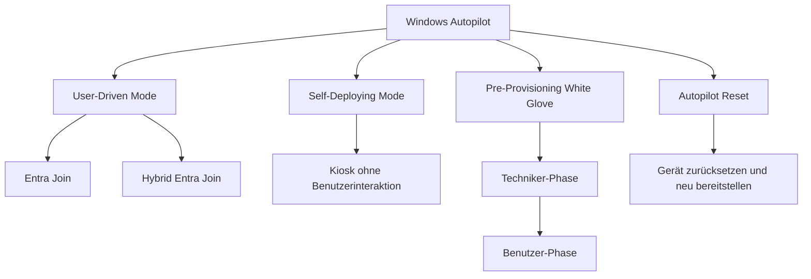
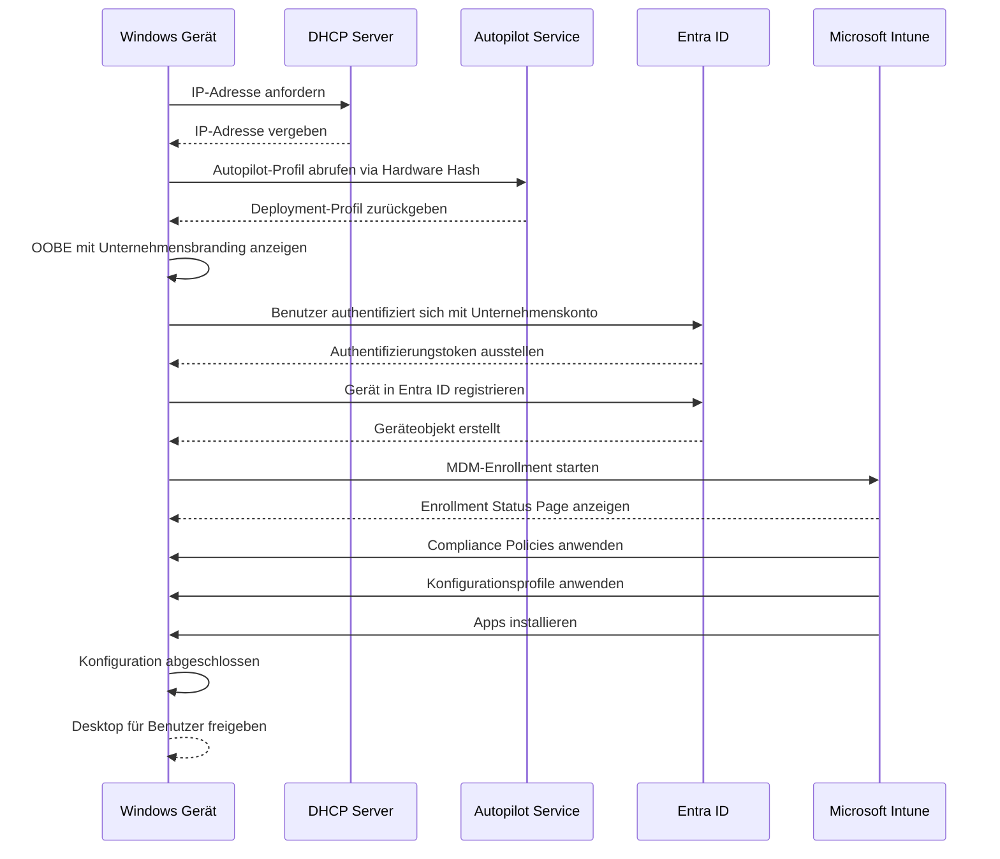
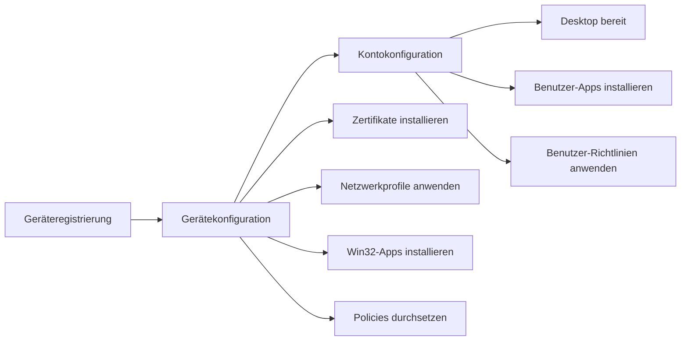
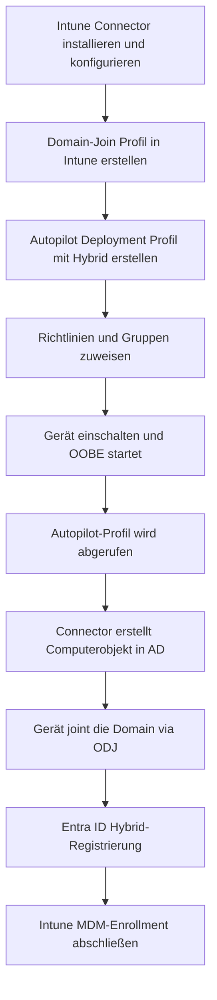

# Windows Autopilot

> [!ABSTRACT]
> Windows Autopilot ermöglicht die automatisierte, zero-touch Bereitstellung von Windows-Geräten direkt ab Werk. Geräte werden über Microsoft Intune konfiguriert, ohne dass IT-Abteilungen physischen Zugriff benötigen. Dieser Artikel beschreibt alle Deployment-Modi, die Hardware-Hash-Registrierung, ESP-Konfiguration, Hybrid Entra Join sowie die Fehlerbehebung.

---

## Was ist Windows Autopilot?

Windows Autopilot ist ein cloudbasierter Bereitstellungsmechanismus für Windows 10/11-Geräte. Er ermöglicht es Unternehmen, neue Geräte direkt vom Hersteller oder Händler an Endbenutzer zu versenden, ohne dass die IT-Abteilung das Gerät physisch vorkonfigurieren muss.

**Kernfunktionen:**
- Zero-Touch Deployment: Geräte werden beim ersten Start automatisch konfiguriert
- Out-of-Box Experience (OOBE): Benutzerdefinierte Willkommensseite mit Unternehmensbranding
- Integration mit Microsoft Entra ID und Microsoft Intune
- Unterstützung für Hybrid-Szenarien mit lokalem Active Directory

**Voraussetzungen:**
- Microsoft Entra ID (Azure AD) Tenant
- Microsoft Intune-Lizenz (Intune Plan 1 oder höher)
- Windows 10 1703+ oder Windows 11
- Internetzugang während der OOBE
- Gerät muss im Autopilot-Service registriert sein

**Unterstützte Plattformen:**

| Plattform | Minimale Version | Einschränkungen |
|-----------|-----------------|----------------|
| Windows 10 | 1703 | Eingeschränkte Features |
| Windows 10 | 1809+ | Empfohlen für alle Modi |
| Windows 11 | 21H2 | Vollständige Unterstützung |
| HoloLens 2 | Ja | Eingeschränkte Modi |
| Surface Hub | Nein | Nicht unterstützt |

---

## Deployment-Modi

Windows Autopilot unterstützt vier primäre Deployment-Modi, die je nach Anwendungsfall ausgewählt werden.



### Vergleich der Deployment-Modi

| Modus | Benutzer-Interaktion | AD-Join-Typ | TPM erforderlich | Typischer Anwendungsfall |
|-------|---------------------|-------------|-----------------|--------------------------|
| User-Driven Entra Join | Benutzeranmeldung | Nur Entra ID | Nein | Cloud-only Geräte |
| User-Driven Hybrid | Benutzeranmeldung | Entra ID und On-Prem AD | Nein | Hybrid-Umgebungen |
| Self-Deploying | Keine Interaktion | Nur Entra ID | Ja (TPM 2.0) | Kiosk, Shared Devices |
| Pre-Provisioning | Techniker und Benutzer | Beide möglich | Nein | Schnellere Bereitstellung |
| Autopilot Reset | Minimal | Unverändert | Nein | Geräterücksetzung |

### User-Driven Mode

Der gebräuchlichste Modus: Der Endbenutzer startet das Gerät, durchläuft die OOBE und authentifiziert sich mit seinen Unternehmensanmeldedaten. Anschließend wird das Gerät automatisch konfiguriert.

**Entra Join:** Gerät wird ausschließlich in Microsoft Entra ID (Azure AD) eingebunden. Kein lokales Active Directory erforderlich.

**Hybrid Entra Join:** Gerät wird sowohl in Entra ID als auch in lokales Active Directory eingebunden. Erfordert den Intune Connector for Active Directory.

### Self-Deploying Mode

Für benutzerlose Geräte (Kiosk, Digital Signage, Shared Devices). Keine Benutzerinteraktion erforderlich. Das Gerät konfiguriert sich vollständig automatisch.

> [!IMPORTANT]
> Self-Deploying Mode erfordert TPM 2.0 und Device Certificate Attestation. Virtuelle Maschinen und Geräte ohne TPM werden nicht unterstützt.

### Pre-Provisioning (White Glove)

Zweiphasiger Prozess für schnellere Bereitstellung beim Endbenutzer:
- **Techniker-Phase:** IT-Mitarbeiter schließt zeitintensive Konfigurationen (Apps, Policies) vorab ab
- **Benutzer-Phase:** Endbenutzer meldet sich an, nur noch benutzerspezifische Konfigurationen werden angewendet

### Autopilot Reset

Setzt ein vorhandenes Windows-Gerät in einen bereitstellungsbereiten Zustand zurück, ohne es physisch einschicken zu müssen. Das Gerät bleibt im Autopilot-Service registriert und behält seine Entra ID-Zugehörigkeit.

---

## OOBE-Ablauf mit Autopilot



---

## Hardware Hash registrieren

Der Hardware Hash ist ein eindeutiger Identifier für jedes Gerät und enthält Informationen über Hardware-Komponenten. Er wird zur Autopilot-Registrierung benötigt.

### Methode 1 — OEM- und Händler-Registrierung

Der einfachste Weg: OEM-Hersteller (Dell, HP, Lenovo, Microsoft) oder autorisierte Händler registrieren die Hardware-Hashes direkt im Autopilot-Service, bevor das Gerät versandt wird.

**Vorteile:**
- Kein manueller Aufwand für die IT
- Geräte sind sofort nach Lieferung einsatzbereit
- Empfohlene Methode für Neugeräte-Bestellungen in größerem Umfang

### Methode 2 — CSV-Import

Bestehende Geräte können über eine CSV-Datei importiert werden.

**CSV-Format:**
```
Device Serial Number,Windows Product ID,Hardware Hash,Group Tag,Assigned User
SN12345678,,<Hardware-Hash-Wert>,,user@contoso.com
SN87654321,,<Hardware-Hash-Wert>,Vertrieb,sales@contoso.com
```

**Import in Intune:**
1. Intune Admin Center → Geräte → Enrollment
2. Windows → Windows Autopilot → Geräte
3. Importieren → CSV-Datei hochladen → Überprüfen

### Methode 3 — PowerShell (Get-WindowsAutoPilotInfo)

```powershell
# Modul aus PowerShell Gallery installieren
Install-Script -Name Get-WindowsAutoPilotInfo -Force

# Hardware Hash extrahieren und direkt in Autopilot importieren (benötigt Graph API)
Get-WindowsAutoPilotInfo -Online

# Hash in CSV-Datei exportieren
Get-WindowsAutoPilotInfo -OutputFile C:\Temp\AutopilotHWID.csv

# Mehrere Geräte remote erfassen
Get-WindowsAutoPilotInfo -ComputerName PC01,PC02,PC03 -OutputFile C:\Temp\MultiDevice.csv

# Mit Group Tag für dynamische Gruppensteuerung
Get-WindowsAutoPilotInfo -Online -GroupTag "Vertrieb-Notebook"

# Mit zugewiesenem Benutzer
Get-WindowsAutoPilotInfo -Online -AssignedUser "max.mustermann@contoso.com"
```

> [!NOTE]
> Das Skript `Get-WindowsAutoPilotInfo` benötigt lokale Administratorrechte. Für den direkten Import (`-Online`) sind Graph API-Berechtigungen erforderlich (DeviceManagementServiceConfig.ReadWrite.All).

---

## Autopilot Deployment Profiles konfigurieren

Deployment Profiles steuern das Verhalten der OOBE und legen fest, welcher Deployment-Modus verwendet wird.

**Konfigurationspfad:** Intune Admin Center → Geräte → Enrollment → Windows Autopilot → Deployment profiles

### Wichtige Einstellungen

| Einstellung | Verfügbare Optionen | Empfehlung (Enterprise) |
|-------------|--------------------|-----------------------|
| Deployment mode | User-Driven / Self-Deploying | User-Driven |
| Join to Entra as | Entra joined / Hybrid Entra joined | Je nach Infrastruktur |
| Microsoft Software License Terms (EULA) | Anzeigen / Überspringen | Überspringen |
| Privacy settings | Anzeigen / Überspringen | Überspringen |
| Hide change account options | Ja / Nein | Ja (verhindern) |
| User account type | Administrator / Standard | Standard |
| Language Region | Konfigurieren / Überspringen | Überspringen wenn einheitlich |
| Keyboard | Konfigurieren / Überspringen | Überspringen |
| Pre-provisioning support | Ja / Nein | Je nach Modus |

**Group Tags:** Ermöglichen dynamische Autopilot-Gerätegruppenzuweisung basierend auf einer Gerätekategorie, zum Beispiel `Vertrieb-Notebook` oder `Kiosk-Erdgeschoss`.

---

## Enrollment Status Page (ESP)

Die ESP zeigt den Konfigurationsfortschritt während der OOBE an und verhindert, dass Benutzer das Gerät vor Abschluss der Konfiguration verwenden können.

**Konfigurationspfad:** Intune Admin Center → Geräte → Enrollment → Windows → Enrollment Status Page

### ESP-Phasen



### ESP-Konfigurationsoptionen

| Option | Beschreibung | Empfehlung |
|--------|-------------|-----------|
| Show app and profile configuration progress | Fortschrittsanzeige aktivieren | Ja |
| Block device use until all apps and profiles are installed | Desktop bis Abschluss sperren | Ja |
| Allow users to reset device if installation error occurs | Reset bei Fehler ermöglichen | Ja |
| Allow users to use device if installation error occurs | Trotz Fehler fortfahren | Nein (Sicherheit) |
| Show custom message when installation error occurs | Eigene Fehlermeldung | Helpdesk-Kontakt |
| Timeout (minutes) | Maximale Wartezeit | 60 Minuten |
| Block device use until required apps are installed | Pflicht-Apps definieren | Ja |

> [!TIP]
> Setze eine sinnvolle Timeout-Zeit von 60 Minuten. Bei langsamen Netzwerken oder vielen Apps kann es sonst zu unnötigen Timeouts kommen. Definiere nur wirklich kritische Apps als Pflicht-Apps in der ESP.

---

## Hybrid Entra Join mit Autopilot und Intune Connector

Hybrid Entra Join kombiniert lokales Active Directory mit Microsoft Entra ID und ermöglicht es, Geräte in beide Verzeichnisse einzubinden.

### Voraussetzungen

- Windows Server 2016+ mit installiertem Intune Connector for Active Directory
- Intune Connector auf einem Domain-joined Server mit Internetkonnektivität
- Sichtbarkeit auf Domain Controller während der OOBE (direkte Verbindung oder Always-On VPN)
- Offline Domain Join (ODJ) Blob-Austausch zwischen Connector und Gerät

### Konfigurationsschritte



**Domain-Join Profil erstellen:**
1. Intune Admin Center → Geräte → Configuration Profiles → Erstellen
2. Plattform: Windows 10 and later
3. Profiltyp: Templates → Domain Join
4. Domain-Name, Organisationseinheit (OU) und NetBIOS-Name eintragen

> [!WARNING]
> Der Intune Connector benötigt ausgehende HTTPS-Verbindungen zu `*.manage.microsoft.com` und `*.microsoftonline.com`. Stellt sicher, dass Firewall-Regeln und Proxy entsprechend konfiguriert sind.

---

## Pre-Provisioning (White Glove)

### Techniker-Phase

1. Gerät einschalten, bevor es an den Benutzer übergeben wird
2. Auf dem OOBE-Willkommensbildschirm fünfmal die Windows-Taste drücken
3. Im Techniker-Menü "Windows Autopilot provisioning" auswählen
4. "Provision" klicken und den Fortschritt abwarten
5. Status-Anzeige nach Abschluss:
   - Grüner Haken = Konfiguration erfolgreich
   - Roter Kreis = Fehler (Neuversuch oder Diagnose nötig)
6. Gerät herunterfahren und versiegelt an Endbenutzer übergeben

### Benutzer-Phase

Nach der Techniker-Phase erhält der Endbenutzer ein vorkonfiguriertes Gerät:
1. Benutzer schaltet Gerät ein
2. Kurze OOBE: Nur Benutzeranmeldung erforderlich
3. Benutzerspezifische Konfigurationen (Benutzer-Apps, Benutzerrichtlinien) werden angewendet
4. Desktop erscheint deutlich schneller als bei normalem Autopilot-Deployment

> [!NOTE]
> Pre-Provisioning funktioniert nur mit Deployment Profiles, bei denen "Pre-provisioning support" auf Ja gesetzt ist. Das Profil muss User-Driven sein.

---

## Windows Autopilot Device Preparation (ab 2024)

Windows Autopilot Device Preparation ist ein vereinfachter Bereitstellungs-Flow, der klassischen Autopilot ergänzt und schrittweise ablösen soll.

**Hauptunterschiede zum klassischen Autopilot:**

| Merkmal | Klassischer Autopilot | Device Preparation |
|---------|----------------------|-------------------|
| Hardware-Hash erforderlich | Ja | Nein |
| Konfiguration via | Deployment Profiles | Device Preparation Policies |
| Gerätezuweisung | Manuell via Gruppe | Automatisch beim Enrollment |
| ESP | Separate ESP-Richtlinie | Integriert in Policy |
| Reporting | Begrenzt | Verbessertes Statusreporting |
| Entra ID-Anforderungen | P1/P2 | P1/P2 |

**Vorteile:**
- Keine manuelle Hardware-Hash-Registrierung und kein OEM-Import nötig
- Vereinfachtes Policy-Management mit weniger Richtlinien
- Bessere Transparenz und Fehlermeldungen im Reporting
- Schnellere initiale Einrichtung für neue Tenants

**Einrichtung:** Intune Admin Center → Geräte → Enrollment → Windows → Device preparation policies

---

## Autopilot for Existing Devices

Ermöglicht die Bereitstellung von Autopilot auf bestehenden Geräten, die bereits mit Microsoft Configuration Manager (MEMCM/SCCM) verwaltet werden.

### Ablauf


### Konfiguration

```powershell
# Autopilot-Konfigurationsdatei aus Intune exportieren (benötigt Graph API)
$profiles = Get-AutopilotProfile
$json = $profiles | ConvertTo-AutopilotConfigurationJSON

# JSON-Datei speichern
$json | Out-File -FilePath "C:\Staging\AutopilotConfiguration.json" -Encoding utf8

# Zieldatei auf dem Gerät (wird von Task Sequence platziert)
# C:\Windows\Provisioning\Autopilot\AutopilotConfiguration.json
```

Die JSON-Datei wird in die Task Sequence als Paket eingebunden. Die Task Sequence installiert Windows neu und platziert die JSON-Datei vor dem ersten Start.

---

## Via Microsoft Intune Admin Center (UI)

### Windows Autopilot über die UI konfigurieren

1. Öffne das **Microsoft Intune Admin Center** unter [intune.microsoft.com](https://intune.microsoft.com)

#### Autopilot-Geräte registrieren (CSV-Import)

2. Navigiere zu **Geräte → Enrollment → Windows Autopilot → Geräte**
3. Klicke auf **Importieren**
4. Lade die CSV-Datei mit den Hardware-Hashes hoch (Format: Seriennummer, Windows-Produkt-ID, Hardware-Hash, Group Tag, Assigned User)
5. Warte auf die Bestätigung der Importierung (kann bis zu 15 Minuten dauern)
6. Klicke auf **Synchronisieren** um den Importstatus zu aktualisieren

#### Autopilot-Bereitstellungsprofil erstellen

7. Navigiere zu **Geräte → Enrollment → Windows Autopilot → Bereitstellungsprofile → + Profil erstellen**
8. Wähle **Windows-PC**
9. Konfiguriere:
   - **Name:** z. B. `AUTOPILOT-UserDriven-EntraJoin-v1`
   - **Bereitstellungsmodus:** `Benutzergesteuert`
   - **In Microsoft Entra ID einbinden als:** `In Microsoft Entra ID eingebunden`
   - **EULA überspringen:** `Ja`
   - **Datenschutzeinstellungen überspringen:** `Ja`
   - **Kontoänderungsoptionen ausblenden:** `Ja`
   - **Benutzerkontentyp:** `Standard`
10. Klicke auf **Weiter → Zuweisungen**
11. Weise das Profil einer Autopilot-Gerätegruppe zu (dynamisch nach Seriennummer oder Group Tag)
12. Klicke auf **Weiter → Erstellen**

#### Enrollment Status Page für Autopilot konfigurieren

13. Navigiere zu **Geräte → Enrollment → Windows Enrollment → Registrierungsstatusseite**
14. Klicke auf **+ Profil erstellen**
15. Konfiguriere:
    - **App- und Profilkonfigurationsfortschritt anzeigen:** `Ja`
    - **Geräteverwendung blockieren:** `Ja`
    - **Timeout:** `60` Minuten
    - **Benutzern das Zurücksetzen erlauben:** `Ja`
16. Weise das ESP-Profil der gleichen Autopilot-Gruppe zu → **Weiter → Erstellen**

#### Autopilot-Status überwachen

17. Navigiere zu **Geräte → Enrollment → Windows Autopilot → Geräte**
18. Überprüfe den **Bereitstellungsprofilstatus** der registrierten Geräte
19. Navigiere zu **Berichte → Windows Autopilot → Autopilot-Bereitstellungen** für Deployment-Berichte

> [!TIP]
> Nutze **Group Tags** beim Hardware-Hash-Import, um Geräte automatisch dynamischen Entra-ID-Gruppen zuzuweisen. Erstelle eine dynamische Gerätegruppe mit der Regel `(device.devicePhysicalIds -any (_ -eq "[OrderID]:TAG_NAME"))` für automatische Profilzuweisung.

---

## Fehlerbehebung

### MDMDiagnosticsTool

```powershell
# Diagnosebericht erstellen und als CAB-Datei exportieren
MDMDiagnosticsTool.exe -area Autopilot -cab C:\Temp\AutopilotDiag.cab

# Erweiterte Diagnose
MDMDiagnosticsTool.exe -area Autopilot;DeviceEnrollment;DeviceProvisioning -cab C:\Temp\FullDiag.cab

# Alternativ via Windows-Einstellungen
# Einstellungen → Konten → Auf Arbeits- oder Schulkonto zugreifen → Info → Bericht exportieren
```

### Event Viewer Log-Pfade

| Log-Quelle | Pfad im Event Viewer | Relevante Event IDs |
|-----------|---------------------|---------------------|
| Autopilot | Anwendungs- und Dienstprotokolle → Microsoft → Windows → Provisioning-Diagnostics-Provider → AutoPilot | 100, 101, 102 |
| MDM Enrollment | Anwendungs- und Dienstprotokolle → Microsoft → Windows → DeviceManagement-Enterprise-Diagnostics-Provider | 72, 75, 76 |
| User Device Registration | Anwendungs- und Dienstprotokolle → Microsoft → Windows → User Device Registration | 300, 304 |
| ESP | Anwendungs- und Dienstprotokolle → Microsoft → Windows → ModernDeployment-Diagnostics-Provider | Alle |

### Log-Dateipfade auf dem Gerät

```powershell
# IME (Intune Management Extension) Logs
C:\ProgramData\Microsoft\IntuneManagementExtension\Logs\

# ESP-Logs
C:\Windows\Temp\IntuneEnrollmentStatusPage\

# OOBE / Panther-Logs
C:\Windows\Panther\

# Autopilot ETL-Log
C:\Windows\Logs\MoSetup\BlueBox.log

# Logs mit CMTrace oder OneTrace lesen
# CMTrace.exe C:\ProgramData\Microsoft\IntuneManagementExtension\Logs\IntuneManagementExtension.log
```

### Häufige Fehler und Lösungen

| Fehlercode | Beschreibung | Lösung |
|-----------|-------------|--------|
| 0x80180014 | Gerät nicht in Autopilot registriert | Hardware Hash importieren, Registrierung im Portal prüfen |
| 0x80070774 | Enrollment Timeout | ESP-Timeout erhöhen, Netzwerkverbindung prüfen |
| 0x800705B4 | Verbindungs-Timeout | Netzwerk, Proxy und Firewall-Regeln prüfen |
| 0x801c0003 | Gerät darf Entra ID nicht beitreten | Geräteregistrierungseinstellungen in Entra ID prüfen |
| 0x801c001d | Keine gültige TPM-Hardware | TPM-Status im BIOS und Windows-Version prüfen |
| 0x80070490 | Element nicht gefunden | Autopilot-Profil und Zuweisung prüfen |
| 0xcaa9001f | Authentifizierungsfehler | MFA-Einstellungen und Conditional Access prüfen |
| 0x80180018 | Autopilot-Profil nicht gefunden | Gruppentagging und Profilzuweisung prüfen |
| 0x80070005 | Zugriff verweigert | Benutzerrechte und Richtlinienkonflikte prüfen |
| 0x800706ba | RPC-Server nicht verfügbar | Netzwerkkonnektivität zu Intune-Endpunkten prüfen |

### Nützliche PowerShell-Diagnose-Befehle

```powershell
# MDM-Enrollment-Status prüfen
dsregcmd /status

# Autopilot-Registrierung des aktuellen Geräts prüfen
Get-ItemProperty -Path "HKLM:\SOFTWARE\Microsoft\Provisioning\Diagnostics\AutoPilot"

# Intune-Enrollment-Status
Get-ItemProperty -Path "HKLM:\SOFTWARE\Microsoft\Enrollments\" -ErrorAction SilentlyContinue

# Gerät manuell mit Intune synchronisieren
Invoke-CimMethod -Namespace "root\cimv2\mdm\dmmap" `
    -ClassName "MDM_EnterpriseModernAppManagement_AppManagement01" `
    -MethodName "UpdateScanMethod"
```

> [!TIP]
> Das Tool `CMTrace` oder `OneTrace` von Configuration Manager eignet sich hervorragend zum Lesen und Filtern der Intune-Logdateien in Echtzeit.

---

## Verwandte Notizen

- [[Windows Enrollment]]
- [[Intune Grundlagen]]
- [[Konfigurationsprofile]]
- [[Endpoint Security]]
