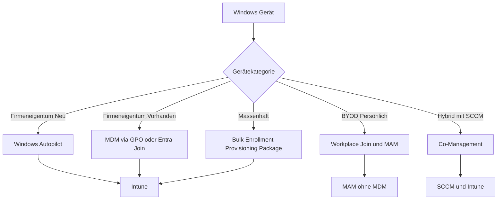
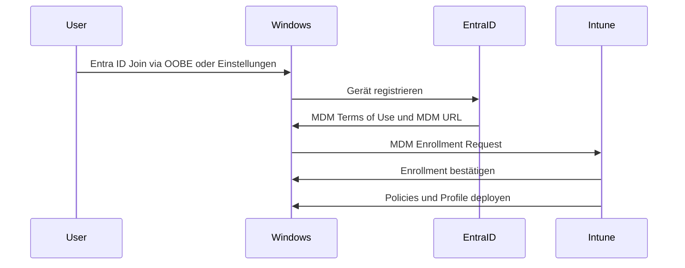
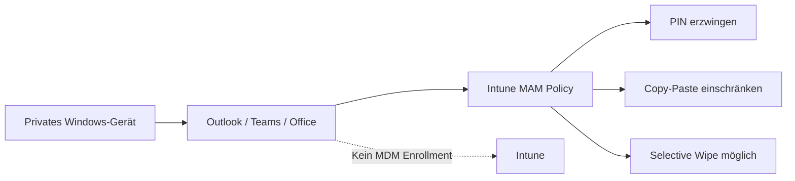
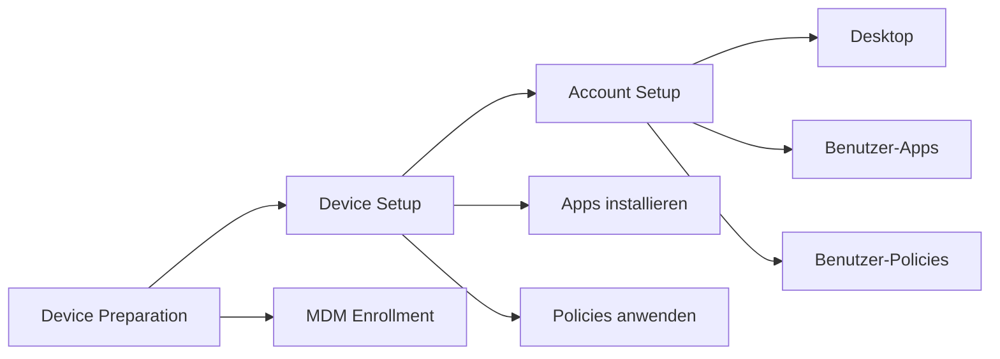
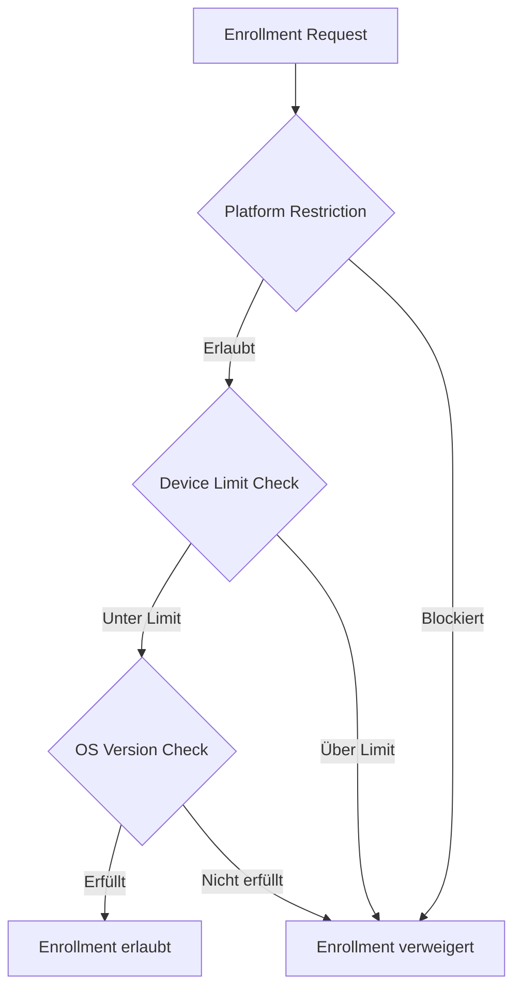

---
tags:
  - microsoft365
  - intune
  - windows
  - enrollment
  - autopilot
aliases:
  - Windows MDM Enrollment
  - Windows Intune Enrollment
---

# Windows Enrollment

> [!ABSTRACT] TL;DR
> Windows-Geräte können auf mehreren Wegen bei Intune registriert werden: Windows Autopilot (Zero-Touch), automatisches MDM-Enrollment via Entra ID Join, BYOD-Workplace Join mit MAM, Bulk Enrollment per Provisioning Package und Co-Management mit SCCM. Die empfohlene Methode für neue firmeneigene Geräte ist Windows Autopilot.

---

## Enrollment-Methoden Übersicht



| Methode | Geräteeigentum | Enrollment-Tiefe | Benutzerinteraktion |
|---------|---------------|-----------------|-------------------|
| **Windows Autopilot** | Unternehmen | Vollständig MDM | Minimal (nur Anmeldung) |
| **Entra ID Join + Auto-Enrollment** | Unternehmen | Vollständig MDM | Mittel |
| **Hybrid Entra Join + Co-Management** | Unternehmen | MDM + SCCM | Keine (GPO-getrieben) |
| **GPO-based MDM Enrollment** | Unternehmen (AD) | Vollständig MDM | Keine |
| **BYOD Workplace Join** | Privat | MAM (optional MDM) | Gering |
| **Bulk Enrollment** | Unternehmen | Vollständig MDM | Keine |
| **Manuell via Company Portal** | Beide | Vollständig MDM | Hoch |

---

## Automatisches MDM-Enrollment via Entra ID Join

Wenn ein Benutzer ein Windows-Gerät mit seinem **Entra ID (Geschäfts-) Konto** verbindet, wird das Gerät automatisch bei Intune enrolled — sofern Auto-Enrollment konfiguriert ist.

### Konfiguration (Entra ID Admin Center)

1. **Entra ID** → Mobility (MDM and WIP) → Microsoft Intune
2. **MDM User Scope** setzen:
   - `None` — kein Auto-Enrollment
   - `Some` — nur ausgewählte Gruppen
   - `All` — alle Benutzer

### Enrollment-Ablauf



> [!IMPORTANT]
> Der **MDM User Scope** in Entra ID muss auf `Some` oder `All` gesetzt sein. Standardmäßig ist er `None`.

---

## BYOD-Enrollment (Workplace Join + MAM)

Für private Geräte bietet Windows **Workplace Join** (auch "Register Device" oder "Add Work Account") — ohne vollständiges MDM-Enrollment.

### Schritte für Endbenutzer

1. Einstellungen → Konten → E-Mail & Konten → Geschäfts- oder Schulkonto hinzufügen
2. Oder: Einstellungen → Konten → Auf Arbeit oder Schule zugreifen → Verbinden
3. Entra ID Anmeldedaten eingeben
4. Je nach MAM-Konfiguration: App Protection Policies werden automatisch angewendet

### MAM ohne Enrollment (MAM-WE)



> [!NOTE]
> MAM-WE auf Windows unterstützt aktuell nur **Microsoft 365 Apps** (Outlook, Teams, Word, Excel, PowerPoint). Drittanbieter-Apps benötigen das Intune SDK oder App Wrapping Tool.

---

## Hybrid Entra Join mit Co-Management

Für Organisationen mit bestehender **Active Directory (AD)** und **SCCM-Infrastruktur** ermöglicht Hybrid Entra Join die schrittweise Migration zu Intune.

### Voraussetzungen

- Windows Server Active Directory vorhanden
- Azure AD Connect konfiguriert (Hybrid Entra Join)
- SCCM (Configuration Manager) mit Cloud Management Gateway
- Intune-Lizenz vorhanden

### Co-Management Aktivierung

```powershell
# In SCCM: Co-Management Properties prüfen
# Administration → Cloud Services → Co-Management
# Enrollment tab: Auto-enrollment into Intune aktivieren

# Prüfen ob Hybrid Entra Join aktiv ist
dsregcmd /status | Select-String "AzureAdJoined|DomainJoined|EnterpriseJoined"
```

> [!WARNING]
> Bei Hybrid Entra Join werden Geräte sowohl in AD als auch in Entra ID registriert. Achte auf doppelte Geräteeinträge und MDM-Authority-Konflikte.

---

## Bulk Enrollment

Bulk Enrollment ermöglicht das Enrollment **vieler Geräte** ohne individuelle Konfiguration, indem ein **Provisioning Package** erstellt und auf die Geräte angewendet wird.

### Windows Configuration Designer (WCD)

1. **Windows Assessment and Deployment Kit (ADK)** installieren
2. **Windows Configuration Designer** öffnen
3. Neues Projekt erstellen: "Provision desktop devices"
4. MDM-Enrollment konfigurieren (Intune Enrollment URL)
5. Provisioning Package (`.ppkg`) exportieren
6. Package auf Geräte anwenden (USB, shared folder, OOBE)

### Enrollment-URLs für Intune

```
MDM Enrollment URL:   https://enrollment.manage.microsoft.com/enrollmentserver/discovery.svc
MDM Terms of Use URL: https://portal.manage.microsoft.com/TermsofUse.aspx
MDM Compliance URL:   https://portal.manage.microsoft.com/?portalAction=Compliance
```

> [!TIP]
> Bulk Enrollment eignet sich für **Shared Devices** und Kiosk-Szenarien ohne Benutzer-Zuordnung. Für persönlich zugeordnete Geräte ist Autopilot die bessere Wahl.

---

## Via Microsoft Intune Admin Center (UI)

### Windows-Enrollment und Enrollment Status Page konfigurieren

1. Öffne das **Microsoft Intune Admin Center** unter [intune.microsoft.com](https://intune.microsoft.com)
2. Navigiere zu **Geräte → Enrollment → Windows Enrollment**

#### Auto-Enrollment konfigurieren (Entra ID)

3. Öffne das **Microsoft Entra Admin Center** unter [entra.microsoft.com](https://entra.microsoft.com)
4. Navigiere zu **Identität → Mobilität (MDM und MAM) → Microsoft Intune**
5. Setze den **MDM-Benutzerbereich** auf `Alle` oder `Einige` (ausgewählte Gruppe)
6. Klicke auf **Speichern**

#### Enrollment Status Page (ESP) konfigurieren

7. Zurück im Intune Admin Center: **Geräte → Enrollment → Windows Enrollment → Registrierungsstatusseite**
8. Klicke auf **+ Profil erstellen**
9. Konfiguriere die Einstellungen:
   - **App- und Profilkonfigurationsfortschritt anzeigen:** `Ja`
   - **Geräteverwendung bis zur Installation aller Apps und Profile blockieren:** `Ja`
   - **Timeout (Minuten):** `60`
   - **Benutzern das Zurücksetzen des Geräts bei Installationsfehler erlauben:** `Ja`
10. Weise das Profil einer **Entra ID-Gruppe** zu → **Weiter → Erstellen**

#### Enrollment-Beschränkungen konfigurieren

11. Navigiere zu **Geräte → Enrollment → Geräteregistrierungseinschränkungen**
12. Wähle eine bestehende Einschränkung oder erstelle eine neue über **+ Einschränkung erstellen**
13. Konfiguriere erlaubte Plattformen, OS-Versionen und Gerätelimits pro Benutzer
14. Klicke auf **Weiter → Erstellen**

> [!TIP]
> Für **BYOD-Szenarien** reicht oft MAM ohne MDM-Enrollment aus. Konfiguriere App Protection Policies unter **Apps → App-Schutzrichtlinien**, ohne Auto-Enrollment zu erzwingen.

---

## MDM-Enrollment via Group Policy

Für Geräte, die bereits **Active Directory-joined** sind, kann das MDM-Enrollment per **Gruppenrichtlinie** erzwungen werden.

### GPO-Konfiguration

```
Computerkonfiguration → Administrative Vorlagen → Windows-Komponenten
→ MDM → Auto MDM Enrollment with AAD Token aktivieren
```

Oder per Registry:

```powershell
# MDM Auto-Enrollment via Registry
$path = "HKLM:\SOFTWARE\Policies\Microsoft\Windows\CurrentVersion\MDM"
New-Item -Path $path -Force
Set-ItemProperty -Path $path -Name "AutoEnrollMDM" -Value 1
Set-ItemProperty -Path $path -Name "UseAADCredentialType" -Value 1
```

> [!NOTE]
> Voraussetzung: Das Gerät muss **Hybrid Entra ID Joined** sein und der Benutzer braucht eine **Intune-Lizenz**.

---

## Enrollment Status Page (ESP)

Die **Enrollment Status Page** zeigt Benutzern den Fortschritt der Geräteeinrichtung während des Autopilot-Prozesses.

### ESP-Phasen



### ESP-Konfiguration (Intune Admin Center)

1. **Devices** → **Enroll Devices** → **Windows Enrollment** → **Enrollment Status Page**
2. Default-Profil bearbeiten oder neues Profil erstellen
3. Einstellungen konfigurieren:
   - "Show app and profile installation progress" → `Yes`
   - "Block device use until all apps and profiles are installed" → `Yes` (für Autopilot empfohlen)
   - "Allow users to reset device if installation error occurs" → je nach Policy

### ESP Best Practices

| Einstellung | Empfehlung |
|------------|-----------|
| Block bis Apps installiert | Ja (für Autopilot) |
| Timeout | 60 Minuten |
| Fehler erlauben fortzufahren | Nein (strikt) oder Ja (BYOD) |
| Log collection bei Fehler | Ja |

---

## Enrollment-Beschränkungen

Enrollment Restrictions erlauben die **Steuerung**, welche Geräte sich bei Intune enrollen dürfen.

### Typen von Beschränkungen

| Beschränkung | Beschreibung |
|-------------|-------------|
| **Platform Restrictions** | Welche Plattformen dürfen sich enrollen (Windows, iOS, Android, macOS) |
| **Device Limit Restrictions** | Maximale Anzahl Geräte pro Benutzer (1–15 oder unbegrenzt) |
| **Corporate vs. Personal** | Persönliche Geräte blockieren |
| **OS Version** | Mindest- und Maximalversion |



---

## Device Categories

Device Categories ermöglichen die **automatische Gruppenzuordnung** basierend auf der Gerätekategorie, die der Benutzer beim Enrollment auswählt.

### Konfiguration

1. **Devices** → **Device Categories** → Neue Kategorie erstellen (z.B. "Laptops", "Desktops", "Surface")
2. **Dynamic Device Groups** in Entra ID erstellen:

```
Regel: device.deviceCategory -eq "Laptops"
```

3. Geräte werden beim Enrollment automatisch der richtigen Gruppe zugewiesen

---

## Troubleshooting Windows Enrollment

### Häufige Fehler

| Fehlercode | Ursache | Lösung |
|-----------|---------|--------|
| `0x80180026` | MDM-Authority nicht gesetzt | MDM-Authority auf "Intune" setzen |
| `0x80180014` | Enrollment-Limit erreicht | Device Limit Restriction erhöhen oder Geräte entfernen |
| `0x80180026` | Lizenz fehlt | Intune-Lizenz dem Benutzer zuweisen |
| `0x801c0003` | Entra ID Join fehlgeschlagen | Entra ID Connectivity prüfen |
| `0xCAA9001F` | MDM Terms not accepted | MDM Terms of Use URL prüfen |

### Diagnose-Tools

```powershell
# MDM Diagnostics Tool (auf dem Gerät ausführen)
mdmdiagnosticstool.exe -area DeviceEnrollment -cab C:\Temp\EnrollmentDiag.cab

# Enrollment Status prüfen
dsregcmd /status

# MDM Enrollment Registry prüfen
Get-ChildItem "HKLM:\SOFTWARE\Microsoft\Enrollments" | Select-Object Name

# Event Viewer - Enrollment Events
Get-WinEvent `
    -LogName "Microsoft-Windows-DeviceManagement-Enterprise-Diagnostics-Provider/Admin" `
    -MaxEvents 50
```

### Diagnose via Intune Admin Center

1. **Devices** → Gerät auswählen → **Managed Apps** / **Device Configuration**
2. **Troubleshoot + Support** → **Troubleshoot** → Benutzer auswählen → Device Status prüfen

> [!TIP]
> Unter **Devices → Monitor → Enrollment failures** im Intune Admin Center findest du aggregierte Enrollment-Fehler über alle Geräte hinweg — ideal für großflächige Probleme.

---

## Verwandte Notizen

- [[Intune Grundlagen]]
- [[Windows Autopilot]]
- [[Compliance Policies]]
- [[Konfigurationsprofile]]
- [[Endpoint Security]]
