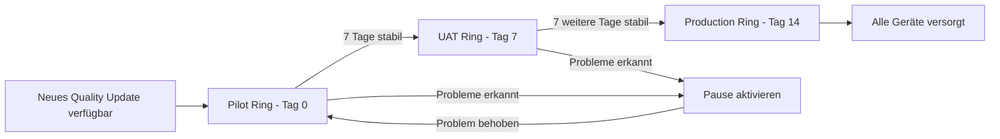

---
tags:
  - microsoft365
  - intune
  - windows-update
  - wufb
  - autopatch
aliases:
  - WUfB
  - Windows Update Intune
  - Autopatch
---

# Windows Update for Business

> [!ABSTRACT]
> Windows Update for Business (WUfB) ermöglicht die zentrale Steuerung von Windows-Updates über Microsoft Intune – ohne lokalen WSUS-Server. Update Rings, Feature Update Policies und Windows Autopatch bieten flexible Rollout-Strategien für Qualitäts-, Feature- und Treiber-Updates.

---

## Konzept und Vorteile

Windows Update for Business ist ein cloudbasierter Dienst, der Windows-Endgeräte direkt aus der Microsoft Update-Infrastruktur mit Updates versorgt. Im Gegensatz zu WSUS entfällt die lokale Server-Infrastruktur.

### WUfB vs. WSUS im Vergleich

| Kriterium | WUfB (Intune) | WSUS (ConfigMgr) |
|---|---|---|
| Infrastruktur | Kein lokaler Server | WSUS-Server erforderlich |
| Bandbreitenoptimierung | Delivery Optimization (P2P/CDN) | BranchCache / LEDBAT |
| Update-Genehmigung | Automatisch (Ringe) | Manuelle Genehmigung |
| Compliance-Reporting | Intune Reports | WSUS / ConfigMgr Reports |
| Treiber-Updates | Unterstützt | Limitiert |
| Offline-Geräte | Eingeschränkt | Lokales Netz |

### Unterstützte Update-Typen

| Update-Typ | Beschreibung |
|---|---|
| Quality Updates | Monatliche kumulative Sicherheits- und Bugfix-Updates |
| Feature Updates | Halbjährliche Windows-Versionsupgrades (z. B. 23H2 → 24H2) |
| Driver Updates | Hardware-Treiber-Updates von OEMs über Windows Update |
| Microsoft Product Updates | Office, .NET, andere Microsoft-Produkte |
| Expedited Updates | Beschleunigtes Deployment kritischer Sicherheits-Updates |

---

## Update Rings (Qualitätsupdates)

Update Rings sind der zentrale Mechanismus in WUfB. Sie steuern, wann Geräte monatliche Qualitätsupdates erhalten.

### Kerneinstellungen eines Update Rings

| Einstellung | Beschreibung | Empfohlener Wert |
|---|---|---|
| Deferral (Quality) | Verzögerung in Tagen vor Installation | Pilot: 0 / UAT: 7 / Prod: 14 |
| Deferral (Feature) | Verzögerung in Tagen für Feature Updates | Pilot: 0 / UAT: 30 / Prod: 60 |
| Deadline (Quality) | Maximale Tage bis zur erzwungenen Installation | 2–5 Tage |
| Deadline (Feature) | Maximale Tage bis zum erzwungenen Feature Update | 7–14 Tage |
| Grace Period | Tage nach Deadline bis zum erzwungenen Neustart | 2 Tage |
| Auto Restart Notification | Benachrichtigungen vor Neustart | Aktiviert |
| Pause Quality Updates | Update-Rollout temporär pausieren | Bei Problemen nutzen |
| Delivery Optimization | Bandbreitenoptimierung via P2P/CDN | HTTP + Peering |

### Active Hours (Aktive Stunden)

Verhindert Neustarts während der Arbeitszeit:

| Einstellung | Empfehlung |
|---|---|
| Active Hours Start | 08:00 Uhr |
| Active Hours End | 18:00 Uhr |
| Automatically detect | Deaktivieren – manuelle Konfiguration empfohlen |

> [!TIP]
> Setze die **Grace Period** auf mindestens 2 Tage, damit Benutzer einen Neustart verschieben können, ohne den Deadline-Termin zu verpassen.

---

## Update Ring Strategie: Pilot → UAT → Production



### Ring-Konfiguration im Detail

| Ring | Zielgruppe | Quality Deferral | Feature Deferral | Deadline |
|---|---|---|---|---|
| Pilot | IT-Team, Early Adopters (5–10 %) | 0 Tage | 0 Tage | 2 Tage |
| UAT | Power-User, Testgruppe (10–20 %) | 7 Tage | 30 Tage | 3 Tage |
| Production | Alle übrigen Geräte (70–85 %) | 14 Tage | 60 Tage | 5 Tage |
| Sensitive | Kritische Systeme (Server-ähnlich) | 21 Tage | 90 Tage | 7 Tage |

> [!NOTE]
> Weise Update Rings über **Entra ID-Gruppen** zu. Nutze dynamische Gruppen für automatische Zuweisung (z. B. nach Abteilung oder Gerätekategorie).

---

## Feature Updates

Feature Update Policies steuern, auf welche Windows-Version Geräte aktualisiert werden.

### Konfigurationsoptionen

| Einstellung | Beschreibung |
|---|---|
| Windows-Version | Ziel-OS-Version (z. B. Windows 11 24H2) |
| Rollout-Optionen | Stufenweiser Rollout oder sofort |
| Deferral | Verzögerung aus dem Update Ring gilt |
| Safeguard Holds | Microsoft blockiert ggf. inkompatible Geräte |

### Windows 11 Upgrade via Feature Update Policy

1. Feature Update Policy erstellen: **Devices → Windows → Update policies for Windows 10 and later → Feature updates**
2. Zielversion: **Windows 11, Version 24H2** auswählen
3. Gerätegruppe zuweisen (z. B. Entra-Gruppe "Win11-Piloten")
4. Rollout-Optionen: Stufenweise oder sofort
5. Compatibility Check: Autopilot/Hardware-Kompatibilität prüfen

> [!IMPORTANT]
> Microsoft setzt **Safeguard Holds** (auch Compatibility Holds genannt) für Geräte, die bekannte Inkompatibilitäten aufweisen. Diese Geräte erhalten das Feature Update erst nach Behebung des bekannten Problems, auch wenn eine Policy aktiv ist.

### Safeguard Holds verstehen

- Microsoft erkennt automatisch inkompatible Hardware/Treiber-Kombinationen
- Safeguard Holds können **nicht manuell deaktiviert** werden (außer über Opt-out-Registrierungsschlüssel)
- Betroffene Geräte werden im Update Compliance Report markiert

---

## Quality Updates (Monatlich)

Monatliche kumulative Updates enthalten Sicherheitsfixes und Fehlerbehebungen.

### Patch Tuesday Zeitplan

| Ereignis | Zeitpunkt |
|---|---|
| Patch Tuesday Release | 2. Dienstag des Monats |
| Pilot Ring Installation | Release-Tag (0 Tage Deferral) |
| UAT Ring Installation | Release + 7 Tage |
| Production Ring Installation | Release + 14 Tage |
| Erzwungener Neustart (Deadline) | Deferral + Deadline-Tage |

---

## Driver Updates

Ab 2023 bietet Intune dedizierte **Driver Update Policies** für OEM-Treiber.

### Automatisch vs. Manuell

| Modus | Verhalten |
|---|---|
| Automatisch | Neue Treiber werden automatisch zugelassen und installiert |
| Manuell (Review) | Administrator muss jeden Treiber einzeln genehmigen |

> [!WARNING]
> Automatische Treiber-Updates können bei bestimmten Unternehmensgeräten problematisch sein (z. B. spezielle Grafikkarten-Treiber). Empfehlung: Erst im Pilot-Ring testen.

### Driver Update Policy Einstellungen

| Einstellung | Beschreibung |
|---|---|
| Approval Type | Automatic oder Manual |
| Deployment Rings | Gleiche Ring-Struktur wie Quality Updates |
| Pause | Manuelle Pause für Fehler-Szenarien |

---

## Expedite Updates

Ermöglicht das sofortige Deployment kritischer Sicherheits-Updates, ohne Deferral-Zeiten abzuwarten.

### Wann Expedite nutzen?

- Kritische Zero-Day-Schwachstelle veröffentlicht
- CVSS-Score ≥ 9.0 (Critical)
- Aktive Ausnutzung in the wild bekannt

### Vorgehensweise

1. **Reports → Windows Updates → Quality updates** öffnen
2. Betroffenes Update auswählen
3. **"Expedite"** → Konfiguration erstellen
4. Gerätegruppe zuweisen
5. Deadline: 0–2 Tage (je nach Dringlichkeit)

> [!DANGER]
> Expedited Updates übergehen alle Deferral-Einstellungen und erzwingen die Installation auf den zugewiesenen Geräten. Stelle sicher, dass Benutzer informiert sind und kritische Arbeiten gesichert wurden.

---

## Windows Autopatch

Windows Autopatch ist ein vollautomatischer Update-Service, der den gesamten Update-Prozess für Windows, Microsoft 365 Apps, Microsoft Edge und Teams übernimmt.

### Was Autopatch automatisiert

| Komponente | Autopatch-Funktion |
|---|---|
| Windows Quality Updates | Automatische Ring-Einteilung und Rollout |
| Windows Feature Updates | Gesteuerte Aktualisierung auf aktuelle Windows-Versionen |
| Microsoft 365 Apps | Update-Kanal-Management |
| Microsoft Edge | Automatische Edge-Updates |
| Microsoft Teams | Teams-Aktualisierungen |

### Autopatch Deployment Rings

Microsoft teilt Geräte automatisch in Ringe ein:

| Ring | Anteil | Update-Verhalten |
|---|---|---|
| Test | ~1 % | Sofortiges Update ohne Deferral |
| First | ~9 % | Kurze Deferral-Zeit |
| Fast | ~20 % | Mittlere Deferral-Zeit |
| Broad | ~70 % | Längere Deferral-Zeit |

> [!NOTE]
> Autopatch erfordert **Windows 10/11 Pro, Enterprise oder Education** sowie eine **Microsoft 365 E3-Lizenz** oder höher. Es übernimmt die Update-Ring-Verwaltung vollständig und ersetzt manuelle Ring-Konfigurationen.

### Aktivierung von Windows Autopatch

1. **Tenant Enrollment:** Intune Admin Center → **Tenant administration → Windows Autopatch → Enroll**
2. **Readiness-Prüfung:** Microsoft prüft automatisch Voraussetzungen
3. **Gerätezuweisung:** Geräte zur Autopatch-Gerätegruppe hinzufügen
4. **Monitoring:** Reports → Autopatch → Update status

---

## Update Compliance Reports in Intune

### Verfügbare Berichte

| Bericht | Pfad | Inhalt |
|---|---|---|
| Windows Update Reports | Reports → Windows updates | Übersicht aller Update-Ringe |
| Quality Update Status | Reports → Windows updates → Quality updates | Compliance je Update |
| Feature Update Status | Reports → Windows updates → Feature updates | Win-Versions-Rollout |
| Driver Update Status | Reports → Windows updates → Driver updates | Treiber-Deployment |
| Windows Autopatch | Reports → Windows Autopatch | Autopatch-spezifische Berichte |

### Wichtige Gerätezustände

| Status | Beschreibung |
|---|---|
| Up to date | Gerät hat aktuellstes Update |
| In progress | Update wird gerade installiert |
| Paused | Update durch Policy pausiert |
| Needs attention | Fehler oder Safeguard Hold aktiv |
| Pending reboot | Warte auf Neustart |

---

## Kiosk-Updates

Kiosk-Geräte (Single App oder Multi-App Kiosk) erfordern spezielle Update-Behandlung:

- **Wartungsfenster:** Updates nur nachts oder am Wochenende
- **Strenge Deadlines:** Geräte müssen up-to-date bleiben
- **Kein Benutzer-Eingriff:** Automatische Neustarts ohne Benutzer-Interaktion
- **Separate Ring:** Eigener Update Ring "Kiosk" mit angepassten Zeiten


---

## Co-Management mit WSUS und ConfigMgr

In Co-managed Umgebungen muss entschieden werden, welches System die Update-Verwaltung übernimmt.

### Workload-Zuweisung

| Workload | ConfigMgr | Intune (WUfB) |
|---|---|---|
| Windows Update Policies | ✅ WSUS-basiert | ✅ Cloud-basiert |
| Pilot Workload | Empfohlen: Intune | Für Pilotgeräte |
| Vollständige Migration | Schrittweise | Zielzustand |

> [!IMPORTANT]
> Wenn der Workload **Windows Update Policies** in ConfigMgr bleibt, werden Intune-Update-Ring-Einstellungen ignoriert. Workloads können schrittweise (Pilot → Alle) zu Intune migriert werden.

### Migrations-Schritte von WSUS zu WUfB

1. Co-Management aktivieren und Update-Workload auf Pilotgruppe setzen
2. Update Rings in Intune konfigurieren und testen
3. Pilotgruppe validieren (Compliance, Berichte)
4. Workload schrittweise auf alle Geräte ausdehnen
5. WSUS-Server abschalten (oder für andere Zwecke weiter nutzen)

---

## PowerShell: Update-Status prüfen

### Windows Update Log analysieren

```powershell
# Windows Update Log in lesbares Format konvertieren (Windows 10/11)
Get-WindowsUpdateLog -LogPath "$env:TEMP\WindowsUpdate.log"

# Letzten Neustart und Update-Datum prüfen
$lastReboot = (Get-Date) - (New-TimeSpan -Seconds (Get-CimInstance Win32_OperatingSystem).LastBootUpTime.Second)
Write-Output "Letzter Neustart: $lastReboot"

# Installierte Windows-Updates der letzten 30 Tage anzeigen
Get-HotFix | Where-Object { $_.InstalledOn -gt (Get-Date).AddDays(-30) } |
    Select-Object Description, HotFixID, InstalledOn |
    Sort-Object InstalledOn -Descending
```

### Update-Status per Graph API abfragen

```powershell
# Verbindung herstellen
Connect-MgGraph -Scopes "DeviceManagementManagedDevices.Read.All"

# Geräte mit Update-Status abrufen
$devices = Get-MgDeviceManagementManagedDevice -Filter "operatingSystem eq 'Windows'" -Select "deviceName,osVersion,complianceState,lastSyncDateTime"

# Geräte mit veraltetem OS anzeigen (vor Oktober 2023 kein Update)
$threshold = (Get-Date).AddDays(-30)
$outdated = $devices | Where-Object {
    $_.LastSyncDateTime -lt $threshold
}

Write-Output "Geräte ohne Update seit 30+ Tagen: $($outdated.Count)"
$outdated | Select-Object DeviceName, OsVersion, LastSyncDateTime | Format-Table -AutoSize
```

### Windows Update via PowerShell direkt auslösen (lokal)

```powershell
# Windows Update manuell anstoßen (benötigt PSWindowsUpdate-Modul)
Install-Module PSWindowsUpdate -Force -Scope CurrentUser
Import-Module PSWindowsUpdate

# Verfügbare Updates anzeigen
Get-WindowsUpdate -ComputerName localhost

# Alle verfügbaren Updates installieren
Install-WindowsUpdate -AcceptAll -AutoReboot -Verbose
```

---

## Fehlerbehebung Update-Probleme

### Diagnose-Tabelle

| Problem | Ursache | Lösung |
|---|---|---|
| Gerät erhält kein Update | Falscher Ring, Safeguard Hold | Ring-Zuweisung prüfen, Compliance Report ansehen |
| Update schlägt fehl (0x80070643) | Korrupte Windows-Komponenten | DISM /Online /Cleanup-Image /RestoreHealth |
| Endlosschleife beim Neustart | Treiber-Konflikt nach Update | Gerätetreiber prüfen, Update ggf. zurückrollen |
| Deferral wird ignoriert | Co-Management, WSUS-Policy überlagert | Workload-Zuweisung in ConfigMgr prüfen |
| Deadline wird nicht eingehalten | Active Hours zu groß, Gerät offline | Active Hours anpassen, Connectivity prüfen |
| Autopatch funktioniert nicht | Enrollment-Fehler | Autopatch Readiness Report prüfen |
| Feature Update blockiert | Safeguard Hold | Update Compliance Report → Safeguard Holds |
| Update pausiert (Org-Policy) | Admin hat Pause aktiviert | Pause im Admin Center aufheben |

### Diagnose-Skript auf dem Endgerät

```powershell
# WUfB-Diagnose: Aktuelle Update-Policy und Status prüfen
Write-Output "=== Windows Update Policy Status ==="

# Update-Richtlinien aus Registry lesen
$wuPolicies = Get-ItemProperty -Path "HKLM:\SOFTWARE\Policies\Microsoft\Windows\WindowsUpdate" -ErrorAction SilentlyContinue
if ($wuPolicies) {
    Write-Output "DeferQualityUpdates: $($wuPolicies.DeferQualityUpdates)"
    Write-Output "DeferQualityUpdatesPeriodInDays: $($wuPolicies.DeferQualityUpdatesPeriodInDays)"
    Write-Output "DeferFeatureUpdates: $($wuPolicies.DeferFeatureUpdates)"
    Write-Output "DeferFeatureUpdatesPeriodInDays: $($wuPolicies.DeferFeatureUpdatesPeriodInDays)"
    Write-Output "PauseQualityUpdates: $($wuPolicies.PauseQualityUpdatesStartTime)"
} else {
    Write-Output "Keine WUfB-Richtlinien in Registry gefunden"
}

# Laufende Windows Update-Dienste prüfen
Write-Output "`n=== Windows Update Dienste ==="
@("wuauserv", "UsoSvc", "BITS", "DsSvc") | ForEach-Object {
    $svc = Get-Service -Name $_ -ErrorAction SilentlyContinue
    Write-Output "$_ : $($svc.Status) / $($svc.StartType)"
}

# Windows Update Pending Reboot prüfen
Write-Output "`n=== Pending Reboot Status ==="
$pendingReboot = @(
    Test-Path "HKLM:\SOFTWARE\Microsoft\Windows\CurrentVersion\WindowsUpdate\Auto Update\RebootRequired",
    Test-Path "HKLM:\SYSTEM\CurrentControlSet\Control\Session Manager\PendingFileRenameOperations"
)
Write-Output "Reboot erforderlich: $($pendingReboot -contains $true)"
```

---

## Verwandte Notizen

- [[Intune Grundlagen]]
- [[Windows Enrollment]]
- [[Endpoint Security]]
- [[Endpoint Analytics]]
