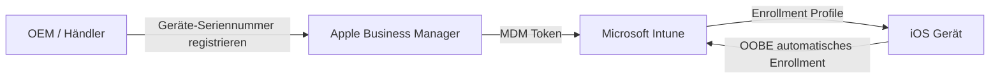
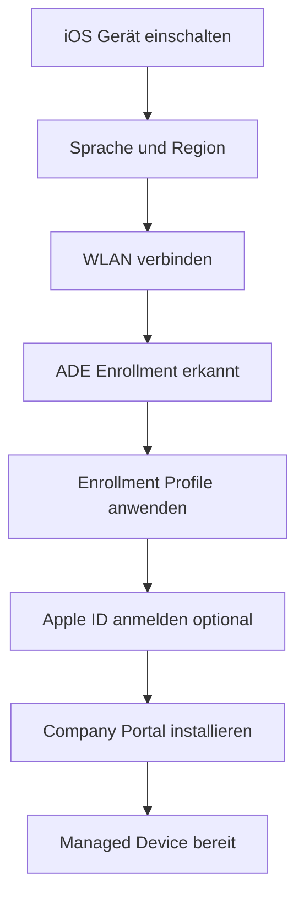
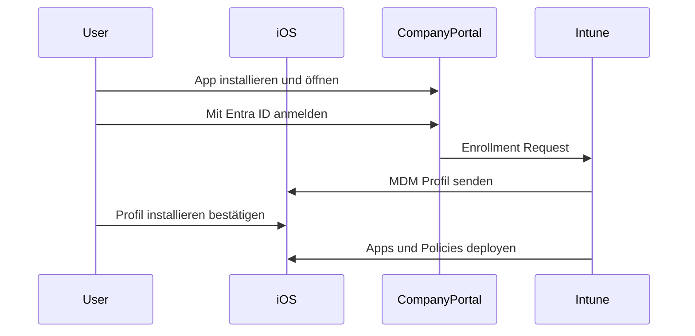

---
tags:
  - microsoft365
  - intune
  - ios
  - ipados
  - apple
  - enrollment
aliases:
  - iOS Enrollment
  - iPadOS Enrollment
  - Apple MDM Enrollment
---

# iOS und iPadOS Enrollment

> [!ABSTRACT] TL;DR
> iOS- und iPadOS-Geräte können über Apple Business Manager (ABM) mit Automated Device Enrollment (ADE/DEP) vollständig verwaltet werden — im Supervised Mode mit maximaler Kontrolltiefe. BYOD-Szenarien nutzen User Enrollment oder Device Enrollment ohne ABM. Für die Intune-Kommunikation mit Apple-Geräten ist ein Apple MDM Push Certificate zwingend erforderlich.

---

## Voraussetzung: Apple MDM Push Certificate

Bevor iOS/iPadOS-Geräte bei Intune enrollt werden können, muss ein **Apple MDM Push Certificate** konfiguriert werden.

### Einrichtung

1. **Intune Admin Center** → Devices → iOS/iPadOS → iOS/iPadOS Enrollment → **Apple MDM Push Certificate**
2. Apple-ID erstellen/verwenden (Unternehmens-Apple-ID empfohlen)
3. CSR (Certificate Signing Request) herunterladen
4. Auf **https://identity.apple.com/pushcert** hochladen und Zertifikat herunterladen
5. Zertifikat in Intune hochladen

> [!IMPORTANT]
> Das Apple MDM Push Certificate muss **jährlich erneuert** werden. Bei Ablauf verlieren alle iOS/macOS-Geräte die MDM-Verbindung. Erneuere es immer **mit derselben Apple-ID**!

### Überwachung des Ablaufdatums

```powershell
Connect-MgGraph -Scopes "DeviceManagementServiceConfig.Read.All"
$cert = Invoke-MgGraphRequest -Method GET `
    -Uri "https://graph.microsoft.com/v1.0/deviceManagement/applePushNotificationCertificate"
$cert | Select-Object appleIdentifier, expirationDateTime, lastModifiedDateTime
```

---

## Apple Business Manager (ABM) Einrichtung

**Apple Business Manager (ABM)** ist das Apple-Portal zur Geräteverwaltung für Unternehmen. Mit ABM können firmeneigene iOS/iPadOS/macOS-Geräte automatisch und im Supervised Mode deployed werden.

### ABM mit Intune verbinden

1. **ABM Portal** (business.apple.com) → Einstellungen → MDM-Server
2. Neuen MDM-Server erstellen → "Microsoft Intune" auswählen
3. MDM-Server-Token herunterladen
4. **Intune Admin Center** → Devices → iOS/iPadOS → Enrollment → **Enrollment Program Tokens**
5. Token hochladen und ABM-Geräte zuweisen



> [!TIP]
> Geräte, die über einen **autorisierten Apple-Reseller** gekauft wurden, können direkt in ABM erscheinen, wenn die Kunden-ID beim Kauf angegeben wurde.

---

## Automated Device Enrollment (ADE / DEP)

**ADE** (früher Device Enrollment Program / DEP) ist die bevorzugte Enrollment-Methode für firmeneigene iOS/iPadOS-Geräte.

### Eigenschaften von ADE

| Merkmal | ADE Supervised |
|---------|---------------|
| **Supervision** | Automatisch aktiviert |
| **Enrollment verhinderbar** | Nein (Gerätelevel-Sperre) |
| **Remote Wipe** | Vollständig |
| **Maximale Kontrolle** | Ja |
| **App Silent Install** | Ja |
| **Restrictions** | Umfangreich |
| **Activation Lock** | Verwaltbar |

### ADE Enrollment Profile erstellen

1. **Devices** → iOS/iPadOS → **Enrollment** → **Enrollment program tokens** → Token auswählen
2. **Profiles** → Create Profile
3. Einstellungen konfigurieren:
   - Supervised: `Yes` (empfohlen)
   - Locked enrollment: `Yes` (verhindert MDM-Entfernung)
   - Sync with computers: `Never` (verhindert iTunes-Sync)
   - Setup Assistant screens: konfigurieren welche Schritte angezeigt werden

### Setup Assistant Ablauf



---

## User Enrollment (BYOD)

**User Enrollment** ist für **private iOS/iPadOS-Geräte (BYOD)** konzipiert. Es erfordert eine **Managed Apple ID** (aus ABM/ASM) und trennt private von geschäftlichen Daten strikt.

### Eigenschaften User Enrollment

| Merkmal | User Enrollment |
|---------|----------------|
| **Supervision** | Nein |
| **Enrollment entfernen** | Benutzer kann jederzeit |
| **Private Daten einsehbar** | Nein |
| **Managed Apps** | Ja (separater Container) |
| **Certificate-based WiFi** | Ja |
| **Remote Wipe** | Nur Corporate Data |
| **Geräteinventar** | Eingeschränkt |

### Web-Based User Enrollment (ab iOS 15)

Ab iOS 15 gibt es **Web-Based Device Enrollment** ohne Company Portal App:

1. Benutzer öffnet Safari auf dem iOS-Gerät
2. Navigiert zur **Intune Company Portal Website**
3. Meldet sich mit Entra ID Konto an
4. Folgt dem Web-Enrollment-Prozess
5. MDM-Profil wird über den Browser installiert

> [!NOTE]
> Web-Based Enrollment vereinfacht den BYOD-Prozess erheblich — die Installation der Company Portal App ist nicht mehr erforderlich.

---

## Device Enrollment (ohne ABM)

Für Geräte ohne ABM-Registrierung gibt es manuelles **Device Enrollment** über die Company Portal App.

### Ablauf

1. **Company Portal App** aus dem App Store installieren
2. App öffnen → Mit Geschäftskonto anmelden
3. "Gerät registrieren" starten
4. Konfigurationsprofil installieren (MDM Profile)



> [!NOTE]
> Geräte ohne ABM sind **nicht supervised** und bieten weniger Verwaltungstiefe als ADE-Geräte.

---

## Enrollment-Typen Vergleich

| Merkmal | ADE Supervised | Device Enrollment | User Enrollment |
|---------|---------------|------------------|-----------------|
| **ABM erforderlich** | Ja | Nein | Ja (Managed Apple ID) |
| **Supervised** | Ja | Nein | Nein |
| **Enrollment entfernbar** | Nein | Ja | Ja |
| **Private Daten** | Sichtbar (Gerät) | Sichtbar | Nicht sichtbar |
| **Kiosk-Modus** | Ja | Nein | Nein |
| **Per-App VPN** | Ja | Ja | Ja |
| **Silent App Install** | Ja | Nein | Ja (Managed) |
| **Activation Lock** | Verwaltbar | Nicht verwaltbar | Nicht verwaltbar |
| **Geeignet für** | Firmeneigene Geräte | Kleine Org ohne ABM | BYOD |

---

## Volume Purchase Program (VPP) / ABM App Distribution

Mit ABM können Apps im Bulk über **Managed Distribution** erworben und deployed werden — ohne dass Benutzer eine persönliche Apple-ID benötigen.

### VPP Token in Intune einrichten

1. **ABM** → Apps und Bücher → App kaufen
2. **Intune** → Apps → **iOS VPP Token** → Token aus ABM hochladen
3. Apps erscheinen unter **Apps** → **iOS Store Apps**
4. Deployment auf Geräte oder Benutzer konfigurieren


---

## Konfigurationsprofile für iOS

### Häufige Profil-Typen

| Profil-Typ | Verwendung |
|-----------|-----------|
| **Device Restrictions** | Kamera, App Store, Safari, Screenshots sperren |
| **Wi-Fi** | Unternehmens-WLAN (WPA2-Enterprise) |
| **VPN** | Per-App VPN, Always-On VPN |
| **Email** | Exchange ActiveSync automatisch konfigurieren |
| **Certificate SCEP/PKCS** | Für Geräteauthentifizierung |
| **Trusted Certificate** | Root CA installieren |
| **Single Sign-On** | Kerberos SSO Extension |
| **Wallpaper** | Unternehmenslogo als Hintergrundbild |
| **Home Screen Layout** | App-Anordnung auf Supervised Geräten |

---

## Supervised Mode Features

Im **Supervised Mode** (nur ADE) sind zusätzliche Verwaltungsfunktionen verfügbar:

| Feature | Supervised | Nicht Supervised |
|---------|-----------|-----------------|
| Silent App Installation | ✅ | ❌ |
| Kiosk / Single App Mode | ✅ | ❌ |
| Activation Lock verwalten | ✅ | ❌ |
| App Store sperren | ✅ | ❌ |
| iMessage / FaceTime sperren | ✅ | ❌ |
| AirDrop sperren | ✅ | ❌ |
| Globaler HTTP-Proxy | ✅ | ❌ |
| Web Content Filter | ✅ | ❌ |
| Lost Mode via Intune | ✅ | ❌ |
| Software Update erzwingen | ✅ | ❌ |

> [!TIP]
> **Lost Mode** (nur Supervised) ermöglicht das Sperren eines verlorenen Geräts und das Anzeigen einer Kontaktnachricht auf dem Sperrbildschirm — direkt aus dem Intune Admin Center.

---

## Fehlerbehebung iOS Enrollment

### Häufige Probleme

| Problem | Ursache | Lösung |
|---------|---------|--------|
| Enrollment schlägt fehl | Apple MDM Push Cert abgelaufen | Zertifikat erneuern |
| ADE-Profil wird nicht angewendet | Token abgelaufen | ABM-Token in Intune erneuern |
| Company Portal zeigt Fehler | Keine Intune-Lizenz | Lizenz dem Benutzer zuweisen |
| VPP Apps installieren nicht | VPP Token inaktiv | Token erneut synchronisieren |
| Gerät nicht in ABM sichtbar | Falscher Reseller | Direkt bei Apple registrieren |
| MDM Profil lässt sich nicht installieren | Datenschutzeinstellung | Gerät auf Werkseinstellungen zurücksetzen |

### Diagnose

```bash
# Auf dem iOS-Gerät: Einstellungen → Datenschutz & Sicherheit
# → VPN & Geräteverwaltung → Management Profile → More Details
# MDM-Profil-Details und Certificate anzeigen
```

```powershell
# Enrollment-Status via Graph API prüfen
Connect-MgGraph -Scopes "DeviceManagementManagedDevices.Read.All"
$devices = Invoke-MgGraphRequest -Method GET `
    -Uri "https://graph.microsoft.com/v1.0/deviceManagement/managedDevices?`$filter=operatingSystem eq 'iOS'"
$devices.value | Select-Object deviceName, enrolledDateTime, complianceState, managedDeviceOwnerType
```

> [!TIP]
> Für tiefgehende Diagnose: **Apple Configurator 2** auf Mac installieren und Gerät per USB verbinden → Console-Logs einsehen.

---

## Verwandte Notizen

- [[Intune Grundlagen]]
- [[App Management MAM]]
- [[Compliance Policies]]
- [[Konfigurationsprofile]]
- [[macOS Enrollment]]
