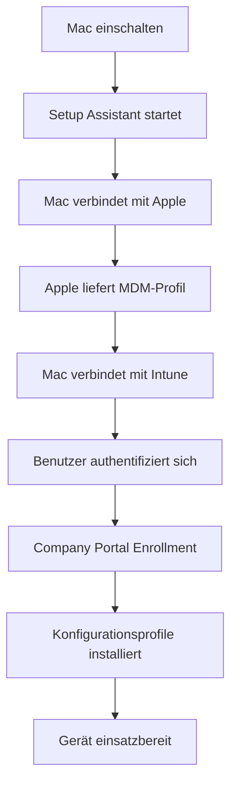

# macOS Enrollment

> [!ABSTRACT]
> macOS-Geräte werden über Apple Business Manager (ABM) und Automated Device Enrollment (ADE) in Microsoft Intune verwaltet. Platform SSO ermöglicht nahtlose Entra-ID-Anmeldung auf dem Mac. Dieser Artikel erklärt den vollständigen Enrollment-Prozess, Konfigurationsprofile, FileVault-Verwaltung, Shell-Script-Deployment und macOS-spezifische Besonderheiten wie Bootstrap Token, System Extensions und Rosetta 2.

---

## Voraussetzungen

| Anforderung | Details |
|---|---|
| Apple Business Manager (ABM) | Kostenloses Apple-Programm für Unternehmen |
| Intune-Lizenz | Microsoft 365 Business Premium, EMS E3/E5 oder Intune Plan 1 |
| Apple MDM Push Certificate | Wird jährlich über das Apple Developer Portal erneuert |
| macOS-Version | macOS 11 Big Sur oder neuer (empfohlen: macOS 13+) |
| Company Portal App | Für Platform SSO und manuelle Enrollments erforderlich |
| ABM-Token in Intune | MDM-Server-Token aus ABM hochladen |

> [!IMPORTANT]
> Das Apple MDM Push Certificate ist an eine Apple-ID gebunden. Verwende eine **unternehmenseigene Apple-ID**, nie eine private. Läuft das Zertifikat ab, verlieren alle verwalteten Macs ihre MDM-Verbindung.

### Apple MDM Push Certificate einrichten

```bash
# Schritt 1: CSR-Datei in Intune herunterladen
# Intune > Geräte > macOS > Enrollment > Apple MDM Push Certificate

# Schritt 2: Auf https://identity.apple.com mit Apple-ID anmelden
# CSR hochladen → PEM-Datei herunterladen

# Schritt 3: PEM-Datei in Intune hochladen
```

---

## Apple Business Manager für Mac

Apple Business Manager ist das zentrale Portal für die Verwaltung von Apple-Geräten in Unternehmen. Macs, die über autorisierte Reseller oder den Apple Online Store bestellt werden, erscheinen automatisch in ABM.

### ABM-Token in Intune konfigurieren

```
Intune > Geräte > macOS > Enrollment > Enrollment Program Tokens > Hinzufügen
```

1. **MDM-Server-Token herunterladen** — In Intune einen neuen Token generieren
2. **MDM-Server in ABM anlegen** — ABM > MDM-Server > Microsoft Intune
3. **Token hochladen** — Die `.p7m`-Datei in ABM hochladen
4. **Token aus ABM herunterladen** — Neuen Token von ABM in Intune importieren
5. **Geräte zuweisen** — In ABM Geräte dem Intune MDM-Server zuweisen

> [!NOTE]
> ABM-Token müssen jährlich erneuert werden. Intune zeigt eine Warnung 30 Tage vor Ablauf an. Bei Ablauf können keine neuen ADE-Enrollments mehr durchgeführt werden.

### Geräte manuell zu ABM hinzufügen

Macs, die nicht über ABM-Reseller gekauft wurden, können über Apple Configurator 2 nachträglich zu ABM hinzugefügt werden:

```bash
# Apple Configurator 2 auf einem vorhandenen Mac installieren
# Mac mit USB-C oder Lightning an den Configurator-Mac anschließen
# Gerät vorbereiten > Organisation auswählen > MDM-Server: Intune
```

> [!WARNING]
> Dieser Prozess setzt den Mac vollständig zurück. Alle Daten gehen verloren. Nur für neue oder vollständig gesicherte Geräte geeignet.

---

## Automated Device Enrollment (ADE)

ADE (früher DEP – Device Enrollment Program) ermöglicht Zero-Touch-Deployment: Macs werden beim ersten Start automatisch mit Intune verbunden, ohne dass IT-Personal das Gerät anfassen muss.

### ADE-Profil erstellen

```
Intune > Geräte > macOS > Enrollment > Enrollment Program Tokens > [Token auswählen] > Profile > Erstellen
```

**Wichtige ADE-Profileinstellungen:**

| Einstellung | Empfehlung | Beschreibung |
|---|---|---|
| Setup Assistant überspringen | Selektiv | Datenschutz, Standort deaktivieren |
| Await Final Configuration | Aktivieren | Mac wartet auf Intune-Profile |
| Benutzer-Affinität | Mit Affinität | Für Single-User-Geräte |
| Authentication | Company Portal | Sicherste Methode |
| Supervised | Immer aktivieren | Ermöglicht maximale Verwaltung |
| Locked Enrollment | Optional | Verhindert MDM-Entfernung |

### ADE-Ablauf



> [!TIP]
> Mit **Await Final Configuration** wartet der Mac im Setup Assistant, bis alle Intune-Profile installiert sind. So ist das Gerät sofort nach dem ersten Login vollständig konfiguriert.

---

## Platform SSO

Platform SSO ermöglicht die Integration von macOS mit Entra ID (Azure AD), sodass Benutzer sich mit ihren Unternehmensanmeldedaten am Mac anmelden können.

### Funktionsweise


### Platform SSO Konfigurationsprofil

Platform SSO wird über ein **Settings Catalog**-Profil in Intune konfiguriert:

```
Intune > Geräte > Konfigurationsprofile > Erstellen > macOS > Settings Catalog
Kategorie: Extensible Single Sign On
```

**Wichtige Einstellungen:**

| Einstellung | Wert |
|---|---|
| Extension Identifier | `com.microsoft.CompanyPortalMac.ssoextension` |
| Type | Redirect |
| URLs | `https://login.microsoftonline.com`, `https://login.microsoft.com` |
| Authentication Method | Password oder Secure Enclave |
| Registration Token | Entra ID Tenant ID |

> [!IMPORTANT]
> Platform SSO erfordert macOS 13 Ventura oder neuer und die **Company Portal App Version 5.2310 oder neuer**. Die Company Portal App muss via Intune deployed sein, bevor Platform SSO greift.

### Secure Enclave vs. Password Authentication

| Methode | Vorteile | Nachteile |
|---|---|---|
| Password | Kompatibel mit allen Macs | Passwort muss manuell synchronisiert werden |
| Secure Enclave | Phishing-resistent, kein Passwort nötig | Nur macOS 14+ mit Apple Silicon oder T2-Chip |

---

## Manuelles MDM-Enrollment

Für Macs ohne ABM-Zuordnung (z.B. ältere Geräte oder Privatgeräte im BYOD-Szenario):

### Via Company Portal

```bash
# 1. Company Portal App von https://aka.ms/CompanyPortalMac herunterladen
# 2. Company Portal öffnen und mit Unternehmenskonto anmelden
# 3. "Dieses Gerät registrieren" auswählen
# 4. MDM-Profil in Systemeinstellungen installieren
```

### Via Systemeinstellungen

```
Systemeinstellungen > Datenschutz & Sicherheit > Profile > Profil hinzufügen
```

> [!NOTE]
> Manuell enrollte Macs sind **nicht Supervised**. Dadurch sind bestimmte Verwaltungsoptionen eingeschränkt, z.B. können bestimmte Systemeinstellungen nicht gesperrt werden und Kernel Extensions können nicht per MDM genehmigt werden.

---

## Bootstrap Token

Der Bootstrap Token ist ein kryptografisches Token, das Intune für FileVault-Entsperrung und Softwareinstallation auf verwalteten Macs verwendet.

### Funktion des Bootstrap Tokens

- **FileVault Recovery** — Ermöglicht FileVault-Wiederherstellung ohne Benutzereingriff
- **Kernel Extension Genehmigung** — MDM kann KEXTs ohne Benutzerinteraktion genehmigen
- **System Extension Genehmigung** — Erlaubt Genehmigung von System Extensions per MDM
- **macOS Updates** — Ermöglicht MDM-gesteuerte macOS-Updates ohne Benutzerlogin

### Bootstrap Token überprüfen

```bash
# Auf dem Mac prüfen, ob Bootstrap Token vorhanden ist
sudo profiles status -type bootstraptoken

# Ausgabe bei vorhandenem Token:
# Bootstrap Token supported on server: YES
# Bootstrap Token exists on disk: YES
# Bootstrap Token escrowed to server: YES
```

> [!IMPORTANT]
> Der Bootstrap Token wird automatisch hinterlegt, wenn sich ein Benutzer zum ersten Mal an einem ADE-enrollten Mac anmeldet. Bei manuellem Enrollment muss der Benutzer Admin-Rechte haben.

---

## System Extensions vs Kernel Extensions

### Kernel Extensions (KEXTs) — Legacy

Kernel Extensions laufen im macOS-Kernel und sind seit macOS 11 deprecated. Apple empfiehlt die Migration zu System Extensions.

```bash
# Installierte KEXTs anzeigen
kextstat | grep -v apple

# KEXT manuell laden (nicht empfohlen in Produktion)
sudo kextload /Library/Extensions/mein.kext
```

**MDM-Genehmigung für KEXTs (Settings Catalog):**
```
Kategorie: Kernel Extension Policy
- Allowed Team Identifiers: [Team-ID des Herstellers]
- Allowed Kernel Extensions: [Bundle-ID der KEXT]
```

### System Extensions — Modern

System Extensions laufen im User Space und sind sicherer als KEXTs:

| Typ | Verwendung | Beispiele |
|---|---|---|
| Network Extension | VPN, Firewalls, Content Filter | Cisco AnyConnect, Zscaler |
| Endpoint Security Extension | EDR, Antivirus | CrowdStrike, Defender |
| Driver Extension | Hardware-Treiber | Druckertreiber, USB-Geräte |

**MDM-Genehmigung für System Extensions:**
```
Settings Catalog > System Extension > Allowed System Extensions
- Team ID: [Hersteller Team-ID]
- Allowed System Extension Types: SystemExtensionsEndpointSecurity
```

> [!TIP]
> Verwende den **System Extension Policy**-Profiltyp im Settings Catalog, um System Extensions per MDM zu genehmigen. Ohne diese Genehmigung sieht der Benutzer einen Sicherheitshinweis und muss die Extension manuell erlauben.

---

## Konfigurationsprofile

### Settings Catalog (Empfohlen)

Settings Catalog ist die moderne Methode zur Konfiguration von macOS-Einstellungen. Er enthält über 1000 macOS-spezifische Einstellungen:

```
Intune > Geräte > Konfigurationsprofile > Erstellen > macOS > Settings Catalog
```

**Häufig genutzte Kategorien:**

| Kategorie | Typische Einstellungen |
|---|---|
| Restrictions | Siri, iCloud, App Store deaktivieren |
| Privacy Preferences Policy Control | Datenschutz-Zugriffsrechte für Apps |
| Disk Management | Externe Laufwerke einschränken |
| Firewall | macOS Application Firewall aktivieren |
| Login Window | Anmeldefenster-Optionen |
| Notifications | App-Benachrichtigungen konfigurieren |
| Software Update | Automatische Updates steuern |

### Custom Profiles (Mobileconfig)

Für Einstellungen, die nicht im Settings Catalog verfügbar sind, können `.mobileconfig`-Dateien erstellt werden:

```xml
<?xml version="1.0" encoding="UTF-8"?>
<!DOCTYPE plist PUBLIC "-//Apple//DTD PLIST 1.0//EN"
  "http://www.apple.com/DTDs/PropertyList-1.0.dtd">
<plist version="1.0">
<dict>
    <key>PayloadContent</key>
    <array>
        <dict>
            <key>PayloadType</key>
            <string>com.apple.MCX</string>
            <key>PayloadVersion</key>
            <integer>1</integer>
            <key>PayloadIdentifier</key>
            <string>com.contoso.screensaver</string>
            <key>PayloadUUID</key>
            <string>A1B2C3D4-E5F6-7890-ABCD-EF1234567890</string>
            <key>loginWindowScreenSaverModulePath</key>
            <string>/System/Library/Screen Savers/Flurry.saver</string>
        </dict>
    </array>
    <key>PayloadDisplayName</key>
    <string>Screensaver Konfiguration</string>
    <key>PayloadIdentifier</key>
    <string>com.contoso.screensaver.profile</string>
    <key>PayloadType</key>
    <string>Configuration</string>
    <key>PayloadUUID</key>
    <string>B2C3D4E5-F6A7-8901-BCDE-F12345678901</string>
    <key>PayloadVersion</key>
    <integer>1</integer>
</dict>
</plist>
```

> [!NOTE]
> Custom Profiles werden in Intune unter `Geräte > Konfigurationsprofile > Erstellen > macOS > Vorlagen > Custom` hochgeladen. Die Datei muss signiert sein (empfohlen) oder unsigned hochgeladen werden.

### Compliance Policies für macOS

```
Intune > Geräte > Compliance Policies > Erstellen > macOS
```

| Einstellung | Empfohlener Wert |
|---|---|
| Min. Betriebssystemversion | 13.0 |
| Max. Betriebssystemversion | Leer lassen |
| Systemintegrität | Erforderlich |
| FileVault | Erforderlich |
| Firewall | Erforderlich |
| Gatekeeper | App Store und identifizierte Entwickler |

### Gatekeeper

Gatekeeper kontrolliert, welche Apps auf dem Mac ausgeführt werden dürfen:

| Einstellung | Beschreibung |
|---|---|
| App Store | Nur Apps aus dem App Store |
| App Store und identifizierte Entwickler | Apps mit gültiger Apple-Signatur |
| Überall | Keine Einschränkung (nicht empfohlen) |

```bash
# Gatekeeper-Status prüfen
spctl --status

# Gatekeeper aktivieren
sudo spctl --master-enable

# Gatekeeper deaktivieren (nicht empfohlen)
sudo spctl --master-disable
```

---

## FileVault-Verwaltung

FileVault ist Apples Festplattenverschlüsselung für macOS. Intune kann FileVault aktivieren und den Recovery Key zentral hinterlegen.

### FileVault via Intune aktivieren

```
Intune > Endpoint Security > Disk Encryption > Erstellen > macOS
```

**Empfohlene Einstellungen:**

| Einstellung | Wert | Beschreibung |
|---|---|---|
| FileVault aktivieren | Ja | Verschlüsselung erzwingen |
| Recovery Key rotieren | Aktiviert | Key nach Nutzung rotieren |
| Escrow Location | Intune | Key in Intune hinterlegen |
| Escrow Timeout | 30 Tage | Frist zur Key-Hinterlegung |
| Key für Benutzer ausblenden | Optional | Verhindert Key-Anzeige beim Benutzer |

### FileVault Recovery Key auslesen

```powershell
# Via Microsoft Graph API
$deviceId = "DEVICE-ID"
$uri = "https://graph.microsoft.com/beta/informationProtection/bitlocker/recoveryKeys"

# Für macOS FileVault
$uri = "https://graph.microsoft.com/beta/deviceManagement/managedDevices/$deviceId/getFileVaultKey"
Invoke-MgGraphRequest -Method GET -Uri $uri
```

```bash
# Auf dem Mac: FileVault-Status prüfen
fdesetup status

# Alle FileVault-Benutzer anzeigen
sudo fdesetup list

# Recovery Key anzeigen (erfordert Admin-Passwort)
sudo fdesetup changerecovery -personal
```

> [!IMPORTANT]
> Der FileVault Recovery Key wird nur **einmalig** in Intune hinterlegt. Wenn der Key geändert wird ohne Intune-Rotation, geht der Zugriff verloren. Aktiviere immer die automatische Key-Rotation.

---

## Shell Scripts deployen

Intune ermöglicht das Deployen von Shell-Scripts auf macOS-Geräten:

```
Intune > Geräte > macOS > Shell Scripts > Hinzufügen
```

### Script-Einstellungen

| Einstellung | Optionen | Empfehlung |
|---|---|---|
| Als angemeldetem Benutzer ausführen | Ja/Nein | Nein für System-Konfigurationen |
| Script-Ausführung maximieren | Ja/Nein | Ja für lange Scripts |
| Script-Häufigkeit | Einmal / Bei jedem Login / Täglich | Nach Anwendungsfall |
| Maximale Fehleranzahl | 3 | Standard beibehalten |

### Beispiel: Homebrew installieren

```bash
#!/bin/bash
# homebrew_install.sh
# Läuft als root via Intune Shell Script

set -e

# Prüfen ob Homebrew bereits installiert ist
if command -v brew &>/dev/null; then
    echo "Homebrew ist bereits installiert"
    exit 0
fi

# Homebrew als Benutzer installieren (nicht als root)
CURRENT_USER=$(stat -f "%Su" /dev/console)
echo "Installiere Homebrew für Benutzer: $CURRENT_USER"

sudo -u "$CURRENT_USER" /bin/bash -c \
    "$(curl -fsSL https://raw.githubusercontent.com/Homebrew/install/HEAD/install.sh)" </dev/null

echo "Homebrew erfolgreich installiert"
exit 0
```

### Beispiel: macOS-Einstellungen konfigurieren

```bash
#!/bin/bash
# configure_macos_settings.sh

# Finder: Versteckte Dateien anzeigen
defaults write com.apple.finder AppleShowAllFiles -bool true

# Dock: Automatisch ausblenden
defaults write com.apple.dock autohide -bool true
defaults write com.apple.dock autohide-delay -float 0

# Screenshot-Format auf JPG setzen
defaults write com.apple.screencapture type jpg

# Finder neu starten
killall Finder 2>/dev/null || true
killall Dock 2>/dev/null || true

echo "Einstellungen erfolgreich konfiguriert"
exit 0
```

> [!TIP]
> Scripts werden als `.zsh` ausgeführt. Die Ausgabe (stdout und stderr) wird in den Intune-Logs gespeichert und kann unter `Geräte > [Gerät] > Shell Script States` eingesehen werden.

### Script-Ausführung überwachen

```powershell
# Via Graph API: Script-Status für alle Geräte abrufen
$scriptId = "SCRIPT-ID"
$uri = "https://graph.microsoft.com/beta/deviceManagement/deviceShellScripts/$scriptId/deviceRunStates"
$response = Invoke-MgGraphRequest -Method GET -Uri $uri
$response.value | Select-Object deviceName, runState, lastStateUpdateDateTime
```

---

## Software Deployment

### PKG-Dateien deployen

PKG ist das bevorzugte Format für macOS-Anwendungen in Intune:

```
Intune > Apps > macOS > Hinzufügen > Branchen-App (macOS)
```

**Anforderungen:**
- PKG muss signiert und notarisiert sein
- Maximale Dateigröße: 8 GB
- PKG muss für stilles Installieren konfiguriert sein

```bash
# PKG auf Signierung prüfen
pkgutil --check-signature /path/to/app.pkg

# PKG-Inhalt anzeigen
pkgutil --expand /path/to/app.pkg /tmp/pkg_contents
```

### DMG-Dateien deployen

DMGs können nicht direkt in Intune hochgeladen werden. Alternativen:

1. **DMG zu PKG konvertieren** — Mit `pkgbuild` oder Packages.app
2. **Shell Script** — DMG mounten, App kopieren, DMG unmounten

```bash
#!/bin/bash
# dmg_deploy.sh — App aus DMG installieren

APP_NAME="MeineApp"
DMG_URL="https://download.example.com/meineapp.dmg"
DMG_PATH="/tmp/${APP_NAME}.dmg"

# DMG herunterladen
curl -L -o "$DMG_PATH" "$DMG_URL"

# DMG mounten
MOUNT_POINT=$(hdiutil attach "$DMG_PATH" -nobrowse -quiet | tail -n1 | awk '{print $NF}')

# App in Applications kopieren
cp -R "${MOUNT_POINT}/${APP_NAME}.app" /Applications/

# DMG unmounten und aufräumen
hdiutil detach "$MOUNT_POINT" -quiet
rm -f "$DMG_PATH"

echo "${APP_NAME} erfolgreich installiert"
exit 0
```

### macOS App Store Apps via VPP

Volume Purchase Program (VPP) Apps werden über ABM gekauft und via Intune deployt:

```
Intune > Apps > macOS > Hinzufügen > macOS App Store App
```

> [!NOTE]
> VPP-Apps erfordern einen aktiven ABM-VPP-Token in Intune. Apps können **Required** (erzwungen) oder **Available** (Unternehmensportal) zugewiesen werden.

---

## Rosetta 2 auf Apple Silicon

Apple Silicon Macs (M1/M2/M3/M4) können Intel-Apps via Rosetta 2 ausführen. Intune kann Rosetta 2 automatisch installieren.

### Rosetta 2 via Intune deployen

```bash
#!/bin/bash
# rosetta2_install.sh

# Prüfen ob Apple Silicon
if [ "$(uname -m)" != "arm64" ]; then
    echo "Kein Apple Silicon - Rosetta 2 nicht erforderlich"
    exit 0
fi

# Prüfen ob Rosetta 2 bereits installiert
if /usr/bin/pgrep -q oahd; then
    echo "Rosetta 2 ist bereits installiert"
    exit 0
fi

# Rosetta 2 installieren
/usr/sbin/softwareupdate --install-rosetta --agree-to-license

echo "Rosetta 2 erfolgreich installiert"
exit 0
```

> [!TIP]
> Dieses Script kann als Intune Shell Script deployt werden und stellt sicher, dass Rosetta 2 auf allen Apple Silicon Macs verfügbar ist, ohne manuelle Benutzerinteraktion.

### Intel vs Apple Silicon Apps erkennen

```bash
# App-Architektur prüfen
file /Applications/MeineApp.app/Contents/MacOS/MeineApp

# Universal Binary (läuft nativ auf beiden):
# MeineApp: Mach-O universal binary with 2 architectures

# Nur Intel:
# MeineApp: Mach-O 64-bit executable x86_64

# Nur Apple Silicon:
# MeineApp: Mach-O 64-bit executable arm64
```

---

## Via Microsoft Intune Admin Center (UI)

### macOS-Enrollment über die UI konfigurieren

1. Öffne das **Microsoft Intune Admin Center** unter [intune.microsoft.com](https://intune.microsoft.com)

#### Apple MDM Push Certificate einrichten (falls noch nicht vorhanden)

2. Navigiere zu **Geräte → macOS → Enrollment → Apple MDM Push Certificate**
3. Lade den CSR herunter, erstelle das Zertifikat auf [identity.apple.com/pushcert](https://identity.apple.com/pushcert) und lade es hoch

#### ADE-Profil für macOS erstellen

4. Navigiere zu **Geräte → macOS → Enrollment → Enrollment-Programmtoken**
5. Wähle den ABM-Token → **Profile → + Profil erstellen → macOS**
6. Konfiguriere:
   - **Benutzeraffinität:** `Mit Benutzeraffinität registrieren`
   - **Überwacht:** `Ja`
   - **Registrierungssperre:** `Ja`
   - **Setup-Assistent-Schritte:** nicht benötigte Schritte ausblenden (Datenschutz, Apple ID, Bildschirmzeit)
7. Klicke auf **Weiter → Erstellen**
8. Weise das Profil den gewünschten ABM-Geräten zu

#### FileVault-Verwaltung aktivieren

9. Navigiere zu **Endpunktsicherheit → Datenträgerverschlüsselung → + Richtlinie erstellen**
10. Wähle **Plattform: macOS** und **Profil: FileVault**
11. Konfiguriere:
    - **FileVault aktivieren:** `Ja`
    - **Wiederherstellungsschlüssel-Rotation:** `1 Monat`
    - **Escrow-Beschreibung für Wiederherstellungsschlüssel:** Informationstext für Benutzer
12. Weise die Richtlinie einer macOS-Gerätegruppe zu → **Weiter → Erstellen**

#### macOS-Konfigurationsprofil (Settings Catalog) erstellen

13. Navigiere zu **Geräte → macOS → Konfigurationsprofile → + Profil erstellen**
14. Wähle **Plattform: macOS** und **Profiltyp: Einstellungskatalog**
15. Klicke auf **+ Einstellungen hinzufügen** und suche nach den gewünschten Kategorien (z. B. **Passwort**, **Firewall**, **Sicherheits- und Datenschutz**)
16. Konfiguriere die gewünschten Einstellungen → **Weiter → Zuweisungen → Erstellen**

> [!TIP]
> Den **Bootstrap Token**-Status eines macOS-Geräts kannst du im Admin Center unter **Geräte → [Gerät auswählen] → Übersicht** einsehen. Der Bootstrap Token wird automatisch hinterlegt, wenn das Gerät bei Intune enrollt und der Benutzer sich anmeldet.

---

## Troubleshooting

### Häufige Probleme und Lösungen

| Problem | Ursache | Lösung |
|---|---|---|
| Enrollment schlägt fehl | MDM Push Certificate abgelaufen | Certificate erneuern |
| ADE-Profil wird nicht angewendet | Gerät nicht in ABM | Gerät in ABM prüfen/zuweisen |
| Profile werden nicht installiert | Synchronisierungsfehler | Gerät in Intune manuell synchronisieren |
| FileVault Key nicht in Intune | Bootstrap Token fehlt | Gerät neu enrollen oder Key manuell hinterlegen |
| Shell Script schlägt fehl | Falscher Interpreter | Shebang-Zeile und Berechtigungen prüfen |
| Platform SSO funktioniert nicht | Company Portal veraltet | Company Portal aktualisieren |

### Diagnose-Befehle

```bash
# MDM-Enrollment-Status prüfen
sudo profiles status -type enrollment

# Alle installierten Profile anzeigen
sudo profiles list -all

# MDM-Kommunikation prüfen
sudo /usr/libexec/mdmclient QueryDeviceInformation

# Intune Company Portal Logs
# ~/Library/Logs/Company\ Portal/

# MDM-Logs auf dem Mac
log show --predicate 'subsystem == "com.apple.ManagedClient"' --last 1h

# Gerät manuell mit Intune synchronisieren
sudo /usr/libexec/mdmclient SendIdleNotifications
```

### Intune-seitige Diagnose

```powershell
# Graph API: Gerätestatus abrufen
$deviceName = "MacBook-Pro-001"
$uri = "https://graph.microsoft.com/v1.0/deviceManagement/managedDevices?`$filter=deviceName eq '$deviceName'"
$device = Invoke-MgGraphRequest -Method GET -Uri $uri
$device.value | Select-Object deviceName, complianceState, enrollmentType, managementState

# Konfigurationsprofil-Status abrufen
$deviceId = $device.value[0].id
$uri = "https://graph.microsoft.com/beta/deviceManagement/managedDevices/$deviceId/deviceConfigurationStates"
$states = Invoke-MgGraphRequest -Method GET -Uri $uri
$states.value | Select-Object displayName, state, errorDescription
```

> [!TIP]
> Die **Managed Device Diagnostic** im Azure Portal (Intune > Geräte > [Gerät] > Gerätediagnose) sammelt automatisch Logs vom Mac und zeigt sie in Intune an. Das spart oft den Umweg über Remote-Zugriff.

---

## Verwandte Notizen

- [[Compliance Policies]]
- [[Konfigurationsprofile]]
- [[App Management MAM]]
