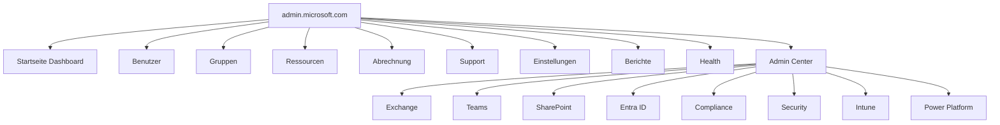
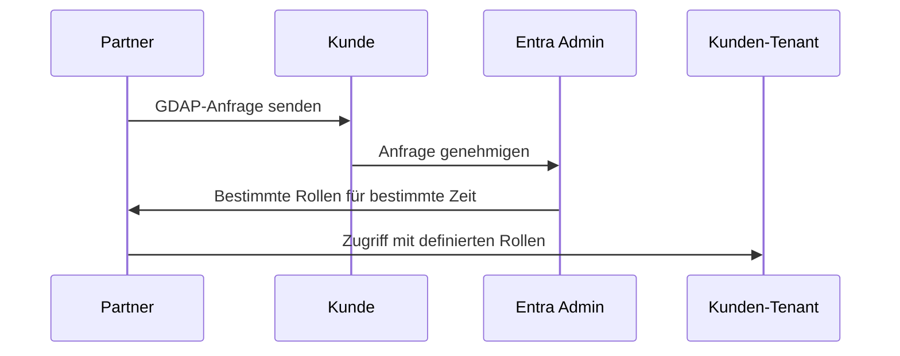

# M365 Admin Center

> [!ABSTRACT] TL;DR
> Das **Microsoft 365 Admin Center** (admin.microsoft.com) ist die zentrale Schaltzentrale für alle M365-Verwaltungsaufgaben. Es bietet Zugriff auf Benutzer- und Lizenzverwaltung, Health-Dashboard, Nachrichten-Center und verlinkt zu allen Unteradmin-Centern (Exchange, Teams, SharePoint, Entra ID, Intune usw.).

---

## Navigation und Aufbau

Das Admin Center ist in mehrere Hauptbereiche unterteilt:



### Startseite (Dashboard)

Die Startseite zeigt:
- **Karten** mit wichtigen KPIs (aktive Benutzer, Speichernutzung)
- **Service Health**: Aktueller Status aller M365-Dienste
- **Nachrichten-Center**: Neue Features und Ankündigungen
- **Schulungsvideos** und Schnellaktionen

> [!TIP] Startseite anpassen
> Über den Button "Karten anpassen" lässt sich das Dashboard personalisieren. Nicht benötigte Karten ausblenden, wichtige fixieren.

---

## Via Microsoft 365 Admin Center (UI)

### Benutzer erstellen

1. Melde dich an beim **Microsoft 365 Admin Center** unter [admin.microsoft.com](https://admin.microsoft.com)
2. Navigiere zu **Benutzer → Aktive Benutzer**
3. Klicke auf **Benutzer hinzufügen**
4. Gib Name, Anzeigename und Benutzerprinzipalname (E-Mail-Adresse) ein
5. Stelle **Nutzungsstandort** auf *Deutschland* ein
6. Wähle die gewünschte **Lizenz** aus
7. Weise bei Bedarf eine **Admin-Rolle** zu
8. Klicke auf **Fertig stellen → Hinzufügen**

### Lizenz zuweisen oder ändern

1. Melde dich an beim **Microsoft 365 Admin Center** unter [admin.microsoft.com](https://admin.microsoft.com)
2. Navigiere zu **Benutzer → Aktive Benutzer**
3. Klicke auf den gewünschten Benutzer → Tab **Lizenzen und Apps**
4. Aktiviere oder deaktiviere die gewünschten **Lizenzen**
5. Klicke auf **Änderungen speichern**

### Admin-Rolle zuweisen

1. Melde dich an beim **Microsoft 365 Admin Center** unter [admin.microsoft.com](https://admin.microsoft.com)
2. Navigiere zu **Rollen → Rollenzuweisungen**
3. Wähle die gewünschte Rolle (z.B. *Benutzeradministrator*)
4. Klicke auf **Admins hinzufügen**
5. Suche nach dem Benutzer und wähle ihn aus → **Speichern**

### Dienststatus prüfen

1. Melde dich an beim **Microsoft 365 Admin Center** unter [admin.microsoft.com](https://admin.microsoft.com)
2. Navigiere zu **Integrität → Dienststatus**
3. Überprüfe den Status aller M365-Dienste (Grün = Normal, Gelb = Eingeschränkt, Rot = Incident)

---

## Benutzer und Lizenzen verwalten

### Benutzer erstellen

**Admin Center → Benutzer → Aktive Benutzer → Benutzer hinzufügen**

```powershell
# Benutzer per PowerShell (Microsoft Graph) erstellen
Connect-MgGraph -Scopes "User.ReadWrite.All"

$passwordProfile = @{
    Password = "TempP@ssw0rd!"
    ForceChangePasswordNextSignIn = $true
}

New-MgUser -DisplayName "Max Mustermann" `
    -UserPrincipalName "max.mustermann@contoso.de" `
    -MailNickname "max.mustermann" `
    -PasswordProfile $passwordProfile `
    -AccountEnabled $true `
    -UsageLocation "DE"
```

### Lizenzen zuweisen

```powershell
# Verfügbare SKUs anzeigen
Get-MgSubscribedSku | Select-Object SkuPartNumber, ConsumedUnits, @{N='Total';E={$_.PrepaidUnits.Enabled}}

# Lizenz einem Benutzer zuweisen
$userId = (Get-MgUser -Filter "userPrincipalName eq 'max.mustermann@contoso.de'").Id
$skuId = (Get-MgSubscribedSku | Where-Object { $_.SkuPartNumber -eq "SPE_E3" }).SkuId

Set-MgUserLicense -UserId $userId `
    -AddLicenses @{SkuId = $skuId} `
    -RemoveLicenses @()
```

---

## Admin-Rollen im Überblick

Microsoft 365 nutzt das **RBAC-Modell** (Role-Based Access Control). Rollen werden in Entra ID verwaltet und gelten für alle M365-Dienste.

### Häufig genutzte Rollen

| Rolle | Berechtigungen | Wann vergeben? |
|-------|---------------|----------------|
| **Globaler Administrator** | Vollzugriff auf alles | Maximal 2-4 Personen, NUR für Admin-Aufgaben |
| **Globaler Leser** | Lesezugriff auf alles (kein Schreiben) | Revisoren, Audits |
| **Benutzeradministrator** | Benutzer/Gruppen verwalten | Helpdesk, HR-Admins |
| **Lizenzadministrator** | Lizenzen zuweisen/entziehen | Lizenz-Management |
| **Exchange-Administrator** | Exchange Online verwalten | E-Mail-Admins |
| **Teams-Administrator** | Teams-Dienst verwalten | Teams-Admins |
| **SharePoint-Administrator** | SharePoint/OneDrive verwalten | Intranet-Admins |
| **Helpdesk-Administrator** | Kennwörter zurücksetzen, MFA deaktivieren | IT-Support |
| **Sicherheitsadministrator** | Defender, Purview, Sicherheitsrichtlinien | Security-Team |
| **Complianceadministrator** | Purview Compliance-Portal | Compliance-Beauftragte |
| **Abrechnungsadministrator** | Abonnements und Abrechnung | IT-Leitung, Einkauf |
| **Authentifizierungsadministrator** | MFA-Methoden zurücksetzen | Helpdesk Level 2 |
| **Intune-Administrator** | Geräte- und App-Verwaltung | Endpoint-Admins |
| **Power Platform-Administrator** | Power Apps/Automate/BI verwalten | Power-Platform-Admins |

> [!DANGER] Global Admin schützen
> Der Global Administrator hat unbegrenzten Zugriff auf alle Daten und Einstellungen. Empfehlungen:
> - Maximal 2-4 Global Admins (für Redundanz)
> - Dedizierte Admin-Konten (nicht das normale Arbeitskonto verwenden)
> - MFA ist Pflicht
> - **Privileged Identity Management (PIM)** für Just-in-Time-Zugriff nutzen (erfordert Entra ID P2)

```powershell
# Alle Global Admins anzeigen
Connect-MgGraph -Scopes "RoleManagement.Read.Directory"

$globalAdminRole = Get-MgDirectoryRole | Where-Object { $_.DisplayName -eq "Global Administrator" }
Get-MgDirectoryRoleMember -DirectoryRoleId $globalAdminRole.Id | 
    Select-Object Id, @{N='DisplayName';E={(Get-MgUser -UserId $_.Id).DisplayName}}
```

---

## Alle Unteradmin-Center

| Admin Center | URL | Verwaltet |
|-------------|-----|----------|
| **M365 Admin Center** | admin.microsoft.com | Hauptverwaltung |
| **Exchange Admin Center** | admin.exchange.microsoft.com | E-Mail, Postfächer, Kalender |
| **Teams Admin Center** | admin.teams.microsoft.com | Teams, Meetings, Telefonie |
| **SharePoint Admin Center** | <tenant>-admin.sharepoint.com | Sites, OneDrive, Freigaben |
| **Entra Admin Center** | entra.microsoft.com | Identität, Gruppen, App-Registrierungen |
| **Intune Admin Center** | intune.microsoft.com | Geräte, Apps, Richtlinien |
| **Microsoft 365 Defender** | security.microsoft.com | Sicherheitscenter (XDR) |
| **Microsoft Purview** | compliance.microsoft.com | Compliance, DLP, eDiscovery |
| **Power Platform Admin** | admin.powerplatform.microsoft.com | Power Apps/Automate/BI |
| **Azure Admin** | portal.azure.com | Azure-Ressourcen |
| **Viva Insights** | insights.viva.office.com | Produktivitäts-Analytics |

---

## Delegierte Administration (Partner/MSP)

Microsoft-Partner (CSP/MSP) können Kunden-Tenants verwalten, ohne eigene Konten im Kunden-Tenant zu haben:

### GDAP (Granular Delegated Admin Privileges)

Seit 2023 ersetzt **GDAP** das ältere DAP (Delegated Admin Privileges):



**Vorteile von GDAP gegenüber DAP:**
- **Granulare Rollen**: Nicht pauschal Global Admin, sondern z.B. nur Exchange Admin
- **Zeitbegrenzt**: Zugriff läuft automatisch ab (max. 2 Jahre)
- **Auditierbar**: Alle Partner-Aktionen werden geloggt
- **Sicherer**: Kein dauerhafter ungekontrollierter Zugriff

> [!IMPORTANT] MSPs müssen auf GDAP migrieren
> DAP wurde bis Ende 2023 abgelöst. Alle Microsoft-Partner müssen GDAP nutzen. Kunden sollten prüfen, ob ihre MSPs/Partner auf GDAP umgestellt haben.

---

## Häufige Verwaltungsaufgaben

### Kennwort zurücksetzen

```powershell
# Kennwort zurücksetzen (Benutzer muss beim nächsten Login ändern)
Update-MgUser -UserId "max.mustermann@contoso.de" `
    -PasswordProfile @{
        Password = "NewTempP@ss2024!"
        ForceChangePasswordNextSignIn = $true
    }
```

### Benutzer sperren/entsperren

```powershell
# Benutzer sperren
Update-MgUser -UserId "user@contoso.de" -AccountEnabled $false

# Benutzer entsperren
Update-MgUser -UserId "user@contoso.de" -AccountEnabled $true
```

### Postfach-Größen prüfen

```powershell
# Exchange Online PowerShell
Connect-ExchangeOnline

Get-EXOMailbox -ResultSize Unlimited | 
    Get-EXOMailboxStatistics | 
    Select-Object DisplayName, TotalItemSize, ItemCount |
    Sort-Object TotalItemSize -Descending |
    Select-Object -First 20
```

### Gruppen-Mitgliedschaft verwalten

```powershell
# Mitglieder einer Gruppe anzeigen
$groupId = (Get-MgGroup -Filter "displayName eq 'Marketing'").Id
Get-MgGroupMember -GroupId $groupId | ForEach-Object {
    Get-MgUser -UserId $_.Id | Select-Object DisplayName, UserPrincipalName
}

# Benutzer zu Gruppe hinzufügen
New-MgGroupMember -GroupId $groupId -DirectoryObjectId $userId
```

---

## Service Health und Nachrichten-Center

### Service Health

**Admin Center → Health → Service Health**

Zeigt den aktuellen Status aller M365-Dienste in Echtzeit:
- 🟢 **Normal**: Dienst funktioniert einwandfrei
- 🟡 **Advisory**: Eingeschränkte Funktionalität für einige Benutzer
- 🔴 **Incident**: Aktives Problem, Microsoft arbeitet daran

```powershell
# Service Health per API prüfen
Connect-MgGraph -Scopes "ServiceHealth.Read.All"

Get-MgServiceAnnouncementHealthOverview | 
    Select-Object Service, Status | 
    Where-Object { $_.Status -ne "serviceOperational" }
```

### Nachrichten-Center

Das **Nachrichten-Center** (Admin Center → Health → Nachrichten-Center) informiert über:
- Neue Features (mit "Act by"-Datum)
- Änderungen an bestehenden Features
- Ankündigungen zur Einstellung von Features

> [!TIP] Nachrichten-Center abonnieren
> Unter "Einstellungen → E-Mail-Benachrichtigungen" können Admin-Rollen automatisch per E-Mail über neue Nachrichten informiert werden. Empfehlung: Täglich oder wöchentlich für alle Admins aktivieren.

---

## Microsoft 365 Admin App (Mobile)

Die **M365 Admin-App** (iOS und Android) ermöglicht unterwegs:
- Benutzer erstellen, sperren, Kennwörter zurücksetzen
- Service Health überwachen
- Nachrichten-Center lesen
- Support-Tickets öffnen

> [!NOTE] Eingeschränkter Funktionsumfang
> Die Mobile-App bietet nicht alle Funktionen des Web-Admin-Centers. Für komplexe Konfigurationen immer das Web-Interface oder PowerShell nutzen.

---

## Microsoft 365 Roadmap

Die **M365 Roadmap** (microsoft.com/en-us/microsoft-365/roadmap) zeigt:
- **In Entwicklung**: Features die gerade gebaut werden
- **Vorschau**: Features in öffentlicher Beta
- **Kürzlich gestartet**: Neu veröffentlichte Features

Filter-Optionen nach: Produkt, Release-Zeitraum, Status, Cloud-Instanz

> [!TIP] Roadmap für Change Management nutzen
> Die Roadmap ist ein wichtiges Tool für die **Change-Management-Planung**. Neue Features, die Benutzer-Workflows verändern, können frühzeitig identifiziert und in Kommunikationspläne eingeplant werden.

---

## Troubleshooting: Häufige Admin-Probleme

> [!WARNING] "Sie haben keine Berechtigung"
> Wenn eine Aktion im Admin Center verweigert wird: Prüfen, ob die korrekte Admin-Rolle zugewiesen ist. Manche Aktionen (z.B. E-Discovery, Compliance) erfordern spezifische Rollen, nicht nur Global Admin.

> [!BUG] Admin Center lädt nicht
> - **Inkognito-Modus** testen (Browser-Cache-Problem)
> - **Anderen Browser** testen
> - Status unter **status.office.com** prüfen
> - Proxy/Firewall: Admin Center benötigt Zugriff auf `*.admin.microsoft.com` und `login.microsoftonline.com`

> [!WARNING] MFA-Anforderung beim ersten Login
> Neue Tenants haben seit 2023 **Security Defaults** aktiviert, was MFA für alle erzwingt. Wenn der erste Global Admin sich nicht anmelden kann, MFA-Methode registrieren (Authenticator-App empfohlen).

---

## Verwandte Notizen

- [[Was ist Microsoft 365]]
- [[M365 Lizenzmodelle und Pläne]]
- [[M365 Tenant-Verwaltung]]
- [[Microsoft 365 Apps]]
