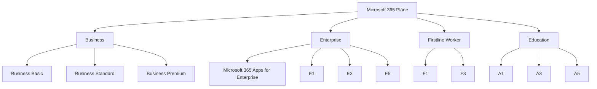
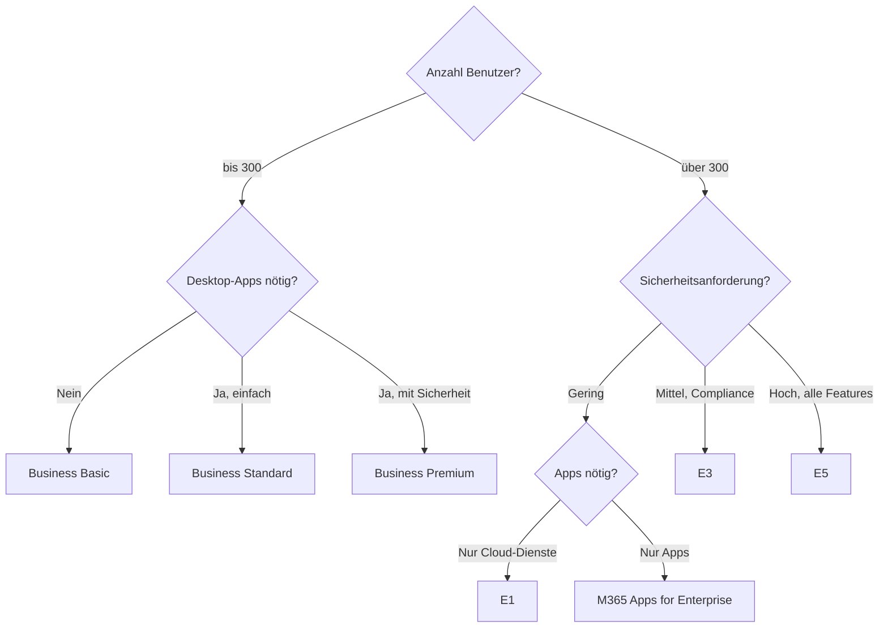

# M365 Lizenzmodelle und Pläne

> [!ABSTRACT] TL;DR
> Microsoft 365 bietet Pläne für jede Unternehmensgröße: **Business-Pläne** für bis zu 300 Benutzer, **Enterprise-Pläne** (E1/E3/E5) ab 1 Benutzer ohne Mengenlimit, **F-Pläne** für Firstline Worker und **Education/Non-Profit**-Varianten. Die richtige Wahl hängt von App-Bedarf, Sicherheitsanforderungen und Budget ab.

---

## Planübersicht nach Zielgruppe



---

## Business-Pläne (bis 300 Benutzer)

Business-Pläne sind für **KMU bis 300 Benutzer** konzipiert. Sie bieten alle wesentlichen Funktionen ohne die Komplexität der Enterprise-Pläne.

| Feature | Business Basic | Business Standard | Business Premium |
|---------|---------------|-------------------|-----------------|
| **Preis/Monat/User** | ~6 € | ~12,50 € | ~22 € |
| Web-/Mobile-Apps | ✅ | ✅ | ✅ |
| Desktop-Apps (Word, Excel, etc.) | ❌ | ✅ | ✅ |
| Exchange Online (50 GB) | ✅ | ✅ | ✅ |
| SharePoint Online | ✅ | ✅ | ✅ |
| Microsoft Teams | ✅ | ✅ | ✅ |
| OneDrive (1 TB) | ✅ | ✅ | ✅ |
| Intune (MDM) | ❌ | ❌ | ✅ |
| Entra ID P1 | ❌ | ❌ | ✅ |
| Defender for Business | ❌ | ❌ | ✅ |
| Azure AD P1 / Conditional Access | ❌ | ❌ | ✅ |
| Information Protection P1 | ❌ | ❌ | ✅ |

> [!TIP] Wann Business Premium?
> **Business Premium** ist die Empfehlung für KMU, die Sicherheit ernst nehmen. Intune + Entra ID P1 + Defender for Business machen es zur sichersten Business-Option und sind im Vergleich zu separaten Add-ons sehr günstig.

---

## Enterprise-Pläne (unbegrenzte Benutzer)

Enterprise-Pläne haben **keine Benutzerobergrenze** und enthalten erweiterte Compliance-, Sicherheits- und Analytics-Funktionen.

| Feature | M365 Apps | E1 | E3 | E5 |
|---------|-----------|-----|-----|-----|
| **Preis/Monat/User** | ~12 € | ~8 € | ~36 € | ~54 € |
| Desktop-Apps | ✅ | ❌ | ✅ | ✅ |
| Exchange Online | ❌ | ✅ (2 GB) | ✅ (100 GB) | ✅ (Unlimited) |
| SharePoint Online | ❌ | ✅ | ✅ | ✅ |
| Teams | ❌ | ✅ | ✅ | ✅ |
| OneDrive (1 TB) | ✅ | ✅ | ✅ | ✅ |
| Intune | ❌ | ❌ | ✅ | ✅ |
| Entra ID P1 | ❌ | ❌ | ✅ | ✅ |
| Entra ID P2 | ❌ | ❌ | ❌ | ✅ |
| Defender for Office 365 P1 | ❌ | ❌ | ❌ | ✅ |
| Defender for Office 365 P2 | ❌ | ❌ | ❌ | ✅ |
| Purview Compliance P2 | ❌ | ❌ | ❌ | ✅ |
| Power BI Pro | ❌ | ❌ | ❌ | ✅ |
| Teams Phone System | ❌ | ❌ | ❌ | ✅ |
| Audio Conferencing | ❌ | ❌ | ❌ | ✅ |
| eDiscovery (Premium) | ❌ | ❌ | ❌ | ✅ |

> [!NOTE] E1 ohne Desktop-Apps
> Microsoft 365 E1 enthält **keine installierbaren Office-Apps**. Benutzer arbeiten ausschließlich über den Browser. Für Desktop-Apps muss entweder E3/E5 oder **Microsoft 365 Apps for Enterprise** zusätzlich lizenziert werden.

---

## Firstline Worker Pläne (F1/F3)

Für **gewerbliche Mitarbeiter ohne festen Büroarbeitsplatz** (Fertigung, Einzelhandel, Gesundheitswesen, Logistik):

| Feature | F1 | F3 |
|---------|-----|-----|
| **Preis/Monat/User** | ~2,25 € | ~8 € |
| Microsoft Teams (kein Scheduling) | ✅ Eingeschränkt | ✅ |
| Exchange Online (2 GB) | ❌ (nur Exchange Kiosk) | ✅ |
| SharePoint Online | ✅ (Konsum) | ✅ |
| OneDrive | 2 GB | 2 GB |
| Microsoft 365 Apps | ❌ | ❌ |
| Teams Shifts | ✅ | ✅ |
| Walkie Talkie (Teams) | ✅ | ✅ |
| Intune | ❌ | ✅ |

> [!INFO] F1 Einschränkungen
> F1-Benutzer können keine E-Mails senden/empfangen (nur Exchange Kiosk) und keine Desktop-Apps installieren. Ideal für Mitarbeiter, die nur Teams auf dem Smartphone benötigen.

---

## Microsoft 365 Apps for Enterprise/Business

**Reine App-Lizenzen** ohne Cloud-Dienste:

| Plan | Zielgruppe | Apps |
|------|-----------|------|
| **M365 Apps for Business** | Bis 300 User | Word, Excel, PowerPoint, Outlook, OneNote, Access, Publisher |
| **M365 Apps for Enterprise** | Unbegrenzt | Word, Excel, PowerPoint, Outlook, OneNote, Access, Publisher + erweiterte Verwaltung |

Diese Pläne sind sinnvoll wenn:
- Exchange/SharePoint On-Premises weiter genutzt wird
- Nur die Desktop-Apps benötigt werden
- Als Add-on zu E1 (für Desktop-Apps)

---

## Add-ons und Erweiterungen

Wichtige Add-ons, die separat lizenziert werden können:

| Add-on | Funktion | Preis (ca.) |
|--------|---------|------------|
| **Teams Phone Essentials** | Telefonanlage in Teams | ~7 €/User/Monat |
| **Teams Phone Standard** | Vollständige PBX | ~8 €/User/Monat |
| **Teams Calling Plan** | Anrufminuten (PSTN) | ~12 €/User/Monat |
| **Defender for Office 365 P1** | Anti-Phishing, Safe Links | ~2 €/User/Monat |
| **Entra ID P1** | Conditional Access, SSPR | ~6 €/User/Monat |
| **Entra ID P2** | PIM, Identity Protection | ~9 €/User/Monat |
| **Intune Plan 1** | MDM/MAM | ~8 €/User/Monat |
| **Power BI Pro** | BI-Berichte | ~10 €/User/Monat |
| **Microsoft 365 Copilot** | KI-Assistent | ~30 €/User/Monat |
| **Viva Suite** | Alle Viva-Module | ~12 €/User/Monat |
| **Advanced Compliance** | eDiscovery Premium | im E5 enthalten |

> [!TIP] E5 als Bündel-Deal
> Microsoft 365 E5 enthält zahlreiche Add-ons (Defender P2, Entra P2, Purview P2, Power BI Pro, Teams Phone). Bei mehr als 3-4 Add-ons auf E3-Basis ist E5 oft **günstiger als E3 + Add-ons**.

---

## Via Microsoft 365 Admin Center (UI)

### Lizenzüberblick und verfügbare Lizenzen prüfen

1. Melde dich an beim **Microsoft 365 Admin Center** unter [admin.microsoft.com](https://admin.microsoft.com)
2. Navigiere zu **Abrechnung → Ihre Produkte**
3. Prüfe alle aktiven Abonnements sowie verbrauchte und verfügbare Lizenzen

### Lizenz einem Benutzer zuweisen

1. Melde dich an beim **Microsoft 365 Admin Center** unter [admin.microsoft.com](https://admin.microsoft.com)
2. Navigiere zu **Benutzer → Aktive Benutzer**
3. Klicke auf den gewünschten Benutzer → Tab **Lizenzen und Apps**
4. Setze einen Haken bei der gewünschten Lizenz
5. Deaktiviere ggf. einzelne Service-Pläne unter **Apps**
6. Klicke auf **Änderungen speichern**

### Gruppenbasierte Lizenzierung konfigurieren

1. Melde dich an beim **Entra Admin Center** unter [entra.microsoft.com](https://entra.microsoft.com)
2. Navigiere zu **Identität → Gruppen → Alle Gruppen**
3. Wähle eine Gruppe aus → **Lizenzen**
4. Klicke auf **Zuweisung hinzufügen**
5. Wähle den Lizenzplan und deaktiviere ggf. einzelne Dienste
6. Klicke auf **Speichern**

### Lizenznutzung und Kosten prüfen

1. Melde dich an beim **Microsoft 365 Admin Center** unter [admin.microsoft.com](https://admin.microsoft.com)
2. Navigiere zu **Berichte → Verwendung → Lizenzen** für eine Übersicht über zugewiesene und verfügbare Lizenzen
3. Über **Abrechnung → Rechnungen und Zahlungen** sind vergangene Rechnungen einsehbar

---

## Gruppenbasierte Lizenzierung

Lizenzen können in Entra ID **automatisch über Gruppen** zugewiesen werden. Dies vereinfacht das Management erheblich.

```powershell
# Gruppenbasierte Lizenzierung per PowerShell (Microsoft Graph)
# Gruppe mit Lizenz verknüpfen
$groupId = "xxxxxxxx-xxxx-xxxx-xxxx-xxxxxxxxxxxx"
$skuId = "yyyyyyyy-yyyy-yyyy-yyyy-yyyyyyyyyyyy"  # E3 SKU-ID

# Lizenz der Gruppe zuweisen
Set-MgGroupLicense -GroupId $groupId -AddLicenses @{SkuId = $skuId} -RemoveLicenses @()
```

> [!IMPORTANT] Voraussetzungen für gruppenbasierte Lizenzierung
> Gruppenbasierte Lizenzierung erfordert **Entra ID P1** (enthalten in E3, E5, Business Premium). Ohne diese Lizenz müssen Lizenzen manuell pro Benutzer zugewiesen werden.

Schritte zur Einrichtung:
1. Im **Entra Admin Center** → Gruppen → Gruppe auswählen
2. **Lizenzen** → Zuweisung hinzufügen
3. Plan auswählen, ggf. Service-Pläne deaktivieren
4. Automatische Zuweisung für alle Gruppenmitglieder aktiv

---

## Wann welcher Plan? – Entscheidungshilfe



---

## Kostenoptimierung

> [!TIP] Kostenoptimierungs-Strategien
> - **Mixed Licensing**: E3 für Knowledge Worker, F3 für Firstline Worker
> - **Inaktive Benutzer**: Lizenzen deaktivierter Konten entfernen (30 Tage Aufbewahrungsfrist für Daten)
> - **Jahresabonnement**: 15-20% Rabatt gegenüber Monatsabonnement
> - **Microsoft Cloud Solution Provider (CSP)**: Oft günstiger als direkt von Microsoft
> - **Non-Profit**: Bis zu 75% Rabatt über Microsoft Tech for Social Impact
> - **Bildungseinrichtungen**: Microsoft 365 A1 ist kostenlos (Web-Apps only)

```powershell
# Lizenzbericht: Benutzer ohne zugewiesene Dienste
Connect-MgGraph -Scopes "User.Read.All", "Organization.Read.All"

Get-MgUser -All -Property DisplayName, AssignedLicenses, UserPrincipalName |
    Where-Object { $_.AssignedLicenses.Count -eq 0 } |
    Select-Object DisplayName, UserPrincipalName |
    Export-Csv -Path "UnlicensedUsers.csv" -NoTypeInformation
```

---

## Lizenz-Aktivierungs-Übersicht prüfen

```powershell
# Aktuell verbrauchte Lizenzen anzeigen
Connect-MgGraph -Scopes "Directory.Read.All"

Get-MgSubscribedSku | Select-Object SkuPartNumber, ConsumedUnits,
    @{N='Total';E={$_.PrepaidUnits.Enabled}},
    @{N='Available';E={$_.PrepaidUnits.Enabled - $_.ConsumedUnits}} |
    Format-Table -AutoSize
```

---

## Troubleshooting: Häufige Lizenzprobleme

> [!WARNING] Häufige Fehler bei der Lizenzierung
> - **Doppelte Lizenzierung**: Benutzer hat E3 und Business Standard – E3 ist führend, Business Standard-Features werden teilweise doppelt gezählt
> - **Fehlende Service-Pläne**: Einzelne Dienste (z.B. Teams) können in einer Lizenz deaktiviert sein – im Admin Center unter Lizenzen prüfen
> - **Gruppenbasierte Lizenzkonflikt**: Wenn zwei Gruppen widersprüchliche Lizenzen zuweisen, zeigt Entra ID einen Fehler an

> [!BUG] Bekanntes Problem: Lizenzzuweisung verzögert
> Nach Lizenzzuweisung kann es bis zu **24 Stunden** dauern, bis alle Dienste vollständig verfügbar sind. Teams und Exchange sind meist schneller (< 30 Minuten), SharePoint kann länger dauern.

---

## Verwandte Notizen

- [[Was ist Microsoft 365]]
- [[M365 Tenant-Verwaltung]]
- [[M365 Admin Center]]
- [[Microsoft Copilot for M365]]
