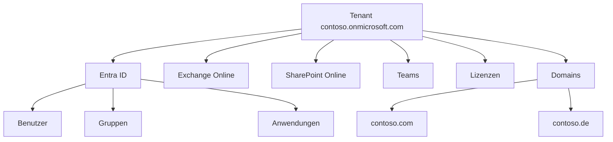
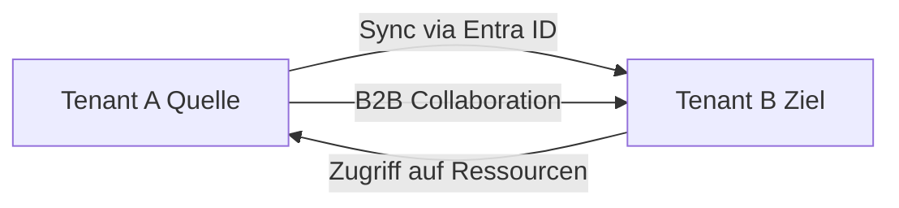

# M365 Tenant-Verwaltung

> [!ABSTRACT] TL;DR
> Der **Tenant** ist die dedizierte M365-Instanz einer Organisation. Zu den Kernadministrationsaufgaben gehören: eigene Domains hinzufügen (DNS-Einträge: MX, TXT, CNAME), Data Residency konfigurieren und Multi-Tenant-Szenarien verstehen. Ein einmal erstellter Tenant kann **nicht umgezogen** werden – vorausschauende Planung ist entscheidend.

---

## Was ist ein Tenant?

Ein Microsoft 365 Tenant ist die **logisch isolierte Instanz** aller M365-Dienste für eine Organisation. Er enthält:

- **Entra ID** (Verzeichnis mit Benutzern, Gruppen, Apps)
- **Lizenzen** und Abonnements
- **Daten** (E-Mails, Dateien, Teams-Nachrichten)
- **Konfigurationen** (Richtlinien, Einstellungen, Compliance)
- **Domains** (eigene Domains, die dem Tenant zugewiesen sind)



### Tenant-ID und Tenant-Name

Jeder Tenant hat zwei wichtige Identifikatoren:
- **Tenant-ID**: Eine GUID (z.B. `xxxxxxxx-xxxx-xxxx-xxxx-xxxxxxxxxxxx`)
- **Initial Domain**: `<name>.onmicrosoft.com` – dieser Name ist **dauerhaft** und kann nicht geändert werden

```powershell
# Tenant-ID per PowerShell abrufen
Connect-MgGraph -Scopes "Organization.Read.All"
(Get-MgOrganization).Id

# Oder über die Azure CLI
az account show --query tenantId -o tsv
```

> [!IMPORTANT] Initial Domain ist permanent
> Der Name `<name>.onmicrosoft.com` kann nach der Erstellung **niemals geändert** werden. Er wird auch für SharePoint-URLs verwendet (`<name>.sharepoint.com`). Sorgfältige Namenswahl bei der Erstellung ist wichtig.

---

## Via Microsoft 365 Admin Center (UI)

### Tenant erstellen

1. Rufe [microsoft.com/microsoft-365](https://www.microsoft.com/de-de/microsoft-365) auf
2. Wähle einen Plan → **Kostenlos testen** oder **Jetzt kaufen**
3. Klicke auf **Für Ihr Unternehmen** → **Neues Konto erstellen**
4. Gib E-Mail-Adresse, Passwort und Organisationsname ein
5. Lege den **Domainnamen** fest (`<name>.onmicrosoft.com`) – dieser ist dauerhaft und nicht änderbar
6. Wähle **Land/Region** (für EU-Datenspeicherung: *Deutschland* oder ein EU-Land)
7. Schließe die Zahlung ab

### Domain hinzufügen und verifizieren

1. Melde dich an beim **Microsoft 365 Admin Center** unter [admin.microsoft.com](https://admin.microsoft.com)
2. Navigiere zu **Einstellungen → Domänen → Domäne hinzufügen**
3. Gib deinen Domainnamen ein (z.B. `contoso.de`) → **Diese Domain verwenden**
4. Wähle die Überprüfungsmethode (**TXT-Eintrag** empfohlen)
5. Setze den angezeigten TXT-Eintrag bei deinem DNS-Anbieter
6. Klicke auf **Überprüfen** nach TTL-Ablauf
7. Konfiguriere die angezeigten **DNS-Einträge** (MX, CNAME, TXT für SPF)

### Organisationseinstellungen verwalten

1. Melde dich an beim **Microsoft 365 Admin Center** unter [admin.microsoft.com](https://admin.microsoft.com)
2. Navigiere zu **Einstellungen → Organisationseinstellungen → Organisationsprofil**
3. Ändere Name, Sprache, Zeitzone und Support-Informationen → **Speichern**

### Datenspeicherorte prüfen

1. Melde dich an beim **Microsoft 365 Admin Center** unter [admin.microsoft.com](https://admin.microsoft.com)
2. Navigiere zu **Einstellungen → Organisationseinstellungen → Datenspeicherorte**
3. Überprüfe für jeden Dienst, in welcher Region die Daten gespeichert werden

---

## Tenant erstellen

### Voraussetzungen
- Gültige E-Mail-Adresse (für Bestätigung)
- Kreditkarte oder Billing-Konto
- Eigene Domain (optional, kann später hinzugefügt werden)

### Schritte
1. **microsoft.com/microsoft-365** aufrufen → Plan auswählen → "Kostenlos testen" oder "Jetzt kaufen"
2. **Neues Konto erstellen** oder mit bestehendem Microsoft-Konto anmelden
3. **Organisationsname** und **Initial Domain** (`<name>.onmicrosoft.com`) festlegen
4. **Land/Region** auswählen – bestimmt den **primären Datenspeicherort**
5. Zahlungsinformationen eingeben
6. **Globaler Administrator** wird erstellt

> [!DANGER] Land/Region kann nicht geändert werden
> Das bei der Tenant-Erstellung gewählte Land legt die **primäre Datenregion dauerhaft fest**. Für europäische Compliance EU als Standort wählen. Eine nachträgliche Änderung des Datenspeicherorts ist nicht möglich (außer über Data Residency Add-ons).

---

## Eigene Domain hinzufügen

Standardmäßig haben Benutzer E-Mail-Adressen wie `user@contoso.onmicrosoft.com`. Mit einer eigenen Domain werden daraus `user@contoso.com`.

### Schritt 1: Domain im Admin Center hinzufügen

1. **admin.microsoft.com** → **Einstellungen → Domains → Domain hinzufügen**
2. Domainnamen eingeben (z.B. `contoso.de`)
3. Besitzernachweis-TXT-Eintrag im DNS setzen

### Schritt 2: DNS-Einträge konfigurieren

Microsoft gibt nach der Bestätigung der Domain-Eigentumsschaft die benötigten DNS-Einträge an:

| Typ | Name/Host | Wert | TTL | Zweck |
|-----|----------|------|-----|-------|
| **TXT** | `@` | `MS=msXXXXXXXX` | 3600 | Domain-Eigentumsnachweis |
| **MX** | `@` | `contoso-de.mail.protection.outlook.com` | 3600 | E-Mail-Empfang |
| **CNAME** | `autodiscover` | `autodiscover.outlook.com` | 3600 | Outlook Autodiscover |
| **CNAME** | `lyncdiscover` | `webdir.online.lync.com` | 3600 | Skype/Teams |
| **CNAME** | `sip` | `sipdir.online.lync.com` | 3600 | SIP (Teams-Telefonie) |
| **CNAME** | `enterpriseregistration` | `enterpriseregistration.windows.net` | 3600 | Geräteregistrierung |
| **CNAME** | `enterpriseenrollment` | `enterpriseenrollment.manage.microsoft.com` | 3600 | Intune-Enrollment |
| **TXT** | `@` | `v=spf1 include:spf.protection.outlook.com -all` | 3600 | SPF (Anti-Spam) |

> [!WARNING] MX-Eintrag erst nach Migration setzen
> Wenn E-Mails aktuell on-premises ankommen, den MX-Eintrag erst **nach** der vollständigen Postfach-Migration zu Exchange Online umstellen. Sonst gehen E-Mails verloren.

### DKIM einrichten

DKIM (DomainKeys Identified Mail) signiert ausgehende E-Mails und verhindert Spoofing:

```powershell
# Exchange Online PowerShell
Connect-ExchangeOnline

# DKIM-Signatur für Domain aktivieren
Set-DkimSigningConfig -Identity contoso.de -Enabled $true

# Status prüfen
Get-DkimSigningConfig -Identity contoso.de | Select-Object Domain, Enabled, Status
```

Im DNS müssen dann zwei CNAME-Einträge gesetzt werden:
- `selector1._domainkey.contoso.de` → `selector1-contoso-de._domainkey.contoso.onmicrosoft.com`
- `selector2._domainkey.contoso.de` → `selector2-contoso-de._domainkey.contoso.onmicrosoft.com`

### DMARC einrichten

```
_dmarc.contoso.de  TXT  "v=DMARC1; p=quarantine; rua=mailto:dmarc@contoso.de; pct=100"
```

---

## Multi-Tenant-Szenarien

Große Organisationen oder MSPs arbeiten häufig mit mehreren Tenants.

### Typische Szenarien

| Szenario | Beschreibung |
|----------|-------------|
| **Holding mit Tochtergesellschaften** | Jede GmbH hat eigenen Tenant |
| **Merger & Acquisition** | Zwei Tenants nach Übernahme zusammenführen |
| **MSP/Partner** | Verwaltet Kunden-Tenants über GDAP |
| **Test/Entwicklung** | Separater Developer-Tenant |

### Cross-Tenant-Synchronisation

Seit 2023 bietet Microsoft **Cross-Tenant Synchronization** in Entra ID:



```powershell
# Cross-Tenant Sync konfigurieren (Microsoft Graph)
# Quell-Tenant: Sync-Konfiguration erstellen
New-MgPolicyCrossTenantAccessPolicyPartner -TenantId "target-tenant-id"
```

### B2B Collaboration

Externe Benutzer aus anderen Tenants können als **Gäste** eingeladen werden:
- Einladung per E-Mail oder direkter Link
- Zugriff auf Teams, SharePoint, Anwendungen
- Keine separate Lizenz im eigenen Tenant nötig (in den meisten Fällen)

> [!INFO] B2B Lizenzierung
> Für einfache B2B-Zusammenarbeit (Dateizugriff, Teams-Gäste) ist **keine zusätzliche Entra-ID-Lizenz** nötig. Für erweiterte Features (Conditional Access für Gäste, Identity Governance) wird Entra ID P1/P2 benötigt.

---

## Data Residency und EU Data Boundary

### EU Data Boundary

Seit **Januar 2023** speichert Microsoft alle M365-Kundendaten für EU/EEA-Tenants in der EU:
- Exchange Online, SharePoint, OneDrive, Teams
- Entra ID
- Verarbeitung (nicht nur Speicherung) ebenfalls in der EU

### Advanced Data Residency (ADR)

ADR ist ein **kostenpflichtiges Add-on**, das die Datenspeicherung auf spezifische Länder einschränkt:

| Land | Verfügbare Workloads |
|------|---------------------|
| Deutschland | Exchange, SharePoint, OneDrive, Teams |
| Frankreich | Exchange, SharePoint, OneDrive, Teams |
| Norwegen | Exchange, SharePoint, OneDrive, Teams |
| Schweiz | Exchange, SharePoint, OneDrive, Teams |

```powershell
# Datenspeicherorte für Tenant prüfen
Connect-MgGraph -Scopes "Organization.Read.All"
(Get-MgOrganization).DataLocation
```

Im Admin Center: **Einstellungen → Organisationseinstellungen → Datenspeicherorte**

---

## Tenant-Einstellungen im Admin Center

### Wichtige Einstellungen

| Einstellung | Pfad im Admin Center | Beschreibung |
|------------|---------------------|-------------|
| **Organisationsprofil** | Einstellungen → Organisationseinstellungen | Name, Sprache, Zeitzone |
| **Sicherheitsstandards** | Entra ID → Eigenschaften | MFA erzwingen (für neue Tenants auto) |
| **Selbstbedienungs-Kennwortreset** | Entra ID → Kennwort zurücksetzen | SSPR konfigurieren |
| **Externe Freigabe** | SharePoint Admin → Richtlinien | OneDrive/SharePoint externe Freigabe |
| **Gast-Zugriff** | Entra ID → Externe Identitäten | B2B-Einladungseinstellungen |
| **Microsoft 365 Gruppen** | Admin → Einstellungen | Wer darf Gruppen erstellen |

### Tenant-Erstanmeldung Checkliste

- [ ] MFA für den Global Admin aktivieren
- [ ] Notfall-Zugriffskonto (Break-Glass) erstellen
- [ ] Eigene Domain hinzufügen und DNS konfigurieren
- [ ] SPF, DKIM, DMARC einrichten
- [ ] Sicherheitsstandards oder Conditional Access aktivieren
- [ ] Data Residency prüfen/konfigurieren
- [ ] Admin-Rollen auf dedizierte Admin-Accounts aufteilen
- [ ] Backup-Lösung für M365-Daten evaluieren

---

## Tenant-Umzug: Was ist (nicht) möglich

> [!DANGER] Tenant-Umzug ist nicht möglich
> Microsoft bietet **keinen offiziellen Tenant-Umzug** an. Die onmicrosoft.com-Domain, die SharePoint-URL und der Datenspeicherort können **nicht nachträglich geändert** werden.

### Alternativen

| Szenario | Lösung |
|----------|-------|
| **Falscher Tenant-Name** | Neuen Tenant erstellen, Daten migrieren (Aufwand!) |
| **Falscher Datenspeicherort** | Advanced Data Residency Add-on |
| **Falsche Region (EU)** | Tenant neu erstellen oder Data Residency Add-on |
| **Domain umbenennen** | Nicht möglich – neue Domain hinzufügen, alte entfernen |

### Migrations-Tools für Tenant-zu-Tenant

Bei echten Umzügen (z.B. nach M&A) werden Tools benötigt:
- **Microsoft Tenant-to-Tenant Migration** (nativ, limitiert)
- **BitTitan MigrationWiz** (kommerziell)
- **ShareGate** (kommerziell, gut für SharePoint/Teams)
- **Quest On Demand Migration** (kommerziell, Enterprise)

---

## Troubleshooting: Häufige Probleme

> [!WARNING] DNS-Probleme bei Domain-Verifikation
> - TTL-Warte: Nach DNS-Änderungen bis zu **48 Stunden** warten (TTL-abhängig)
> - TXT-Eintrag korrekt? Kein Leerzeichen vor/nach dem Wert
> - Delegierung prüfen: Wenn Domain bei Hoster, aber DNS-Delegation an anderen Provider, beim richtigen DNS-Anbieter eintragen

> [!BUG] MX-Einträge nicht aktiv nach Domain-Wechsel
> Outlook-Clients cachen Autodiscover-Informationen. Nach MX-Umstellung: Outlook-Profil neu erstellen oder `outlook /cleanprofile` ausführen.

```powershell
# DNS-Einträge prüfen
Resolve-DnsName -Name "contoso.de" -Type MX
Resolve-DnsName -Name "autodiscover.contoso.de" -Type CNAME
Resolve-DnsName -Name "_dmarc.contoso.de" -Type TXT
```

---

## Verwandte Notizen

- [[Was ist Microsoft 365]]
- [[M365 Lizenzmodelle und Pläne]]
- [[M365 Admin Center]]
