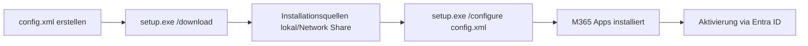
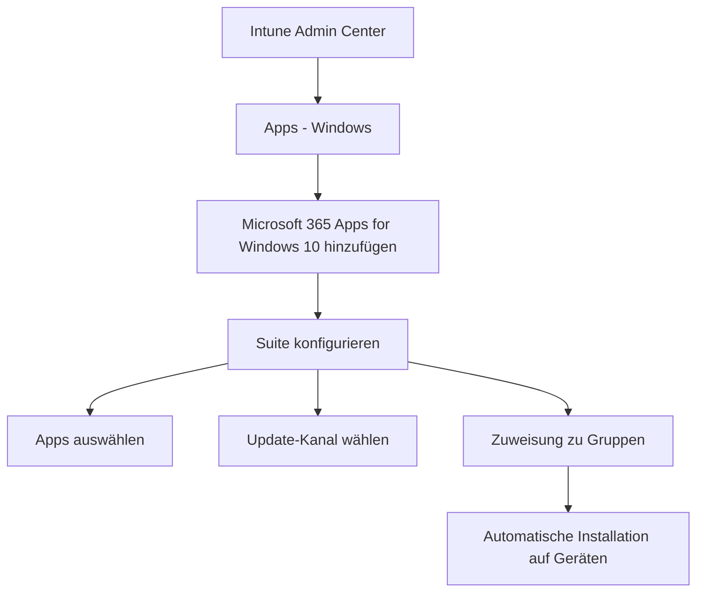

# Microsoft 365 Apps

> [!ABSTRACT] TL;DR
> **Microsoft 365 Apps** (früher Office 365 ProPlus) sind die installierbaren Desktopanwendungen von Microsoft: Word, Excel, PowerPoint, Outlook, OneNote, Access und Publisher. Über die **Click-to-Run**-Technologie werden sie kontinuierlich aktualisiert. Deployment erfolgt via **ODT** (manuell), **Intune** (Cloud) oder **SCCM/MECM** (on-premises). Die Aktivierung läuft nutzungs- oder gerätebasiert.

---

## Was sind Microsoft 365 Apps?

Microsoft 365 Apps umfassen die bekannten Office-Desktopanwendungen, die im Rahmen eines M365-Abonnements installiert werden:

| Anwendung | Funktion |
|-----------|---------|
| **Word** | Textverarbeitung |
| **Excel** | Tabellenkalkulation |
| **PowerPoint** | Präsentationen |
| **Outlook** | E-Mail- und Kalender-Client |
| **OneNote** | Notizbücher |
| **Access** | Datenbank (nur Windows) |
| **Publisher** | Desktop Publishing (nur Windows, wird eingestellt) |
| **Teams** | Nicht mehr in M365 Apps enthalten (seit 2023 separat) |
| **OneDrive** | Sync-Client (separat installiert) |

> [!NOTE] Microsoft 365 Apps vs. Office LTSC
> **Microsoft 365 Apps** erhalten kontinuierlich neue Features (monatliche Updates). **Office LTSC** (Long-Term Servicing Channel) ist die Einmal-Kauf-Version ohne Abonnement – erhält nur Sicherheitsupdates, keine neuen Features. Für moderne Workflows empfehlen sich M365 Apps.

---

## Click-to-Run Technologie

**Click-to-Run (C2R)** ist die Installationstechnologie für Microsoft 365 Apps. Sie ersetzt den klassischen Windows Installer (MSI) seit Office 2013.

### Vorteile von Click-to-Run

- **Schnelle Installation**: Anwendungen können gestartet werden, während noch Inhalte heruntergeladen werden ("Streaming")
- **Virtualisierung**: Läuft in einem isolierten Container, verhindert Konflikte mit anderen Anwendungen
- **Automatische Updates**: Neue Features und Sicherheitspatches werden automatisch im Hintergrund heruntergeladen
- **Rollback**: Automatisches Zurückrollen bei fehlerhaften Updates
- **Parallele Installation**: Mehrere Office-Versionen parallel möglich (z.B. M365 Apps + Project)

### Installationsverzeichnis und Komponenten

```
C:\Program Files\Microsoft Office\root\Office16\
C:\Program Files\Common Files\Microsoft Shared\ClickToRun\
```

```powershell
# Installierte C2R-Version prüfen
$c2rPath = "HKLM:\SOFTWARE\Microsoft\Office\ClickToRun\Configuration"
Get-ItemProperty $c2rPath | Select-Object VersionToReport, UpdateChannel, CDNBaseUrl
```

---

## Update-Kanäle

Microsoft 365 Apps bieten mehrere **Update-Kanäle** mit unterschiedlicher Update-Häufigkeit:

| Kanal | Update-Rhythmus | Zielgruppe | Empfehlung |
|-------|----------------|-----------|-----------|
| **Current Channel** | Monatlich (keine festen Termine) | Tester, Early Adopter | Pilot-Gruppe |
| **Monthly Enterprise Channel** | Monatlich (zweiter Dienstag) | Standard-Benutzer | **Empfohlen für die meisten** |
| **Semi-Annual Enterprise Channel** | Halbjährlich (Januar/Juli) | Regulierte Umgebungen | Streng kontrollierte Umgebungen |
| **Semi-Annual Enterprise Channel (Preview)** | Halbjährlich (März/September) | Validierungs-Gruppe | Testen vor breitem Rollout |
| **Beta Channel** | Wöchentlich | Insider, Feedback | Nur für Feedback/Test |

> [!TIP] Monthly Enterprise Channel für Unternehmen
> Der **Monthly Enterprise Channel** ist der beste Kompromiss: Regelmäßige Updates mit neuen Features, aber feste Termine (zweiter Dienstag = "Patch Tuesday") ermöglichen geplante Deployments.

```xml
<!-- Update-Kanal in ODT-Konfiguration festlegen -->
<Updates Enabled="TRUE" Channel="MonthlyEnterprise" />
```

```powershell
# Update-Kanal per Registry ändern
$regPath = "HKLM:\SOFTWARE\Microsoft\Office\ClickToRun\Configuration"
Set-ItemProperty -Path $regPath -Name "CDNBaseUrl" -Value "http://officecdn.microsoft.com/pr/55336b82-a18d-4dd6-b5f6-9e5095c314a6"
# MonthlyEnterprise Channel GUID: 55336b82-a18d-4dd6-b5f6-9e5095c314a6
```

---

## Office Deployment Tool (ODT)

Das **Office Deployment Tool (ODT)** ist das offizielle Werkzeug von Microsoft für die Verwaltung von M365 Apps.

### ODT herunterladen und verwenden

```powershell
# ODT von Microsoft herunterladen
# Aktuelle Version: https://www.microsoft.com/en-us/download/details.aspx?id=49117
# Nach Download: setup.exe /download config.xml → lädt Installationsdateien herunter
# setup.exe /configure config.xml → installiert
# setup.exe /uninstall config.xml → deinstalliert
```

### Beispiel: ODT-Konfigurationsdatei

```xml
<Configuration ID="M365Apps-Enterprise">
  <Add OfficeClientEdition="64" Channel="MonthlyEnterprise">
    <Product ID="O365ProPlusRetail">
      <Language ID="de-de" />
      <Language ID="en-us" />
      <ExcludeApp ID="Access" />
      <ExcludeApp ID="Publisher" />
      <ExcludeApp ID="Bing" />
    </Product>
    <Product ID="ProjectProRetail">
      <Language ID="de-de" />
    </Product>
  </Add>
  <Updates Enabled="TRUE" Channel="MonthlyEnterprise" />
  <Display Level="None" AcceptEULA="TRUE" />
  <Logging Level="Standard" Path="%temp%" />
  <Property Name="SharedComputerLicensing" Value="0" />
  <Property Name="PinIconsToTaskbar" Value="FALSE" />
  <RemoveMSI />
</Configuration>
```

> [!NOTE] Office Customization Tool (OCT)
> Microsoft bietet unter **config.office.com** ein grafisches Web-Interface zum Erstellen von ODT-Konfigurationsdateien – einfacher als manuelles XML-Schreiben.

### ODT-Deployment-Workflow



---

## Deployment-Methoden im Vergleich

| Methode | Geeignet für | Vorteile |
|---------|------------|---------|
| **ODT manuell** | Einzelne PCs, Tests | Einfach, keine Infrastruktur |
| **ODT + Software-Verteilung** | On-Premises (SCCM/MECM) | Zentrales Management, Netzwerk-Caching |
| **Microsoft Intune** | Cloud-verwaltete Geräte | Modern, kein On-Prem nötig |
| **Microsoft Endpoint Config Manager (MECM)** | Große Enterprise-Umgebungen | Feingranulare Steuerung |
| **Autopilot + Intune** | Neue Geräte | Zero-Touch-Deployment |

### Deployment via Intune



---

## Aktivierungstypen

### Benutzer-basierte Aktivierung (Standard)

Jeder lizenzierte Benutzer kann M365 Apps auf **bis zu 5 PCs, 5 Tablets und 5 Smartphones** installieren.

- Aktivierung erfolgt durch **Anmeldung mit dem Microsoft-Konto** beim ersten Start
- Wenn ein Gerät nicht mehr benötigt wird: Im Account-Portal Gerät deaktivieren

```powershell
# Aktivierungsstatus prüfen
cscript "C:\Program Files\Microsoft Office\root\Office16\OSPP.VBS" /dstatus
```

### Geräte-basierte Aktivierung (Device-Based)

Für **gemeinsam genutzte Geräte** (Schulungsräume, Kiosk-PCs, Shared Workstations):
- Lizenz wird dem Gerät, nicht dem Benutzer zugewiesen
- Jeder Benutzer kann sich anmelden und Office nutzen
- Erfordert eigene **Microsoft 365 Apps for Enterprise (Device)** SKU
- Activation über Intune oder gruppenbasierte Lizenzierung

```xml
<!-- Geräte-Aktivierung in ODT aktivieren -->
<Property Name="DeviceBasedLicensing" Value="1" />
```

### Shared Computer Activation (SCA)

**Shared Computer Activation** ist für **Remote Desktop Services (RDS) / Virtual Desktop Infrastructure (VDI)** gedacht:

```xml
<!-- Shared Computer Activation in ODT -->
<Property Name="SharedComputerLicensing" Value="1" />
```

```powershell
# SCA per Registry aktivieren
Set-ItemProperty -Path "HKLM:\SOFTWARE\Microsoft\Office\ClickToRun\Configuration" `
    -Name "SharedComputerLicensing" -Value "1"
```

> [!IMPORTANT] SCA-Voraussetzungen
> - Benutzer benötigt eine M365-Lizenz die M365 Apps enthält
> - RDS-Server braucht Internetverbindung zu Microsoft-Aktivierungsservern
> - Tokens werden gecacht (ohne Internet: 30-Tage-Toleranz)

---

## Updates verwalten

### Manuelle Update-Steuerung

```powershell
# Sofortiges Update anstoßen
$officePath = "C:\Program Files\Common Files\Microsoft Shared\ClickToRun\OfficeC2RClient.exe"
& $officePath /update user updatepromptuser=false forceappshutdown=false displaylevel=false

# Update-Status prüfen
Get-ItemProperty "HKLM:\SOFTWARE\Microsoft\Office\ClickToRun\Configuration" | 
    Select-Object VersionToReport, UpdateChannel
```

### Update-Kontrolle via Intune/MECM

- **Update-Kanal** über Konfigurationsprofil oder ODT festlegen
- **Automatische Updates deaktivieren** (nicht empfohlen, aber möglich):

```xml
<Updates Enabled="FALSE" />
```

> [!WARNING] Updates nicht dauerhaft deaktivieren
> Microsoft stellt den Sicherheitssupport für veraltete M365 Apps-Versionen nach 14 Monaten ein. Ohne Updates entstehen Sicherheitslücken. Stattdessen lieber einen kontrollierten Kanal (Monthly Enterprise Channel) nutzen.

---

## Troubleshooting Aktivierung

### Häufige Aktivierungsfehler

| Fehler | Ursache | Lösung |
|--------|---------|--------|
| **0x80070005** | Zugriffsverweigert (lokale Berechtigungen) | Als Admin ausführen |
| **0x4004F401** | KMS-Problem (Transition von Volume License) | C2R-Reset ausführen |
| **0x8004FC12** | Token abgelaufen | Neu anmelden (Abmelden → Anmelden) |
| **Abonnement abgelaufen** | Lizenz entzogen | Lizenz zuweisen, dann Aktivierung erneuern |
| **Aktivierungsassistent** loop | Korrupte Aktivierungsdaten | Aktivierungsdaten löschen |

```powershell
# Aktivierungsdaten zurücksetzen
# Office-Anmeldeinformationen aus Anmeldeinformationsverwaltung löschen
cmdkey /list | Select-String "MicrosoftOffice" | ForEach-Object {
    $target = ($_ -split "Ziel: ")[1].Trim()
    cmdkey /delete:$target
}

# Office-Aktivierungstoken zurücksetzen
Remove-Item -Path "$env:LOCALAPPDATA\Microsoft\Office\16.0\Licensing" -Recurse -Force
```

### Microsoft Support and Recovery Assistant (SaRA)

Das **SaRA-Tool** von Microsoft diagnostiziert und behebt automatisch häufige Office-Probleme:
- Download: `aka.ms/SaRA`
- Szenarien: Outlook-Probleme, Aktivierung, Teams, OneDrive

### Microsoft 365 Apps Health (Admin Center)

Im **Microsoft 365 Apps Admin Center** (config.office.com) gibt es unter "Health" einen Überblick über:
- Absturzraten nach App und Version
- Add-in-Probleme
- Geräte mit veralteten Versionen

---

## Verwandte Notizen

- [[M365 Lizenzmodelle und Pläne]]
- [[M365 Admin Center]]
- [[M365 Tenant-Verwaltung]]
