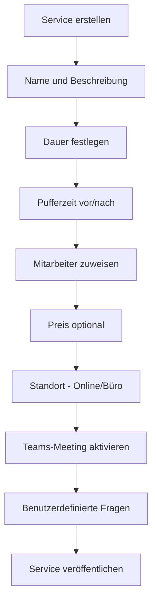
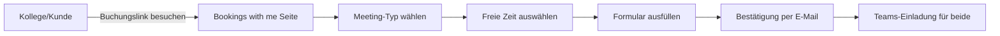

# Microsoft Bookings

> [!ABSTRACT] TL;DR
> **Microsoft Bookings** ist das integrierte Online-Terminbuchungssystem in Microsoft 365. Kunden und Kollegen können über eine öffentliche Buchungsseite selbständig Termine mit verfügbaren Mitarbeitern buchen. Die Integration mit Outlook-Kalendern verhindert Doppelbuchungen. **Bookings with me** bietet zusätzlich eine persönliche Buchungsseite pro Benutzer.

---

## Was ist Microsoft Bookings?

Microsoft Bookings löst das klassische Problem: "Haben Sie am Dienstag um 14 Uhr Zeit?" Es ermöglicht:

- **Selbstbuchung**: Kunden/Kollegen wählen eigenständig Datum und Uhrzeit
- **Kalender-Synchronisation**: Verhindert Doppelbuchungen durch Outlook-Integration
- **Teams-Meetings**: Automatische Erstellung von Teams-Besprechungslinks
- **Erinnerungen**: Automatische E-Mail-/SMS-Bestätigungen und Erinnerungen
- **Mehrere Mitarbeiter**: Buchung bei verfügbaren Teammitgliedern

### Anwendungsszenarien

| Szenario | Beschreibung |
|----------|-------------|
| IT-Helpdesk | Supporttermine online buchen |
| HR-Interviews | Vorstellungsgespräche koordinieren |
| Beratungsgespräche | Kundentermine verwalten |
| Arztpraxen | Patientenplanung (kommerziell) |
| Schulungen | Workshop-Anmeldungen |
| Behörden | Bürgertermine digital |

---

## Via Microsoft 365 Admin Center (UI)

### Microsoft Bookings für den Tenant aktivieren

1. Melde dich an beim **Microsoft 365 Admin Center** unter [admin.microsoft.com](https://admin.microsoft.com)
2. Navigiere zu **Einstellungen → Organisationseinstellungen**
3. Wähle den Tab **Dienste** → **Buchungen**
4. Aktiviere oder deaktiviere die Option **Buchungen für Ihre Organisation aktivieren**
5. Konfiguriere weitere Einstellungen (z.B. wer Buchungsseiten erstellen darf)
6. Klicke auf **Änderungen speichern**

### Neue Buchungsseite erstellen (Bookings-App)

1. Öffne die **Bookings-App** unter [bookings.office.com](https://bookings.office.com) oder über den M365 App-Launcher
2. Klicke auf **Neue Buchungsseite erstellen**
3. Gib Name und Kategorie ein → **Weiter**
4. Konfiguriere Geschäftszeiten, Logo und Zeitzone
5. Füge unter **Dienste** die buchbaren Leistungen hinzu
6. Füge unter **Mitarbeiter** die beteiligten Personen hinzu
7. Veröffentliche die Seite und teile den **Buchungslink**

---

## Voraussetzungen und Lizenzierung

> [!IMPORTANT] Lizenzanforderungen
> Microsoft Bookings ist enthalten in:
> - **Microsoft 365 Business Basic, Standard, Premium**
> - **Microsoft 365 E3, E5**
> - **Microsoft 365 F3** (eingeschränkt)
> 
> Nicht enthalten in: M365 Apps for Business/Enterprise, E1, F1

### Admin-Einstellungen

Im **M365 Admin Center** kann Bookings aktiviert/deaktiviert werden:

```powershell
# Bookings für den Tenant aktivieren/deaktivieren
Connect-ExchangeOnline

# Bookings aktivieren (Standard: aktiviert)
Set-OrganizationConfig -BookingsEnabled $true

# Bookings für alle neuen Benutzer deaktivieren
Set-OrganizationConfig -BookingsCreationOfCustomQuestionsRestricted $false
```

---

## Einrichtung: Business-Seite konfigurieren

### Schritt 1: Neue Buchungsseite erstellen

1. **bookings.office.com** aufrufen oder in **M365 Apps** → **Bookings**
2. **Erste Buchungsseite erstellen** → Name und Typ wählen
3. Buchungsseiten-Detailseite öffnet sich

### Schritt 2: Business-Informationen

**Buchungsseite → Buchungsseiteninformationen:**

| Einstellung | Beschreibung |
|------------|-------------|
| **Name** | Anzeigename der Buchungsseite |
| **Kategorie** | Branchentyp |
| **Zeitzone** | Wichtig für internationale Teams |
| **Geschäftszeiten** | Allgemeine Verfügbarkeit |
| **Logo** | Firmenlogo hochladen |
| **Farbe** | Primärfarbe der Buchungsseite |
| **Buchungsrichtlinie** | Mindest-Vorlaufzeit, Max. Buchungsvorschau |

### Schritt 3: Services anlegen

**Buchungsseite → Dienste → Dienst hinzufügen:**



**Wichtige Service-Einstellungen:**

| Einstellung | Beschreibung |
|------------|-------------|
| **Dauer** | 15 min bis mehrere Stunden |
| **Pufferzeit** | Zeit vor/nach dem Termin (Vorbereitung/Nachbereitung) |
| **Maximale Kapazität** | Für Gruppenangebote (z.B. Schulungen) |
| **Online-Meeting** | Teams-Link automatisch erstellen |
| **Standort** | Adresse oder "Online" |
| **Sichtbarkeit** | Öffentlich oder nur per direktem Link |

---

## Mitarbeiterverwaltung (Staff)

### Mitarbeiter hinzufügen

1. **Buchungsseite → Mitarbeiter → Mitarbeiter hinzufügen**
2. M365-Benutzer aus dem Verzeichnis auswählen
3. Rolle zuweisen: **Administrator**, **Viewer** oder **Gast** (externe Mitarbeiter)

### Verfügbarkeit konfigurieren

Für jeden Mitarbeiter kann individuelle Verfügbarkeit eingestellt werden:
- **Allgemeine Geschäftszeiten verwenden**: Erbt die Buchungsseiten-Stunden
- **Individuelle Stunden**: Unterschiedliche Verfügbarkeit pro Wochentag
- **Outlook-Kalender-Integration**: Blockiert Zeiten bei bestehenden Terminen automatisch

> [!NOTE] Kalender-Verknüpfung
> Bookings liest den **Frei/Gebucht-Status** aus dem Outlook-Kalender des Mitarbeiters. Private Termindetails sind nicht sichtbar – nur ob der Mitarbeiter frei oder gebucht ist.

### Rollen im Überblick

| Rolle | Buchungsseite verwalten | Eigene Termine sehen | Alle Termine sehen |
|-------|------------------------|---------------------|-------------------|
| **Administrator** | ✅ | ✅ | ✅ |
| **Viewer** | ❌ | ✅ | ✅ |
| **Gast** | ❌ | ✅ (nur eigene) | ❌ |

---

## Buchungsseite teilen und veröffentlichen

### Öffentliche Buchungsseite

Nach der Einrichtung hat jede Bookings-Seite eine öffentliche URL:
`https://outlook.office365.com/owa/calendar/[TenantName]/bookings/`

### Sharing-Möglichkeiten

- **Direkter Link**: URL kopieren und per E-Mail/Teams teilen
- **Einbetten in Website**: HTML-Embed-Code für externe Websites
- **QR-Code**: Über den "Seite teilen"-Dialog generieren
- **Outlook-Signatur**: Link in die E-Mail-Signatur integrieren
- **SharePoint**: Als Webpart in SharePoint-Seiten einbetten

---

## Teams-Meeting-Integration

Wenn für einen Service **"Online-Meeting"** aktiviert ist:
- Bei jeder Buchung wird automatisch ein **Teams-Besprechungslink** erstellt
- Sowohl der Buchende als auch der Mitarbeiter erhalten den Link per E-Mail
- Link wird in die Kalendereinladung eingebettet

> [!TIP] Teams-Meeting-Qualität
> Teams-Meetings aus Bookings werden als normale Teams-Besprechungen erstellt. Alle Teams-Features (Aufzeichnung, Breakout-Rooms, etc.) sind verfügbar.

---

## Bookings with Me (Persönliche Buchungsseite)

**Bookings with me** ist eine individuelle Buchungsseite pro Benutzer – ohne dass ein Administrator eine Buchungsseite einrichten muss.

### Aktivierung

Unter **outlook.office.com** → **Kalender** → **Bookings with me** aktivieren, oder direkt unter `aka.ms/bookingswithme`.

### Funktionen

- **Meeting-Typen erstellen**: Beratungsgespräch (30 min), Quick-Call (15 min) etc.
- **Verfügbarkeit**: Basierend auf dem Outlook-Kalender
- **Teams-Link**: Automatisch für jeden Meeting-Typ
- **Persönliche URL**: `outlook.office365.com/bookwithme/user@domain.de`



> [!INFO] Sichtbarkeit
> Bookings with me zeigt **keine Details** bestehender Termine – nur freie und gebuchte Slots. Die Privatsphäre bleibt gewahrt.

---

## Benachrichtigungen und Erinnerungen

Bookings sendet automatische E-Mails:

| Zeitpunkt | Empfänger | Inhalt |
|-----------|----------|--------|
| **Buchungsbestätigung** | Kunde + Mitarbeiter | Termindetails, Teams-Link |
| **Erinnerung (24h vorher)** | Kunde | Erinnerung, Storno-Link |
| **Erinnerung (2h vorher)** | Kunde | Letzte Erinnerung |
| **Stornierungsbestätigung** | Kunde + Mitarbeiter | Stornierungsnachweis |
| **Änderungsbenachrichtigung** | Kunde + Mitarbeiter | Neue Termindaten |

E-Mail-Texte können individuell angepasst werden (Service-Einstellungen → E-Mail-Benachrichtigungen).

---

## Limits

| Limit | Wert |
|-------|------|
| Buchungsseiten pro Tenant | Keine offizielle Grenze |
| Mitarbeiter pro Buchungsseite | Keine offizielle Grenze |
| Services pro Buchungsseite | Keine offizielle Grenze |
| Terminspeicherung | 500 Termine pro Kalendermonat (pro Buchungsseite empfohlen) |
| Buchungsvorschau | Bis zu 12 Monate im Voraus konfigurierbar |

---

## Troubleshooting

> [!WARNING] Mitarbeiter-Kalender wird nicht synchronisiert
> **Problem**: Bookings zeigt Mitarbeiter immer als verfügbar, obwohl Termine im Kalender vorhanden sind.
> **Lösung**: 
> 1. Mitarbeiter-Konto prüfen: Exchange Online-Lizenz vorhanden?
> 2. Mitarbeiter muss Bookings-App zumindest einmal geöffnet haben
> 3. Cache leeren: Mitarbeiter aus Buchungsseite entfernen und neu hinzufügen

> [!BUG] Teams-Link fehlt in Buchungsbestätigung
> Wenn der Teams-Link nicht in der Bestätigung erscheint: Unter Service-Einstellungen → "Online-Meeting" aktivieren. Bereits erstellte Buchungen erhalten nachträglich keinen Link – nur neue Buchungen.

> [!WARNING] Externe Buchungen nicht möglich
> Wenn externe Benutzer (außerhalb der Organisation) die Buchungsseite nicht öffnen können: In den Buchungsseiten-Einstellungen → "Buchungsrichtlinie" → sicherstellen, dass "Öffentlich" ausgewählt ist und keine Anmeldung erzwungen wird.

---

## Verwandte Notizen

- [[Microsoft Forms]]
- [[Microsoft Viva Insights]]
- [[M365 Admin Center]]
