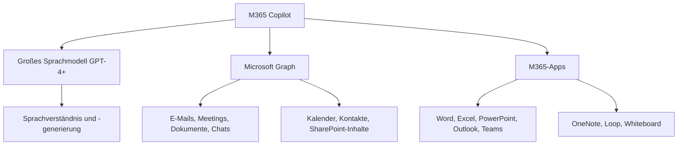
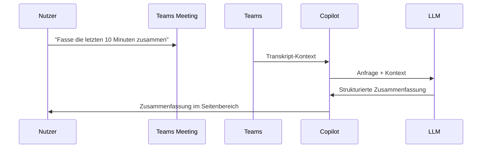
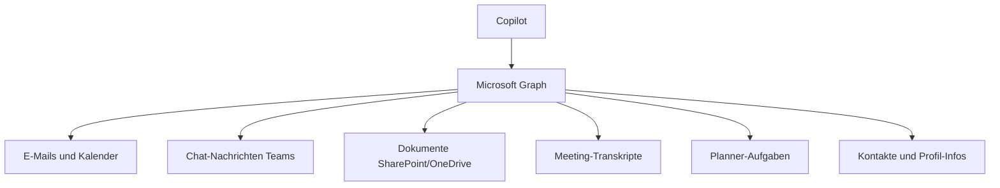

# Microsoft Copilot for M365

> [!ABSTRACT] TL;DR
> **Microsoft 365 Copilot** ist der KI-Assistent, der in alle M365-Apps integriert ist. Er basiert auf großen Sprachmodellen (GPT-4+) kombiniert mit dem **Microsoft Graph** (Zugriff auf organisationale Daten). Er fasst Meetings zusammen, erstellt Entwürfe, analysiert Daten und beantwortet Fragen – immer im Kontext der eigenen Organisation. Lizenziert als Add-on (~30 €/User/Monat) zu M365 E3/E5 oder Business-Plänen.

---

## Was ist Microsoft 365 Copilot?

Microsoft 365 Copilot kombiniert drei Kernkomponenten:



### Das Zusammenspiel

1. **Benutzer stellt Anfrage** (Prompt) in einer M365-App
2. **Microsoft Graph** liefert relevanten Kontext aus der Organisation
3. **LLM** verarbeitet Prompt + Kontext und generiert Antwort
4. **App** zeigt die Antwort kontextbezogen an

> [!IMPORTANT] Sicherheitsgrenzen bleiben erhalten
> Copilot greift **nur auf Inhalte zu, auf die der Benutzer bereits Zugriff hat**. Keine erweiterten Zugriffsrechte durch Copilot. Wenn ein Benutzer keinen Zugriff auf eine SharePoint-Site hat, kann Copilot auch keine Inhalte von dort anzeigen.

---

## Copilot in den einzelnen Apps

### Microsoft Teams

**Copilot in Meetings:**
- **Live-Transkription**: Automatische Protokollführung während des Meetings
- **Zusammenfassung**: "Was wurde besprochen?" nach dem Meeting
- **Aktionspunkte**: "Welche To-Dos wurden identifiziert?"
- **Entscheidungen**: "Welche Entscheidungen wurden getroffen?"
- **Catch-up**: "Was habe ich verpasst?" für Späteinsteiger



**Copilot im Chat:**
- "Fasse diese Konversation zusammen"
- "Was hat [Name] über das Projekt gesagt?"
- "Gibt es offene Punkte aus unserem Chat?"

### Microsoft Word

| Funktion | Beschreibung |
|---------|-------------|
| **Entwurf erstellen** | "Erstelle einen Projektbericht über..." |
| **Inhalt umschreiben** | Ton anpassen (formell, informell, kürzer, länger) |
| **Zusammenfassen** | Langes Dokument auf Kernpunkte reduzieren |
| **Aus anderen Quellen** | "Basierend auf diesem Meeting-Protokoll..." |
| **Visualize as Table** | Text in Tabelle umwandeln |

**Beispiel-Prompts für Word:**
```
Erstelle einen Projektvorschlag basierend auf der E-Mail-Konversation mit [Name] der letzten Woche.

Fasse dieses 50-seitige Dokument in 5 Kernaussagen zusammen.

Schreibe diesen Abschnitt formeller um, geeignet für Vorstandspräsentation.
```

### Microsoft Excel

| Funktion | Beschreibung |
|---------|-------------|
| **Analyse** | "Was sind die Top-Verkäufer dieses Quartals?" |
| **Formeln erstellen** | "Erstelle eine Formel für gleitenden Durchschnitt" |
| **Visualisierung** | "Erstelle ein Diagramm dieser Daten" |
| **Datenbereinigung** | "Identifiziere Ausreißer in Spalte B" |
| **Insights** | Automatische Erkennung von Trends und Mustern |

> [!TIP] Copilot in Excel: Strukturierte Tabellen
> Copilot funktioniert in Excel am besten mit **strukturierten Tabellen** (Strg+T). Unstrukturierte Daten werden weniger gut analysiert.

### Microsoft Outlook

| Funktion | Beschreibung |
|---------|-------------|
| **E-Mail-Zusammenfassung** | Langer E-Mail-Thread auf Kernpunkte |
| **Entwurf erstellen** | "Antworte auf diese E-Mail, lehne höflich ab..." |
| **Ton anpassen** | Formeller/informeller machen |
| **Coaching** | Feedback zu geschriebener E-Mail |
| **Scheduling Assist** | Termin basierend auf E-Mail-Kontext planen |

### Microsoft PowerPoint

| Funktion | Beschreibung |
|---------|-------------|
| **Präsentation erstellen** | "Erstelle eine Präsentation über unsere Q3-Ergebnisse" |
| **Aus Dokument** | Aus Word-Dokument Präsentation generieren |
| **Slides hinzufügen** | "Füge einen Slide über Risks hinzu" |
| **Zusammenfassen** | Präsentation in Sprechernotizen zusammenfassen |
| **Redesign** | Layouts optimieren |

### Microsoft OneNote

- **Seiteninhalt zusammenfassen**
- **Fragen an Notizbuch stellen**: "Was hat das Team in Q3 erarbeitet?"
- **Strukturieren**: Unstrukturierte Notizen in Gliederung umwandeln
- **Pläne erstellen**: "Erstelle einen Lernplan basierend auf diesen Notizen"

### Microsoft Loop

- **Inhalt generieren** in Loop Pages
- **Loop Components füllen**: Tabellen, Aufgabenlisten per Prompt erstellen
- **Zusammenfassen**: Loop-Seiteninhalte komprimieren

---

## Copilot Chat (ehemals BizChat / Microsoft 365 Chat)

**Copilot Chat** ist der universelle KI-Assistent außerhalb spezifischer Apps:

- Verfügbar unter **microsoft365.com/chat** und in Teams
- Greift auf alle M365-Daten des Benutzers zu (Graph)
- **Work-Modus**: Zugriff auf Organisationsdaten
- **Web-Modus**: Zugriff auf öffentliche Webinhalte (Bing)
- **Dateien hochladen**: Eigene Dokumente analysieren (Grounding)

**Anwendungsbeispiele:**
```
"Fasse alle E-Mails von [Projekt-Name] der letzten 30 Tage zusammen"

"Wer in meiner Organisation hat Expertise in Azure Kubernetes?"

"Erstelle eine Agenda für unser Weekly basierend auf den offenen Planner-Aufgaben"

"Was sind die wichtigsten Punkte aus dem Dokument 'Q4 Strategy.docx'?"
```

---

## Microsoft Graph als Datenbasis

Microsoft Graph ist die **einheitliche API** für alle Microsoft 365-Daten:



### Semantic Index

Der **Semantic Index for Copilot** ist ein spezieller Index, der nicht nur Schlüsselwörter, sondern **Bedeutungen und Zusammenhänge** versteht:

- Findet Dokumente auch ohne genaue Wortübereinstimmung
- Versteht organisationale Konzepte und Beziehungen
- Verbessert die Qualität der Copilot-Antworten erheblich

> [!NOTE] Semantic Index Build-Zeit
> Nach Aktivierung von Copilot kann es **mehrere Tage** dauern, bis der Semantic Index vollständig aufgebaut ist und Copilot optimal funktioniert.

---

## Via Microsoft 365 Admin Center (UI)

### Microsoft 365 Copilot-Lizenz zuweisen

1. Melde dich an beim **Microsoft 365 Admin Center** unter [admin.microsoft.com](https://admin.microsoft.com)
2. Navigiere zu **Benutzer → Aktive Benutzer**
3. Klicke auf den gewünschten Benutzer → Tab **Lizenzen und Apps**
4. Aktiviere die Lizenz **Microsoft 365 Copilot**
5. Klicke auf **Änderungen speichern**

### Copilot-Einstellungen und Adoption verwalten

1. Melde dich an beim **Microsoft 365 Admin Center** unter [admin.microsoft.com](https://admin.microsoft.com)
2. Navigiere zu **Einstellungen → Copilot**
3. Prüfe den Aktivierungsstatus und konfiguriere tenant-weite Benutzerrichtlinien
4. Navigiere zu **Berichte → Verwendung → Copilot** um die Adoption nachzuverfolgen

### Copilot in Teams-Meetings konfigurieren

1. Melde dich an beim **Microsoft Teams Admin Center** unter [admin.teams.microsoft.com](https://admin.teams.microsoft.com)
2. Navigiere zu **Meetings → Meeting-Richtlinien**
3. Wähle die gewünschte Richtlinie (z.B. *Global*)
4. Suche den Abschnitt **Aufzeichnung und Transkription**
5. Stelle **Copilot** auf *Ein* (erlaubt KI-Zusammenfassungen in Meetings)
6. Klicke auf **Speichern**

---

## Lizenzierung

### Anforderungen

| Voraussetzung | Details |
|--------------|---------|
| **Basis-Lizenz** | M365 E3/E5, Business Standard/Premium, oder Teams Essentials |
| **Add-on** | Microsoft 365 Copilot Add-on |
| **Preis Add-on** | ~30 €/User/Monat (2025) |
| **Mindestanzahl** | Keine Mindestanzahl (seit Januar 2024) |

> [!WARNING] Copilot erfordert hochwertige M365-Lizenz
> Microsoft 365 Copilot funktioniert nicht mit reinen E1-Lizenzen ohne M365 Apps oder reinen Teams-Lizenzen. Mindestens **M365 E3** oder **Business Standard** ist erforderlich.

---

## Datenschutz und Compliance

### Was Microsoft NICHT tut

> [!IMPORTANT] Datenschutz-Garantien
> - Daten werden **nicht für Training** von KI-Modellen verwendet
> - Daten werden **nicht zwischen Tenants** geteilt
> - Microsoft hat **keinen Zugriff** auf Kundendaten für Copilot
> - Alle Verarbeitungen finden innerhalb der **kommerziellen Cloud-Grenze** statt

### EU Data Boundary

Für EU-Kunden: Copilot-Verarbeitungen finden **innerhalb der EU** statt (EU Data Boundary). Microsoft verarbeitet Anfragen nicht in US-Rechenzentren für EU-Tenants.

### Audit-Log

Alle Copilot-Aktivitäten werden im **Microsoft Purview Audit Log** protokolliert:
```
Aktivität: CopilotInteraction
Enthält: Benutzer, App, Zeitstempel, grober Prompt-Typ
Nicht enthalten: Vollständiger Prompt-Text und Antwort-Inhalt
```

---

## Governance und Vorbereitung

### Vor der Einführung

> [!WARNING] Datenschutz-Vorbereitung ist kritisch
> Bevor Copilot aktiviert wird:
> - **SharePoint-Berechtigungen prüfen**: Übermäßig freigegebene Dateien sind über Copilot zugänglich
> - **Sensitivity Labels**: Dokumente klassifizieren (Vertraulich, Intern, etc.)
> - **Oversharing Assessment**: Purview → SharePoint-Freigabe-Report
> - **Entra ID-Gruppen**: Sicherstellen dass "Alle" oder "Jeder" nicht zu viel Zugriff hat

### Copilot Dashboard (in Viva Insights)

Das **Copilot Dashboard** (in Viva Insights) zeigt Admins:
- Adoption-Rate (wie viele Benutzer Copilot aktiv nutzen)
- Am häufigsten genutzte Apps und Features
- Zeitersparnis (selbst berichtete Metriken)
- ROI-Berechnung

---

## Prompting-Tipps

### Effektive Prompts schreiben

Das **GRCT-Framework** für gute Prompts:

| Buchstabe | Bedeutung | Beispiel |
|-----------|----------|---------|
| **G** | Goal (Ziel) | "Erstelle eine Zusammenfassung..." |
| **R** | Role (Rolle) | "Als Kommunikationsexperte..." |
| **C** | Context (Kontext) | "Basierend auf dem Meeting vom Montag..." |
| **T** | Type (Format) | "...als Aufzählung mit max. 5 Punkten" |

### Beispiel-Prompts nach App

```
# Teams - Meeting-Zusammenfassung
"Fasse die wichtigsten Entscheidungen und Aktionspunkte aus diesem Meeting zusammen, 
gruppiert nach Verantwortlichem."

# Outlook - E-Mail-Entwurf
"Schreibe eine höfliche Absage-E-Mail an [Kunde] bezüglich des Angebots vom [Datum]. 
Begründe mit Ressourcenengpässen und schlage Alternativen für Q2 vor."

# Word - Dokumentenanalyse
"Vergleiche die Strategiedokumente aus Q3 und Q4 und identifiziere die 
wichtigsten Änderungen der Prioritäten."

# Excel - Datenanalyse
"Analysiere diese Verkaufsdaten und identifiziere die Top-3-Trends sowie 
mögliche Gründe für den Einbruch im August."
```

---

## Aktuelle Funktionen 2025

Neue und geplante Copilot-Funktionen 2025:

| Feature | Beschreibung | Status |
|---------|-------------|--------|
| **Copilot Pages** | Persistente KI-Arbeitsflächen (Loop) | GA |
| **Copilot Agents** | Spezialisierte KI-Agenten für spezifische Tasks | GA |
| **Copilot Studio** | Eigene Copilots erstellen | GA |
| **Voice Interaction** | Sprachbasierte Prompts | Preview |
| **Copilot in Teams Phone** | KI während Telefonanrufen | GA |
| **Meeting-Recap** | Tiefere Meeting-Analyse nach Ende | GA |
| **Document Actions** | Multi-Dokument-Analyse | GA |
| **Excel Formula Builder** | Komplexe Formeln per Sprache | GA |

---

## Troubleshooting

> [!WARNING] Copilot findet Inhalte nicht
> Wenn Copilot relevante Dokumente nicht findet:
> - Dokument wirklich für den Benutzer zugänglich? Berechtigungen prüfen
> - Semantic Index noch im Aufbau? Bis 7 Tage nach Aktivierung warten
> - Dokument zu alt oder sehr selten aufgerufen? Graph priorisiert aktuelle/relevante Inhalte

> [!BUG] Copilot in Teams-Meeting nicht verfügbar
> Voraussetzungen:
> - Transcription muss aktiviert sein (Teams Admin Center → Meeting-Richtlinien)
> - Copilot-Lizenz zugewiesen
> - Copilot in Meeting-Richtlinien nicht deaktiviert: Teams Admin → Meetings → Meeting-Richtlinien → Copilot

> [!WARNING] Qualität der Antworten niedrig
> - Bessere Prompts schreiben (mehr Kontext geben)
> - Spezifischen Zeitraum oder Dokument als Quelle angeben
> - "Grounding" nutzen: Dokument hochladen oder explizit referenzieren (`/[Dateiname]`)

---

## Verwandte Notizen

- [[Was ist Microsoft 365]]
- [[M365 Lizenzmodelle und Pläne]]
- [[Microsoft Viva Insights]]
- [[M365 Admin Center]]
