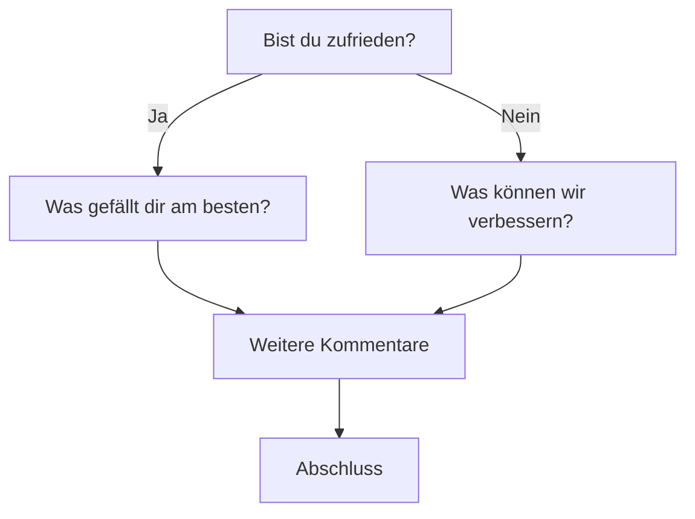
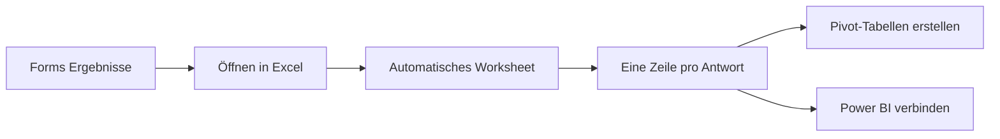
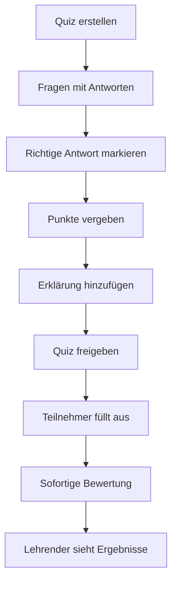

# Microsoft Forms

> [!ABSTRACT] TL;DR
> **Microsoft Forms** ist das integrierte Formular- und Umfrage-Tool in M365. Es ermöglicht das schnelle Erstellen von Umfragen, Quizzen und Registrierungsformularen ohne technische Kenntnisse. Ergebnisse werden in Echtzeit visualisiert und lassen sich direkt nach Excel exportieren. Die Integration in Teams (Polls) und SharePoint macht es zum Standard-Tool für einfache Dateneingaben.

---

## Was ist Microsoft Forms?

Microsoft Forms ist eine cloudbasierte App zum Erstellen von:
- **Umfragen** – Feedback, Zufriedenheitsmessungen
- **Quizzen** – Lernkontrolle mit automatischer Bewertung
- **Registrierungsformularen** – Events, Anmeldungen
- **Abstimmungen** – Schnelle Entscheidungshilfen

Formulare sind über einen Link, QR-Code oder eingebettet in Websites/Teams zugänglich. Antworten werden sofort in einer Übersicht angezeigt.

---

## Fragetypen

| Fragetyp | Beschreibung | Beispiel |
|----------|-------------|---------|
| **Auswahl** | Einfach- oder Mehrfachauswahl | "Welches Betriebssystem?" |
| **Text** | Freitext (kurz oder lang) | "Ihr Feedback:" |
| **Bewertung** | Sterne (1-10) oder Smiley | Zufriedenheit |
| **Datum** | Datumseingabe | Geburtsdatum |
| **Ranking** | Elemente sortieren | Prioritäten setzen |
| **Likert** | Skala zu mehreren Aussagen | Stimme zu/Nicht zu |
| **Net Promoter Score** | 0-10 Skala (NPS) | Weiterempfehlung |
| **Datei-Upload** | Dateien hochladen | Bewerbungsunterlagen |
| **Abschnitt** | Strukturierung des Formulars | Trenner zwischen Themen |

> [!IMPORTANT] Datei-Upload Voraussetzungen
> Der **Datei-Upload** Fragetyp ist nur verfügbar, wenn das Formular mit einem **Microsoft-365-Konto** (nicht als anonym) ausgefüllt wird. Hochgeladene Dateien werden in OneDrive des Formular-Erstellers gespeichert.

---

## Branching Logic (Verzweigungen)

Mit **Branching** können Folgefragen abhängig von vorherigen Antworten gesteuert werden:



### Branching einrichten

1. Frage auswählen → **...** (Mehr Optionen) → **Verzweigung hinzufügen**
2. Für jede Antwortoption die Ziel-Frage oder den Abschnitt festlegen
3. Alternativ: "Zum Ende gehen" für direkte Weiterleitung zur letzten Seite

> [!TIP] Abschnitte für komplexe Formulare
> Bei langen Formularen Fragen in **Abschnitte** gruppieren. Branching kann dann ganze Abschnitte überspringen, was die Navigation deutlich vereinfacht.

---

## Design und Anpassung

Forms bietet verschiedene Design-Optionen:

- **Themes**: Vordefinierte Farbschemata (über 60 auswählbar)
- **Hintergrundbilder**: Benutzerdefinierte Bilder als Hintergrund
- **Eigene Farben**: Primärfarbe des Unternehmens einsetzen
- **Logo**: Firmenlogo als Header-Bild
- **Fortschrittsbalken**: Anzeige des Fortschritts für Befragte

> [!NOTE] Responsive Design
> Formulare sind automatisch **für mobile Geräte optimiert**. Auf Smartphones werden Fragen im vertikalen Scrollformat angezeigt, Auswahlelemente sind als große Schaltflächen dargestellt.

---

## Sharing und Verteilung

### Zugriffsoptionen

| Option | Beschreibung | Wann nutzen? |
|--------|-------------|-------------|
| **Jeder mit dem Link** | Öffentlich zugänglich | Externe Umfragen, Kundenfeedback |
| **Nur Personen in der Organisation** | M365-Anmeldung erforderlich | Interne Mitarbeiterbefragungen |
| **Bestimmte Personen** | Einladung per E-Mail | Gezielte Zielgruppe |

### Sharing-Methoden

1. **Direkt-Link**: URL kopieren und per E-Mail/Teams verteilen
2. **QR-Code**: Automatisch generierter QR-Code (ideal für Veranstaltungen, Poster)
3. **Embed-Code**: HTML-Code für Einbettung in SharePoint-Seiten oder Websites
4. **E-Mail**: Direkt aus Forms per Outlook versenden
5. **Teams-Integration**: Als Tab oder Poll im Teams-Kanal

```html
<!-- Embed-Code Beispiel (wird von Forms generiert) -->
<iframe width="640px" height="480px" 
  src="https://forms.office.com/r/XXXXXXXXXX?embedded=true" 
  frameborder="0">
</iframe>
```

---

## Ergebnisanalyse

### Echtzeit-Dashboard

Nach dem Versenden werden Ergebnisse **sofort aktualisiert** im Response-Tab:
- **Übersichtsstatistiken** pro Frage (Balkendiagramme, Kreisdiagramme)
- **Einzelantworten** durchblättern
- **Durchschnittswert** bei Bewertungsfragen
- **Wort-Cloud** bei Textfragen

### Excel-Export



1. **Antworten** → **In Excel öffnen** oder **Ergebnisse herunterladen**
2. Excel-Datei enthält: Timestamp, E-Mail (wenn erfasst), alle Antworten als Spalten
3. Für tiefere Analyse: Excel-Tabelle mit Power BI verbinden

> [!TIP] Live-Excel-Verbindung
> **"In Excel öffnen"** erstellt eine **Live-Verbindung** – neue Antworten erscheinen automatisch bei Excel-Aktualisierung. "Herunterladen" erstellt nur einen Einmal-Export.

---

## Integration in Microsoft Teams

### Teams-Tab

Ein Forms-Formular kann als **Tab** in einem Teams-Kanal hinzugefügt werden:
1. Teams-Kanal → **+ Tab hinzufügen** → **Forms**
2. Neues Formular erstellen oder bestehendes verknüpfen
3. Alle Kanalmitglieder können das Formular ausfüllen und Ergebnisse sehen

### Quick Poll in Meetings und Kanälen

Für spontane Abstimmungen direkt in Teams:
- In **Meetings**: "..." in der Menüleiste → **Forms** → Umfrage erstellen
- In **Kanal-Nachrichten**: Über die Message-Extension (Formularsymbol)

---

## Quizze mit automatischer Bewertung

Forms kann als **Quiz-Tool** genutzt werden (ideal für Schulungen, e-Learning):

1. **Neues Quiz** erstellen (statt "Neues Formular")
2. Für jede Frage **richtige Antwort** festlegen
3. **Punkte** pro Frage vergeben
4. **Erklärungen** für richtige/falsche Antworten hinterlegen
5. Nach dem Ausfüllen: Sofortige Rückmeldung für den Teilnehmer



---

## Datenspeicherung

Formulare und Antworten werden in **Microsoft-Cloud-Infrastruktur** gespeichert:

| Typ | Speicherort |
|-----|------------|
| **M365-Arbeits-/Schulkonto** | SharePoint-Bibliothek des Benutzers |
| **Gruppenformular (Teams)** | SharePoint-Site der M365-Gruppe |
| **Microsoft-Privatkonto** | OneDrive Consumer |

> [!INFO] Antwort-Verbleib nach Benutzer-Offboarding
> Wenn ein Benutzer das Unternehmen verlässt, werden seine Formulare in der **Exchange-Mailbox** des Benutzers gespeichert. Admins können über die Exchange-Admin-Center auf Daten zugreifen oder Formulare an einen anderen Benutzer übertragen.

---

## Microsoft Forms vs. Customer Voice (Dynamics 365)

| Merkmal | Microsoft Forms | Customer Voice |
|---------|----------------|----------------|
| **Zielgruppe** | Alle M365-Benutzer | Unternehmen mit CRM-Bedarf |
| **Komplexität** | Einfach | Erweitert |
| **Branching** | ✅ Einfach | ✅ Erweitert |
| **CRM-Integration** | ❌ | ✅ Dynamics 365 |
| **Multi-Language** | ✅ | ✅ |
| **Power BI Dashboards** | Basic | ✅ Erweitert |
| **Satisfaction Metrics** | NPS | NPS, CSAT, CES |
| **Lizenz** | Im M365 enthalten | Dynamics 365 Add-on |

---

## Limits

| Limit | Wert |
|-------|------|
| Fragen pro Formular | 200 |
| Antworten pro Formular | 50.000 |
| Dateigröße je Upload-Antwort | 1 GB |
| Formulare pro Benutzer | 200 |
| Zeichenanzahl pro Frage | 4.000 |
| Antwortzeit-Begrenzung | Nicht nativ (nur per Forms Pro/Customer Voice) |

---

## Via Microsoft 365 Admin Center (UI)

### Microsoft Forms im Tenant verwalten

1. Melde dich an beim **Microsoft 365 Admin Center** unter [admin.microsoft.com](https://admin.microsoft.com)
2. Navigiere zu **Einstellungen → Organisationseinstellungen**
3. Wähle den Tab **Dienste** → **Microsoft Forms**
4. Konfiguriere, wer externe Formulare erstellen und teilen darf
5. Aktiviere oder deaktiviere den Phishing-Schutz und automatisch blockierte Formulare
6. Klicke auf **Speichern**

### Neues Formular erstellen (Forms-App)

1. Rufe die **Microsoft Forms App** unter [forms.office.com](https://forms.office.com) auf oder öffne sie über den M365 App-Launcher
2. Klicke auf **Neues Formular**
3. Gib einen Titel und optional eine Beschreibung ein
4. Füge Fragen hinzu über **Frage hinzufügen** → Fragetyp wählen
5. Konfiguriere Zugriffseinstellungen über das **Zahnrad-Symbol** (wer antworten darf, Start-/Enddatum)
6. Klicke auf **Teilen** und wähle den Zugriffstyp sowie die Sharing-Methode (Link, QR-Code, Embed)

---

## Troubleshooting

> [!WARNING] Externe Benutzer können Formular nicht ausfüllen
> Wenn "Nur Personen in der Organisation" eingestellt ist, können externe Benutzer das Formular nicht öffnen. In den Einstellungen (Zahnrad-Symbol im Formular) auf "Jeder kann antworten" umstellen.

> [!BUG] Antworten fehlen im Excel-Export
> Der Live-Excel-Export zeigt manchmal nicht alle neuesten Antworten. Lösung: "Ergebnisse herunterladen" für einen vollständigen Export verwenden, oder in Excel "Daten aktualisieren" klicken.

---

## Verwandte Notizen

- [[Microsoft Lists]]
- [[Microsoft Viva Pulse]]
- [[M365 Admin Center]]
