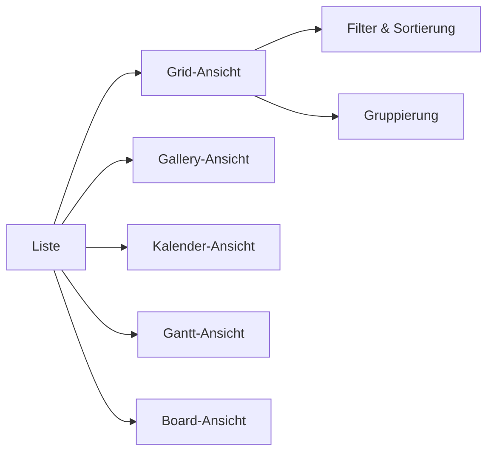
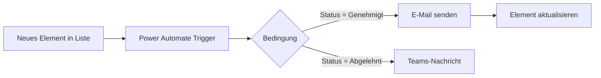

# Microsoft Lists

> [!ABSTRACT] TL;DR
> **Microsoft Lists** ist eine App zur strukturierten Informationsverwaltung – vergleichbar mit einer smarten Excel-Tabelle in der Cloud. Basierend auf SharePoint-Listen bietet sie flexible Spaltentypen, unterschiedliche Ansichten (Grid, Gallery, Kalender, Gantt), Regeln, Automatisierungen und nahtlose Integration in Teams und SharePoint. Wichtige Grenze: Ab **5.000 Elementen** greifen Listenansichtsschwellen.

---

## Was ist Microsoft Lists?

Microsoft Lists wurde 2020 als eigenständige App auf Basis der bewährten **SharePoint-Listentechnologie** veröffentlicht. Es ist im Wesentlichen eine modernisierte, mobile und in Teams integrierte Oberfläche für SharePoint-Listen.

### Einsatzszenarien

- **Aufgabenverfolgung** (einfache Projektlisten)
- **Issue-Tracking** (Fehler, Support-Tickets)
- **Asset-Verwaltung** (Inventar, Geräte)
- **Eventregistrierung**
- **Genehmigungsprozesse**
- **Inhaltskalender** (Redaktionsplanung)

> [!NOTE] Lists ≠ Planner
> Microsoft Lists verwaltet strukturierte **Informationen und Datensätze**. Microsoft Planner ist für **Aufgaben und Projekte** (Kanban-Board, Aufgabenzuweisung). Beide können kombiniert werden (Lists für Daten, Planner für Tasks).

---

## Listentypen und Vorlagen

### Erstellen aus Vorlagen

Lists bietet vordefinierte **Vorlagen** für häufige Anwendungsfälle:

| Vorlage | Inhalt |
|---------|--------|
| **Issue Tracker** | Fehler/Probleme verfolgen |
| **Event Schedule** | Veranstaltungsplanung |
| **Asset Manager** | Geräteverwaltung |
| **Recruitment Tracker** | Bewerberverwaltung |
| **Travel Requests** | Reiseanfragen |
| **Work Progress Tracker** | Projektstatus |
| **Content Scheduler** | Inhaltsplanung |
| **Patient Care Checklist** | Gesundheitswesen |

### Erstellen aus anderen Quellen

- **Leere Liste** – von Grund auf aufbauen
- **Aus Excel** – Excel-Tabelle als Liste importieren
- **Aus bestehender Liste** – Struktur einer anderen Liste übernehmen
- **Aus CSV** – Kommagetrennte Dateien importieren

---

## Spaltentypen

Lists unterstützt umfangreiche Datentypen:

| Spaltentyp | Beschreibung | Beispiel |
|-----------|-------------|---------|
| **Einzeiligen Text** | Kurzer Text | Name, Titel |
| **Mehreren Zeilen Text** | Langer Text, Rich Text | Beschreibung |
| **Zahl** | Numerische Werte | Menge, Preis |
| **Währung** | Währungsformatierung | Kosten (€) |
| **Datum und Uhrzeit** | Datumswerte | Fälligkeitsdatum |
| **Auswahl** | Dropdown-Liste | Status (Offen, In Bearbeitung, Erledigt) |
| **Ja/Nein** | Boolean | Genehmigt? |
| **Person oder Gruppe** | Benutzer aus Entra ID | Verantwortlicher |
| **Hyperlink** | URL + Anzeigename | Referenz-Link |
| **Bild** | Bild-Upload | Produktbild |
| **Suche (Lookup)** | Verweis auf andere Liste | Kategorie aus Masterliste |
| **Verwaltete Metadaten** | Term Store (SharePoint) | Klassifikation |
| **Standort** | Bing Maps Integration | Bürostandort |
| **Bewertung** | Sternebewertung | Priorität 1-5 |

---

## Ansichten

Lists unterstützt fünf verschiedene Ansichtstypen:

### Grid-Ansicht (Standard)

Die klassische **Tabellenansicht** – ähnlich wie Excel. Direktes Bearbeiten in Zellen möglich.

### Gallery-Ansicht

**Kachelansicht** mit konfigurierbaren Karten – ideal für visuelle Inhalte (Bilder, Produkte).

### Kalender-Ansicht

Zeigt Elemente auf einem **Kalender** basierend auf Datumsspalten. Hilfreich für Eventplanung, Fristen.

### Gantt-Ansicht

**Balkendiagramm** für Zeitplanung mit Start- und Enddatum. Für Projektpläne und Meilensteine.

### Board-Ansicht (Kanban)

**Kanban-Board** basierend auf einer Auswahlspalte (z.B. Status). Elemente per Drag & Drop verschieben.



---

## Regeln und Automatisierungen

### Regeln (integriert)

Einfache Wenn-Dann-Regeln direkt in Lists:
- Benachrichtigung bei Änderung
- E-Mail wenn Spalte einen bestimmten Wert erreicht
- Workflow starten

### Power Automate Integration

Für komplexere Automatisierungen:



Häufige Automatisierungen:
- **Genehmigungsworkflows**: Element erstellt → Manager genehmigt → Status wird aktualisiert
- **Benachrichtigungen**: Fälligkeitsdatum erreicht → Reminder-E-Mail
- **Datensynchronisation**: Lists → Excel/SharePoint/Dataverse

---

## Integration in Microsoft Teams

### Lists als Teams-Tab hinzufügen

1. Teams-Kanal öffnen → **+ (Tab hinzufügen)**
2. **Lists** aus dem App-Katalog wählen
3. Bestehende Liste auswählen oder neue erstellen
4. Tab-Name anpassen

> [!TIP] Lists in Teams für Teamarbeit
> Das Einbinden von Lists als Tab in einem Teams-Kanal macht die Zusammenarbeit nahtlos: Alle Kanalmitglieder sehen und bearbeiten die Liste direkt in Teams, ohne zu einem Browser wechseln zu müssen.

### Integration in SharePoint

Lists-Daten sind identisch mit SharePoint-Listen – beide Oberflächen zeigen dieselben Daten. Eine in Lists erstellte Liste ist sofort in der SharePoint-Site verfügbar und umgekehrt.

---

## Berechtigungen

Lists erbt die Berechtigungen von der SharePoint-Site, in der die Liste erstellt wurde:

| Berechtigungsebene | Rechte |
|-------------------|--------|
| **Vollzugriff** | Alle Einstellungen, Löschen |
| **Entwerfen** | Spalten und Ansichten verwalten |
| **Bearbeiten** | Elemente hinzufügen, bearbeiten, löschen |
| **Mitwirken** | Elemente hinzufügen und bearbeiten |
| **Lesen** | Nur ansehen |
| **Eingeschränktes Lesen** | Nur zugewiesene Elemente |

> [!INFO] Elementebene-Berechtigungen
> Einzelne Listenelemente können mit eingeschränkten Berechtigungen versehen werden ("Element-level permissions"). Dies sollte sparsam eingesetzt werden, da es die Komplexität erhöht und Listenansichtsschwellen beeinflusst.

---

## Limits und Einschränkungen

> [!WARNING] Listenansichtsschwelle: 5.000 Elemente
> Ab **5.000 Elementen** greift die SharePoint-Listenansichtsschwelle (List View Threshold). Ansichten, die mehr als 5.000 Elemente gleichzeitig abfragen, werden blockiert. Lösungen:
> - Indizierte Spalten für gefilterte Ansichten verwenden
> - Ansichten mit Filter erstellen (nicht alle Elemente gleichzeitig laden)
> - Für sehr große Datensätze: Dataverse oder SQL verwenden

> [!NOTE] Erhöhung des Limits möglich
> Für bestimmte Abfragen (z.B. von Admins oder in der Nacht) kann das Limit auf 20.000 erhöht werden. Das Erstellen von Indizes auf gefilterten Spalten ist aber die sauberere Lösung.

| Limit | Wert |
|-------|------|
| Elemente pro Liste | 30.000.000 |
| Ansichtsschwelle (gleichzeitig ladbar) | 5.000 |
| Indizes pro Liste | 20 |
| Anhänge pro Element | 250 MB pro Anhang |
| Spalten pro Liste | 300 |
| Ansichten pro Liste | 100 |
| Dateigröße (als Anlage) | 250 MB |

---

## Unterschied zu Excel, Planner und Dataverse

| Merkmal | Microsoft Lists | Excel/OneDrive | Planner | Dataverse |
|---------|----------------|----------------|---------|-----------|
| **Struktur** | Spaltenbasiert | Tabellenbasiert | Aufgaben-fokussiert | Relational |
| **Mehrbenutzer-Bearbeitung** | ✅ Nativ | ✅ (co-authoring) | ✅ | ✅ |
| **Automatisierung** | Power Automate | Power Automate | Eingeschränkt | Power Automate |
| **Teams-Integration** | ✅ Nativ | ✅ Tab | ✅ Nativ | Über Power Apps |
| **Max. Datenmenge** | 30 Mio. Elemente | ~1 Mio. Zeilen | Begrenzt | Sehr groß |
| **Berechtigungen granular** | ✅ | Eingeschränkt | ❌ | ✅ |
| **Ansichten** | 5 Typen | Pivot, Filter | Kanban | Power Apps |
| **Lizenzierung** | M365 inkl. | M365 inkl. | M365 inkl. | Power Apps Premium |

---

## Troubleshooting

> [!WARNING] "Ansicht kann nicht angezeigt werden" (5.000-Limit)
> **Problem**: Liste enthält mehr als 5.000 Elemente, Ansicht lädt nicht.
> **Lösung**: Filter hinzufügen (z.B. nur Elemente des aktuellen Jahres), oder Index auf gefilterte Spalte erstellen: Liste → Einstellungen → Indizierte Spalten → Index erstellen

> [!BUG] Elemente verschwinden nach Verschieben
> Beim Verschieben von Lists-Elementen zwischen Ordnern können in seltenen Fällen Permissions-Inheritance-Probleme auftreten. Lösung: Berechtigungen für das Element zurücksetzen (Einstellungen → Berechtigungen verwalten → Vererbung wiederherstellen).

```powershell
# SharePoint-Liste per PnP PowerShell auslesen
Connect-PnPOnline -Url "https://contoso.sharepoint.com/sites/MySite" -Interactive

Get-PnPListItem -List "MeineListe" -Fields "Title", "Status", "Verantwortlicher" |
    ForEach-Object {
        [PSCustomObject]@{
            Titel = $_["Title"]
            Status = $_["Status"]
        }
    }
```

---

## Verwandte Notizen

- [[Microsoft Planner und Project]]
- [[Microsoft Forms]]
- [[M365 Admin Center]]
