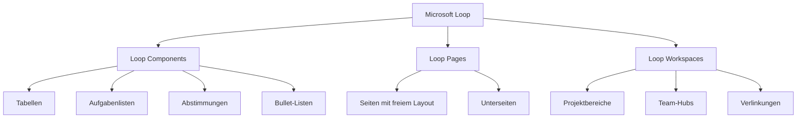
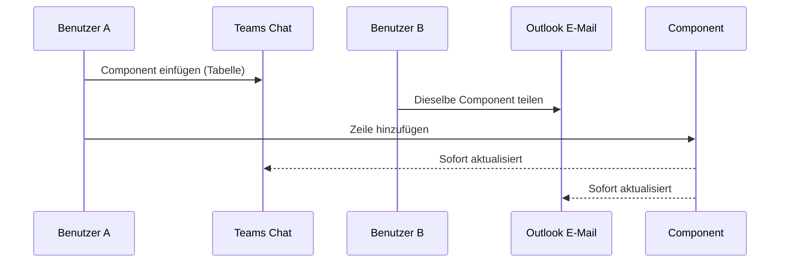
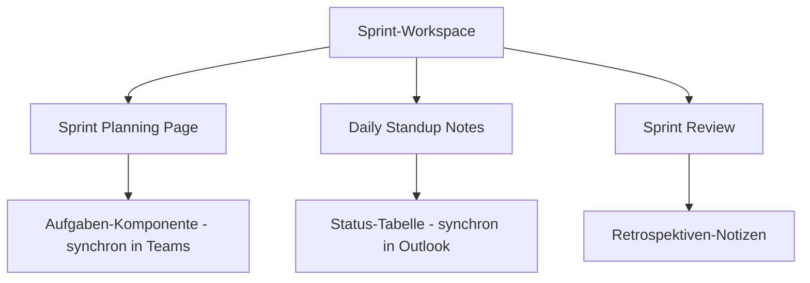

# Microsoft Loop

> [!ABSTRACT] TL;DR
> **Microsoft Loop** ist Microsofts Co-Creation-Plattform – ein modernes, flexibles Workspace-Tool für Teams. Das Besondere: **Loop Components** sind portierbare Inhaltselemente, die gleichzeitig in Teams-Chats, Outlook-E-Mails, OneNote und anderen Apps bearbeitet werden können und überall synchron bleiben. Daten werden als `.loop`-Dateien in OneDrive gespeichert.

---

## Was ist Microsoft Loop?

Microsoft Loop (GA: November 2023) ist eine **Co-Creation-Plattform**, die das Konzept der portablen, synchronen Inhaltselemente einführt. Es besteht aus drei Kernkonzepten:



### Die drei Loop-Konzepte

| Konzept | Beschreibung |
|---------|-------------|
| **Loop Workspaces** | Strukturierte Arbeitsbereiche für Teams/Projekte, enthalten Pages und Links zu Ressourcen |
| **Loop Pages** | Flexible, unstrukturierte Seiten mit Notizen, Komponenten, eingebetteten Inhalten |
| **Loop Components** | Portable, synchronisierte Inhaltselemente, die überall eingebettet werden können |

---

## Loop Components – Das Herzstück

**Loop Components** sind die revolutionäre Idee hinter Loop: Ein Inhaltselement kann in mehrere Apps eingebettet werden, alle Instanzen bleiben **synchron**.

### Wie das funktioniert



### Verfügbare Component-Typen

| Component | Beschreibung | Symbol |
|-----------|-------------|--------|
| **Tabelle** | Strukturierte Datentabelle | 📊 |
| **Aufgabenliste** | To-Do-Liste mit Zuweisungen | ✅ |
| **Fortschrittsverfolgung** | Statusanzeige für Aufgaben | 📈 |
| **Abstimmung** | Einfache Ja/Nein-Umfrage | 🗳️ |
| **Bullet-Liste** | Aufzählung | • |
| **Nummerierte Liste** | Geordnete Aufzählung | 1. |
| **Überschriften** | Strukturierter Text | H1-H3 |
| **Code** | Code-Blöcke | `</>` |

### Components in verschiedenen Apps einfügen

**Teams-Chat:**
1. Chat öffnen → Nachricht schreiben → **Loop Component** (Schleifensymbol) klicken
2. Component-Typ wählen → sofort bearbeitbar

**Outlook:**
1. Neue E-Mail verfassen → **Loop Component** im Menüband
2. Nur in Outlook for Web und neues Outlook (nicht klassisch)

**OneNote:**
- Loop Components als eingebettete Elemente

**Whiteboard:**
- Loop-Elemente auf dem Whiteboard

---

## Loop Pages und Workspaces

### Loop Pages

Pages sind **freie, flexible Dokumentflächen** – ähnlich wie Notion-Seiten:
- **Blöcke**: Jede Seite besteht aus verschiedenen Blöcken (Text, Tabellen, Components, eingebettete Medien)
- **Unterseiten**: Hierarchische Struktur möglich
- **@-Erwähnungen**: Personen und Seiten verlinken
- **Slash-Befehle**: `/tabelle`, `/aufgabe`, `/bild` für schnelles Einfügen

### Loop Workspaces

Workspaces sind **strukturierte Bereiche** für Teams oder Projekte:
- **Seiten-Hierarchie**: Organisierte Seitenstruktur
- **Geteilte Ressourcen**: Links zu relevanten Dateien, Meetings, Seiten
- **Mitglieder**: Einladen von Team-Kollegen
- **Vorlagen**: Workspace-Vorlagen für häufige Szenarien (z.B. Projekt-Kickoff, Sprint-Planning)

---

## Datenspeicherung

Loop-Inhalte werden als **`.loop`-Dateien in OneDrive for Business** gespeichert:

```
OneDrive → Dateien → Microsoft Loop → [Workspace-Name] → [Seitenname].loop
```

### Dateistruktur

| Element | Speicherort |
|---------|------------|
| **Loop Workspace** | OneDrive des Erstellers (Root: "Microsoft Loop") |
| **Loop Pages** | In Workspace-Ordner in OneDrive |
| **Loop Components (persönlich)** | OneDrive des Erstellers |
| **Komponenten aus Teams-Kanal** | SharePoint-Bibliothek des Kanals |

> [!IMPORTANT] Datenspeicherung beeinflusst Compliance
> Da Loop-Dateien in OneDrive/SharePoint gespeichert sind, greifen alle **Purview Retention Policies, DLP-Richtlinien und eDiscovery-Funktionen**. Governance-Einstellungen für OneDrive/SharePoint gelten automatisch für Loop-Inhalte.

---

## Unterschied zu SharePoint und OneNote

| Merkmal | Microsoft Loop | SharePoint | OneNote |
|---------|--------------|------------|---------|
| **Primärer Zweck** | Co-Creation, portable Components | Intranet, Dokumentenverwaltung | Notizbücher, strukturierte Notizen |
| **Echtzeitkollaboration** | ✅ Nativ (alle Components synchron) | ✅ (Co-Authoring) | ✅ (Co-Authoring) |
| **Portierbare Inhalte** | ✅ Loop Components | ❌ | ❌ |
| **Struktur** | Flexibel (Workspace/Page) | Hierarchisch (Sites/Libraries) | Hierarchisch (Notebooks/Sections/Pages) |
| **Suche** | Microsoft Search | Microsoft Search | Microsoft Search |
| **Offline-Nutzung** | Eingeschränkt | Sync-Client | OneNote-App |
| **Teams-Integration** | ✅ Native Components | Tab | ✅ Native Tab |
| **Verwaltung/Governance** | OneDrive-basiert | Vollständig | SharePoint/OneDrive |

> [!INFO] Wann welches Tool?
> - **Loop**: Wenn dynamische, portierbare Inhalte über Apps hinweg geteilt werden sollen; agile Team-Arbeit
> - **SharePoint**: Für strukturiertes Intranet, offizielle Dokumente, komplexe Berechtigungen
> - **OneNote**: Für persönliche Notizen, strukturierte Team-Dokumentation, Meeting-Notizen

---

## Via Microsoft 365 Admin Center (UI)

### Loop für den Tenant aktivieren oder deaktivieren

1. Melde dich an beim **Microsoft 365 Admin Center** unter [admin.microsoft.com](https://admin.microsoft.com)
2. Navigiere zu **Einstellungen → Organisationseinstellungen**
3. Wähle den Tab **Dienste** → **Microsoft Loop**
4. Aktiviere oder deaktiviere **Loop-Workspaces** und **Loop-Komponenten in Teams/Outlook**
5. Klicke auf **Speichern**

### Neuen Loop Workspace erstellen

1. Öffne die **Microsoft Loop App** unter [loop.microsoft.com](https://loop.microsoft.com) oder über den M365 App-Launcher
2. Klicke auf **Neuer Workspace**
3. Gib einen Namen und optional eine Beschreibung ein
4. Lade Teammitglieder über **Mitglieder hinzufügen** ein
5. Erstelle erste **Seiten** über das **+**-Symbol im Workspace

### Loop Component in Teams-Chat einfügen

1. Öffne einen **Teams-Chat oder Kanal**
2. Klicke auf das **Loop-Symbol** (Schleife) in der Nachrichtenleiste
3. Wähle den Component-Typ (Tabelle, Aufgabenliste, Abstimmung usw.)
4. Bearbeite den Component direkt im Chat – Änderungen sind sofort für alle sichtbar

---

## Governance und Admin-Einstellungen

### Loop im Admin Center aktivieren/deaktivieren

Im **Microsoft 365 Admin Center** → Einstellungen → Loop:

| Einstellung | Beschreibung |
|------------|-------------|
| **Loop-App aktivieren** | Zugriff auf loop.microsoft.com |
| **Loop-Workspaces** | Erstellen von Workspaces |
| **Components in Teams** | Loop-Elemente in Teams-Chats |
| **Components in Outlook** | Loop-Elemente in E-Mails |

```powershell
# Loop-Cloud-Richtlinien via Cloud Policy Service
# Konfiguration über: config.office.com → Richtlinien → Looprichtlinien
# Oder per Microsoft Graph (Cloud Policy)
```

### Compliance-Überlegungen

> [!WARNING] Loop und eDiscovery
> Loop-Inhalte in OneDrive sind über **Purview Content Search und eDiscovery** durchsuchbar. Allerdings sind `.loop`-Dateien technisch komplexer als normale Dokumente – immer prüfen, ob aktuelle Compliance-Tools Loop vollständig unterstützen.

---

## Lizenzierung und Voraussetzungen

| Anforderung | Details |
|------------|---------|
| **Lizenz** | Microsoft 365 Business Basic/Standard/Premium, E3/E5 |
| **OneDrive** | Aktiviert und mit ausreichend Speicher |
| **Entra ID** | Für Workspace-Freigabe |
| **Browser** | Edge, Chrome (aktuell) |
| **Loop-App** | loop.microsoft.com oder M365-Apps |

> [!NOTE] Loop Components in Teams
> Für Loop Components in Teams ist **keine separate Loop-Lizenz** nötig – die Funktion ist in den Teams-Plänen enthalten. Voller Workspace-Zugang erfordert M365 E3/E5 oder Business-Pläne.

---

## Praktische Einsatzszenarien

### Sprint Planning mit Loop



### Besprechungsvorbereitung

1. **Loop Page** für Meeting-Agenda erstellen
2. **Agenda-Components** in Teams-Meeting-Chat einfügen
3. Alle Teilnehmer bearbeiten die Agenda direkt im Teams-Chat
4. Nach dem Meeting: Aktionspunkte als **Aufgaben-Component** – synchron mit allen

---

## Troubleshooting

> [!WARNING] "Loop Component kann nicht geladen werden"
> Ursachen und Lösungen:
> - Loop im Admin Center deaktiviert → Admin prüfen
> - OneDrive-Speicher voll → Speicher freigeben
> - Nicht kompatible App-Version → Teams/Outlook aktualisieren
> - Externe Benutzer: Components funktionieren möglicherweise nicht für Gäste

> [!BUG] Änderungen werden nicht synchronisiert
> Wenn Loop Components nicht in Echtzeit synchronisieren:
> 1. Browser/App aktualisieren
> 2. Internet-Verbindung prüfen
> 3. Bei anhaltendem Problem: Component neu einfügen (Kopie)

---

## Verwandte Notizen

- [[Microsoft Whiteboard]]
- [[Microsoft Stream]]
- [[Microsoft Viva Connections]]
- [[M365 Admin Center]]
