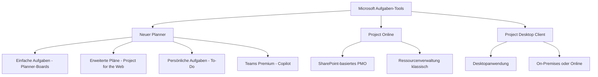
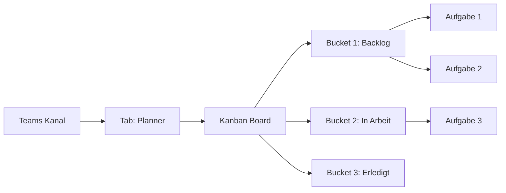
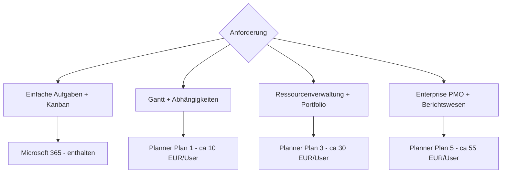

# Microsoft Planner und Project

> [!ABSTRACT] TL;DR
> Microsoft bietet eine **Aufgaben-Werkzeug-Familie** von einfach bis komplex: Der **neue Planner** (2024) vereint Aufgabenverwaltung (ehemals Planner) und komplexe Projektplanung (Project for the Web) in einer App. **Project Online** (SharePoint-basiert) und der **Project Desktop Client** existieren für Legacy-Szenarien. Lizenzierung ist gestaffelt – einfache Aufgaben sind in M365 enthalten, Premium-Features kosten extra.

---

## Übersicht: Die Aufgaben-Familie



---

## New Planner (2024) – Die vereinte App

Seit **2024** vereint Microsoft den **neuen Planner** alle bisherigen Aufgaben-Tools:

### Was der neue Planner bietet

| Feature | Verfügbarkeit | Lizenz |
|---------|-------------|--------|
| **Einfache Boards** (Kanban) | ✅ | M365 (alle) |
| **Persönliche Aufgaben** (To-Do) | ✅ | M365 (alle) |
| **Sprint-Planung** | ✅ | M365 (alle) |
| **Gantt-Diagramm** | ✅ | Planner Plan 1 |
| **Abhängigkeiten** | ✅ | Planner Plan 1 |
| **Ressourcenverwaltung** | ✅ | Planner Plan 1 |
| **Ziele (OKR)** | ✅ | Planner Plan 1 |
| **Copilot-Integration** | ✅ | Copilot + Teams Premium |
| **Premium-Dashboards** | ✅ | Planner Plan 3 |

### Ansichten im neuen Planner

- **Board** (Kanban): Aufgaben als Karten in Spalten (Status)
- **Liste**: Tabellarische Aufgabenübersicht
- **Zeitplan** (Gantt): Zeitachse mit Abhängigkeiten
- **Ziele**: OKR-ähnliche Zielverfolgung
- **Diagramme**: Statistische Auswertungen

---

## Microsoft Planner (ehemals "Planner")

Der klassische Planner ist für **einfaches Aufgabenmanagement** in Teams:

### Kernfunktionen

- **Boards**: Kanban-Boards mit Spalten (Status)
- **Aufgaben**: Titel, Beschreibung, Fälligkeitsdatum, Zugewiesene Person
- **Labels**: Farbige Markierungen für Kategorisierung
- **Checklisten**: Unteraufgaben als Checkliste
- **Anhänge**: Dateien aus OneDrive/SharePoint anhängen
- **Kommentare**: Diskussion direkt an der Aufgabe
- **M365-Gruppen-basiert**: Jeder Plan gehört zu einer M365-Gruppe

### Planner in Microsoft Teams

Planner ist nativ in Teams integriert:
- **Tasks-App in Teams**: Zeigt Planner-Aufgaben und To-Do-Aufgaben kombiniert
- **Planner-Tab im Kanal**: Plan direkt im Teams-Kanal



---

## Project for the Web (im neuen Planner)

**Project for the Web** ist für **komplexe Projektplanung** – jetzt als Teil des neuen Planners:

### Erweiterte Features (gegenüber einfachem Planner)

| Feature | Beschreibung |
|---------|-------------|
| **Gantt-Diagramm** | Zeitachse mit Start/Enddatum |
| **Aufgaben-Abhängigkeiten** | Vorgänger-Nachfolger-Beziehungen |
| **Ressourcen-Zuweisung** | Arbeitsstunden pro Aufgabe und Person |
| **Auslastung** | Ressourcenauslastung visualisieren |
| **Ziele** | Verknüpfung mit OKRs |
| **Portfolio** | Mehrere Projekte übergreifend |
| **Sprints** | Agile Sprint-Planung |
| **Dataverse-Backend** | Daten in Microsoft Dataverse gespeichert |

> [!IMPORTANT] Dataverse-Backend
> Project for the Web (und der neue Premium-Planner) nutzt **Microsoft Dataverse** als Datenspeicher. Das hat Auswirkungen auf Governance: Dataverse-Umgebungen müssen im **Power Platform Admin Center** verwaltet werden.

---

## Microsoft Project Online (Legacy)

**Project Online** ist die ältere, SharePoint-basierte Projektmanagementlösung:

### Typische Einsatzfälle

- **Project Management Office (PMO)**: Zentrale Projektverwaltung für Großunternehmen
- **Ressourcenverwaltung**: Unternehmensweite Ressourcenplanung
- **Portfoliomanagement**: Priorisierung von Projekten

> [!WARNING] Project Online Ablösung
> Microsoft empfiehlt die Migration von **Project Online zu Project for the Web**. Project Online wird noch supportet, erhält aber keine neuen Features mehr. Migrationspfad: Project Online → Planner Premium (Project for the Web).

### Lizenzierung

| Plan | Inhalt |
|------|--------|
| **Project Plan 1** | Project for the Web (Browser) |
| **Project Plan 3** | Project for the Web + Project Online |
| **Project Plan 5** | Project Plan 3 + Ressourcenverwaltung |

---

## Project Desktop Client

Der **Microsoft Project Desktop Client** ist die klassische Windows-Anwendung:

- Verbindung zu **Project Online** oder **lokalen Project Server**
- Vollständige MPP-Datei-Unterstützung
- Gantt, Netzplan, Kalender, Ressourcenanalyse
- Erfordert **Project Plan 3 oder 5** Lizenz

---

## Vergleich: Wann welches Tool?

| Kriterium | Einfacher Planner | Planner Premium | Project Desktop |
|-----------|------------------|----------------|----------------|
| **Komplexität** | Einfach | Mittel-Komplex | Sehr komplex |
| **Gantt** | ❌ | ✅ | ✅ |
| **Abhängigkeiten** | ❌ | ✅ | ✅ |
| **Ressourcen** | Eingeschränkt | ✅ | ✅ Erweitert |
| **Portfolio** | ❌ | ✅ | ✅ |
| **Offline** | ❌ | ❌ | ✅ |
| **Teams-Integration** | ✅ Nativ | ✅ | ❌ |
| **Lizenz** | M365 | Plan 1/3/5 | Plan 3/5 |
| **Zielgruppe** | Teams, alle | PM, Teamleads | PM-Profis |

---

## Lizenzierung im Überblick



---

## Via Microsoft 365 Admin Center (UI)

### Neuen Planner-Plan erstellen

1. Öffne **Microsoft Teams** → klicke im linken Menü auf **Planner** (oder installiere die App über den App-Store)
2. Klicke auf **Neuer Plan**
3. Gib einen Namen ein und wähle eine übergeordnete M365-Gruppe
4. Füge **Buckets** (Spalten) und **Aufgaben** mit Fälligkeitsdaten und Zuständigen hinzu

### Planner-Tab zu einem Teams-Kanal hinzufügen

1. Öffne den gewünschten **Teams-Kanal**
2. Klicke auf **+ Tab hinzufügen** → **Planner**
3. Wähle **Neuen Plan erstellen** oder **Bestehenden Plan hinzufügen**
4. Benenne den Tab und klicke auf **Speichern**

### Planner Premium (Project for the Web) aktivieren

1. Melde dich an beim **Microsoft 365 Admin Center** unter [admin.microsoft.com](https://admin.microsoft.com)
2. Navigiere zu **Abrechnung → Ihre Produkte** → prüfe vorhandene Planner-Lizenzen
3. Navigiere zu **Benutzer → Aktive Benutzer → Benutzer auswählen → Tab Lizenzen**
4. Aktiviere die **Planner Plan 1/3/5**-Lizenz → **Änderungen speichern**
5. Öffne den neuen Planner in Teams → **Premium-Plan erstellen** für Gantt und Abhängigkeiten

---

## Planner in Teams einrichten

### Planner-Tab zu Kanal hinzufügen

1. Teams-Kanal → **+ Tab hinzufügen** → **Planner**
2. **Neuen Plan erstellen** oder **Bestehenden Plan hinzufügen**
3. Kanalmitglieder haben automatisch Zugang

### Tasks-App in Teams

Die **Tasks-App** (jetzt "Planner" in Teams) aggregiert:
- Alle Planner-Aufgaben des Benutzers
- Alle Microsoft To-Do Aufgaben
- Aufgaben aus Teams-Meetings

```powershell
# Planner-Aufgaben per Graph API abrufen
Connect-MgGraph -Scopes "Tasks.Read"

# Alle Pläne des Benutzers
Get-MgUserPlannerTask -UserId "user@contoso.de" |
    Select-Object Title, DueDateTime, PercentComplete |
    Sort-Object DueDateTime
```

---

## Microsoft Roadmap (Project)

Die **Roadmap**-Funktion ist in Planner Premium enthalten:
- Übergreifende Darstellung von Projekten auf einer Zeitachse
- Verknüpfung mit Planner-Plänen und Azure DevOps
- Portfolio-Überblick für Management

---

## Troubleshooting

> [!WARNING] Planner-Aufgaben erscheinen nicht in Teams Tasks-App
> Sicherstellen, dass:
> - Der Benutzer Mitglied der M365-Gruppe des Plans ist
> - Die Tasks-App in Teams installiert ist (Apps → Tasks by Planner and To Do)
> - Der Plan einer M365-Gruppe zugeordnet ist (nicht Shareable Plans)

> [!BUG] Gantt-Ansicht fehlt im Planner
> Gantt ist nur in **Planner Premium (Plan 1+)** verfügbar. Wenn die Ansicht fehlt, liegt entweder keine Premium-Lizenz vor oder der Plan ist noch als "Basic Plan" erstellt. Lösung: Plan in Premium-Plan umwandeln (Einstellungen → Plan-Typ).

> [!WARNING] Project for the Web-Daten in Dataverse
> Wenn Dataverse-Umgebung nicht korrekt konfiguriert ist, können Project for the Web-Pläne nicht erstellt werden. Im **Power Platform Admin Center** prüfen, ob eine Dataverse-Umgebung existiert und die Benutzer berechtigt sind.

---

## Verwandte Notizen

- [[Microsoft Lists]]
- [[Microsoft Viva Goals]]
- [[M365 Admin Center]]
