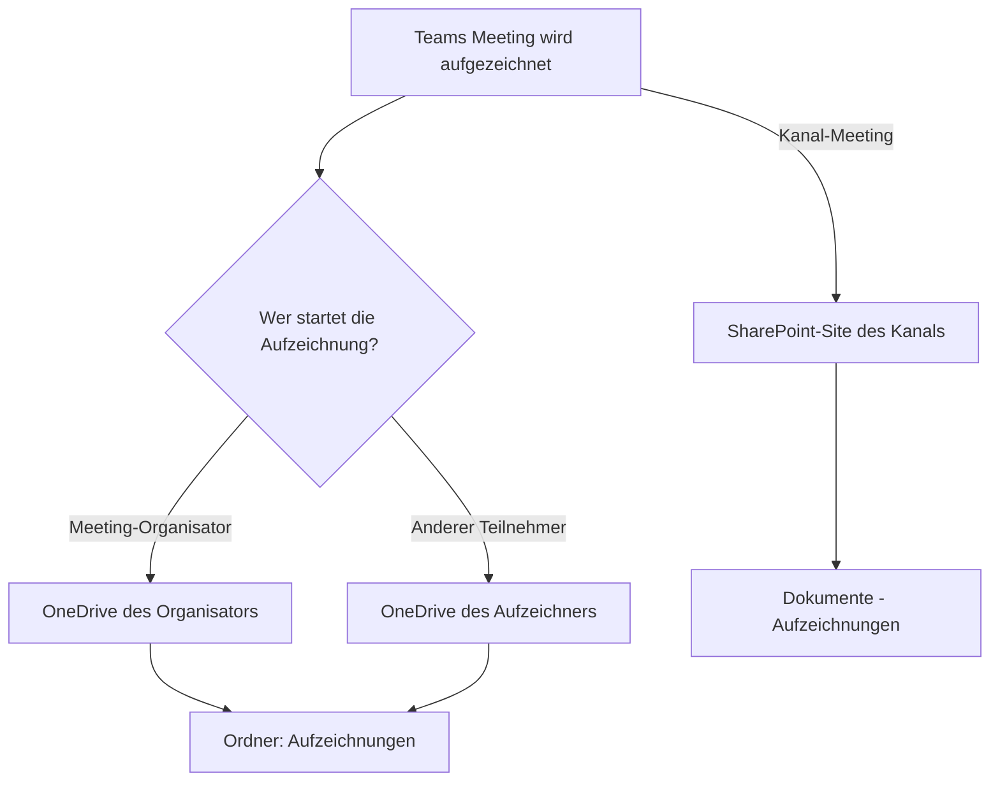
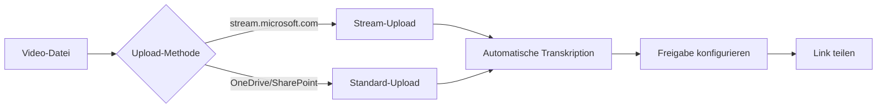

# Microsoft Stream

> [!ABSTRACT] TL;DR
> **Microsoft Stream (on SharePoint)** ist die aktuelle Videoplatform in M365 – Videos werden in SharePoint und OneDrive gespeichert (keine separate Azure-Infrastruktur mehr). Teams-Meeting-Aufzeichnungen landen automatisch in OneDrive/SharePoint. Das klassische Stream (Azure Media Services) wurde Ende April 2024 eingestellt. Die neue Version bietet Transkription, automatische Untertitel, Kapitelmarken und Playlisten.

---

## Stream klassisch vs. Stream on SharePoint

| Merkmal | Stream (klassisch) | Stream on SharePoint |
|---------|------------------|---------------------|
| **Speicher** | Azure Media Services | SharePoint/OneDrive |
| **Status** | Eingestellt (April 2024) | Aktuell |
| **Datenverwaltung** | Separate Video-Plattform | Teil von M365-Ökosystem |
| **DLP/Compliance** | Eingeschränkt | ✅ Purview-Integration |
| **Suche** | Eigenständig | Microsoft Search |
| **Berechtigungen** | Eigen | SharePoint/OneDrive-Standard |
| **Teams-Aufzeichnung** | In Stream klassisch | OneDrive/SharePoint |

> [!WARNING] Klassisches Stream eingestellt
> Microsoft Stream (klassisch) wurde am **15. April 2024** offiziell eingestellt. Alle Inhalte mussten vorher zu SharePoint migriert werden. Nicht migrierte Videos waren danach nicht mehr zugänglich.

---

## Videospeicherung in SharePoint und OneDrive

### Teams-Meeting-Aufzeichnungen

**Wo landen Teams-Aufzeichnungen?**



> [!NOTE] Kanal-Meetings vs. normale Meetings
> - **Normale Teams-Meetings** (ad-hoc, geplant ohne Kanal): Aufzeichnung in **OneDrive des Organisators**
> - **Kanal-Meetings** (in einem Teams-Kanal geplant): Aufzeichnung in **SharePoint der Channel-Site**

### Aufbewahrungsfristen für Aufzeichnungen

Standardmäßig werden Teams-Aufzeichnungen **60 Tage** nach dem Meeting automatisch gelöscht (seit August 2021). Dies lässt sich anpassen:

```powershell
# Standardmäßige Aufbewahrungszeit ändern (Teams Admin)
Set-CsTeamsMeetingPolicy -Identity Global -MeetingRecordingExpirationDays 120
# Wert -1 = unbegrenzt (kein automatisches Löschen)
Set-CsTeamsMeetingPolicy -Identity Global -MeetingRecordingExpirationDays -1
```

> [!IMPORTANT] Purview Retention Policy übersteuert
> Wenn eine **Purview Retention Policy** für OneDrive/SharePoint konfiguriert ist, hat diese Vorrang vor der Teams-Aufzeichnungs-Ablaufzeit. Compliance-Anforderungen zuerst klären.

---

## Stream-Funktionen

### Video-Player-Features

| Feature | Beschreibung |
|---------|-------------|
| **Automatische Transkription** | Spracherkennung in 30+ Sprachen |
| **Interaktive Suche** | Im Transkript nach Zeitstempeln suchen |
| **Kapitelmarken** | Videos in Abschnitte unterteilen |
| **Untertitel** | Auto-generiert oder manuell hochgeladen |
| **Geschwindigkeit** | 0,5x bis 2x Wiedergabegeschwindigkeit |
| **Loop** | Bestimmte Segmente wiederholen |
| **Notizen** | Zeitstempel-basierte Notizen |
| **Kommentare** | Kommentare an bestimmten Zeitpunkten |

### Transkription und Untertitel

Transkription wird automatisch für Videos in SharePoint und OneDrive erstellt:

- **Genauigkeit**: Hoch bei klarer Sprache, variabel bei Hintergrundgeräuschen
- **Sprachen**: 30+ Sprachen unterstützt (inkl. Deutsch, Englisch, Französisch)
- **Bearbeitbar**: Transkript kann manuell korrigiert werden
- **VTT-Export**: Untertiteldatei (.vtt) herunterladbar
- **Compliance**: Transkripte können für eDiscovery durchsucht werden

---

## Channels und Organisation

### Channels (Kanäle)

In Stream können **Channels** für die Organisation von Videos erstellt werden:
- Vergleichbar mit YouTube-Kanälen
- Können für eine Abteilung, ein Team oder ein Thema erstellt werden
- Kanal-URLs für einfaches Teilen

> [!NOTE] Channels basieren auf SharePoint
> Stream-Channels sind technisch **SharePoint-Bibliotheken oder Dokumentbibliotheks-Ansichten**. Sie bieten keine eigenständige Infrastruktur – Videos liegen weiterhin in OneDrive/SharePoint.

### Playlisten

Videos können zu **Playlisten** zusammengefasst werden:
- Weiterbildungsreihen
- Onboarding-Videos
- Produktdemos
- Schulungsvideos

---

## Stream-Seite (stream.microsoft.com)

Die Stream-Startseite `stream.microsoft.com` bietet:
- **Entdecken**: Empfohlene und populäre Videos
- **Meine Videos**: Eigene hochgeladene Videos
- **Geteilt mit mir**: Von anderen freigegebene Videos
- **Aufzeichnungen**: Teams-Meeting-Aufzeichnungen
- **Hochladen**: Direktes Hochladen von Videodateien
- **Suche**: Suche nach Video-Titel, Transkript, Metadaten

---

## Upload und Veröffentlichung

### Video hochladen



### Unterstützte Formate

| Videoformat | Unterstützt |
|------------|------------|
| MP4 | ✅ (empfohlen) |
| MOV | ✅ |
| WMV | ✅ |
| AVI | ✅ |
| MKV | ✅ |

**Maximale Dateigröße**: 100 GB pro Video (SharePoint-Limit)

---

## Admin-Einstellungen

### Teams-Aufzeichnungsrichtlinien

```powershell
# Teams-Meeting-Aufzeichnung konfigurieren
Connect-MicrosoftTeams

# Aufzeichnung für alle erlauben/verbieten
Set-CsTeamsMeetingPolicy -Identity Global -AllowCloudRecording $true

# Aufzeichnung nur für Owner erlauben
Set-CsTeamsMeetingPolicy -Identity Global -AllowRecordingStorageOutsideRegion $false

# Transkription aktivieren
Set-CsTeamsMeetingPolicy -Identity Global -AllowTranscription $true
```

### Stream-Einstellungen im Admin Center

Im **Teams Admin Center** → **Meetings → Meeting-Richtlinien:**
- Cloud-Aufzeichnung erlauben (ein/aus)
- Transkription aktivieren
- Aufbewahrungszeit für Aufzeichnungen

### OneDrive/SharePoint Speicher-Quoten

Da Videos in OneDrive/SharePoint gespeichert werden, verbrauchen sie den entsprechenden Speicher:
- **OneDrive-Standardkontingent**: 1 TB pro Benutzer
- **SharePoint-Kontingent**: 1 TB + 10 GB pro Lizenz

```powershell
# OneDrive-Speichernutzung überprüfen
Connect-SPOService -Url "https://contoso-admin.sharepoint.com"

Get-SPOSite -IncludePersonalSite $true -Limit All -Filter "Url -like '-my.sharepoint'" |
    Select-Object Url, StorageUsageCurrent, StorageQuota |
    Sort-Object StorageUsageCurrent -Descending |
    Select-Object -First 20
```

---

## Integration mit anderen M365-Diensten

| Dienst | Integration |
|--------|------------|
| **Teams** | Aufzeichnungen, Video-Tab in Kanal |
| **SharePoint** | Stream-Webpart in Seiten |
| **Yammer/Viva Engage** | Video-Posts |
| **Viva Learning** | Video als Lerninhalt |
| **Microsoft Search** | Videos durchsuchbar |
| **Purview** | DLP, Retention, eDiscovery |

---

## Troubleshooting

> [!WARNING] Teams-Aufzeichnung startet nicht
> Mögliche Ursachen:
> - Meeting-Richtlinie: Cloud-Aufzeichnung deaktiviert → Teams Admin Center prüfen
> - OneDrive-Speicher voll → Speicher freigeben oder Kontingent erhöhen
> - Compliance-Richtlinien verbieten Aufzeichnung

> [!BUG] Transkription in falscher Sprache
> Transkription nutzt die **Meeting-Sprache**. Wenn Deutsch erwartet wird, aber Englisch transkribiert wird:
> In den Teams-Meeting-Einstellungen vor dem Meeting die Sprache auf Deutsch setzen, oder nach dem Meeting das Transkript manuell korrigieren.

> [!WARNING] Video "Wird verarbeitet" angezeigt
> Nach dem Upload verarbeitet SharePoint/Stream das Video (Thumbnail, Transkription). Dies kann je nach Dateigröße **5-30 Minuten** dauern. Bei großen Dateien (>1 GB) kann es länger dauern.

---

## Verwandte Notizen

- [[Microsoft Whiteboard]]
- [[Microsoft Loop]]
- [[M365 Admin Center]]
