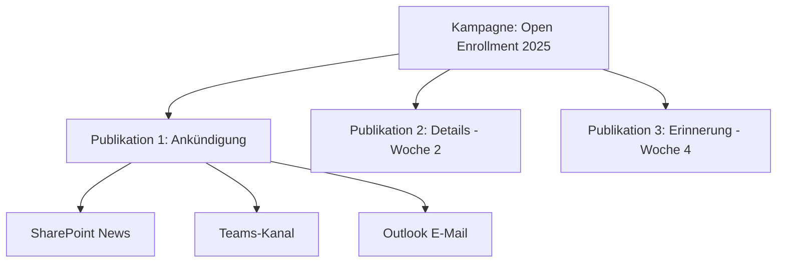
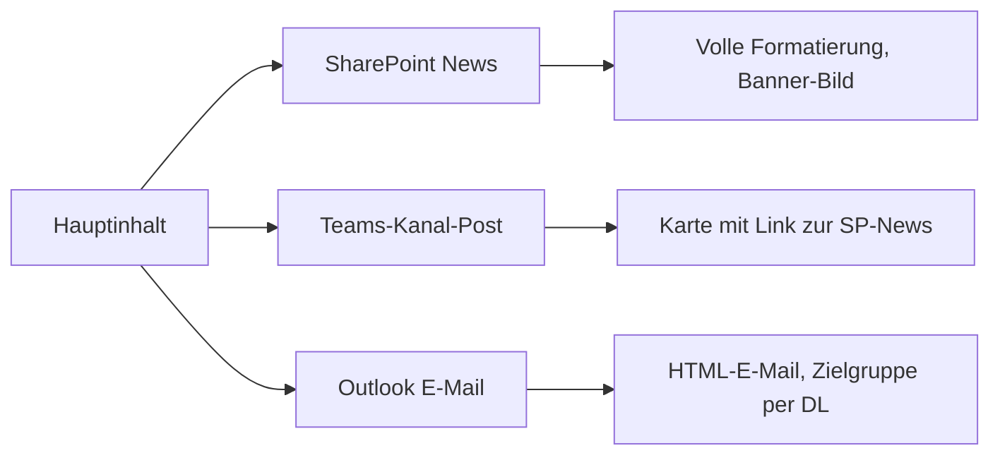
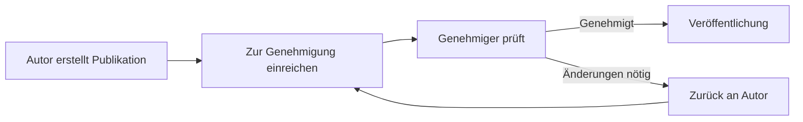

# Microsoft Viva Amplify

> [!ABSTRACT] TL;DR
> **Microsoft Viva Amplify** ist das Tool für strukturierte interne Kommunikationskampagnen in Microsoft 365. Kommunikatoren erstellen Inhalte einmalig und veröffentlichen sie gleichzeitig über mehrere Kanäle: **SharePoint News, Teams-Kanäle und Outlook E-Mail** – mit automatischer Formatierungsanpassung pro Kanal. Analytics zeigen, welche Kanäle welche Zielgruppen am besten erreichen.

---

## Was ist Viva Amplify?

Viva Amplify löst das Problem der fragmentierten internen Kommunikation: Statt denselben Inhalt manuell für SharePoint News, Teams und E-Mail separat zu erstellen, wird er **einmalig in Amplify** verfasst und dann automatisch für alle Kanäle aufbereitet.

### Warum Viva Amplify?

| Problem ohne Amplify | Lösung mit Amplify |
|---------------------|-------------------|
| Inhalt 3x erstellen (SP/Teams/Outlook) | Einmal erstellen, mehrfach veröffentlichen |
| Keine Übersicht über Reichweite | Zentrales Analytics-Dashboard |
| Zielgruppen manuell verwalten | Entra ID-Gruppen als Audiences |
| Kein Kampagnen-Management | Strukturierte Kampagnen |
| Kein Konsistenz-Check | Einheitliche Gestaltung |

---

## Kernkonzepte

### Kampagnen

Eine **Kampagne** ist ein übergeordnetes Kommunikationsprojekt:
- Unternehmensweite Ankündigung
- Change-Management-Initiative
- Sicherheits-Awareness-Kampagne
- Mitarbeiterbindungs-Initiative

### Publikationen

Jede **Publikation** innerhalb einer Kampagne ist ein konkreter Inhalt, der veröffentlicht wird.

---

## Kampagne erstellen

### Schritt 1: Neue Kampagne

1. **Viva Amplify App öffnen** (über M365 App-Launcher oder Teams)
2. **Neue Kampagne erstellen**
3. Name, Beschreibung, Zeitraum, Farbe/Icon festlegen
4. Team-Mitglieder zur Kampagne einladen (Autoren, Genehmiger)

### Schritt 2: Publikation erstellen

1. Kampagne öffnen → **Neue Publikation**
2. **Inhalt verfassen** (Rich-Text-Editor ähnlich wie SharePoint News)
3. Bilder, Videos, Links einfügen
4. **Kanäle auswählen**: SharePoint News, Teams, Outlook

### Schritt 3: Kanäle konfigurieren

Für **jeden Kanal** können Anpassungen vorgenommen werden:

| Kanal | Anpassungen |
|-------|------------|
| **SharePoint News** | Banner-Bild, Kategorie, Site auswählen |
| **Teams** | Kanal auswählen, zusätzliche Teams-Nachricht |
| **Outlook** | Betreff, Verteiler, Absendernamen |

---

## Multi-Kanal-Publishing

### SharePoint News

- Wird auf der gewählten SharePoint-Site veröffentlicht
- Erscheint im **Viva Connections Feed** aller Mitarbeiter
- Indexiert und durchsuchbar in Microsoft Search

### Teams-Kanal

- Automatische Post in den gewählten Teams-Kanal
- Erscheint als **News-Karte** mit Vorschau und Link zur vollständigen Seite
- Kommentare und Reaktionen direkt im Teams-Post

### Outlook E-Mail

- Wird als **HTML-formatierte E-Mail** versendet
- Absender konfigurierbar (z.B. "HR-Team@contoso.de")
- Empfänger via Entra ID-Gruppen oder Verteilerlisten

> [!TIP] Outlet-Reihenfolge planen
> Nicht alle Kanäle gleichzeitig veröffentlichen:
> - SharePoint News zuerst (als "Quelle")
> - Teams kurz danach (mit Link zur SP-Seite)
> - E-Mail für wichtige Zielgruppen mit hoher Dringlichkeit

---

## Zielgruppen (Audiences)

Publikationen können für **spezifische Zielgruppen** konfiguriert werden:

- **Entra ID-Gruppen**: Sicherheitsgruppen, M365-Gruppen
- **Verteilerlisten**: Exchange-Verteilerlisten
- **Alle**: Gesamte Organisation
- **Benutzerdefiniert**: Kombination aus Gruppen

### Audience-Targeting in SharePoint News

SharePoint News kann **automatisch gefiltert** werden:
- Benutzer sehen nur Neuigkeiten, die für ihre Gruppen relevant sind
- Viva Connections Feed berücksichtigt Zielgruppen

---

## Genehmigungsworkflow

Für größere Unternehmen können **Genehmigungsschritte** konfiguriert werden:

Rollen in Viva Amplify:
- **Kampagnen-Autor**: Inhalte erstellen und bearbeiten
- **Kampagnen-Manager**: Kampagne verwalten, veröffentlichen
- **Genehmiger**: Inhalte vor Veröffentlichung freigeben

---

## Analytics

Nach der Veröffentlichung bietet Viva Amplify **Reichweiten-Analytics**:

| Metrik | Beschreibung |
|--------|-------------|
| **Erreichte Personen** | Unique Views gesamt |
| **Kanal-Aufschlüsselung** | Views per SharePoint/Teams/Outlook |
| **Öffnungsrate** | Outlook E-Mail-Öffnungsrate |
| **Klickrate** | Klicks auf Links |
| **Engagement** | Reaktionen, Kommentare |
| **Zielgruppen-Abdeckung** | Prozent der Zielgruppe erreicht |

> [!NOTE] Analytics-Verfügbarkeit
> Vollständige Analytics (inkl. E-Mail-Öffnungsraten) erfordern **Viva Amplify Premium** (Viva Suite). Basis-Analytics sind in Standard-M365-Plänen verfügbar.

---

## Unterschied zu SharePoint News allein

| Merkmal | SharePoint News | Viva Amplify |
|---------|----------------|-------------|
| **Multi-Kanal** | ❌ Nur SharePoint | ✅ SP + Teams + Outlook |
| **Kampagnen-Management** | ❌ | ✅ |
| **Genehmigungsworkflow** | Eingeschränkt | ✅ |
| **Analytics** | Basis-Seitenanalyse | ✅ Kanal-übergreifend |
| **Audience-Targeting** | ✅ | ✅ Erweitert |
| **Mehrsprachig** | ✅ | ✅ |
| **Team-Kollaboration** | Eingeschränkt | ✅ |
| **Lizenz** | M365 inkl. | Viva Suite |

---

## Voraussetzungen

| Anforderung | Details |
|------------|---------|
| **Lizenz** | Viva Suite oder Viva Amplify Add-on |
| **SharePoint** | Home Site eingerichtet (für optimale Nutzung) |
| **Teams** | Microsoft Teams aktiv |
| **Exchange** | Exchange Online (für Outlook-Kanal) |
| **Berechtigungen** | SharePoint News veröffentlichen |

---

## Troubleshooting

> [!WARNING] E-Mail-Kanal sendet nicht
> Häufige Ursachen:
> - Benutzer hat keine Berechtigung, im Namen der Verteilergruppe zu senden ("Send As")
> - Verteilergruppe zu groß (Exchange-Limits beachten)
> - Spam-Filter blockiert Massenversand – IT für "Whitelist" informieren

> [!BUG] SharePoint-News erscheint nicht im Feed
> - Audience-Targeting prüfen: Ist der aktuelle Benutzer in der Zielgruppe?
> - SharePoint-News auf der richtigen Site veröffentlicht? Home Site?
> - Viva Connections Feed-Cache kann bis zu 30 Minuten verzögert sein

> [!WARNING] Genehmiger erhält keine Benachrichtigung
> Sicherstellen dass:
> - Genehmiger hat eine gültige E-Mail-Adresse in Entra ID
> - Benachrichtigungs-E-Mails nicht im Spam
> - Genehmiger hat Zugriff auf die Kampagne (Mitglied der Kampagne)

---

## Verwandte Notizen

- [[Microsoft Viva Connections]]
- [[Microsoft Viva Engage]]
- [[Microsoft Viva Pulse]]
- [[M365 Admin Center]]
