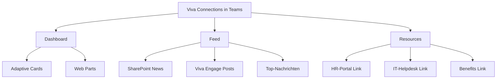

# Microsoft Viva Connections

> [!ABSTRACT] TL;DR
> **Microsoft Viva Connections** bringt das Unternehmens-Intranet direkt in Microsoft Teams. Als zentraler Hub zeigt es personalisierte Nachrichten (Feed), ein anpassbares Dashboard mit Adaptive Cards und Links zu wichtigen Ressourcen. Basis ist eine **SharePoint Communication Site als Home Site**. Viva Connections ist in M365 E1/E3/E5 und Business-Plänen enthalten.

---

## Was ist Viva Connections?

Viva Connections ist der **Einstiegspunkt für das digitale Arbeitsleben** – direkt in Microsoft Teams. Es kombiniert:

- **Dashboard**: Personalisierte Kacheln und Adaptive Cards mit relevanten Informationen (Urlaub, Spesen, IT-Tickets, etc.)
- **Feed**: Personalisierter Nachrichtenstrom aus SharePoint News, Yammer/Viva Engage
- **Resources**: Links zu wichtigen Ressourcen (HR-Portal, Richtlinien, Tools)



---

## Voraussetzungen

| Anforderung | Details |
|------------|---------|
| **Lizenz** | Microsoft 365 (jede aktive M365-Lizenz) |
| **SharePoint** | SharePoint Online aktiviert |
| **Teams** | Microsoft Teams aktiv |
| **Home Site** | SharePoint Communication Site als Home Site designiert |
| **App-Katalog** | SharePoint-App-Katalog für benutzerdefinierte Karten |
| **Admin-Rollen** | SharePoint-Admin + Global Admin für Einrichtung |

> [!IMPORTANT] Home Site ist Pflicht
> Eine **SharePoint Communication Site muss als Home Site** designiert werden. Ohne Home Site kann Viva Connections nicht konfiguriert werden. Eine Organisation kann nur **eine** Home Site haben.

---

## Via Microsoft 365 Admin Center (UI)

### Home Site im SharePoint Admin Center einrichten

1. Melde dich an beim **SharePoint Admin Center** unter `https://<tenant>-admin.sharepoint.com`
2. Navigiere zu **Einstellungen → Home Site**
3. Gib die URL der Communication Site ein, die als Home Site dienen soll
4. Klicke auf **Speichern**

### Viva Connections in Teams aktivieren

1. Melde dich an beim **Microsoft Teams Admin Center** unter [admin.teams.microsoft.com](https://admin.teams.microsoft.com)
2. Navigiere zu **Teams-Apps → Apps verwalten**
3. Suche nach **Viva Connections** und stelle sicher, dass die App erlaubt ist
4. Navigiere zu **Teams-Apps → Einrichtungsrichtlinien**
5. Bearbeite die globale Richtlinie → **Apps hinzufügen → Viva Connections** auswählen
6. Verschiebe die App an die gewünschte Position in der Leiste → **Speichern**

### Dashboard im SharePoint Home Site konfigurieren

1. Öffne die **Home Site** in SharePoint
2. Klicke auf das **Zahnrad-Symbol → Viva Connections einrichten**
3. Navigiere zu **Dashboard → Karte hinzufügen**
4. Wähle eine vordefinierte Karte (z.B. *Genehmigte Anfragen*, *Schichtpläne*) oder erstelle eine benutzerdefinierte Adaptive Card
5. Konfiguriere **Zielgruppen** für jede Karte (Entra ID-Gruppen)
6. Klicke auf **Veröffentlichen**

---

## Einrichtung: Schritt für Schritt

### Schritt 1: Home Site erstellen und designieren

```powershell
# SharePoint Communication Site als Home Site setzen
Connect-SPOService -Url "https://contoso-admin.sharepoint.com"

# Home Site setzen
Set-SPOHomeSite -HomeSiteUrl "https://contoso.sharepoint.com/sites/intranet"

# Verifizieren
Get-SPOHomeSite
```

### Schritt 2: Viva Connections App in Teams aktivieren

Im **Teams Admin Center:**
1. **Apps → Teams-Apps verwalten**
2. "Viva Connections" suchen → App-Status prüfen (Erlaubt/Blockiert)
3. App als **"Für alle fixiert"** in der App-Einrichtungsrichtlinie hinzufügen

```powershell
# Teams App-Richtlinie aktualisieren (Viva Connections pinnen)
Connect-MicrosoftTeams

# Bestehende Richtlinie anzeigen
Get-CsTeamsAppSetupPolicy -Identity "Global"
```

### Schritt 3: Dashboard konfigurieren

Im **SharePoint Home Site:**
1. **Einstellungen (Zahnrad) → Viva Connections einrichten**
2. Dashboard öffnen → **Karte hinzufügen**
3. Karten aus der Bibliothek wählen oder benutzerdefinierte Karten (Adaptive Cards) einbinden

---

## Dashboard – Adaptive Cards

Das Dashboard besteht aus **Adaptive Cards** – vorgefertigten oder benutzerdefinierten Kacheln.

### Vordefinierte Karten (Out-of-the-Box)

| Karte | Funktion |
|-------|---------|
| **Approvals** | Ausstehende Genehmigungen anzeigen |
| **Assigned tasks** | Aufgaben aus Planner/To Do |
| **Shifts** | Schichtpläne (Teams Shifts) |
| **Topics** | Viva Topics Wissensartikel |
| **News** | SharePoint News-Nachrichten |
| **Events** | Kommende Ereignisse |
| **Web Link** | Link zu internen/externen Seiten |
| **Teams App** | Jede Teams-App als Karte öffnen |
| **Card Designer** | Benutzerdefinierte Karte erstellen |

### Benutzerdefinierte Adaptive Cards

Für spezifische Unternehmensanwendungen können **eigene Adaptive Cards** entwickelt werden:

```json
{
  "type": "AdaptiveCard",
  "version": "1.4",
  "body": [
    {
      "type": "TextBlock",
      "text": "Meine Urlaubstage",
      "size": "Large",
      "weight": "Bolder"
    },
    {
      "type": "TextBlock",
      "text": "Verbleibend: 14 Tage",
      "size": "Medium"
    }
  ],
  "actions": [
    {
      "type": "Action.OpenUrl",
      "title": "Urlaub beantragen",
      "url": "https://hr.contoso.de/urlaub"
    }
  ]
}
```

> [!TIP] Adaptive Card Designer
> Microsoft bietet unter **adaptivecards.io/designer** einen visuellen Designer für Adaptive Cards. Keine JSON-Kenntnisse nötig für einfache Karten.

---

## Feed – Personalisierter Nachrichtenstrom

Der **Feed** zeigt personalisierte Inhalte basierend auf:
- SharePoint News von Sites, die der Benutzer folgt
- Boosted News (von Admins/Site-Owners priorisiert)
- Viva Engage (ehemals Yammer) Community-Posts
- Organisationsweite Ankündigungen

### Nachrichten boosten

Wichtige Nachrichten können "geboosted" werden, damit sie für alle oben erscheinen:
1. SharePoint News-Artikel → **Promote (Bewerben)**
2. Dauer des Boosts festlegen (1-30 Tage)
3. Boost erscheint im Viva Connections Feed aller Benutzer

---

## Resources – Navigation

Resources ist der **Navigationsbereich** mit Links zu wichtigen Unternehmensressourcen:
- HR-Richtlinien
- IT-Helpdesk
- Benefits-Portal
- Lernressourcen
- Externe Tools

Konfiguration im **SharePoint Home Site → Global Navigation** (die Navigationsleiste des Home Sites wird zum Resources-Bereich in Viva Connections).

---

## Viva Connections Mobile

Die Viva Connections Mobile-App (Teil der Teams Mobile App) ist optimiert für:
- **Firstline Worker** auf dem Smartphone
- Push-Benachrichtigungen für Schichten, Aufgaben, Ankündigungen
- Offline-Support (eingeschränkt)
- Vereinfachtes Dashboard für Touch-Bedienung

> [!NOTE] Mobile-First Design
> Viva Connections Mobile priorisiert Karten, die für mobile Benutzer relevant sind. Das Dashboard kann für Desktop und Mobile **unterschiedlich konfiguriert** werden – verschiedene Karten für verschiedene Personas.

---

## Personas und Zielgruppen

Adaptive Cards und Dashboard-Inhalte können für **Zielgruppen (Audiences)** konfiguriert werden:

- **Entra ID-Gruppen**: Karten nur für bestimmte Gruppen anzeigen
- **M365-Gruppen**: Basierend auf Teams-Mitgliedschaft
- **Alle**: Für die gesamte Organisation

Beispiel: Schicht-Karte (Shifts) nur für Firstline Worker, Genehmigungs-Karte (Approvals) nur für Manager.

---

## Analytics

Im **SharePoint Admin Center** und **Viva Insights** (für Viva Suite-Lizenzen):
- **Seitenaufrufe** des Home Sites
- **Engagement** mit Dashboard-Karten
- **Feed-Klickrate** auf Nachrichten
- **Unique Visitors** und **Verweildauer**

---

## Troubleshooting

> [!WARNING] Viva Connections App fehlt in Teams
> Wenn die App in Teams nicht erscheint:
> 1. Teams Admin Center → App-Status prüfen (nicht blockiert?)
> 2. App-Einrichtungsrichtlinie: App gepinnt für Benutzer?
> 3. Teams neu starten (Cache leeren: Teams-App → ... → Einstellungen zurücksetzen)

> [!BUG] Dashboard zeigt keine Karten
> Home Site korrekt gesetzt? Prüfen mit:
> ```powershell
> Connect-SPOService -Url "https://contoso-admin.sharepoint.com"
> Get-SPOHomeSite
> ```
> Wenn leer → Home Site neu designieren.

> [!WARNING] Feed zeigt keine Inhalte
> - Hat der Benutzer SharePoint-Sites abonniert/gefolgt? → Site → "Folgen" klicken
> - Gibt es NewsPublished-Elemente auf abonnierten Sites?
> - Mindestens eine Site mit veröffentlichten Neuigkeiten erforderlich

---

## Verwandte Notizen

- [[Microsoft Viva Engage]]
- [[Microsoft Viva Insights]]
- [[Microsoft Viva Learning]]
- [[M365 Admin Center]]
