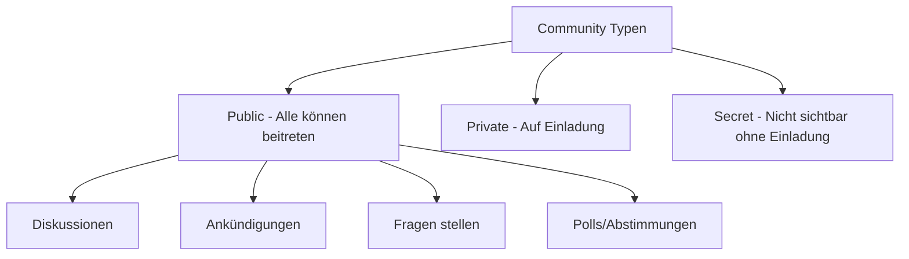

# Microsoft Viva Engage

> [!ABSTRACT] TL;DR
> **Microsoft Viva Engage** (ehemals Yammer) ist das Enterprise Social Network in Microsoft 365. Es ermöglicht offene Communities, Diskussionen über Abteilungsgrenzen hinweg und direkte Kommunikation zwischen Führungskräften und Mitarbeitern. Mit **Storylines** haben alle Mitarbeiter eine persönliche Stimme. Im **Native Mode** sind alle Daten M365-Gruppen-basiert und compliance-fähig.

---

## Was ist Viva Engage?

Viva Engage ist das **"Facebook/LinkedIn des Unternehmens"** – ein offenes, Community-basiertes Netzwerk für:
- **Offene Kommunikation** über Abteilungs- und Hierarchiegrenzen
- **Communities of Interest**: Gruppen zu Themen, Projekten, Hobbies
- **Leadership Communication**: Führungskräfte kommunizieren direkt mit allen
- **Wissensaustausch**: Fragen stellen, Antworten finden
- **Ankündigungen**: Unternehmensweite Kommunikation

### Viva Engage vs. Microsoft Teams

| Merkmal | Viva Engage | Microsoft Teams |
|---------|------------|----------------|
| **Kommunikationstyp** | Offen, asynchron, Community | Strukturiert, Echtzeit, Team-fokussiert |
| **Zielgruppe** | Gesamte Organisation | Spezifisches Team/Projekt |
| **Sichtbarkeit** | Meist öffentlich im Unternehmen | Meist privat (Team-Mitglieder) |
| **Struktur** | Communities, Storylines | Kanäle, Chats |
| **Persistenz** | Langfristig | Kurzfristig bis mittelfristig |
| **Suche** | Gut für Wissenssuche | Gut für Team-Kontext |

---

## Kernfunktionen

### Communities

**Communities** sind offene oder geschlossene Gruppen zu einem Thema oder einer Abteilung:



**Community-Inhalte:**
- **Posts**: Beiträge mit Text, Bildern, Dateien, GIFs
- **Events**: Virtuelle und physische Events ankündigen
- **Fragen**: Fragen stellen mit bester Antwort markieren
- **Gelobt/Hervorgehoben**: Mitarbeiter hervorheben
- **Dateien**: Dateien in der Community teilen (SharePoint)

### Storylines (persönliche Profile)

**Storylines** geben jedem Mitarbeiter eine persönliche Stimme:
- Eigener Feed auf dem persönlichen Profil
- Kollegen können folgen
- Beiträge erscheinen im Feed der Follower
- Reaktionen und Kommentare von Kollegen

> [!INFO] Storylines aktivieren
> Storylines können im **Viva Engage Admin Center** aktiviert oder deaktiviert werden. Für volle Nutzung wird eine **Viva Suite**-Lizenz empfohlen, aber grundlegende Storylines sind in M365 E1/E3/E5 enthalten.

### Leadership Corner

Der **Leadership Corner** ist ein dedizierter Bereich für:
- CEO/Führungskräfte-Beiträge
- Unternehmensankündigungen
- **AMA (Ask Me Anything)**: Führungskräfte beantworten Mitarbeiterfragen live
- Town Hall-Diskussionen (virtuell)

### Answers in Viva

**Answers** ist die Q&A-Funktion:
- Mitarbeiter stellen Fragen an die gesamte Organisation
- Experten beantworten (mit Badge-System)
- Beste Antworten werden markiert und archiviert
- Wissensaufbau durch Crowdsourcing

---

## Via Microsoft 365 Admin Center (UI)

### Viva Engage Admin Center öffnen

1. Melde dich an beim **Microsoft 365 Admin Center** unter [admin.microsoft.com](https://admin.microsoft.com)
2. Klicke in der linken Navigation auf **Admin Center → Viva Engage** (oder öffne direkt [engage.cloud.microsoft](https://engage.cloud.microsoft))
3. Klicke oben rechts auf das **Zahnrad-Symbol** um das Viva Engage Admin Center zu öffnen

### Community erstellen

1. Öffne **Viva Engage** unter [engage.cloud.microsoft](https://engage.cloud.microsoft)
2. Klicke auf **+ Neue Community**
3. Gib Namen, Beschreibung und Sichtbarkeit ein (Öffentlich / Privat / Geheim)
4. Lade Mitglieder ein und weise **Community-Admins** zu
5. Klicke auf **Community erstellen**

### Features im Viva Engage Admin Center konfigurieren

1. Öffne das **Viva Engage Admin Center** (Zahnrad-Symbol in Engage)
2. Navigiere zu **Mandanteneinstellungen**
3. Aktiviere oder deaktiviere **Storylines**, **Answers in Viva** und **Leadership Corner**
4. Konfiguriere unter **Moderation** die Überwachungsregeln und blockierten Schlüsselwörter
5. Klicke auf **Speichern**

---

## Native Mode

Der **Native Mode** ist der empfohlene Betriebsmodus für Unternehmens-Tenants:

### Was der Native Mode ändert

| Aspekt | Ohne Native Mode | Mit Native Mode |
|--------|----------------|----------------|
| **Gruppen** | Yammer-eigene Gruppen | M365-Gruppen-basiert |
| **Compliance** | Eingeschränkt | Vollständig (Purview) |
| **eDiscovery** | Eingeschränkt | ✅ |
| **Gastnutzer** | Eigenes System | Entra ID B2B |
| **SharePoint-Dateien** | In Yammer | In SharePoint |
| **Teams-Integration** | Eingeschränkt | ✅ Native |

> [!IMPORTANT] Native Mode Migration
> Die Migration in den Native Mode ist **einseitig** – kein Zurück möglich. Microsoft bietet ein **Alignment Tool** zur Vorbereitung und Migration. Vor der Aktivierung alle Yammer-Gruppen prüfen und nicht-konforme Gruppen bereinigen.

### Native Mode aktivieren

```powershell
# Native Mode über PowerShell prüfen
# Viva Engage Admin Center → Tenant settings → Microsoft 365 Native Mode
# Alignment Tool ausführen (im Admin Center)
```

---

## Einrichtung und Konfiguration

### Viva Engage Admin Center

Das Admin Center ist unter **admin.microsoft.com** → **Viva Engage** oder direkt in der Viva Engage App:

| Einstellung | Beschreibung |
|------------|-------------|
| **Tenant-Einstellungen** | Native Mode, externe Netzwerke |
| **Features** | Storylines, Answers, Leadership Corner ein/aus |
| **Analytics** | Engagement-Statistiken |
| **Moderation** | Moderationsregeln, blockierte Schlüsselwörter |
| **Datenaufbewahrung** | Exportfunktionen |

### Viva Engage in Teams integrieren

1. **Teams Admin Center** → Apps → Viva Engage erlauben
2. **Viva Engage App** in Teams installieren (über Teams App Store)
3. Optionale Pinnung in App-Einrichtungsrichtlinie

Im Teams-Kanal:
- **Viva Engage-Tab**: Community direkt als Tab einbinden
- **Nachrichten aus Engage teilen**: In Teams-Chats teilen

---

## Governance und Moderation

### Moderation

Viva Engage bietet:
- **Netzwerkadministratoren**: Vollständige Verwaltungsrechte
- **Community-Administratoren**: Verwaltung einzelner Communities
- **Inhaltsmoderation**: Meldungssystem, Nachrichten entfernen
- **Schlüsselwort-Überwachung**: Automatisches Markieren bei bestimmten Wörtern

### Datenschutz und Compliance

> [!WARNING] Datenspeicherung im Native Mode
> Im Native Mode werden alle Viva Engage-Nachrichten in **Microsoft 365-Mailboxen** (Exchange Online) gespeichert und sind damit compliance-fähig (eDiscovery, Legal Hold, DLP). Ohne Native Mode sind die Daten in Yammer-eigener Infrastruktur und schwerer zu verwalten.

```powershell
# Viva Engage Compliance Export (Native Mode)
# Über Microsoft Purview Content Search:
# Suchbereiche: Yammer-Nachrichten sind in Exchange Online enthalten
New-ComplianceSearch -Name "VE-Export" -ExchangeLocation All `
    -ContentMatchQuery "kind:yammer"
```

---

## Datenspeicherung

| Inhaltstyp | Speicherort |
|------------|------------|
| **Nachrichten (Native Mode)** | Exchange Online Mailboxen |
| **Nachrichten (Legacy)** | Yammer-Infrastruktur |
| **Dateien** | SharePoint (M365-Gruppen-basiert) |
| **Bilder/GIFs** | SharePoint/Azure Blob |
| **Videos** | SharePoint/Stream |

---

## Troubleshooting

> [!WARNING] Benutzer kann Community nicht finden
> Geheime Communities sind nur für Mitglieder sichtbar. Wenn ein Benutzer Zugang benötigt: Admin oder Community-Admin muss Einladung senden.

> [!BUG] Viva Engage zeigt "Provisioning in progress"
> Beim ersten Zugriff auf einen neuen Tenant kann die Viva Engage-Instanz mehrere Stunden zur Bereitstellung benötigen. Wenn das Problem nach 24 Stunden anhält:
> ```powershell
> # Yammer-Dienststatus prüfen
> Invoke-WebRequest -Uri "https://status.office.com" -UseBasicParsing
> ```

> [!WARNING] Native Mode Migration: Nicht-konforme Gruppen
> Das Alignment Tool kann auf Gruppen stoßen, die nicht migriert werden können (externe Mitglieder, spezielle Konfigurationen). Diese müssen vor der Migration manuell bereinigt oder geschlossen werden.

---

## Verwandte Notizen

- [[Microsoft Viva Connections]]
- [[Microsoft Viva Amplify]]
- [[M365 Admin Center]]
