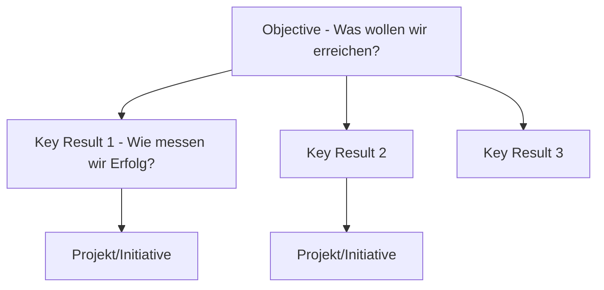
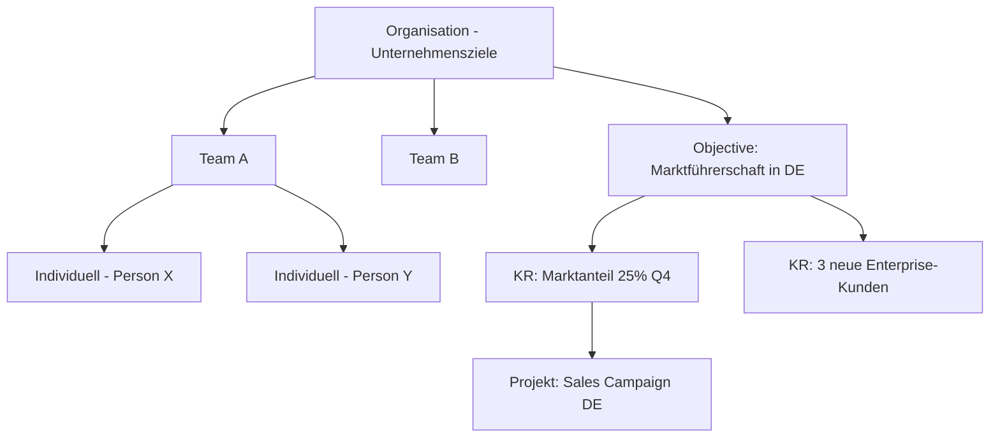
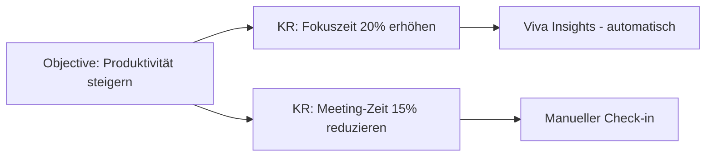
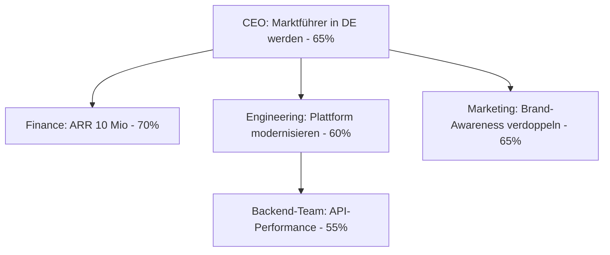

# Microsoft Viva Goals

> [!ABSTRACT] TL;DR
> **Microsoft Viva Goals** ist das OKR-Management-Tool (Objectives & Key Results) in Microsoft 365. Es ermöglicht die Verknüpfung von Unternehmenszielen mit Team- und Einzelzielen, automatische Fortschrittsverfolgung über Integrationen (Planner, Azure DevOps, Jira) und regelmäßige Check-ins. Ziel: Alignment und Transparenz über alle Unternehmensebenen.

---

## Was sind OKRs?

**OKR (Objectives & Key Results)** ist eine Zielsetzungsmethodik, entwickelt bei Intel und popularisiert durch Google:

### OKR-Prinzipien

| Prinzip | Beschreibung |
|---------|-------------|
| **Ambitious** | Ziele sind ambitioniert (stretch goals) |
| **Measurable** | Key Results sind messbar (Zahlen, Prozente) |
| **Aligned** | Teams-OKRs sind mit Unternehmens-OKRs verknüpft |
| **Transparent** | Alle sehen alle OKRs |
| **Time-bound** | Meist quartalsweise |
| **Nicht vergütungsgebunden** | OKRs und Leistungsbeurteilung getrennt |

### Gute vs. schlechte OKRs

| Schlecht | Gut |
|----------|-----|
| "Kundenzufriedenheit verbessern" | "Objective: Kundenbegeisterung steigern – KR: NPS von 42 auf 55 erhöhen" |
| "Mehr verkaufen" | "KR: Quartalsumsatz auf 2,5 Mio. € steigern (von 2,0 Mio.)" |
| "Teams besser nutzen" | "KR: Teams-Adoptionsrate von 60% auf 90% steigern" |

---

## Viva Goals Struktur

### Hierarchie

### Zeiträume

Viva Goals unterstützt verschiedene **Zeit-Horizonte**:
- **Annual**: Jahresziele (übergeordnete Strategie)
- **Quarterly**: Quartals-OKRs (Standard für Teams)
- **Monthly**: Monatliche Ziele
- **Custom**: Benutzerdefinierte Zeiträume

---

## Einrichtung

### Organisation einrichten

1. **Viva Goals App in Teams** öffnen oder `goals.microsoft.com`
2. **Organisation erstellen**: Name, Zeitraum (Q1, Q2, etc.), Farbe
3. **Abteilungen/Teams** als Untereinheiten anlegen
4. **Benutzer einladen** und Rollen zuweisen

### Rollen

| Rolle | Berechtigungen |
|-------|---------------|
| **Organization Admin** | Vollständige Verwaltung, alle OKRs |
| **Team Admin** | Eigene Team-OKRs verwalten |
| **Member** | Eigene OKRs erstellen und aktualisieren |
| **Observer** | Nur ansehen |

---

## Ziele, Key Results und Projekte erstellen

### Objective erstellen

1. **Viva Goals** → **OKRs → Hinzufügen → Objective**
2. Titel (ambitioniert, qualitativ)
3. **Zeitraum** zuweisen (z.B. Q4 2024)
4. **Verantwortlicher** (Owner)
5. **Ausrichten an** (Parent Objective für Alignment)

### Key Result hinzufügen

Zu jedem Objective werden 2-5 **messbare Key Results** hinzugefügt:
- **Metrik-Typ**: Prozent, Zahl, Währung, Ja/Nein
- **Startwert** und **Zielwert**
- **Integration**: Automatische Aktualisierung via Datenquelle

### Projekte (Initiatives)

**Projekte** verknüpfen konkrete Arbeit mit Key Results:
- Planner-Plan verknüpfen
- Azure DevOps Iteration verknüpfen
- Jira Sprint verknüpfen
- Manueller Fortschritt

---

## Check-in Prozess

**Check-ins** sind regelmäßige Fortschrittsberichte (wöchentlich empfohlen):

1. **Viva Goals** → Eigene OKRs → **Check-in**
2. Aktuellen Fortschrittswert eingeben
3. **Status** setzen: On Track (grün), At Risk (gelb), Behind (rot), Closed
4. Kommentar hinzufügen (Was lief gut? Was blockiert?)

### Automatische Check-ins via Integration

Wenn ein Key Result mit einer Datenquelle verbunden ist, werden Check-ins **automatisch** durchgeführt:

| Integration | Was wird synchronisiert |
|------------|------------------------|
| **Microsoft Planner** | Erledigte Aufgaben / Gesamtaufgaben |
| **Azure DevOps** | Story Points, Work Items |
| **Jira** | Issues, Sprint-Fortschritt |
| **Salesforce** | Opportunities, Revenue |
| **Excel/CSV** | Manuell hochgeladene Daten |
| **Power BI** | Dashboard-Metriken |

---

## Rollup und Alignment

### Automatisches Rollup

Key Results rollen automatisch auf das übergeordnete Objective:
- Alle KR-Fortschritte werden zum Objective-Fortschritt zusammengefasst
- Objective-Fortschritte rollen auf Team-OKRs
- Team-OKRs rollen auf Unternehmens-OKRs

### Alignment-Ansicht

Die **Alignment-Ansicht** zeigt, wie alle Ziele miteinander verknüpft sind:

---

## Dashboards

Viva Goals bietet mehrere Dashboard-Typen:

| Dashboard | Inhalt |
|----------|--------|
| **Home** | Persönlicher OKR-Überblick |
| **Team Dashboard** | Team-OKR-Status |
| **Organisation** | Alle Ziele auf einem Blick |
| **Explorer** | Detailansicht mit Filtern |
| **Retrospektive** | Quartals-Abschlussanalyse |

---

## Teams-Integration

### Viva Goals in Teams

1. **Teams App-Store** → "Viva Goals" installieren
2. Als **Tab in einem Kanal** hinzufügen
3. Team-OKRs direkt in Teams anzeigen und aktualisieren

### Meeting-Integration

In Teams-Meetings kann Viva Goals für **OKR-Review-Meetings** genutzt werden:
- Viva Goals als Tab im Meeting-Fenster öffnen
- OKRs gemeinsam reviewen und aktualisieren
- Check-in direkt im Meeting durchführen

---

## Lizenzierung

| Feature | Lizenz |
|---------|-------|
| **Viva Goals (vollständig)** | Viva Goals Add-on oder Viva Suite |
| **Preis (Add-on)** | ca. 6 €/User/Monat |
| **Viva Suite** | Alle Viva-Module inkl. Goals (~12 €/User/Monat) |

> [!WARNING] Keine kostenlose Version
> Im Gegensatz zu einigen anderen Viva-Modulen ist **Viva Goals nicht in Standard-M365-Plänen enthalten**. Eine Viva Goals- oder Viva Suite-Lizenz ist erforderlich.

---

## Best Practices für OKR-Einführung

> [!TIP] OKR-Einführungs-Tipps
> - **Klein anfangen**: Erst mit einem Pilot-Team starten, dann ausrollen
> - **OKR-Schulung**: Mitarbeiter müssen die OKR-Methodik verstehen (Viva Learning nutzen)
> - **Regelmäßige Check-ins**: Wöchentlich oder zweiwöchentlich – Konsistenz ist entscheidend
> - **Executive Sponsorship**: Führungskräfte müssen OKRs vorleben
> - **Weniger ist mehr**: Max. 3-5 Objectives mit je 2-4 KRs pro Team
> - **Stretch Goals**: 70% Zielerreichung = Erfolg (nicht 100%)

---

## Via Microsoft 365 Admin Center (UI)

### Viva Goals lizenzieren und einrichten

1. Melde dich an beim **Microsoft 365 Admin Center** unter [admin.microsoft.com](https://admin.microsoft.com)
2. Navigiere zu **Abrechnung → Ihre Produkte** → prüfe die **Viva Goals** oder **Viva Suite**-Lizenz
3. Navigiere zu **Benutzer → Aktive Benutzer → Benutzer auswählen → Tab Lizenzen**
4. Aktiviere **Microsoft Viva Goals** → **Änderungen speichern**

### Organisation in Viva Goals einrichten

1. Öffne **Viva Goals** unter [goals.microsoft.com](https://goals.microsoft.com) oder in **Microsoft Teams → Viva Goals**
2. Klicke auf **Organisation erstellen**
3. Gib Organisationsname, Zeitraum (z.B. *Q1 2025*) und Farbe ein
4. Lege **Abteilungen und Teams** als Untereinheiten an
5. Weise Benutzern Rollen zu: **Organization Admin**, **Team Admin** oder **Member**

### OKR erstellen

1. Öffne **Viva Goals** und wähle den aktuellen Zeitraum
2. Klicke auf **+ Hinzufügen → Objective**
3. Gib einen ambitionierten, qualitativen Titel ein
4. Richte das Objective über **Ausrichten an** an einem übergeordneten Ziel aus
5. Füge **2–4 Key Results** mit Startwert, Zielwert und Metriktyp hinzu
6. Verknüpfe optional ein **Projekt** (Planner, Azure DevOps) für automatischen Fortschritt

---

## Troubleshooting

> [!WARNING] OKR-Fortschritt wird nicht aktualisiert (Planner-Integration)
> Sicherstellen:
> - Planner-Plan korrekt mit dem Key Result verknüpft
> - Verbindung im Key Result-Dialog erneuern
> - Planner-Aufgaben korrekt als "Erledigt" markiert (nicht nur als abgehakt)

> [!BUG] Alignment-Ansicht zeigt Ziele falsch
> Wenn Ziele in der Alignment-Ansicht an der falschen Position erscheinen:
> - Objective-Ausrichtung prüfen (Objective → Bearbeiten → "Ausrichten an")
> - Seite aktualisieren (F5) – Alignment wird manchmal verzögert aktualisiert

---

## Verwandte Notizen

- [[Microsoft Viva Insights]]
- [[Microsoft Planner und Project]]
- [[Microsoft Viva Learning]]
- [[M365 Admin Center]]
