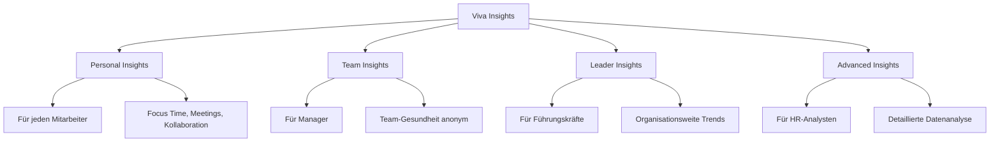
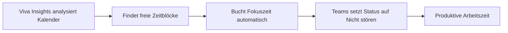

# Microsoft Viva Insights

> [!ABSTRACT] TL;DR
> **Microsoft Viva Insights** analysiert Arbeitsmuster anhand von Microsoft 365-Aktivitätsdaten und gibt Empfehlungen für besseres Arbeiten. Es gibt vier Ebenen: **Personal** (eigene Insights), **Team** (für Manager), **Leader** (für Führungskräfte) und **Advanced** (für HR/Analysten). Datenschutz ist zentral: Individuelle Daten sind nur für den Einzelnen sichtbar – aggregierte Analysen sind anonym.

---

## Überblick: Die vier Ebenen



---

## Personal Insights (MyAnalytics)

**Personal Insights** sind die Einblicke für jeden einzelnen Mitarbeiter – vollständig privat, nur für den eigenen Nutzer sichtbar.

### Zugriff

- **Viva Insights App in Teams**: Hauptzugriffspunkt
- **Outlook-Add-in**: Einblicke direkt in Outlook
- **E-Mail-Digest**: Wöchentliche Zusammenfassung

### Schlüssel-Insights

| Insight | Beschreibung |
|---------|-------------|
| **Fokuszeit** | Unterbrechungsfreie Arbeitszeit |
| **Meeting-Zeit** | Stunden in Meetings pro Woche |
| **After-Hours** | Arbeit außerhalb der Geschäftszeiten |
| **Netzwerk** | Mit wem und wie oft kollaboriert wird |
| **E-Mail-Habits** | Lesegewohnheiten, Reaktionszeiten |
| **Collaboration** | Gemeinsam bearbeitete Dokumente |

### Wellbeing-Features

#### Focus Time (Fokuszeit)

Viva Insights kann automatisch **geschützte Fokuszeit** im Kalender buchen:
1. **Viva Insights App in Teams** → Einstellungen → Fokuszeit planen
2. Täglich X Stunden Fokuszeit reservieren
3. Kalender wird automatisch als "Fokuszeit" blockiert
4. Meetings in dieser Zeit werden automatisch abgelehnt (optional)



#### Virtual Commute

**Virtual Commute** simuliert das Ende des Arbeitstages:
- Täglich zu einer einstellbaren Zeit erscheint eine Erinnerung
- Aufgaben reflektieren und für nächsten Tag planen
- Mentale Grenze zwischen Arbeit und Freizeit schaffen
- Integration mit Headspace (Meditation)

#### Quiet Time / Urgent Message Protection

Benachrichtigungen außerhalb der Arbeitszeiten stumm schalten – zeigt Kollegen auch an, wann jemand nicht verfügbar ist.

---

## Team Insights (für Manager)

**Team Insights** geben Managern einen **anonymisierten Überblick** über Arbeitsgewohnheiten ihres Teams.

> [!IMPORTANT] Datenschutz: Aggregiert und anonym
> Team Insights zeigen **niemals individuelle Daten** einzelner Mitarbeiter. Alle Metriken sind aggregiert. Mindestteamgröße: **10 Mitarbeiter** (Standard) – bei kleineren Teams werden keine Insights angezeigt, um Rückschlüsse zu verhindern.

### Verfügbare Team-Metriken

| Metrik | Beschreibung |
|--------|-------------|
| **After-Hours** | Wie viel das Team außerhalb der Kernzeit arbeitet |
| **Meeting-Last** | Durchschnittliche Meeting-Stunden pro Woche |
| **Fokuszeit** | Verfügbarkeit für ungestörte Arbeit |
| **Manager-Verbindung** | Wie regelmäßig 1:1-Gespräche stattfinden |
| **Netzwerkgröße** | Interne Vernetzung des Teams |

### Manager-Empfehlungen

Basierend auf den Metriken gibt Viva Insights konkrete Empfehlungen:
- "15% des Teams arbeitet regelmäßig nach 19 Uhr – Workload überprüfen"
- "Manager-1:1s finden seltener als empfohlen statt – Meeting einplanen"
- "Meeting-Zeit überschreitet 50% der Arbeitszeit – Meeting-Reduktion erwägen"

---

## Leader Insights

**Leader Insights** sind für **Senior-Führungskräfte und HR-Teams**:
- Organisationsweite Arbeitsgewohnheiten
- Vergleich zwischen Abteilungen (anonym, aggregiert)
- Resilienz- und Engagement-Indikatoren
- Unterstützung bei strategischen Entscheidungen (hybrid work policy, etc.)

---

## Advanced Insights (Analyst Workbench)

**Advanced Insights** ist das **professionelle Analyse-Tool** für HR-Analysten und People-Analytics-Teams:

### Features

- **Query Builder**: SQL-ähnliche Abfragen auf aggregierten Mitarbeiterdaten
- **Vordefinierte Templates**: Häufige Analysen als Startpunkt
- **Power BI Integration**: Ergebnisse in Power BI visualisieren
- **Custom Metrics**: Eigene Metriken definieren

### Wichtige Analysen

| Analyse | Business-Frage |
|---------|---------------|
| **Collaboration Overload** | Welche Gruppen sind überlastet? |
| **Manager Effectiveness** | Wie gut sind Manager vernetzt mit Teams? |
| **Hybrid Work Patterns** | Wie unterscheiden sich Remote vs. Büro? |
| **Organizational Network Analysis** | Wer sind die Influencer im Unternehmen? |
| **Wellbeing** | In welchen Bereichen gibt es Burnout-Risiko? |

> [!WARNING] Datenschutz bei Advanced Insights
> Advanced Insights verarbeitet personenbezogene Daten. Eine **Datenschutz-Folgenabschätzung (DPIA)** und die Einbindung des **Betriebsrats/Datenschutzbeauftragten** sind rechtlich erforderlich. Microsoft stellt Datenschutz-Dokumentation bereit.

---

## Datenschutz-Konzept

### Grundprinzipien

| Prinzip | Beschreibung |
|---------|-------------|
| **Privacy by Design** | Individuelle Daten sind nur für den Einzelnen sichtbar |
| **Aggregierung** | Manager sehen nur Teamdurchschnitte |
| **Mindestanzahl** | Mindestens 10 Personen für Gruppenanalysen |
| **Differentieller Datenschutz** | Statistische Methoden verhindern Rückschlüsse |
| **Keine Überwachung** | Tool ist für Verbesserung, nicht für Kontrolle |
| **Opt-out** | Benutzer können Personal Insights deaktivieren |

> [!DANGER] Kein Überwachungstool
> Microsoft macht deutlich: Viva Insights ist **kein Überwachungstool**. Die Nutzung zur individuellen Leistungsüberwachung verletzt die Microsoft-Nutzungsbedingungen und ist rechtlich in vielen Ländern (Deutschland: §87 BetrVG) unzulässig.

---

## Lizenzierung

| Feature | Lizenz |
|---------|-------|
| **Personal Insights** (grundlegend) | M365 E1/E3/E5, Business-Pläne |
| **Personal Insights** (vollständig mit Headspace) | Microsoft Viva Insights Add-on oder Viva Suite |
| **Team Insights** | Microsoft Viva Insights Add-on |
| **Leader Insights** | Microsoft Viva Insights Add-on |
| **Advanced Insights** | Microsoft Viva Insights Add-on (höhere Stufe) |

> [!NOTE] Basis-Personal-Insights kostenlos
> Grundlegende Personal Insights (E-Mail-Digest, einfache Metriken) sind in jedem M365-Plan enthalten. Für vollständige Funktionen (Focus Session, Virtual Commute, Team-Insights) ist das Viva Insights Add-on nötig.

---

## Via Microsoft 365 Admin Center (UI)

### Viva Insights für den Tenant konfigurieren

1. Melde dich an beim **Microsoft 365 Admin Center** unter [admin.microsoft.com](https://admin.microsoft.com)
2. Navigiere zu **Viva → Viva Insights**
3. Konfiguriere die **Mindest-Teamgröße** für Team-Insights (Standard: 10 Personen)
4. Aktiviere oder deaktiviere Features wie **Briefing-E-Mails** und **Virtual Commute**
5. Lege fest, welche Benutzer von der Analyse ausgeschlossen werden (z.B. sensible Rollen)
6. Klicke auf **Speichern**

### Personal Insights in der Viva Insights App nutzen

1. Öffne **Microsoft Teams → Apps → Viva Insights** (oder installiere die App über den App-Store)
2. Navigiere zur **Startseite** für eine Übersicht deiner Arbeitsgewohnheiten
3. Gehe zu **Fokus → Fokuszeit planen**, um tägliche Fokusblöcke im Kalender zu reservieren
4. Erkunde **Wellbeing → Virtual Commute**, um das Arbeitsende zu markieren
5. Passe persönliche Einstellungen unter **Einstellungen** an (Arbeitszeiten, Opt-out)

### Team-Insights für Manager aufrufen

1. Öffne **Microsoft Teams → Viva Insights App**
2. Navigiere zum Tab **Ihr Team**
3. Prüfe aggregierte Metriken zu After-Hours-Arbeit, Meeting-Last und Fokuszeit
4. Nutze die **Manager-Empfehlungen** für konkrete Maßnahmen

---

## Einrichtung und Konfiguration

### Admin-Konfiguration

Im **Microsoft 365 Admin Center** → Viva → Viva Insights:

```powershell
# Viva Insights per PowerShell konfigurieren
Connect-MgGraph -Scopes "Organization.ReadWrite.All"

# MyAnalytics Zugriffsebene festlegen
# "opt-in" / "opt-out" / "opt-out-all"
```

Im **Viva Insights Admin Center** (insights.viva.office.com):
- **Manager-Einstellungen**: Mindest-Teamgröße für Team-Insights
- **Feature-Aktivierung**: Virtual Commute, Briefing E-Mails
- **Datenschutz-Einstellungen**: Ausschluss bestimmter Benutzer

### Benutzer-Onboarding

1. Benutzer erhalten wöchentlichen **Briefing-E-Mail** (dienstags)
2. Erste Nutzung der **Viva Insights App in Teams**
3. Persönliche Einstellungen (Arbeitszeiten, Fokuszeit, Opt-out)

---

## Troubleshooting

> [!WARNING] Team-Insights zeigen keine Daten
> Wenn Insights für Manager leer sind:
> - Team hat weniger als 10 direkte Berichte (Mindestgröße)
> - Viva Insights Add-on Lizenz nicht zugewiesen
> - Erste Daten erscheinen erst nach **4-6 Wochen** (Datenakkumulation)

> [!BUG] Fokuszeit wird nicht im Kalender geblockt
> Sicherstellen dass:
> - Viva Insights App in Teams geöffnet und Fokuszeit-Feature aktiviert
> - Ausreichend freie Zeit im Kalender vorhanden
> - Exchange Online Kalender-Berechtigungen korrekt (App darf Kalendereinträge erstellen)

---

## Verwandte Notizen

- [[Microsoft Viva Connections]]
- [[Microsoft Viva Pulse]]
- [[Microsoft Viva Learning]]
- [[Microsoft Copilot for M365]]
