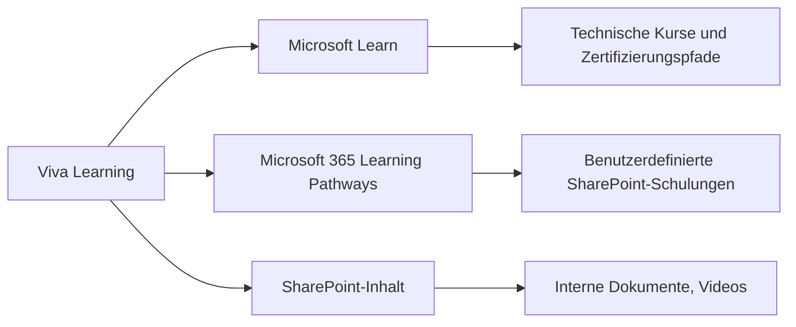
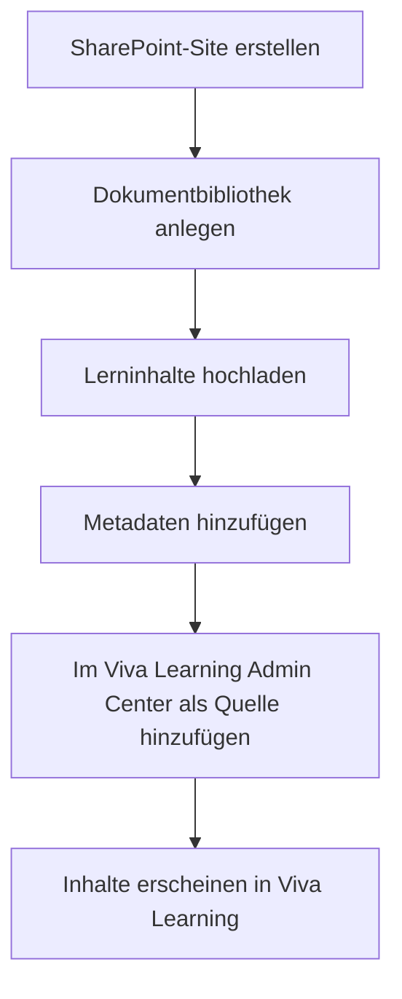

# Microsoft Viva Learning

> [!ABSTRACT] TL;DR
> **Microsoft Viva Learning** ist der zentrale Lern-Hub direkt in Microsoft Teams. Er aggregiert Lerninhalte aus verschiedenen Quellen (Microsoft Learn, LinkedIn Learning, externe LMS, SharePoint) in einer einheitlichen Oberfläche. Mitarbeiter können Lernpfade folgen, Inhalte teilen und Lernerfolge tracken – ohne Teams zu verlassen.

---

## Was ist Viva Learning?

Viva Learning löst das Problem fragmentierter Lernplattformen: Statt zwischen LMS, SharePoint-Seiten, LinkedIn Learning und internen Schulungsdokumenten zu wechseln, sind alle Lerninhalte **in Teams zentralisiert**.

### Kernfunktionen

| Funktion | Beschreibung |
|---------|-------------|
| **Lerninhalt-Aggregation** | Inhalte aus 100+ Quellen in einer Oberfläche |
| **Suche** | Suche über alle Content-Quellen hinweg |
| **Empfehlungen** | Admins und Manager können Inhalte empfehlen |
| **Lernpfade** | Strukturierte Lernsequenzen |
| **Tracking** | Fortschritt und Abschlüsse verfolgen |
| **Featured Learning** | Hervorgehobene Pflichtschulungen |
| **Teams-Chat-Integration** | Lerninhalte direkt in Chats teilen |

---

## Content-Quellen

Viva Learning unterstützt mehrere Kategorien von Lerninhalten:

### Microsoft-eigene Quellen (kostenlos)



**Microsoft Learn:**
- Tausende kostenlose Kurse zu Microsoft-Technologien
- Lernpfade für Azure, M365, Power Platform, Security
- Zertifizierungsvorbereitung

**Microsoft 365 Learning Pathways:**
- Anpassbares Schulungsportal (SharePoint-basiert)
- Vordefinierte Kurse zu M365-Apps für Endbenutzer
- Kann mit eigenen Inhalten erweitert werden

### LinkedIn Learning (Premium)

Erfordert **LinkedIn Learning Lizenz** (separat oder über Viva Suite):
- 20.000+ Video-Kurse
- Business, Technologie, Kreativität
- Abschluss-Zertifikate

> [!NOTE] LinkedIn Learning Verbindung
> Im **Viva Learning Admin Center** muss eine LinkedIn Learning-Integration eingerichtet werden. Dafür ist ein Unternehmens-LinkedIn-Learning-Vertrag notwendig.

### Drittanbieter-LMS-Integration

Viva Learning kann externe LMS-Systeme integrieren:

| Anbieter | Typ |
|---------|-----|
| **SAP SuccessFactors** | Enterprise LMS |
| **Cornerstone OnDemand** | Enterprise LMS |
| **Saba Cloud** | Enterprise LMS |
| **Coursera for Business** | Online-Lernplattform |
| **edX for Business** | Online-Lernplattform |
| **Skillsoft** | Business-Inhalte |
| **Go1** | Content-Aggregator |
| **Udemy Business** | Video-Kurse |

> [!IMPORTANT] LMS-Integration Anforderungen
> Die meisten LMS-Integrationen erfordern **Viva Learning Premium** (Viva Suite oder M365 E3/E5 + Viva Learning Add-on). Grundlegende Microsoft-Inhalte sind in allen M365-Plänen kostenlos.

---

## SharePoint als Content-Quelle

Eigene Lerninhalte können über **SharePoint-Dokumentbibliotheken** in Viva Learning integriert werden:

### SharePoint-Integration einrichten



**Unterstützte Inhaltstypen in SharePoint:**
- Video-Dateien (MP4, MOV)
- PDF-Dokumente
- PowerPoint-Präsentationen
- SCORM-Pakete (mit Connector)

### Metadaten für Lerninhalte

Damit Inhalte in Viva Learning korrekt angezeigt werden, sollten diese Spalten in der SharePoint-Bibliothek vorhanden sein:

| Spalte | Beschreibung |
|--------|-------------|
| **Titel** | Kursname |
| **Beschreibung** | Kursbeschreibung |
| **Dauer** | Länge in Minuten |
| **Thumbnail** | Vorschaubild |
| **Autor** | Kursautor |
| **Sprache** | Inhaltssprache |
| **Zielgruppe** | Für wen ist der Kurs? |

---

## Lernpfade erstellen

Lernpfade sind **strukturierte Sequenzen von Lerninhalten**:

1. **Viva Learning Admin Center** → Lernpfade → Neu erstellen
2. Titel, Beschreibung, Thumbnail festlegen
3. Kurse aus verschiedenen Quellen hinzufügen (Reihenfolge festlegen)
4. Zielgruppe (Entra ID-Gruppen) zuweisen
5. Veröffentlichen

> [!TIP] Onboarding-Lernpfade
> Viva Learning eignet sich hervorragend für strukturiertes **Onboarding**: Neuen Mitarbeitern einen Onboarding-Lernpfad zuweisen, der alle notwendigen Schulungen enthält – von IT-Sicherheit bis Unternehmenskultur.

---

## Featured Learning und Empfehlungen

### Featured Content (Hervorgehobene Inhalte)

Admins können Inhalte als **"Featured"** markieren – diese erscheinen prominent auf der Viva Learning Startseite.

Geeignet für:
- Pflichtschulungen (Datenschutz, Compliance)
- Unternehmensweite Initiativen
- Aktuelle relevante Themen

### Manager-Empfehlungen

Manager können ihren Teammitgliedern direkt aus Teams heraus Lerninhalte empfehlen:
1. In einem Viva Learning-Kurs → **Empfehlen**
2. Mitglieder des Teams auswählen
3. Fälligkeitsdatum optional
4. Empfehlung erscheint im persönlichen Lern-Feed

---

## Via Microsoft 365 Admin Center (UI)

### Viva Learning Content-Quellen konfigurieren

1. Melde dich an beim **Microsoft 365 Admin Center** unter [admin.microsoft.com](https://admin.microsoft.com)
2. Navigiere zu **Viva → Viva Learning**
3. Wähle den Tab **Verwalten → Content-Quellen**
4. Aktiviere oder deaktiviere vorhandene Quellen (Microsoft Learn, LinkedIn Learning usw.)
5. Um eine **SharePoint-Quelle** hinzuzufügen: **Hinzufügen → SharePoint-URL eingeben**
6. Klicke auf **Speichern**

### Featured Content (Pflichtschulungen) verwalten

1. Melde dich an beim **Microsoft 365 Admin Center** unter [admin.microsoft.com](https://admin.microsoft.com)
2. Navigiere zu **Viva → Viva Learning → Hervorgehobener Inhalt**
3. Klicke auf **Inhalt hinzufügen**
4. Suche nach dem gewünschten Kurs → **Hinzufügen**
5. Lege ein optionales **Fälligkeitsdatum** fest
6. Klicke auf **Speichern** – der Kurs erscheint prominent auf der Viva Learning Startseite

### Viva Learning App in Teams für alle Benutzer pinnen

1. Melde dich an beim **Microsoft Teams Admin Center** unter [admin.teams.microsoft.com](https://admin.teams.microsoft.com)
2. Navigiere zu **Teams-Apps → Einrichtungsrichtlinien**
3. Bearbeite die globale Richtlinie → **Apps hinzufügen → Viva Learning**
4. Verschiebe die App an die gewünschte Position in der App-Leiste → **Speichern**

---

## Admin-Einstellungen

### Viva Learning Admin Center

Im **Microsoft 365 Admin Center** → Viva → Viva Learning:

| Einstellung | Beschreibung |
|------------|-------------|
| **Content-Quellen** | LinkedIn Learning, SAP, etc. verbinden |
| **SharePoint-Quellen** | Interne Bibliotheken hinzufügen |
| **Featured Content** | Hervorgehobene Inhalte verwalten |
| **Lernpfade** | Organisationsweite Pfade erstellen |
| **Tab-Pinning** | Viva Learning in Teams pinnen |

```powershell
# Viva Learning Quellen per PowerShell verwalten
# Über Microsoft Graph (SharePoint-Quelle hinzufügen)
Connect-MgGraph -Scopes "LearningContent.ReadWrite.All"

# SharePoint-Lernquelle hinzufügen
New-MgLearningProvider -DisplayName "Interne Schulungen" `
    -LoginWebUrl "https://contoso.sharepoint.com/sites/training" `
    -LongLogoWebUrlForDarkTheme "https://..." `
    -IsEnabled $true
```

---

## Lizenzierung

| Feature | Lizenz |
|---------|-------|
| **Microsoft Learn Inhalte** | Alle M365-Pläne (kostenlos) |
| **M365 Learning Pathways** | Alle M365-Pläne (kostenlos) |
| **SharePoint-Inhalte** | Alle M365-Pläne |
| **Lernpfade erstellen (Admin)** | Alle M365-Pläne |
| **LinkedIn Learning** | LinkedIn Learning Lizenz separat |
| **Drittanbieter-LMS** | Viva Learning Premium / Viva Suite |
| **Advanced Analytics** | Viva Suite |

> [!NOTE] Viva Suite vs. einzelnes Add-on
> Das **Viva Learning Premium Add-on** kostet ca. 4 €/User/Monat. Die **Viva Suite** enthält alle Viva-Module (Connections, Learning, Insights, Goals, Engage, Amplify, Pulse) für ca. 12 €/User/Monat – deutlich günstiger bei mehreren Modulen.

---

## Viva Learning in Teams nutzen

### App installieren

1. Teams-App-Store → "Viva Learning" suchen → Installieren
2. Als Tab in einem Kanal hinzufügen (für Team-Lernaktivitäten)
3. Admin kann App für alle pinnen (App-Einrichtungsrichtlinie)

### Chat-Integration

Lerninhalte können direkt in **Teams-Chats und Kanal-Posts** geteilt werden:
- In Viva Learning einen Kurs öffnen → **Teilen** → Teams-Kanal auswählen
- Der Link erscheint als Karte mit Vorschau im Chat
- Empfänger können den Kurs direkt starten

---

## Troubleshooting

> [!WARNING] SharePoint-Inhalte erscheinen nicht in Viva Learning
> Mögliche Ursachen:
> - SharePoint-Quelle im Admin Center nicht konfiguriert
> - Berechtigungen: Benutzer brauchen Lesezugriff auf die SharePoint-Bibliothek
> - Indizierung: Neue Inhalte können bis zu **24 Stunden** brauchen, um zu erscheinen
> - Metadaten fehlen oder sind falsch formatiert

> [!BUG] LinkedIn Learning Inhalte laden nicht
> Bei LinkedIn Learning Integrationsproblemen:
> 1. LinkedIn Learning Lizenz aktiv und dem Benutzer zugewiesen?
> 2. SSO zwischen M365 und LinkedIn korrekt konfiguriert?
> 3. LinkedIn Learning Admin Center: API-Verbindung zu Viva Learning aktiv?

---

## Verwandte Notizen

- [[Microsoft Viva Connections]]
- [[Microsoft Viva Insights]]
- [[Microsoft Viva Goals]]
- [[M365 Admin Center]]
