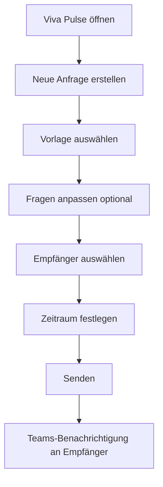
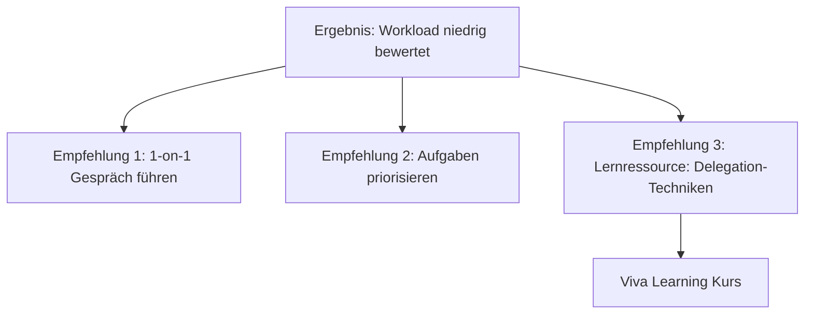

# Microsoft Viva Pulse

> [!ABSTRACT] TL;DR
> **Microsoft Viva Pulse** ist das Tool für Manager, um schnelles, anonymes Feedback von ihrem Team einzuholen. Mit vordefinierten Umfrage-Vorlagen zu Themen wie Teamgesundheit, Workload und Wellbeing senden Manager kurze Puls-Umfragen direkt aus Teams. Ergebnisse sind erst ab **mindestens 5 Antworten** sichtbar – Anonymität ist garantiert.

---

## Was ist Viva Pulse?

Viva Pulse ermöglicht Managern und Teamleads, **kurzfristig Stimmungsbilder** ihres Teams einzuholen:

- **Kurze Umfragen**: 2-10 Fragen (kein langer Fragebogen)
- **Aus Teams heraus**: Direkte Integration ohne Kontextwechsel
- **Anonym**: Antworten werden nicht einzelnen Personen zugeordnet
- **Wissenschaftlich fundiert**: Vorlagen basieren auf Forschung zu Mitarbeiterengagement
- **Empfehlungen**: Nach den Ergebnissen gibt Viva Pulse konkrete Handlungsempfehlungen

### Unterschied zu Microsoft Forms

| Merkmal | Viva Pulse | Microsoft Forms |
|---------|-----------|----------------|
| **Zielgruppe** | Manager | Alle |
| **Zweck** | Teampuls, Engagement | Allgemeine Formulare |
| **Vorlagen** | Wissenschaftlich validiert | Allgemein |
| **Anonymität** | Garantiert (min. 5) | Optional |
| **Empfehlungen** | ✅ KI-gestützt | ❌ |
| **Analytics** | Vergleich zu Benchmarks | Basis |
| **Teams-Integration** | ✅ Nativ | ✅ Tab |

---

## Vorlagen und Fragenkategorien

Viva Pulse bietet **vordefinierte Vorlagen** zu zentralen Themen:

### Verfügbare Vorlagen

| Vorlage | Thema | Fragen |
|---------|-------|--------|
| **Team Health** | Allgemeines Team-Wohlbefinden | 5 Fragen |
| **Workload** | Arbeitslast und Kapazität | 4 Fragen |
| **Wellbeing** | Gesundheit und Work-Life-Balance | 5 Fragen |
| **Teamwork** | Zusammenarbeit und Vertrauen | 5 Fragen |
| **Growth** | Entwicklung und Karriere | 4 Fragen |
| **Onboarding** | Neuer Mitarbeiter (erste 90 Tage) | 6 Fragen |
| **Post-Reorganization** | Nach Umstrukturierungen | 5 Fragen |
| **Meeting Effectiveness** | Meetingqualität | 4 Fragen |

### Fragenformat

Alle Fragen verwenden eine **5-Punkte-Skala** (1 = Stimme nicht zu bis 5 = Stimme vollständig zu):
- "Ich fühle mich bei der Arbeit wertgeschätzt"
- "Ich habe die nötigen Ressourcen, um meine Arbeit gut zu erledigen"
- "Mein Team kommuniziert offen und ehrlich"

---

## Pulsumfrage erstellen und senden

### Schritt 1: Viva Pulse öffnen

1. **Teams** → App-Store → **Viva Pulse** installieren
2. Oder direkt in der Viva-Insights-App (Tab "Pulse")

### Schritt 2: Umfrage konfigurieren

### Schritt 3: Umfrage-Einstellungen

| Einstellung | Optionen |
|------------|---------|
| **Empfänger** | Teams-Gruppe, individuelle Auswahl |
| **Zeitraum** | 24 Stunden bis 7 Tage |
| **Sprache** | Mehrsprachig möglich |
| **Anpassung** | Fragen hinzufügen/entfernen (eingeschränkt) |

> [!WARNING] Fragen nicht übermäßig anpassen
> Viva Pulse Vorlagen sind **wissenschaftlich validiert**. Zu viele Änderungen reduzieren die Aussagekraft. Eigene Fragen nur für sehr spezifischen Kontext hinzufügen.

---

## Anonymität der Antworten

### Mindestanzahl: 5 Antworten

> [!IMPORTANT] 5-Antworten-Regel
> Ergebnisse werden dem Manager **erst dann angezeigt**, wenn **mindestens 5 Antworten** eingegangen sind. Bei weniger als 5 Antworten wird nur "Unzureichende Antworten für Ergebnisse" angezeigt.
>
> Das schützt Mitarbeiter in kleinen Teams vor Identifikation.

### Was ist anonym?

- **Antworten**: Nie einer Person zugeordnet
- **Freitextkommentare**: Anonym (ab mindestens 5 Kommentaren angezeigt)
- **Nicht-Antworter**: Manager kann **nicht** sehen, wer nicht geantwortet hat
- **Zeitpunkt der Antwort**: Wird nicht gespeichert/gezeigt

> [!NOTE] Admin-Zugriff
> Tenant-Admins können im Rahmen von Compliance/eDiscovery auf Daten zugreifen. Für normale Manager ist absolute Anonymität gewährleistet.

---

## Ergebnisanalyse

### Ergebnis-Dashboard

Nach Ende des Umfragezeitraums sieht der Manager:

| Bereich | Inhalt |
|---------|--------|
| **Gesamtscore** | Durchschnitt aller Antworten (1-5) |
| **Rücklaufquote** | Prozent der Antworten |
| **Stärken** | Höchst bewertete Bereiche |
| **Verbesserungsbereiche** | Niedrigst bewertete Bereiche |
| **Trend** | Vergleich mit vorheriger Umfrage |
| **Kommentare** | Anonyme Freitextantworten |

### Benchmark-Vergleich

Ergebnisse werden **mit Benchmarks** verglichen:
- **Industrie-Benchmark**: Branchenvergleich
- **Unternehmens-Benchmark**: Vergleich mit anderen Teams im Unternehmen
- **Historischer Trend**: Entwicklung über Zeit

---

## Empfehlungen

Nach Erhalt der Ergebnisse schlägt Viva Pulse **konkrete Maßnahmen** vor:

Empfehlungen umfassen:
- **Konkrete Gesprächsthemen** für das nächste Team-Meeting
- **Links zu Lernressourcen** in Viva Learning
- **Best Practices** von anderen Managern

---

## Unterschied zu Viva Insights

| Merkmal | Viva Pulse | Viva Insights |
|---------|-----------|--------------|
| **Datenquelle** | Mitarbeiter-Befragungen | M365-Aktivitätsdaten |
| **Art** | Subjektiv (Meinungen) | Objektiv (Verhalten) |
| **Häufigkeit** | Ad hoc (Manager-gesteuert) | Kontinuierlich |
| **Ergebnis** | Stimmungsbild | Arbeitsgewohnheiten |
| **Anonymität** | Min. 5 Antworten | Aggregiert |
| **Zielgruppe** | Manager | Alle + Manager + Leaders |

> [!TIP] Kombination nutzen
> Die beste Employee Experience entsteht durch die **Kombination von Viva Pulse und Viva Insights**:
> - Insights: "Das Team arbeitet 20% mehr After-Hours als der Benchmark"
> - Pulse: "Mitarbeiter bestätigen: Workload ist zu hoch"
> - Maßnahme: Konkrete Entscheidung auf Basis beider Datenquellen

---

## Lizenzierung

| Feature | Lizenz |
|---------|-------|
| **Viva Pulse** | Viva Suite oder Viva Pulse Add-on |
| **Preis (Add-on)** | ca. 2 €/User/Monat |
| **Viva Suite** | Alle Viva-Module (~12 €/User/Monat) |

> [!NOTE] Nur Manager brauchen Lizenz
> Nur die **Person, die Umfragen erstellt und sendet** (Manager), benötigt eine Viva Pulse Lizenz. Mitarbeiter, die nur **antworten**, benötigen keine separate Lizenz.

---

## Admin-Konfiguration

### Viva Pulse im Admin Center

Im **Microsoft 365 Admin Center** → Viva → Viva Pulse:

| Einstellung | Beschreibung |
|------------|-------------|
| **Pulse aktivieren** | Dienst für den Tenant ein/ausschalten |
| **Mindestantworten** | Standard: 5 (kann erhöht, nicht reduziert werden) |
| **Benutzerdefinierte Fragen** | Erlauben/verbieten |
| **Externe Umfragen** | Umfragen außerhalb des Tenants |

---

## Teams-Integration

### Benachrichtigungen

Wenn ein Manager eine Pulsumfrage sendet:
- Empfänger erhalten eine **Teams-Aktivitäts-Benachrichtigung**
- Die Umfrage kann direkt in Teams ausgefüllt werden
- Erinnerungs-Benachrichtigungen (optional)

### Ergebnisse in Teams anzeigen

Manager können Ergebnisse direkt in der **Viva Insights App in Teams** anzeigen:
- Tab "Pulse" in Viva Insights App
- Historische Pulse-Ergebnisse archiviert

---

## Troubleshooting

> [!WARNING] "Unzureichende Antworten" nach Ablauf
> Das Team war kleiner als 5 Personen, oder weniger als 5 Personen haben geantwortet. Bei Teams unter 5 Personen kann Viva Pulse keine sinnvollen, anonymen Ergebnisse liefern.
> **Lösung**: Nächste Umfrage auf größere Gruppe ausweiten oder nach mehr Antworten fragen.

> [!BUG] Benachrichtigung kommt nicht an
> Wenn Mitarbeiter keine Teams-Benachrichtigung erhalten:
> 1. Teams-Benachrichtigungseinstellungen prüfen (Aktivitäts-Feed nicht deaktiviert?)
> 2. Benutzer in der richtigen Teams-Gruppe/Kanal?
> 3. Viva Pulse App für Benutzer verfügbar (nicht durch Admin blockiert)?

> [!WARNING] Anpassung von Fragen nicht möglich
> In der Standard-Konfiguration sind Vorlagen-Fragen schreibgeschützt. Admin muss im Viva Pulse Admin Center "Benutzerdefinierte Fragen" erlauben, damit Manager Fragen anpassen können.

---

## Verwandte Notizen

- [[Microsoft Viva Insights]]
- [[Microsoft Forms]]
- [[Microsoft Viva Amplify]]
- [[M365 Admin Center]]
