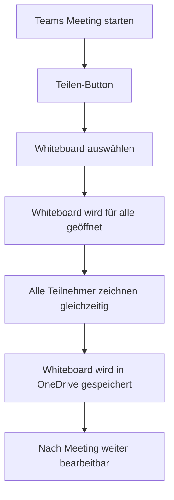

# Microsoft Whiteboard

> [!ABSTRACT] TL;DR
> **Microsoft Whiteboard** ist die digitale Zeichentafel in Microsoft 365 – ideal für Brainstorming, Retrospektiven, Design Thinking und visuelle Zusammenarbeit. Seit 2022 werden alle Whiteboards in **OneDrive for Business** gespeichert. Die Integration in Teams-Meetings macht es zum Standard-Kollaborationstool für verteilte Teams.

---

## Was ist Microsoft Whiteboard?

Microsoft Whiteboard ist eine **unendliche digitale Canvas** für:
- **Brainstorming** – Ideen sammeln mit Sticky Notes
- **Workshops und Retrospektiven** – Agile Methoden digital
- **Design Thinking** – Empathy Maps, User Journeys
- **Planungssessions** – Visuelle Roadmaps
- **Lehre und Schulungen** – Interaktive Präsentationen

### Verfügbare Plattformen

| Plattform | Verfügbarkeit |
|-----------|-------------|
| **Web-App** | whiteboard.microsoft.com |
| **Windows-App** | Windows 10/11 (Store) |
| **iOS-App** | iPad (Touch/Pencil optimiert) |
| **Teams-Integration** | In Meetings und Kanälen |
| **Surface Hub** | Nativ unterstützt |

---

## Datenspeicherung (OneDrive for Business)

Seit **August 2022** (vollständige Migration abgeschlossen) werden alle Whiteboards als **`.whiteboard`-Dateien in OneDrive for Business** gespeichert:

```
OneDrive → Dateien → Whiteboards → [Name].whiteboard
```

### Vorteile der OneDrive-Speicherung

- **Standard-Sharing-Mechanismen**: Freigabe wie normale OneDrive-Dateien
- **Versions-Historie**: Frühere Versionen wiederherstellbar
- **Backup**: OneDrive-Backups schließen Whiteboards ein
- **Compliance**: Purview DLP und Retention Policies greifen
- **Suchbar**: Whiteboards erscheinen in Microsoft Search

> [!WARNING] Klassische Whiteboard-Migration
> Whiteboards, die vor August 2022 auf Microsoft-Servern (nicht OneDrive) gespeichert wurden ("klassische Whiteboards"), mussten bis Ende 2024 migriert werden. Nach diesem Datum wurden nicht migrierte Whiteboards gelöscht. Status: Im Whiteboard-Admin-Center prüfbar.

---

## Funktionen und Tools

### Inhaltselemente

| Element | Beschreibung |
|---------|-------------|
| **Sticky Notes** | Farbige Klebezettel (mehrere Farben) |
| **Text** | Formatierter Text-Block |
| **Zeichnen** | Freihand-Zeichnung (Stift, Marker, Textmarker) |
| **Shapes** | Grundformen (Rechteck, Kreis, Pfeil, etc.) |
| **Bilder** | Bilder hochladen oder einfügen |
| **Dokumente** | Word/PDF als Objekt einbetten |
| **Reaktionen** | Emojis zur Abstimmung/Feedback |
| **Links** | URLs hinzufügen |
| **Video** | YouTube/Stream Videos einbetten |
| **PowerPoint** | Präsentationsfolien einbetten |

### Ink to Shape / Ink to Table

Besondere KI-Features:
- **Ink to Shape**: Freihand gezeichnete Formen werden automatisch in saubere Vektorgrafiken umgewandelt
- **Ink to Table**: Freihand gezeichnete Tabellen werden in strukturierte Tabellen konvertiert
- **Ink to Text**: Handschrift wird in getippten Text umgewandelt

> [!TIP] Ink to Shape auf Surface/iPad
> Diese Funktion ist besonders nützlich auf Touch-Geräten (Surface, iPad). Einfach einen Kreis oder ein Rechteck grob zeichnen, kurz pausieren – Whiteboard erkennt die Form automatisch.

### Templates (Vorlagen)

Whiteboard bietet vordefinierte Vorlagen:

| Vorlage | Einsatz |
|---------|--------|
| **Brainstorm** | Ideensammlung |
| **Sprint Planning** | Scrum Sprint Planung |
| **Retrospective** | Team-Rückblick |
| **Kanban** | Aufgabenverwaltung |
| **Empathy Map** | UX Design |
| **SWOT Analyse** | Strategieplanung |
| **5 Whys** | Ursachenanalyse |
| **Lean Canvas** | Business Model |

---

## Teams-Integration

### Whiteboard in Teams-Meetings

In **laufenden Teams-Meetings**:
1. Obere Menüleiste → **Teilen** (oder Bildschirm teilen)
2. **Whiteboard** auswählen
3. Alle Meeting-Teilnehmer können gleichzeitig zeichnen



> [!NOTE] Whiteboard nach dem Meeting
> Das während eines Meetings erstellte Whiteboard bleibt **dauerhaft in OneDrive** des Meeting-Organisators gespeichert und kann auch nach dem Meeting weiterbearbeitet werden.

### Whiteboard als Teams-Tab

Whiteboards können als **persistenter Tab** in einem Teams-Kanal hinzugefügt werden:
1. Teams-Kanal → **+ Tab hinzufügen** → **Whiteboard**
2. Neues Whiteboard erstellen oder bestehendes aus OneDrive verknüpfen
3. Alle Kanalmitglieder haben dauerhaften Zugang

---

## Kollaboration und Freigabe

### Freigabe-Optionen

| Option | Beschreibung |
|--------|-------------|
| **Direkter Link** | Freigabe-Link (wie OneDrive-Links) |
| **Bearbeitung erlauben** | Empfänger kann zeichnen und bearbeiten |
| **Nur ansehen** | Empfänger sieht nur, kann nicht bearbeiten |
| **Nur Organisation** | Nur Tenant-Mitglieder können zugreifen |
| **Extern** | Externe Benutzer können eingeladen werden |

### Echtzeit-Kollaboration

- Bis zu **150 gleichzeitige Bearbeiter** in einem Whiteboard
- **Cursor-Anzeige**: Alle Bearbeiter sehen die Cursors der anderen in Echtzeit
- **Namensschilder**: Hover über einen Cursor zeigt den Namen
- **Reaktionen**: Sticker/Emojis für schnelles Feedback

> [!TIP] Große Gruppen-Workshops
> Für Workshops mit mehr als 20 Personen: Separate Bereiche auf der unendlichen Canvas für kleine Gruppen definieren. Verwende Shapes oder Textblöcke als "Tischkarten" zur Orientierung.

---

## Whiteboard-App vs. Teams-Whiteboard

| Merkmal | Whiteboard-App | Teams-Whiteboard |
|---------|---------------|-----------------|
| **Öffnen** | whiteboard.microsoft.com | Direkt in Teams-Meeting |
| **Funktionsumfang** | ✅ Vollständig | ✅ Fast vollständig |
| **Templates** | ✅ | ✅ |
| **Offline** | Eingeschränkt | ❌ |
| **Datei-Management** | ✅ (in OneDrive) | ✅ (in OneDrive) |
| **Optimal für** | Längere Arbeitssessions | Ad-hoc in Meetings |

---

## Verwaltung (Admin Center)

### Admin-Einstellungen

Im **Microsoft 365 Admin Center** unter **Einstellungen → Microsoft Whiteboard:**

| Einstellung | Beschreibung |
|------------|-------------|
| **Whiteboard aktivieren** | Dienst für Tenant ein/ausschalten |
| **Externe Zusammenarbeit** | Gäste können eingeladen werden (ja/nein) |
| **Telemetrie** | Nutzungsdaten an Microsoft senden |
| **OneDrive-Speicherung** | Wo Whiteboards gespeichert werden |

```powershell
# Whiteboard-Status per PowerShell prüfen
Connect-MgGraph -Scopes "Organization.Read.All"

# Whiteboard-Einstellungen sind im Admin Center konfigurierbar
# PowerShell-Zugriff über Microsoft Graph Settings
Get-MgOrganizationSetting | Where-Object { $_.DisplayName -like "*Whiteboard*" }
```

---

## Voraussetzungen

| Anforderung | Details |
|------------|---------|
| **Lizenz** | Jede M365-Lizenz (enthalten in E1, E3, E5, Business-Plänen) |
| **Browser** | Edge, Chrome, Firefox (aktuell) |
| **OneDrive** | Für Speicherung aktiviert und lizenziert |
| **iOS** | iOS 14 oder neuer (für iPad-App) |
| **Windows** | Windows 10 Version 1903 oder neuer |

> [!WARNING] Whiteboard benötigt OneDrive
> Da Whiteboards in OneDrive gespeichert werden, müssen Benutzer eine aktive **OneDrive for Business**-Lizenz haben. Ohne OneDrive kann Whiteboard keine Dateien speichern.

---

## Troubleshooting

> [!WARNING] "Whiteboard kann nicht geladen werden"
> Mögliche Ursachen:
> - OneDrive-Lizenz fehlt oder OneDrive nicht eingerichtet
> - Whiteboard vom Admin deaktiviert
> - Browser-Cookies/Cache – Im Inkognito-Modus testen

> [!BUG] Inhalte bei anderen Benutzern nicht sichtbar
> Bei Synchronisationsproblemen:
> 1. Browser-Tab neu laden (F5)
> 2. Sharing-Berechtigungen prüfen (ist der Link wirklich freigegeben?)
> 3. Tenant-Gasteinstellungen: Externe Freigabe in OneDrive erlaubt?

> [!WARNING] Whiteboard in Meeting fehlt
> Wenn die Whiteboard-Option im Meeting-Teilen-Dialog fehlt:
> - Teams-Client aktualisieren
> - Im Teams Admin Center: Whiteboards für Meetings aktiviert?
> - Richtlinie: Bildschirmfreigabe in Meeting-Richtlinien erlaubt?

---

## Verwandte Notizen

- [[Microsoft Loop]]
- [[Microsoft Stream]]
- [[M365 Admin Center]]
