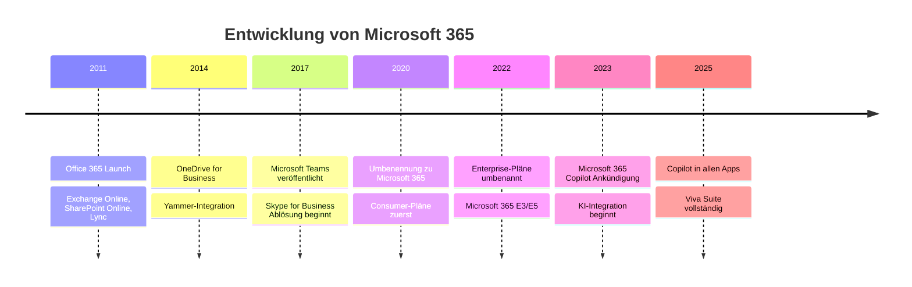
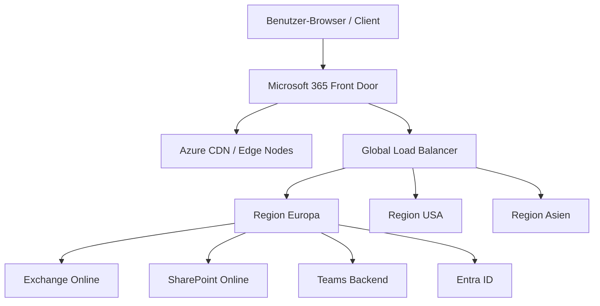
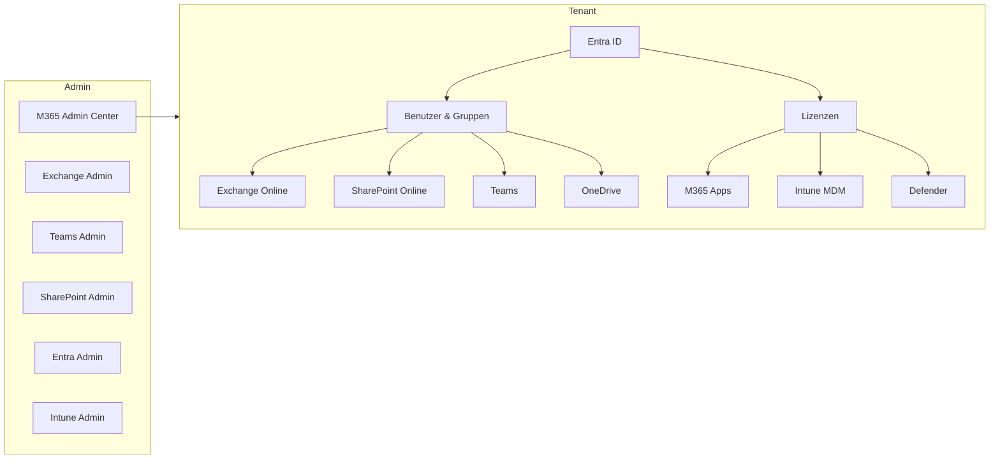

# Was ist Microsoft 365

> [!ABSTRACT] TL;DR
> Microsoft 365 ist Microsofts umfassende Cloud-Produktivitätsplattform – eine Kombination aus Office-Apps, Kommunikationsdiensten, Geräteverwaltung, Identität und Sicherheit. Entstanden aus Office 365 (2011) wurde die Marke 2020 zu Microsoft 365 erweitert. Der Kern: Software-as-a-Service, betrieben auf Microsofts globaler Cloud-Infrastruktur.

---

## Geschichte: Von Office 365 zu Microsoft 365

Microsoft begann bereits in den 2000er-Jahren mit Online-Diensten (BPOS – Business Productivity Online Suite). 2011 folgte der Relaunch als **Office 365** – eine abonnementbasierte Cloud-Suite mit Exchange Online, SharePoint Online und Lync (später Skype for Business).

Der entscheidende Wendepunkt kam **April 2020**: Microsoft benannte die Consumer-Pläne von Office 365 in **Microsoft 365** um, um den erweiterten Funktionsumfang widerzuspiegeln (Sicherheit, Compliance, Geräteverwaltung). Unternehmenpläne folgten **März 2022**.

---

## Cloud-Modelle: SaaS, PaaS, IaaS

Microsoft 365 ist primär **SaaS** (Software as a Service). Im Microsoft-Ökosystem gibt es jedoch alle drei Cloud-Modelle:

| Modell | Beschreibung | Microsoft-Produkt |
|--------|-------------|-------------------|
| **SaaS** | Fertige Software über das Web genutzt | Microsoft 365, Dynamics 365 |
| **PaaS** | Plattform für eigene Anwendungsentwicklung | Azure App Service, Power Platform |
| **IaaS** | Virtuelle Infrastruktur (VMs, Netzwerk, Storage) | Azure Virtual Machines, Azure Storage |

> [!INFO] Abgrenzung SaaS vs. IaaS
> Bei Microsoft 365 (SaaS) verwaltet Microsoft alles – Infrastruktur, Betriebssystem, Middleware und Anwendung. Der Kunde konfiguriert nur seine Daten und Zugriffsrechte. Bei Azure IaaS verantwortet der Kunde das Betriebssystem aufwärts.

---

## Microsoft 365 vs. Office 365 vs. Azure AD

Diese drei Begriffe werden häufig verwechselt:

| Begriff | Was es ist | Status |
|---------|-----------|--------|
| **Office 365** | Alter Markenname der Unternehmens-Pläne | Umbenannt zu M365 (2022) |
| **Microsoft 365** | Aktueller Markenname, erweiterter Scope | Aktuell |
| **Azure AD** | Identitätsdienst (Identity Provider) | Umbenannt zu **Entra ID** (2023) |
| **Azure** | Microsofts IaaS/PaaS Cloud-Plattform | Separat von M365 |

> [!WARNING] Verwechslungsgefahr
> Microsoft 365 und Azure sind **separate Produkte** mit separaten Abonnements und Kosten. Entra ID (ehem. Azure AD) ist Teil von M365, hat aber auch Azure-Funktionen. Ein M365-Abonnement enthält **keinen Azure-Zugang** für VMs oder andere IaaS-Dienste.

---

## Dienste-Übersicht

Microsoft 365 ist kein einzelnes Produkt, sondern ein **Ökosystem aus über 30 Diensten**:

### Kommunikation & Zusammenarbeit
| Dienst | Funktion |
|--------|---------|
| **Microsoft Teams** | Chat, Videomeetings, Telefonie, Kollaboration |
| **Exchange Online** | E-Mail, Kalender, Kontakte (Hosted Exchange) |
| **SharePoint Online** | Intranet, Dokumentenverwaltung, Sites |
| **OneDrive for Business** | Persönlicher Cloud-Speicher (1 TB pro Benutzer) |
| **Viva Engage** (Yammer) | Enterprise Social Network |

### Produktivitäts-Apps
| Dienst | Funktion |
|--------|---------|
| **Microsoft 365 Apps** | Word, Excel, PowerPoint, Outlook, OneNote |
| **Microsoft Forms** | Formulare, Umfragen, Quizze |
| **Microsoft Lists** | Strukturierte Datenverwaltung |
| **Microsoft Planner** | Aufgabenverwaltung (einfach) |
| **Microsoft Bookings** | Terminbuchungssystem |
| **Microsoft Whiteboard** | Digitale Zeichenfläche |
| **Microsoft Stream** | Videoplattform |
| **Microsoft Loop** | Co-Creation-Plattform |

### Identität & Sicherheit
| Dienst | Funktion |
|--------|---------|
| **Microsoft Entra ID** | Identity Provider, SSO, Conditional Access |
| **Microsoft Intune** | Mobile Device Management (MDM/MAM) |
| **Microsoft Defender for M365** | E-Mail-Sicherheit, Anti-Phishing |
| **Microsoft Purview** | Compliance, DLP, Informationsschutz |

### Employee Experience (Viva Suite)
| Dienst | Funktion |
|--------|---------|
| **Viva Connections** | Intranet-Hub in Teams |
| **Viva Insights** | Produktivitäts-Analytik |
| **Viva Learning** | Lern-Hub |
| **Viva Goals** | OKR-Management |
| **Viva Amplify** | Interne Kommunikationskampagnen |
| **Viva Pulse** | Mitarbeiter-Pulsumfragen |

---

## Architektur: Tenant, Global Service, CDN

### Der Tenant

Ein **Tenant** ist die dedizierte, isolierte Instanz von Microsoft 365 für eine Organisation. Jeder Tenant hat:
- Eine eindeutige **Tenant-ID** (GUID)
- Einen **Primärdomänen-Namen** (z.B. `contoso.onmicrosoft.com`)
- Eine zugewiesene **Datenregion** (z.B. Europa, USA)
- Eigene Benutzer, Lizenzen, Konfigurationen und Daten

> [!IMPORTANT] Tenant-Isolation
> Tenants sind vollständig voneinander isoliert. Ohne explizite Konfiguration (B2B Collaboration, Cross-Tenant-Sync) gibt es keine Verbindung zwischen Tenants. Daten eines Tenants sind für andere nicht sichtbar.

### Globale Infrastruktur

Microsoft 365 läuft auf einer globalen Infrastruktur mit **Rechenzentren in über 60 Regionen**. Die Kernkomponenten:

**Microsoft 365 Front Door** optimiert die Verbindung zum nächsten Microsoft-Netzwerkpunkt. Das **Azure CDN** beschleunigt die Auslieferung statischer Inhalte (SharePoint-Seiten, Teams-Dateien).

### Datenspeicherung und EU Data Boundary

Seit **Januar 2023** bietet Microsoft die **EU Data Boundary**: Kundendaten von M365 und Azure werden für EU/EEA-Kunden ausschließlich in der EU gespeichert und verarbeitet.

**Advanced Data Residency (ADR)** geht noch weiter und ermöglicht die Festlegung spezifischer Länder (z.B. Deutschland) für bestimmte Workloads.

> [!NOTE] Datenspeicherorte prüfen
> Im M365 Admin Center unter **Einstellungen → Organisationseinstellungen → Datenspeicherorte** lässt sich prüfen, wo die Daten der einzelnen Dienste gespeichert sind.

---

## Microsoft 365 Architektur-Übersicht

---

## Aktuelle Neuerungen 2025

Microsoft 365 entwickelt sich kontinuierlich weiter. Die wichtigsten Entwicklungen 2025:

- **Microsoft 365 Copilot** ist in allen Apps integriert (Word, Excel, PowerPoint, Outlook, Teams, OneNote, Loop)
- **Copilot Chat** (ehemals Microsoft 365 Chat / BizChat) als zentraler KI-Assistent
- **Viva Suite** vollständig ausgebaut mit Viva Amplify und Viva Pulse
- **New Planner** vereint Microsoft Planner und Project for the Web in einer App
- **Loop Workspaces** für strukturierte kollaborative Arbeit
- **Teams Phone** weiter ausgebaut (Operator Connect, Direct Routing)
- **Purview** als zentrale Compliance- und Governance-Plattform
- **Entra External ID** für B2C-Szenarien (ersetzt Azure AD B2C)
- **Microsoft Places** für hybrides Arbeitsplatzmanagement

> [!TIP] Aktuell bleiben
> Die **Microsoft 365 Roadmap** (microsoft.com/en-us/microsoft-365/roadmap) zeigt alle geplanten, in Entwicklung befindlichen und kürzlich veröffentlichten Features. Im M365 Admin Center gibt es unter **Health → Message Center** alle Ankündigungen für den eigenen Tenant.

---

## Via Microsoft 365 Admin Center (UI)

### Microsoft 365 Admin Center aufrufen und navigieren

1. Melde dich an beim **Microsoft 365 Admin Center** unter [admin.microsoft.com](https://admin.microsoft.com)
2. Nutze die **linke Navigationsleiste** für den Zugriff auf alle Bereiche:
   - **Startseite** – Dashboard mit KPIs und Servicestatus
   - **Benutzer** – Aktive Benutzer, Gastbenutzer, gelöschte Benutzer
   - **Gruppen** – M365-Gruppen, Verteiler, geteilte Postfächer
   - **Abrechnung** – Lizenzen, Rechnungen, Zahlungsmethoden
   - **Einstellungen** – Organisationsprofil, Sicherheit, Dienste und Add-Ins
   - **Berichte** – Verwendung und Aktivierungen
   - **Integrität** – Dienststatus und Nachrichten-Center
   - **Admin Center** – Links zu Exchange, Teams, SharePoint, Entra ID, Intune

### Weitere Admin Center aufrufen

1. Melde dich an beim **Microsoft 365 Admin Center** unter [admin.microsoft.com](https://admin.microsoft.com)
2. Navigiere zu **Admin Center** in der linken Leiste (ganz unten)
3. Wähle das gewünschte Admin Center:
   - **Exchange** – E-Mail und Postfachverwaltung
   - **Teams** – Teams-Konfiguration, Meetings, Telefonie
   - **SharePoint** – Sites, OneDrive, externe Freigaben
   - **Entra ID** – Identität, Gruppen, Conditional Access
   - **Intune** – Geräteverwaltung und App-Schutz

### Microsoft 365-Dienstintegrität überwachen

1. Melde dich an beim **Microsoft 365 Admin Center** unter [admin.microsoft.com](https://admin.microsoft.com)
2. Navigiere zu **Integrität → Dienststatus**
3. Prüfe den Echtzeit-Status aller M365-Dienste
4. Navigiere zu **Integrität → Nachrichten-Center** für Ankündigungen und geplante Änderungen

---

## Troubleshooting: Häufige Fragen

> [!QUESTION] Ist Microsoft 365 dasselbe wie Azure?
> Nein. Microsoft 365 ist eine SaaS-Plattform für Produktivität. Azure ist Microsofts IaaS/PaaS-Cloud. Beide nutzen dieselbe Infrastruktur, sind aber separate Produkte mit eigenen Abonnements.

> [!QUESTION] Was passiert, wenn das Abonnement endet?
> Nach Ablauf des Abonnements gibt es eine **Nachfrist von 30 Tagen** (nur-Lese-Zugang), dann **90 Tage Deaktivierungsphase** (kein Zugriff, aber Daten noch vorhanden), danach werden alle Daten gelöscht. Rechtzeitig vor Ablauf verlängern oder exportieren!

> [!WARNING] Datenverlust bei Abonnement-Ende
> Microsoft löscht Tenant-Daten nach der Deaktivierungsphase unwiderruflich. Regelmäßige Backups (z.B. Veeam Backup for M365, Acronis) sind essentiell – Microsoft bietet keine eigene vollständige Backup-Lösung.

---

## Verwandte Notizen

- [[M365 Lizenzmodelle und Pläne]]
- [[M365 Tenant-Verwaltung]]
- [[M365 Admin Center]]
- [[Microsoft 365 Apps]]
- [[Microsoft Copilot for M365]]
