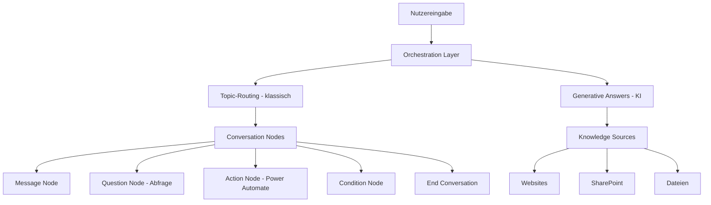
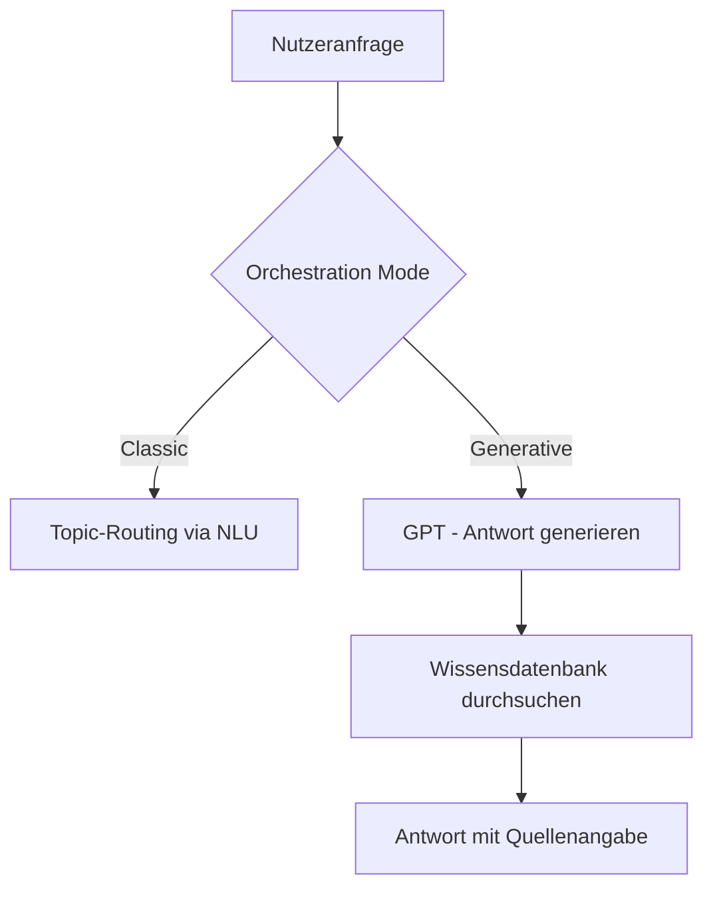
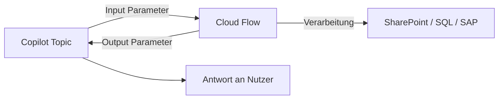

---
tags:
  - microsoft365
  - power-platform
  - copilot-studio
  - chatbot
  - generative-ai
  - conversational-ai
aliases:
  - Power Virtual Agents
  - PVA
  - Copilot Studio Bot
---

# Copilot Studio

> [!ABSTRACT] TL;DR
> Copilot Studio (ehemals Power Virtual Agents) ist die Low-Code-Plattform von Microsoft für die Erstellung von KI-gestützten Chatbots und Copilot-Erweiterungen. Mit dem grafischen Topic-Editor, Generative AI für Wissensdatenbank-Antworten (RAG) und nativer Teams-Integration können Fachanwender ohne Programmierkenntnisse leistungsfähige Conversational AI-Lösungen aufbauen und in beliebige Kanäle deployen.

---

## Was ist Copilot Studio?

Copilot Studio wurde 2023 aus Power Virtual Agents (PVA) weiterentwickelt und positioniert sich als zentrale Plattform für:

1. **Klassische Chatbots**: Regelbasierte Konversationen mit Topics und Trigger Phrases
2. **KI-gestützte Copilots**: Generative Antworten aus eigenen Wissensdatenbanken (RAG-Prinzip)
3. **Microsoft 365 Copilot-Erweiterungen**: Eigene Agents für M365 Copilot erstellen (Declarative Agents)
4. **Autonome Agents**: Agents mit Zieldefinition, die selbstständig Schritte planen und ausführen

> [!NOTE] Power Virtual Agents → Copilot Studio
> Die Umbenennung von Power Virtual Agents zu Copilot Studio erfolgte mit dem Microsoft AI-Wave im November 2023. Bestehende PVA-Bots laufen weiter, werden aber als Copilots bezeichnet. Der Fokus verschob sich stark in Richtung Generative AI und eigenständige Agents.

---

## Architektur: Konversationsfluss



---

## Copilot vs. klassischer Bot

| Merkmal | Klassischer Bot (Topic-basiert) | Generativer Copilot |
|---------|--------------------------------|---------------------|
| **Antwortlogik** | Regelbasierte Topics mit Trigger Phrases | GPT-basierte Antworten aus Wissensdatenbank |
| **Wartung** | Jedes Thema muss manuell gepflegt werden | Wissensdatenbank aktualisieren reicht |
| **Kontrolle** | Hoch — vorhersehbare Antworten | Mittel — KI generiert Antworten |
| **Einrichtungsaufwand** | Hoch (viele Topics nötig) | Niedrig (Knowledge Sources angeben) |
| **Flexibilität** | Begrenzt auf definierte Topics | Beliebige Fragen werden beantwortet |
| **Empfehlung** | Für strukturierte Prozesse (Genehmigungen, Formulare) | Für FAQ und Wissensdatenbank-Szenarien |

---

## Topics

Topics sind die Grundbausteine eines Copilot Studio Bots. Jedes Topic definiert eine Konversationseinheit mit Auslösern und Ablauf.

### System Topics (vordefiniert)

| System Topic | Funktion |
|-------------|---------|
| **Greeting** | Begrüßungstext beim ersten Start |
| **Goodbye** | Abschlussnachricht bei Gesprächsende |
| **Fallback** | Ausgabe wenn kein Topic erkannt wird |
| **Escalate** | Übergabe an menschlichen Agenten |
| **Start Over** | Konversation neu starten |
| **Error** | Fehlerbehandlung bei technischen Problemen |

### Benutzerdefinierte Topics

Eigene Topics werden mit **Trigger Phrases** (3–10 Beispielsätze) ausgelöst:

```
Trigger Phrases:
- "Ich brauche Urlaub"
- "Wie beantrage ich Urlaub?"
- "Urlaubsantrag stellen"
- "Ich möchte Ferien nehmen"
```

> [!TIP] Qualität der Trigger Phrases
> Verwende natürliche, vielfältige Formulierungen — keine exakten Kopien. Das NLU-Modell (Natural Language Understanding) lernt aus den Variationen. 5–10 Phrasen pro Topic sind ideal.

### Conversation Nodes

| Node-Typ | Verwendung |
|---------|-----------|
| **Message** | Ausgabe von Text, Bildern, Videos, Adaptive Cards |
| **Question** | Nutzereingabe abfragen (mit Entitäts-Extraktion) |
| **Condition** | Verzweigung basierend auf Variablenwert |
| **Action** | Power Automate Flow aufrufen oder Connector-Aktion |
| **Redirect** | Zu einem anderen Topic weiterleiten |
| **Topic Management** | Topic beenden oder eskalieren |
| **Variable Management** | Variablen setzen, löschen, abfragen |
| **Send Message** | Nachricht an externen Dienst senden |
| **Generative Answers** | KI-Antwort aus Wissensdatenbank abrufen |

### Entitäten (Entities)

Entitäten extrahieren strukturierte Informationen aus natürlicher Sprache:

| Entitäts-Typ | Beispiel | Extrahierter Wert |
|-------------|---------|-------------------|
| **E-Mail-Adresse** | "Schreib mir an max@firma.de" | max@firma.de |
| **Zahl** | "Ich brauche 5 Tage" | 5 |
| **Datum und Uhrzeit** | "Am nächsten Montag" | 27.01.2025 |
| **Geldbetrag** | "Das kostet 250 Euro" | 250 EUR |
| **Benutzerdefiniert** | "Abteilung IT" | IT (aus Custom Entity List) |

---

## Generative AI und Generative Answers

Generative Answers ermöglichen KI-gestützte Antworten aus eigenen Wissensdatenbanken ohne explizite Topic-Erstellung.

### Knowledge Sources

| Quelle | Beschreibung | Einschränkungen |
|--------|-------------|----------------|
| **Websites** | Öffentlich zugängliche URLs crawlen | Nur öffentliche Seiten |
| **SharePoint** | SharePoint-Seiten und -Dateien | Nutzerauthentifizierung nötig |
| **Dateien (OneDrive)** | PDF, Word, PowerPoint, Excel | Max. Dateigröße beachten |
| **Dataverse** | Dataverse-Tabellen durchsuchen | Tabellenberechtigungen gelten |
| **Azure AI Search** | Benutzerdefinierter Suchindex | Enterprise-Skalierung |

### Orchestration Mode



- **Classic Orchestration**: Topics werden zuerst gematcht; Fallback auf Generative Answers
- **Generative Orchestration**: GPT übernimmt vollständige Konversationssteuerung und ruft Topics als Aktionen auf

> [!WARNING] Content Moderation aktivieren
> Stelle sicher, dass Content Moderation in den Copilot-Einstellungen aktiv ist, um unerwünschte KI-generierte Antworten zu verhindern. Teste den Copilot regelmäßig mit adversarialen Eingaben.

---

## Actions

Actions verbinden den Copilot mit externen Systemen und ermöglichen transaktionale Interaktionen.

### Power Automate Flow aufrufen



**Voraussetzung**: Der Power Automate Flow muss den Trigger **"When Copilot Studio calls a flow"** verwenden und in einer Solution vorhanden sein.

### Connector-Aktionen (direkt)
Seit 2024 können Connector-Aktionen direkt in Copilot Studio ohne expliziten Flow genutzt werden — für einfache GET/POST-Anfragen ohne komplexe Logik.

### HTTP-Anfragen
Direkter Aufruf beliebiger REST-APIs als Action (JSON-Antwort wird geparst).

---

## Authentifizierung

| Modus | Beschreibung | Einsatz |
|-------|-------------|---------|
| **Anonym** | Kein Login erforderlich | Öffentliche Websites, externe Portale |
| **Nur für Teams** | Automatische SSO via Teams | Interne Teams-Bots |
| **Manuelle Authentifizierung (Entra ID)** | OAuth 2.0 Flow, Nutzer loggen sich ein | Interne Bots mit Datenzugriff |
| **Service Principal** | Technischer Account für Systemverbindungen | Backend-Integrationen |

> [!TIP] SSO in Teams nutzen
> Für interne Teams-Bots empfiehlt sich die **Teams SSO-Authentifizierung**: Nutzer müssen sich nicht extra einloggen, da Teams die Identität automatisch weitergibt. So kann der Copilot im Namen des Nutzers auf SharePoint, Outlook oder Dataverse zugreifen.

---

## Kanäle (Deployment)

| Kanal | Beschreibung |
|-------|-------------|
| **Microsoft Teams** | Häufigster interner Kanal, native Integration |
| **Website (iFrame)** | Einbetten via `<iframe>` auf beliebigen Websites |
| **Power Pages** | Direkte Integration in Power Pages-Portale |
| **SharePoint** | Einbetten als Webpart auf SharePoint-Seiten |
| **Telephony** | Azure Communication Services für Sprachkanäle |
| **Mobile App** | Integration via Direct Line API in eigene Apps |
| **Microsoft 365 Copilot** | Als Declarative Agent in M365 Copilot einsetzen |
| **Slack, Facebook, LINE** | Externe Social- und Business-Kanäle |

---

## M365 Copilot vs. eigener Copilot Studio-Copilot

| Merkmal | Microsoft 365 Copilot | Eigener Copilot Studio-Copilot |
|---------|----------------------|-------------------------------|
| **Zugriff auf M365 Daten** | Vollständig (Graph, E-Mails, Teams, SharePoint) | Nur via Actions/Connectors |
| **Anpassbarkeit** | Begrenzt (Prompts, Plugins, Declarative Agents) | Vollständig anpassbar |
| **Lizenz** | M365 Copilot ($30/User/Monat) | Copilot Studio Messages-basiert |
| **Einsatz** | Produktivitätssteigerung für alle Mitarbeiter | Spezifische Prozesse und Workflows |
| **Training** | Von Microsoft trainiert (GPT-4) | Eigene Knowledge Sources |
| **Kanäle** | Office-Apps (Word, Excel, Teams, Outlook) | Beliebige Kanäle |

> [!NOTE] Copilot Studio als Erweiterung für M365 Copilot
> Seit 2024 können in Copilot Studio erstellte Copilots als **Agents** in Microsoft 365 Copilot eingesetzt werden. Nutzer können direkt in Teams oder M365 Copilot mit dem benutzerdefinierten Agent interagieren.

---

## Copilot in Teams deployen

1. **Kanal konfigurieren**: Im Copilot Studio → Kanal → Microsoft Teams → Verbindung herstellen
2. **Verfügbarkeit**: Copilot als Teams-App bereitstellen (direkt für Nutzer oder per Admin)
3. **Teams Admin Center**: App-Richtlinien konfigurieren für organisationsweiten Rollout
4. **Begrüßungsnachricht** in Teams anpassen
5. **Persönliche App oder Kanal-Tab** — je nach Anwendungsfall

---

## Analytics und KPIs

| Metrik | Beschreibung |
|--------|-------------|
| **Total Sessions** | Gesamtanzahl Konversationen im Zeitraum |
| **Engagement Rate** | Anteil der Konversationen mit Nutzer-Interaktion |
| **Resolution Rate** | Anteil erfolgreich abgeschlossener Konversationen ohne Eskalation |
| **Escalation Rate** | Anteil der Eskalationen an menschliche Agenten |
| **CSAT** | Customer Satisfaction Score (1–5 Sternebewertung am Ende) |
| **Unrecognized Phrases** | Eingaben, die keinem Topic zugeordnet wurden |

> [!TIP] Unrecognized Phrases auswerten
> Prüfe regelmäßig die "Unrecognized triggers"-Liste im Analytics-Bereich. Häufige nicht erkannte Eingaben sind Kandidaten für neue Topics oder Knowledge Sources.

---

## Lizenzierung

| Lizenz | Enthält | Kosten (ca.) |
|--------|---------|-------------|
| **Copilot Studio Tenant License** | 25.000 Messages/Monat | $200 / Monat |
| **Message Add-On Pack** | 25.000 zusätzliche Messages | $200 / Pack |
| **M365 Copilot** | Beschränkte Copilot Studio-Nutzung für M365 Copilot-Agents | Im M365 Copilot-Abo enthalten |

> [!NOTE] Was ist eine "Message"?
> Eine Message ist eine einzelne Nutzer-Eingabe oder Bot-Antwort in einer Konversation. Generative AI-Antworten (Generative Answers) verbrauchen deutlich mehr Messages als klassische Topic-Antworten. Überwache den Verbrauch im Power Platform Admin Center.

---

## ALM für Copilots

- Copilots können in **Solutions** verpackt werden (Managed/Unmanaged)
- Transport zwischen Environments via Solution-Export/Import
- **Umgebungsvariablen** für environment-spezifische Konfigurationen (z.B. SharePoint-URLs)
- **Connection References** für Connector-Verbindungen (Power Automate Flows im Copilot)
- GitHub/Azure DevOps Integration via Power Platform CLI (`pac solution export`)

---

## Via Microsoft Copilot Studio (UI)

### Neuen Copilot (Agent) erstellen

1. Öffne **Microsoft Copilot Studio** unter [copilotstudio.microsoft.com](https://copilotstudio.microsoft.com)
2. Wähle oben rechts die gewünschte **Umgebung** aus
3. Klicke im linken Menü auf **Erstellen** oder **+ Neuer Agent**
4. Wähle zwischen **Vorlage** (z.B. HR, IT-Helpdesk) oder **Leerer Agent**
5. Gib dem Agenten einen **Namen** und eine **Beschreibung** — Copilot Studio schlägt anhand der Beschreibung eine erste Konfiguration vor
6. Lege **Sprache** und **Begrüßungsnachricht** fest
7. Klicke auf **Erstellen**

### Topic (Thema) konfigurieren

1. Öffne einen bestehenden Agenten in [copilotstudio.microsoft.com](https://copilotstudio.microsoft.com)
2. Navigiere im linken Menü zu **Topics**
3. Klicke auf **+ Neues Topic** > **Von Grund auf**
4. Vergib einen **Namen** und trage **Trigger-Phrasen** ein (mindestens 5 verschiedene Formulierungen)
5. Gestalte den **Konversationsfluss** im visuellen Editor:
   - **Nachricht**: Bot sendet eine Antwort
   - **Frage**: Bot stellt eine Frage und speichert die Antwort in einer Variable
   - **Bedingung**: Verzweigung abhängig vom Variablenwert
   - **Aktion**: Power Automate Flow aufrufen
6. Klicke oben auf **Speichern**

### Wissensquellen hinzufügen (Generative Answers)

1. Navigiere im Agenten zu **Wissen** (Knowledge)
2. Klicke auf **+ Wissensquelle hinzufügen**
3. Wähle den Quelltyp: **Öffentliche Website**, **SharePoint**, **Dateien** oder **Dataverse**
4. Gib die URL oder wähle die Dateien aus und klicke auf **Hinzufügen**
5. Aktiviere unter **KI-Einstellungen** die Option **Generative Antworten**, damit der Bot auch unbekannte Fragen auf Basis der Wissensquellen beantwortet

### Copilot in Microsoft Teams veröffentlichen

1. Navigiere im Agenten zu **Kanäle** (Channels)
2. Klicke auf **Microsoft Teams** > **Teams hinzufügen**
3. Klicke auf **Aktivieren**
4. Kopiere den **Teams-Link** oder füge den Bot als App im Teams Admin Center hinzu
5. Klicke auf **Veröffentlichen** oben rechts, damit die aktuellen Änderungen live gehen

> [!NOTE] Veröffentlichen erforderlich
> Änderungen am Agenten werden erst nach dem Klick auf **Veröffentlichen** für Endbenutzer sichtbar. Die interne Testumgebung (Test-Canvas) zeigt immer die aktuelle unveröffentlichte Version.

---

## Test-Canvas und Debugging

- **Test-Canvas**: Im Copilot Studio integriertes Chat-Fenster zum direkten Testen
- **Activity Map**: Zeigt welches Topic/welchen Node der aktuelle Gesprächsstand durchläuft
- **Variables anzeigen**: Aktuelle Variablenwerte während des Tests einsehen
- **Topic-Tracking**: Welche Topics wurden ausgelöst und in welcher Reihenfolge?
- **Fehler-Logs**: Im Power Platform Admin Center unter Dataverse Analytics

---

## Verwandte Notizen

- [[Power Platform Grundlagen]]
- [[Power Automate]]
- [[Microsoft Dataverse]]
- [[Power Platform Governance]]
