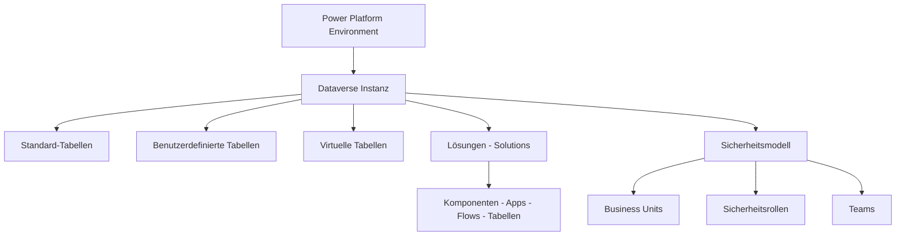
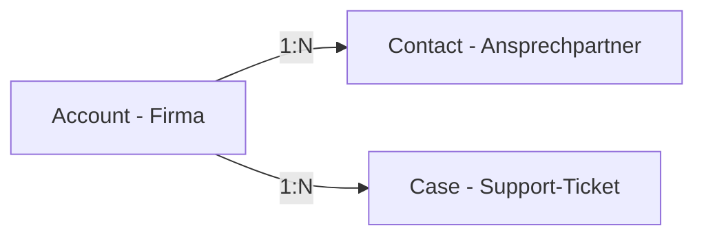
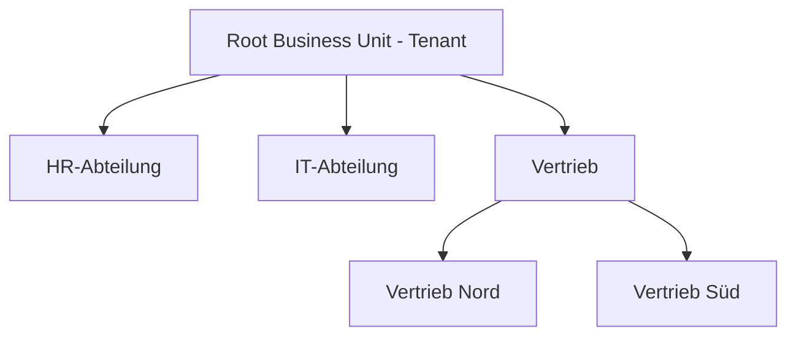
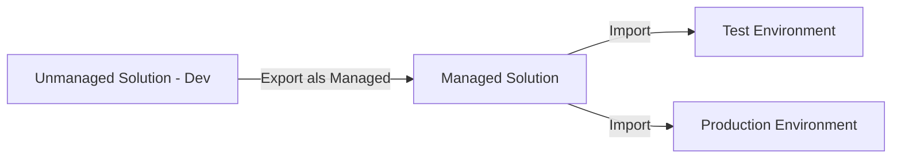
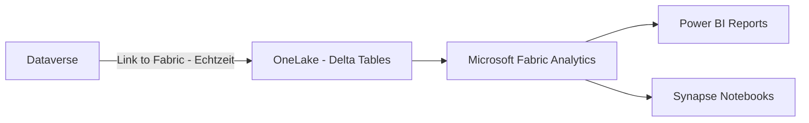

---
tags:
  - microsoft365
  - power-platform
  - dataverse
  - datenbank
  - low-code
aliases:
  - Dataverse
  - Common Data Service
  - CDS
  - Microsoft Dataverse Datenbank
---

# Microsoft Dataverse

> [!ABSTRACT] TL;DR
> Microsoft Dataverse ist die verwaltete Cloud-Datenbank der Power Platform und das Rückgrat aller datenintensiven Power Platform-Lösungen. Sie bietet relationale Tabellen mit umfangreichem Sicherheitsmodell (Business Units, Sicherheitsrollen), deklarative Geschäftslogik (Business Rules, Plug-ins) und eine OData REST-API — und ist damit deutlich leistungsfähiger als SharePoint-Listen für Enterprise-Szenarien.

---

## Was ist Microsoft Dataverse?

Microsoft Dataverse (ehemals Common Data Service / CDS) ist eine verwaltete, cloud-basierte Datenbankplattform, die als zentrale Datenbasis für die gesamte Power Platform dient.

**Wichtige Eigenschaften:**
- **Relationale Datenbank**: Tabellen mit Beziehungen, Constraints und Fremdschlüsseln
- **Rollenbasierte Sicherheit**: Granulare Berechtigungen auf Tabellen-, Zeilen- und Spaltenebene
- **Geschäftslogik auf Serverseite**: Business Rules, Workflows, Plug-ins, Power Automate-Flows
- **Standardisiertes Datenmodell**: Hunderte vordefinierter Tabellen für CRM/ERP-Szenarien
- **Multi-Environment**: Jede Power Platform-Environment hat eine eigene Dataverse-Instanz
- **Tief integriert**: Power Apps, Power Automate, Copilot Studio und Dynamics 365 nutzen Dataverse nativ

---

## Architektur



---

## Tabellen-Typen

| Typ | Beschreibung | Einsatz |
|-----|-------------|---------|
| **Standard** | Von Microsoft mitgeliefert (Account, Contact, Lead, etc.) | CRM-Szenarien, Dynamics 365-Basis |
| **Benutzerdefiniert** | Selbst erstellt, eigenes Schema | Spezifische Geschäftsdaten |
| **Virtuell** | Daten bleiben in externer Quelle (SharePoint, SQL, REST) | Nur lesend oder mit virtuellem Daten-Provider |
| **Elastic** | Cosmos DB-Backend für große Mengen (Milliarden Zeilen) | Log-Daten, IoT, High-Volume-Szenarien |

### Standard-Tabellen (Auswahl)

| Tabelle | Beschreibung |
|---------|-------------|
| **Account** | Firmen/Kunden (Organisationen) |
| **Contact** | Ansprechpartner (Personen) |
| **Lead** | Qualifizierbare Interessenten |
| **Opportunity** | Verkaufschancen |
| **Case** | Support-Tickets/Anfragen |
| **Task, Appointment, Email** | Aktivitäten |
| **User (SystemUser)** | Alle Benutzer der Environment |
| **Team** | Teams für Datenzugriff und Sicherheit |
| **Business Unit** | Organisationseinheiten |

---

## Spalten-Typen

| Typ | Beschreibung | Beispiel |
|-----|-------------|---------|
| **Text (Single/Multi-Line)** | Freitext, bis zu 1 MB | Name, Beschreibung |
| **Zahl (Int/Decimal/Float)** | Ganzzahlen und Dezimalzahlen | Menge, Preis |
| **Datum und Uhrzeit** | Datum, Zeit oder beides | Erstellt am, Fällig bis |
| **Ja/Nein (Boolean)** | Wahr/Falsch | Aktiv, Genehmigt |
| **Lookup** | Beziehung zu einer anderen Tabelle | Kundennummer → Account |
| **Choice / Choices** | Optionssatz (Dropdown) | Status: Offen, In Bearbeitung, Gelöst |
| **Datei / Bild** | Binärdaten oder Bilder | Anhang, Profilbild |
| **Formel (Calculated)** | Berechneter Wert | Volltextfeld aus Vor- und Nachname |
| **Rollup** | Aggregation aus verwandten Zeilen | Summe aller Bestellungen eines Kunden |
| **Auto Number** | Automatisch generierte Sequenznummer | Fallnummer, Rechnungsnummer |

---

## Beziehungen

### 1:N (One-to-Many) — Häufigste Beziehungsart

Eine Zeile in Tabelle A bezieht sich auf viele Zeilen in Tabelle B:



- In der N-Seite entsteht eine **Lookup-Spalte** (Fremdschlüssel)
- Kaskadierungsverhalten konfigurierbar: `Cascade All`, `Cascade Active`, `Cascade None`, `Remove Link`

### N:N (Many-to-Many)

Viele Zeilen in A beziehen sich auf viele Zeilen in B:
- Dataverse erstellt automatisch eine **Intersection-Tabelle** (verborgen)
- Beispiel: Ein Contact ist mit mehreren Accounts verbunden und umgekehrt

### Kaskadierung bei N:1 / 1:N

| Verhalten | Beschreibung |
|-----------|-------------|
| **Cascade All** | Alle abhängigen Zeilen werden ebenfalls gelöscht/zugewiesen |
| **Cascade Active** | Nur aktive abhängige Zeilen werden kaskadiert |
| **Cascade None** | Keine Kaskadierung — Beziehung wird auf null gesetzt |
| **Restrict** | Löschen verhindern wenn abhängige Zeilen existieren |

---

## Sicherheitsmodell

Das Dataverse-Sicherheitsmodell ist mehrschichtig und unterscheidet sich grundlegend von SharePoint.

### Business Units

Business Units (Geschäftseinheiten) bilden die Organisationshierarchie ab:



- Jeder Nutzer gehört genau einer Business Unit an
- Sicherheitsrollen können Business-Unit-übergreifend wirken (via Depth-Einstellung)

### Sicherheitsrollen

Sicherheitsrollen definieren Berechtigungen auf Tabellen-Ebene mit feiner Granularität:

| Berechtigung | Beschreibung |
|-------------|-------------|
| **Create** | Neue Zeilen erstellen |
| **Read** | Zeilen lesen |
| **Write** | Bestehende Zeilen bearbeiten |
| **Delete** | Zeilen löschen |
| **Append** | Zeilen an andere Zeilen anhängen (für Beziehungen) |
| **Append To** | Erlaubt anderen, Zeilen an diese Tabelle anzuhängen |
| **Assign** | Eigentümer einer Zeile ändern |
| **Share** | Zeile mit anderen Nutzern teilen |

**Tiefenstufen (Depth)** bestimmen den Umfang:

| Tiefe | Zugriff auf |
|-------|------------|
| **User** | Eigene Zeilen (Eigentümer = aktueller Nutzer) |
| **Business Unit** | Zeilen der eigenen Business Unit |
| **Parent: Child Business Units** | BU + alle untergeordneten BUs |
| **Organization** | Alle Zeilen in der gesamten Environment |

### Teams

| Team-Typ | Beschreibung |
|---------|-------------|
| **Owner Team** | Kann Eigentümer von Datensätzen sein, hat Sicherheitsrollen |
| **Access Team** | Dynamisches Team für Ad-hoc-Datensatz-Sharing (keine Sicherheitsrollen) |
| **Entra ID Team** | Verknüpft mit einer Entra ID Gruppe |

---

## Lösungen (Solutions)

Solutions sind Container für Power Platform-Komponenten und ermöglichen den Transport zwischen Environments.



| Eigenschaft | Unmanaged | Managed |
|------------|-----------|---------|
| **Bearbeitbar** | Ja, vollständig | Nein (nur via Patch/Upgrade) |
| **Löschbar** | Ja | Ja (entfernt alle Komponenten) |
| **Empfohlen für** | Development | Test und Production |
| **Überschreibt Anpassungen** | Nein | Abhängig von Solution-Upgrade-Einstellung |

### Publisher und Prefix

Jede Solution hat einen **Publisher** mit einem **Customization Prefix** (z.B. `contoso_`):
- Alle benutzerdefinierten Tabellen, Spalten und Komponenten erhalten dieses Prefix
- Verhindert Namenskonflikte bei Solution-Import
- Beispiel: `contoso_urlaubsantrag` statt `urlaubsantrag`

---

## Dataverse for Teams

Eine eingeschränkte Dataverse-Version, die direkt in Teams-Environments ohne separate Power Apps-Premiumlizenz verfügbar ist.

| Eigenschaft | Dataverse for Teams | Vollständiges Dataverse |
|------------|---------------------|------------------------|
| **Tabellen-Limit** | 25 Tabellen | Unbegrenzt |
| **Zeilen-Limit** | 1 Mio. Zeilen (gesamt) | Kapazitätsbasiert |
| **Sicherheitsmodell** | Vereinfacht (Teams-Mitglieder) | Vollständiges Rollenmodell |
| **Web API** | Nein | Ja |
| **Plug-ins** | Nein | Ja |
| **Virtuelle Tabellen** | Nein | Ja |
| **Upgrade möglich** | Ja (→ vollständige Dataverse-Environment) | — |

> [!TIP] Wann Dataverse for Teams nutzen?
> Für einfache Teams-interne Apps ohne komplexe Sicherheitsanforderungen. Sobald die App über Teams hinausgehen, Premium-Lizenz-Funktionen oder externe Verbindungen benötigt werden → Upgrade auf vollständige Dataverse-Environment.

---

## Dataverse vs. SharePoint-Listen

| Kriterium | Dataverse | SharePoint-Listen |
|-----------|-----------|------------------|
| **Datentypen** | Vollständig (Choice, Lookup, Rollup, Formula, etc.) | Begrenzt (kein nativer Rollup) |
| **Beziehungen** | 1:N, N:N mit voller Kaskadierung | Nur einfache Lookup-Spalten |
| **Sicherheit** | Zeilen-/Spaltenebene, Rollen, Business Units | Site-/Listen-/Elementebene |
| **Skalierung** | Milliarden Zeilen (Elastic Tables) | 30 Mio. Elemente (mit Hürden ab 5.000) |
| **API** | OData REST-API, Web API | REST API, PnP |
| **Offline** | Power Apps Offline mit Dataverse | Begrenzt |
| **Serverlogik** | Plug-ins, Workflows, Business Rules | Flows, Power Apps |
| **Lizenz** | Power Apps Premium nötig | In M365 enthalten |
| **Beste Wahl für** | Komplexe Enterprise-Daten, relationale Modelle | Einfache Listen, Dokumentenverwaltung |

---

## Web API (OData REST)

Dataverse stellt eine vollständige OData v4 REST-API bereit.

**Basis-URL**: `https://[org].api.crm[n].dynamics.com/api/data/v9.2/`

### Beispiel-Anfragen

```json
// Alle Accounts abrufen (GET)
GET /api/data/v9.2/accounts?$select=name,emailaddress1&$top=10

// Gefilterte Abfrage
GET /api/data/v9.2/contacts?$filter=lastname eq 'Müller'&$select=fullname,emailaddress1

// Mit verknüpften Daten (Expand)
GET /api/data/v9.2/accounts?$expand=contact_customer_accounts($select=fullname)

// Neuen Datensatz erstellen (POST)
POST /api/data/v9.2/accounts
Content-Type: application/json
{
  "name": "Contoso GmbH",
  "emailaddress1": "info@contoso.de"
}

// Datensatz aktualisieren (PATCH)
PATCH /api/data/v9.2/accounts(GUID)
{
  "telephone1": "+49 30 12345678"
}

// Datensatz löschen (DELETE)
DELETE /api/data/v9.2/accounts(GUID)
```

**Authentifizierung**: OAuth 2.0 via Microsoft Entra ID (App Registration oder Service Principal)

---

## Geschäftslogik

### Business Rules

Deklarative Validierungslogik, die im Browser und im Server ausgeführt wird:
- Felder ein-/ausblenden
- Felder als Pflichtfeld markieren
- Feldwerte berechnen/setzen
- Fehlermeldungen anzeigen
- Kein Code erforderlich — über grafische Oberfläche konfiguriert

### Duplicate Detection

Regeln zur Erkennung von Duplikaten beim Erstellen/Aktualisieren von Datensätzen:
- Regelbasiert (z.B. gleiche E-Mail-Adresse = Duplikat)
- Online-Prüfung oder Batch-Job
- Nutzerwarnungen oder automatisches Blockieren

### Auditing

- Protokollierung aller Erstell-, Änderungs- und Löschoperationen
- Konfigurierbar auf Environment-, Tabellen- und Spaltenebene
- Audit-Logs werden in Dataverse gespeichert und können exportiert werden

---

## Dataverse Search

- **Relevanzsuche** über alle aktivierten Tabellen und Spalten
- Quick Find Views pro Tabelle konfigurieren (welche Spalten werden durchsucht?)
- Volltextsuche mit Relevanz-Ranking
- Schnellsuche in Model-Driven Apps via Suchleiste

---

## Dataflows (Datenmigration und ETL)

Power Query-basierte ETL-Pipeline direkt in der Power Platform:
- Daten aus externen Quellen transformieren und in Dataverse importieren
- Scheduling (stündlich, täglich, wöchentlich)
- Voraussetzung für Incremental Refresh

---

## Dataverse Link to Microsoft Fabric



- Keine ETL-Pipeline nötig — Daten werden in OneLake gespiegelt
- Daten liegen im Delta-Format in OneLake
- Ermöglicht Analytics mit allen Fabric-Tools ohne Dataverse-Last

---

## Elastic Tables

Für extreme Datenmengen (Milliarden Zeilen, z.B. Telemetrie, Logs, IoT):
- Basieren auf Azure Cosmos DB statt SQL
- Automatisches Partitionieren und horizontales Skalieren
- Einschränkungen: keine Plug-ins, eingeschränkte Beziehungen, andere API-Patterns
- Ab Power Apps Premium verfügbar

---

## Kapazität und Limits

| Ressource | Standard | Hinzufügbar |
|-----------|---------|------------|
| **Database Storage** | 10 GB (Tenant Basis) + je Lizenz | Add-On kaufbar |
| **File Storage** | 20 GB (Tenant Basis) + je Lizenz | Add-On kaufbar |
| **Log Storage** | 2 GB | Add-On kaufbar |
| **Anfragen-Limits** | Abhängig von Lizenz (z.B. 40.000 API-Anfragen/Tag per Premium) | Add-On kaufbar |

---

## Verwandte Notizen

- [[Power Platform Grundlagen]]
- [[Power Apps]]
- [[Power Automate]]
- [[Power Pages]]
- [[Power Platform Governance]]
