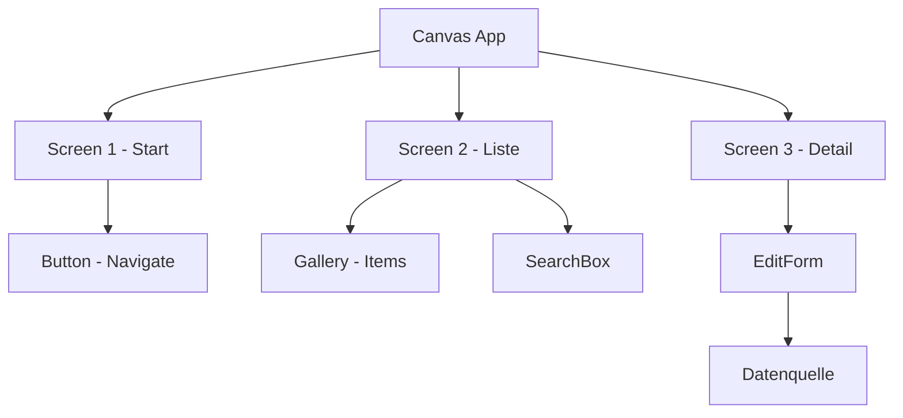
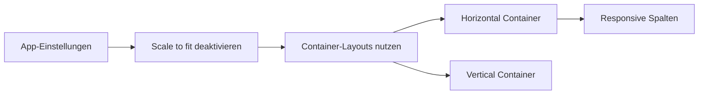
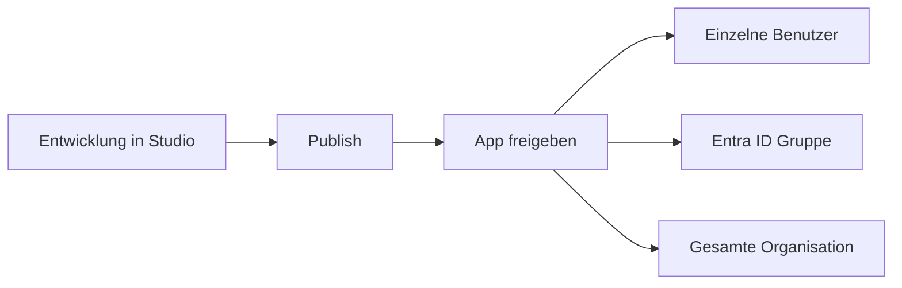
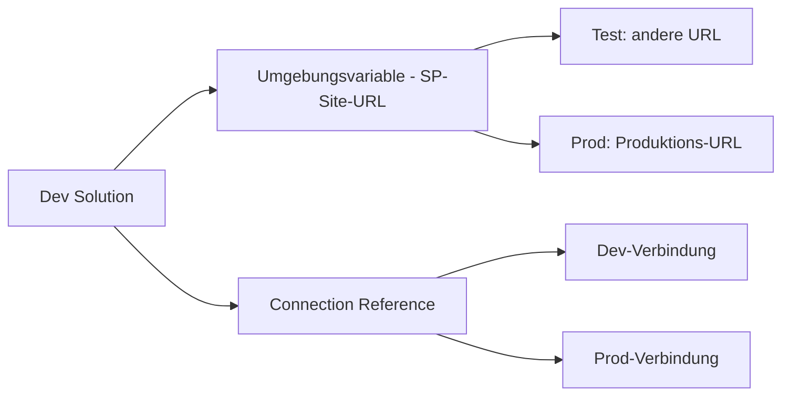

---
tags:
  - microsoft365
  - power-platform
  - power-apps
  - canvas-apps
  - model-driven-apps
aliases:
  - Canvas Apps
  - Model-driven Apps
  - Power Apps Studio
---

# Power Apps

> [!ABSTRACT] TL;DR
> Power Apps ist die Low-Code-Entwicklungsplattform der Microsoft Power Platform für die Erstellung von Geschäftsanwendungen. Canvas Apps bieten maximale Designfreiheit für mobile und Desktop-Szenarien, während Model-Driven Apps auf Microsoft Dataverse aufbauen und automatisch ein responsives, datengesteuertes UI generieren.

---

## App-Typen im Vergleich

Power Apps bietet drei grundlegende App-Typen, die sich in Architektur, Zielgruppe und Einsatzszenario unterscheiden:

| Merkmal | Canvas App | Model-Driven App | Power Pages |
|---------|-----------|-----------------|-------------|
| **Design** | Pixel-perfect, freies Layout | Automatisch generiert (Formulare/Ansichten) | Web-Portal, extern zugänglich |
| **Datenbasis** | SharePoint, Dataverse, SQL, Excel, 500+ Quellen | Ausschließlich Dataverse | Ausschließlich Dataverse |
| **Zielgruppe** | Interne Nutzer (mobil/Desktop) | Interne Nutzer (CRM-ähnlich) | Externe Nutzer (Kunden, Partner) |
| **Logik** | Power Fx Formeln im Client | Serverseitige Plug-ins, Business Rules | Liquid Templates, JavaScript |
| **Komplexität** | Einfach bis mittel | Mittel bis komplex | Mittel bis komplex |
| **Lizenz** | Power Apps (Per User/Per App) | Power Apps (Per User/Per App) | Power Pages (eigene Lizenz) |

### Canvas Apps
Canvas Apps bieten absolute Designfreiheit. Das UI wird per Drag & Drop auf einem Zeichenbereich (Canvas) erstellt. Daten werden über Connectors eingebunden — bis zu 500 Datenquellen gleichzeitig.

**Typische Anwendungsfälle:**
- Mobile Inspektions- und Erfassungs-Apps
- Formular-Workflows (Genehmigungen, Bestellungen)
- Dashboards und Übersichten
- Teams-integrierte Micro-Apps

### Model-Driven Apps
Model-Driven Apps basieren ausschließlich auf Dataverse-Tabellen. Das UI wird automatisch aus dem Datenmodell generiert — Formulare, Ansichten, Dashboards entstehen deklarativ ohne pixelgenaues Design.

**Typische Anwendungsfälle:**
- CRM-ähnliche Anwendungen (Kunden, Opportunities, Cases)
- Komplexe Datenverwaltung mit mehreren Tabellen
- Apps mit serververseitiger Geschäftslogik (Plug-ins, Workflows)
- Erweiterung von Dynamics 365

---

## Canvas App Aufbau



| Komponente | Beschreibung |
|-----------|-------------|
| **Screen** | Container-Ebene, entspricht einer Seite/Ansicht der App |
| **Control** | UI-Element (Button, Label, TextInput, Gallery, Form, etc.) |
| **Property** | Eigenschaft eines Controls (Text, Fill, OnSelect, Items, etc.) |
| **Formula** | Power Fx-Ausdruck, der eine Property berechnet |
| **Connector** | Verbindung zu einer Datenquelle |
| **Variable** | Globale (`Set`) oder lokale (`UpdateContext`) Zustandsspeicherung |

---

## Power Fx Formelsprache

Power Fx ist die deklarative, Excel-ähnliche Formelsprache von Power Apps. Formeln werden direkt in die Properties von Controls eingegeben — kein Event-Handler-Code nötig.

> [!TIP] Excel-Kenntnisse übertragbar
> Wer Excel-Formeln kennt, findet sich in Power Fx schnell zurecht. Funktionen wie `IF()`, `SUM()`, `TEXT()` verhalten sich ähnlich.

### Navigation und Variablen

```javascript
// Zu einem anderen Screen navigieren
Navigate(Screen2, ScreenTransition.Fade)

// Globale Variable setzen (appweit verfügbar)
Set(varAusgewähltesElement, Gallery1.Selected)

// Lokale Variable setzen (nur im aktuellen Screen)
UpdateContext({locLadeIndikator: true})
```

### Daten lesen

```javascript
// Alle Elemente einer SharePoint-Liste filtern
Filter(
    'Urlaubsanträge',
    Status = "Genehmigt" && Antragsteller.Email = User().Email
)

// Einzelnen Datensatz nachschlagen
LookUp(
    Mitarbeiter,
    ID = varAusgewählteMitarbeiterID
)

// Erste 10 Elemente sortiert anzeigen
FirstN(
    SortByColumns('Aufgaben', "Fälligkeitsdatum", SortOrder.Ascending),
    10
)
```

### Daten schreiben

```javascript
// Neuen Datensatz erstellen (Patch zum Anlegen)
Patch(
    'Urlaubsanträge',
    Defaults('Urlaubsanträge'),
    {
        Titel: txtTitel.Text,
        Von: datVon.SelectedDate,
        Bis: datBis.SelectedDate,
        Status: "Offen"
    }
)

// Bestehenden Datensatz aktualisieren
Patch(
    'Urlaubsanträge',
    Gallery1.Selected,
    {Status: "Genehmigt"}
)

// Lokale Sammlung befüllen (keine DB-Schreiboperation)
Collect(colMeineAuswahl, Gallery1.Selected)

// Lokale Sammlung leeren
Clear(colMeineAuswahl)
ClearCollect(colNeu, Filter('Aufgaben', Priorität = "Hoch"))
```

### Formulare

```javascript
// Formular absenden (EditForm)
SubmitForm(Form1)

// Formular zurücksetzen
ResetForm(Form1)

// Formular-Modus wechseln (New/Edit/View)
NewForm(Form1)
EditForm(Form1)
ViewForm(Form1)
```

---

## Datenquellen verbinden

Power Apps kann über Connectors mit hunderten Datenquellen verbunden werden.

| Datenquelle | Connector-Typ | Besonderheiten |
|------------|--------------|----------------|
| **SharePoint** | Standard | Delegierbare Abfragen bis 2.000 Elemente (mit Delegation bis 500) |
| **Microsoft Dataverse** | Premium | Vollständige Delegation, serverseitige Logik, Sicherheitsrollen |
| **SQL Server** | Premium | Direct Query oder Import-Modus |
| **Excel (OneDrive)** | Standard | Tabellen als Datenquelle, kein echtes Concurrent-Access |
| **REST/HTTP** | Premium | Beliebige Web-API, Custom Connectors |
| **Dynamics 365** | Premium | Nahtlose Integration über Dataverse |

> [!WARNING] Delegation verstehen
> Nicht alle Funktionen werden an die Datenquelle delegiert — ohne Delegation werden maximal 500 (Standard) oder 2.000 (konfigurierbar) Datensätze heruntergeladen und lokal gefiltert. Bei großen Listen kann dies zu unvollständigen Ergebnissen führen. Delegierbare Funktionen sind connector-abhängig.

---

## Galerie und Formulare

### Gallery Control
Die Galerie ist das zentrale Control für Listen-Ansichten in Canvas Apps.

```javascript
// Items-Property der Galerie
Sort(
    Filter(
        'Serviceanfragen',
        StartsWith(Titel, txtSuche.Text) || IsBlank(txtSuche.Text)
    ),
    Erstellt,
    SortOrder.Descending
)

// Ausgewähltes Element referenzieren
Gallery1.Selected.Titel
Gallery1.Selected.ID
```

### Formulare (EditForm / DisplayForm)
- **EditForm**: Ermöglicht das Erstellen und Bearbeiten von Datensätzen
- **DisplayForm**: Zeigt Datensätze nur zur Ansicht an
- **DataSource**: Wird auf den Connector gesetzt
- **Item**: Verknüpfung mit dem ausgewählten Galerie-Element (`Gallery1.Selected`)
- **OnSuccess**: Aktion nach erfolgreichem Speichern (`Navigate(Screen1)`)

---

## Offline-Nutzung

Power Apps Canvas Apps unterstützen eingeschränkte Offline-Szenarien über lokale Sammlungen.

```javascript
// Daten lokal speichern (beim Start oder wenn verbunden)
If(
    Connection.Connected,
    ClearCollect(colOfflineData, 'MeineTabelle')
)
SaveData(colOfflineData, "OfflineDaten")

// Beim App-Start: offline gespeicherte Daten laden
LoadData(colOfflineData, "OfflineDaten", true)

// Verbindungsstatus prüfen
If(Connection.Connected, "Online", "Offline - lokale Daten werden verwendet")
```

> [!NOTE] Offline-Einschränkungen
> Offline-Szenarien erfordern sorgfältige Planung der Synchronisierungslogik. Konfliktauflösung bei gleichzeitigen Änderungen muss manuell implementiert werden. Dataverse bietet bessere native Offline-Unterstützung als SharePoint.

---

## Responsive Design



- **Scale to fit**: Standardmäßig aktiviert — die App skaliert auf Bildschirmgröße, ist aber nicht wirklich responsiv
- **Auto-Layout Container**: Moderne Alternative — Horizontal/Vertical Container mit `Fill`-Größen erstellen echte responsive Layouts
- **`App.Width` und `App.Height`**: Können für adaptive Formeln genutzt werden (z.B. unterschiedliche Layouts für Tablet und Telefon)

---

## App-Veröffentlichung und Freigabe



1. **Publish**: Macht die aktuelle Version für alle Nutzer verfügbar (vorher nur für die App-Besitzer sichtbar)
2. **Share**: Über das Power Apps Portal oder Power Apps Studio — mit Benutzern, Gruppen oder der gesamten Organisation
3. **Co-Owner**: Mitarbeiter können als Mitbesitzer hinzugefügt werden (können die App bearbeiten)

> [!TIP] Gruppen-Freigabe bevorzugen
> Teile Apps immer mit **Entra ID Sicherheitsgruppen** statt einzelnen Nutzern. So ist das Benutzermanagement zentral in Entra ID steuerbar und der App-Besitzer muss keine individuellen Berechtigungen verwalten.

---

## App in Microsoft Teams einbetten

Power Apps können als Teams-Tab oder persönliche App direkt in Microsoft Teams bereitgestellt werden:

1. **Als Tab in einem Kanal**: Teams → Kanal → Neuer Tab → Power Apps → App auswählen
2. **Als persönliche App**: Im Power Apps Portal → App → "Zu Teams hinzufügen" → Manifest herunterladen und per Teams Admin Center deployen
3. **Teams als Datenquelle**: Direkte Verbindung zu Teams-Kanälen, Nachrichten und Chats aus der App heraus

> [!NOTE] Dataverse for Teams
> In Teams-Environments kann Dataverse for Teams (eingeschränkte Version) genutzt werden, ohne Power Apps-Premium-Lizenzen zu benötigen. Einschränkungen: max. 25 Tabellen, 1 Million Zeilen, keine externen Connectors.

---

## Lizenzierung: Per User vs. Per App

| Szenario | Empfohlene Lizenz |
|---------|-------------------|
| Nutzer verwendet mehrere Apps | **Per User** ($20/User/Monat) |
| Nutzer verwendet genau eine App | **Per App** ($5/User/App/Monat) |
| Sporadische Nutzung, Azure vorhanden | **Pay-As-You-Go** ($10/aktiver User/Monat) |
| Einfache App ohne Premium Connectors | **M365-inkludiert** (Standard Connectors only) |
| Entwickler und Tests | **Developer Plan** (kostenlos, keine produktive Nutzung) |

---

## Via Power Apps (UI)

### Canvas App erstellen

1. Öffne **Power Apps** unter [make.powerapps.com](https://make.powerapps.com)
2. Wähle oben rechts die gewünschte **Umgebung** aus
3. Navigiere im linken Menü zu **Erstellen**
4. Wähle **Canvas-App von Grund auf** und entscheide dich für das Layout:
   - **Tablet**: Querformat, ideal für Desktop-Nutzung
   - **Telefon**: Hochformat, optimiert für mobile Geräte
   - **Responsiv** (empfohlen 2024): Passt sich automatisch an alle Bildschirmgrößen an
5. Vergib einen **App-Namen** und klicke auf **Erstellen** — Power Apps Studio öffnet sich
6. Füge über das linke Panel **Steuerelemente** ein (Schaltflächen, Galerien, Formulare)
7. Verbinde über **Daten** > **Daten hinzufügen** eine Datenquelle (z.B. SharePoint, Dataverse, Excel)
8. Konfiguriere Navigation zwischen Bildschirmen mit `Navigate(ScreenName)` in der `OnSelect`-Eigenschaft
9. Klicke oben auf **Speichern** (Cloud-Speicherung) und anschließend auf **Veröffentlichen**

> [!TIP] Moderne Steuerelemente aktivieren
> Unter **Einstellungen** > **Neue Funktionen** lassen sich moderne Steuerelemente (Modern Controls) aktivieren, die ein aktualisiertes Design und bessere Barrierefreiheit bieten.

### Model-Driven App erstellen

1. Öffne **Power Apps** unter [make.powerapps.com](https://make.powerapps.com)
2. Navigiere zu **Erstellen** > **Modellgesteuerte App**
3. Gib einen **Namen** ein und klicke auf **Erstellen**
4. Wähle über **Navigation hinzufügen** die Dataverse-Tabellen aus, die in der App erscheinen sollen
5. Konfiguriere Formulare, Ansichten und Diagramme für jede Tabelle
6. Klicke auf **Speichern** und dann **Veröffentlichen**

### App freigeben und verteilen

1. Öffne die App in [make.powerapps.com](https://make.powerapps.com) und klicke auf **…** > **Freigeben**
2. Suche nach **Benutzern oder Gruppen** aus dem Azure AD
3. Lege die Berechtigungsstufe fest (Benutzer oder Co-Besitzer)
4. Klicke auf **Freigeben** — Benutzer erhalten eine E-Mail mit dem App-Link

---

## ALM für Power Apps (Application Lifecycle Management)

### Solutions

Solutions sind Container, die Power Platform-Komponenten (Apps, Flows, Tabellen, etc.) bündeln und zwischen Environments transportierbar machen.

| Solution-Typ | Beschreibung | Verwendung |
|-------------|-------------|------------|
| **Unmanaged** | Vollständig bearbeitbar, keine Einschränkungen | Development-Environment |
| **Managed** | Schreibgeschützt, kann nicht direkt bearbeitet werden | Test und Production |

> [!DANGER] Nie Managed Solutions in Production manuell bearbeiten
> Alle Änderungen müssen in der Development-Environment vorgenommen und als neue Managed Solution deployed werden. Direkte Änderungen in Production gehen beim nächsten Deploy verloren.

### Umgebungsvariablen und Connection References



- **Umgebungsvariablen**: Konfigurationswerte, die pro Environment unterschiedlich sein können (URLs, Feature-Flags)
- **Connection References**: Abstrahieren die Verbindung zu einem Connector — beim Import wird eine andere physische Verbindung zugewiesen

---

## Power Apps Monitor

Der Monitor (`monitor.powerapps.com`) ist das integrierte Debugging-Tool für Canvas Apps.

- **Netzwerkverkehr**: Alle Connector-Aufrufe mit Request/Response und Timing
- **App-Aktivitäten**: Control-Events, Formeln-Auswertungen
- **Fehler-Logs**: Fehler und Warnungen mit Quelle und Zeitstempel
- **Remote Debugging**: Monitoring einer laufenden App bei einem anderen Benutzer

---

## App Checker und Governance

Power Apps Studio enthält einen integrierten **App Checker**, der Probleme und Verbesserungsvorschläge anzeigt:

- **Fehler**: Blockierende Formelfehler
- **Warnungen**: Performance-Probleme (z.B. nicht-delegierbare Funktionen in großen Datensätzen)
- **Empfehlungen**: Accessibility-Checks (Kontrast, Screen Reader, Tab-Reihenfolge)
- **Formula-Checker**: Syntaxfehler und Typinkompatibilitäten

> [!TIP] App-Qualität vor Freigabe prüfen
> Führe vor jeder Veröffentlichung einen vollständigen App Checker-Durchlauf durch. Accessibility-Fehler sollten besonders in unternehmenskritischen Apps behoben werden.

---

## Verwandte Notizen

- [[Power Platform Grundlagen]]
- [[Power Automate]]
- [[Microsoft Dataverse]]
- [[Power Pages]]
- [[Power Platform Governance]]
