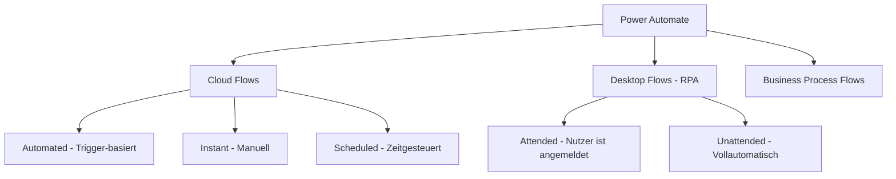
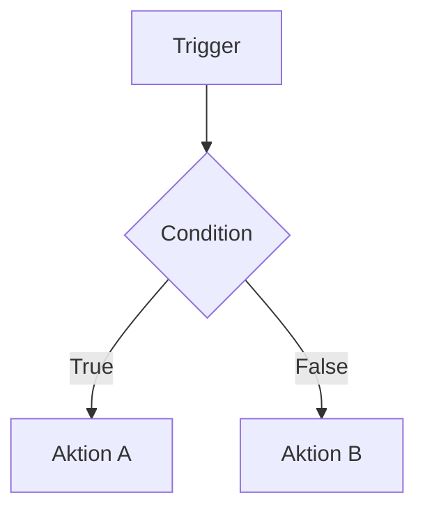
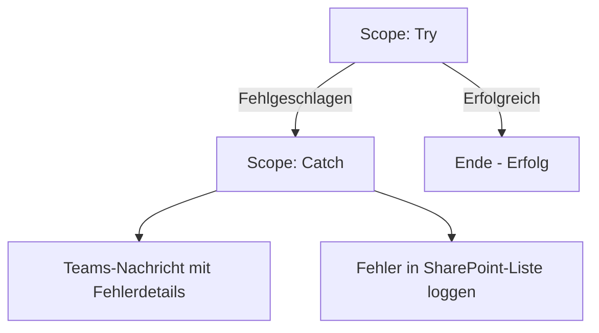
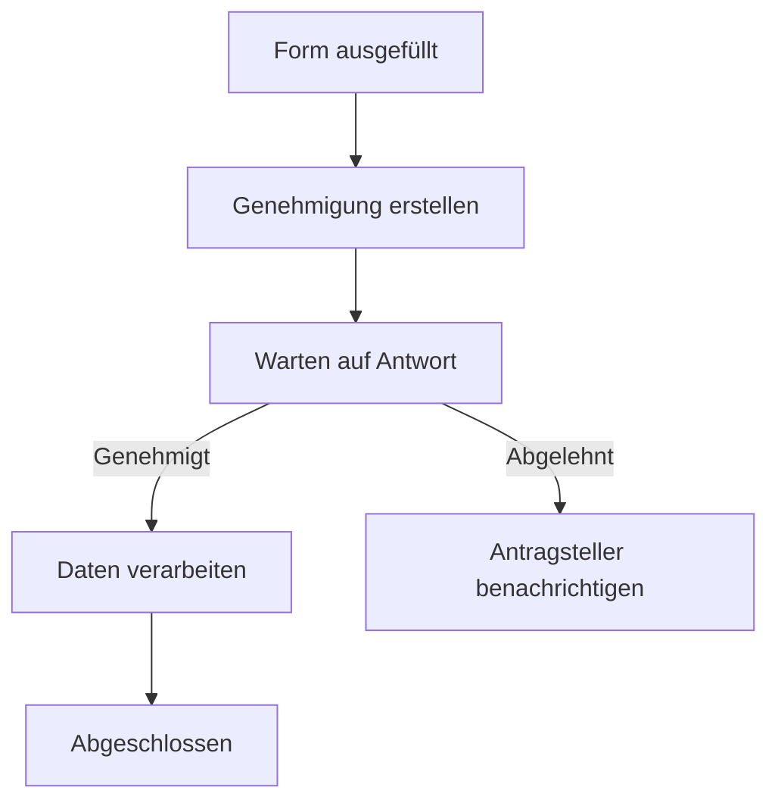
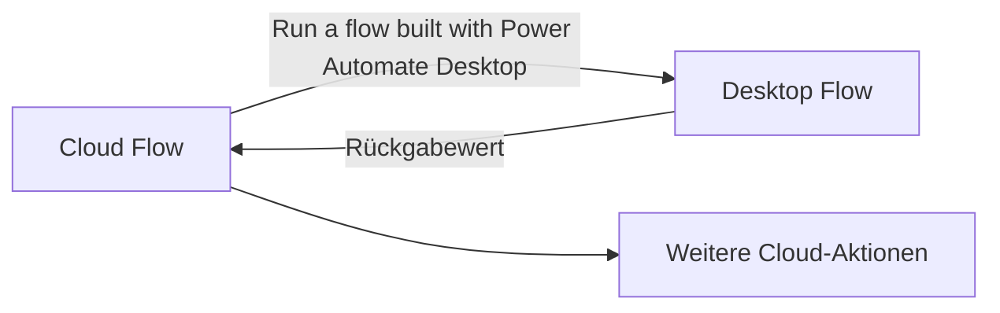

---
tags:
  - microsoft365
  - power-platform
  - power-automate
  - rpa
  - automatisierung
  - cloud-flows
aliases:
  - Flow
  - Cloud Flow
  - Desktop Flow
  - Power Automate Flow
---

# Power Automate

> [!ABSTRACT] TL;DR
> Power Automate ist die Automatisierungsplattform der Microsoft Power Platform für Cloud Flows (ereignisgesteuerte Prozessautomatisierung über 500+ Connectors), Desktop Flows (RPA für Legacy-Systeme ohne API) und Business Process Flows (geführte Prozesspfade). Zusammen mit Genehmigungsworkflows, AI Builder und nativer Microsoft 365-Integration deckt es nahezu alle Automatisierungsszenarien ab.

---

## Flow-Typen im Überblick



| Flow-Typ | Auslöser | Typische Szenarien |
|---------|---------|---------------------|
| **Automated Cloud Flow** | Externer Trigger (Event) | E-Mail empfangen → Ticket erstellen; SharePoint-Element erstellt → Teams-Nachricht |
| **Instant Cloud Flow** | Manueller Start (Nutzer, App, HTTP) | Genehmigung starten; Daten aus App heraus verarbeiten |
| **Scheduled Cloud Flow** | Zeitplan (täglich, stündlich, etc.) | Tagesberichte erstellen; Daten synchronisieren; Aufräumarbeiten |
| **Desktop Flow (Attended)** | Manuell oder von Cloud Flow ausgelöst | RPA mit Nutzer-Interaktion; UI-Automation auf Desktop |
| **Desktop Flow (Unattended)** | Cloud Flow, vollautomatisch | RPA auf dedizierten Bot-Maschinen ohne Login |
| **Business Process Flow** | Dataverse-Datensatz erstellt/geöffnet | Geführter Vertriebsprozess; mehrstufige Genehmigungsphasen |

---

## Trigger-Typen und häufige Trigger

Ein Trigger ist das Startereignis eines Cloud Flows. Jeder Connector bringt eigene Trigger mit.

### Häufig verwendete Trigger

| Connector | Trigger | Beschreibung |
|-----------|---------|-------------|
| **SharePoint** | When an item is created | Neues Listenelement erstellt |
| **SharePoint** | When an item is created or modified | Element erstellt oder geändert |
| **Outlook / Exchange** | When a new email arrives | E-Mail empfangen (mit Filtern) |
| **Microsoft Forms** | When a new response is submitted | Formular ausgefüllt |
| **Teams** | When a new message is posted | Nachricht in Kanal oder Chat |
| **Dataverse** | When a row is added/modified/deleted | Dataverse-Datensatz geändert |
| **HTTP Request** | When a HTTP request is received | REST-Endpoint für externe Systeme |
| **Recurrence** | Recurrence | Zeitgesteuert (täglich, stündlich, etc.) |
| **Power Apps** | PowerApps (V2) | Aufruf direkt aus einer Canvas App |
| **Approvals** | When an approval is completed | Genehmigung abgeschlossen |

> [!TIP] HTTP-Request Trigger für Integrationen
> Der **When a HTTP request is received**-Trigger erzeugt einen eindeutigen HTTPS-Endpoint. Externe Systeme (Webhooks, Drittanwendungen) können damit Cloud Flows auslösen, ohne einen eigenen Connector zu benötigen.

---

## Aktionen und Konnektoren

Power Automate bietet über 1.000 Konnektoren mit tausenden Aktionen.

### Standard-Konnektoren (in M365 enthalten)
- SharePoint (Listen, Bibliotheken, Seiten)
- Microsoft Teams (Nachrichten, Meetings, Mitglieder)
- Outlook / Exchange Online (E-Mails, Kalender, Kontakte)
- Microsoft Forms
- Planner, OneNote, OneDrive for Business
- Excel Online, Word Online
- Azure DevOps (Standard-Aktionen)

### Premium-Konnektoren (Premium-Lizenz erforderlich)
- **Dataverse**: Erstellen, lesen, aktualisieren und löschen von Zeilen
- **HTTP**: Beliebige REST-API aufrufen
- **SQL Server**: Direktverbindung zu Azure SQL oder On-Premises SQL
- **SAP ERP**: Integration mit SAP-Systemen
- **Salesforce, ServiceNow, Zendesk**: CRM/ITSM-Integration
- **Adobe Sign, DocuSign**: Dokumenten-Signatur
- **Azure (Blob Storage, Key Vault, Service Bus)**: Azure-Dienste

### Custom Connectors
Selbst erstellte Connectors auf Basis einer OpenAPI (Swagger) Spezifikation — ermöglichen die Integration beliebiger Web-APIs als Connector.

---

## Kontrollstrukturen

### Bedingungen



- **Condition**: Einfache Wenn-Dann-Sonst-Verzweigung
- **Switch**: Mehrere Verzweigungen auf Basis eines Werts (Case 1, Case 2, Default)

### Schleifen

| Schleife | Verwendung |
|---------|------------|
| **Apply to each** | Iteration über ein Array (z.B. alle E-Mail-Anhänge, alle Listenelemente) |
| **Do until** | Wiederholung bis eine Bedingung wahr wird (z.B. warten auf Statusänderung) |
| **Parallel Branch** | Mehrere Aktionen gleichzeitig ausführen |

> [!WARNING] Concurrency in Apply to each
> Standardmäßig läuft Apply to each sequenziell. Für bessere Performance kann Concurrency aktiviert werden (1–50 parallele Iterationen). Achtung: bei gleichzeitigem Datenbankzugriff können Konflikte entstehen.

---

## Error Handling

### Configure run after

Jede Aktion kann so konfiguriert werden, dass sie nur unter bestimmten Vorbedingungen ausgeführt wird:

| Status | Bedeutung |
|--------|-----------|
| **is successful** | Vorherige Aktion erfolgreich (Standard) |
| **has failed** | Vorherige Aktion fehlgeschlagen |
| **is skipped** | Vorherige Aktion übersprungen |
| **has timed out** | Vorherige Aktion war Timeout |

### Try-Catch mit Scope



**Implementierung:**
1. Haupt-Logik in einen **Scope** packen (Name: "Try")
2. Fehler-Behandlung in zweiten **Scope** (Name: "Catch")
3. Catch-Scope "Configure run after" → "has failed" setzen
4. Im Catch: `result('Try')` Funktion liefert Fehlerdetails

```json
// Fehler-Details aus dem Try-Scope extrahieren
@{result('Try')?[0]?['error']?['message']}
```

---

## Variablen und Ausdrücke

### Variablen-Aktionen

| Aktion | Zweck |
|--------|-------|
| **Initialize variable** | Variable deklarieren (einmalig am Flow-Anfang) |
| **Set variable** | Wert überschreiben |
| **Increment variable** | Zahl erhöhen (z.B. Zähler in Schleife) |
| **Append to string variable** | Text anhängen |
| **Append to array variable** | Element zu Array hinzufügen |

### Wichtige Ausdrücke (Expressions)

```json
// Aktuelles Datum/Uhrzeit (UTC)
utcNow()
utcNow('yyyy-MM-dd')
formatDateTime(utcNow(), 'dd.MM.yyyy')

// Trigger-Outputs
triggerOutputs()?['body/Title']
triggerBody()?['value']

// Aktion-Output
outputs('HTTP')?['body']
body('Parse_JSON')?['id']

// Array-Operationen
first(variables('MeinArray'))
last(variables('MeinArray'))
length(variables('MeinArray'))
join(variables('MeinArray'), ', ')
union(variables('Array1'), variables('Array2'))

// String-Operationen
concat('Hello ', triggerBody()?['Name'])
toLower(triggerBody()?['Email'])
trim(variables('TextVariable'))
split(variables('CSV'), ',')

// Bedingungen
if(equals(variables('Status'), 'Offen'), 'Neu', 'Bekannt')
empty(variables('MeinArray'))
```

---

## Genehmigungsprozesse (Approvals)

Power Automate enthält einen nativen Genehmigungsservice mit Teams-Integration.

### Genehmigungs-Typen

| Typ | Verhalten |
|-----|---------|
| **Approve/Reject - First to respond** | Die erste Person entscheidet für alle |
| **Approve/Reject - Everyone must approve** | Alle müssen genehmigen (eine Ablehnung stoppt den Prozess) |
| **Custom responses** | Eigene Antwortoptionen (z.B. "Genehmigt", "Änderungen erforderlich", "Abgelehnt") |

### Genehmigungsfluss-Muster



### Adaptive Cards für Genehmigungen in Teams

Genehmigungsanfragen erscheinen in Teams als interaktive **Adaptive Cards** direkt im Genehmigungscenter (`teams.microsoft.com/approvals`) oder im Approvals-Tab.

- Genehmigende können direkt in Teams (mobil/Desktop) reagieren
- Kommentare können beim Genehmigen/Ablehnen hinzugefügt werden
- Erinnerungs-E-Mails bei ausstehenden Genehmigungen konfigurierbar

---

## Desktop Flows (Power Automate Desktop)

Power Automate Desktop (PAD) ist Microsofts RPA-Lösung für die Automatisierung von Desktop-Anwendungen, Websites und Legacy-Systemen ohne API.

### Attended vs. Unattended

| Modus | Voraussetzung | Lizenz | Typische Nutzung |
|-------|-------------|--------|-----------------|
| **Attended** | Nutzer muss angemeldet sein | Power Automate Premium | Semi-automatisierte Prozesse mit Nutzer-Interaktion |
| **Unattended** | Dedizierte Bot-Maschine (keine Anmeldung nötig) | Power Automate Process | Vollautomatische Nacht-Batches, volumenintensive Prozesse |

### Recorder

PAD enthält zwei Recorder-Modi:
- **UI Recorder**: Zeichnet Mausklicks und Tastatureingaben in Windows-Anwendungen auf
- **Web Recorder**: Automatisiert Browser-Aktionen in Edge, Chrome und Firefox

### Cloud Flow → Desktop Flow Integration



> [!NOTE] Machine und Machine Group
> Desktop Flows laufen auf registrierten **Machines** (einzelne Computer) oder **Machine Groups** (für Lastverteilung und Hochverfügbarkeit). Die Registrierung erfolgt über die PAD-App → Einstellungen → Machine.

---

## AI Builder in Power Automate

AI Builder ist die KI-Plattform der Power Platform, direkt in Power Automate als Aktionen nutzbar.

| AI Builder Modell | Verwendung |
|------------------|------------|
| **Formularverarbeitung** | Rechnungen, Belege, Formulare automatisch auslesen |
| **Texterkennung (OCR)** | Text aus Bildern und PDFs extrahieren |
| **Objekt-/Bilderkennung** | Produkte, Schäden oder Objekte auf Fotos erkennen |
| **Sentiment-Analyse** | Stimmung in Texten (E-Mails, Feedbacks) analysieren |
| **Sprachmodell-Prompt** | GPT-basierte Textgenerierung und -transformation |

> [!NOTE] AI Builder Lizenzierung
> AI Builder-Aktionen verbrauchen **AI Builder Credits**. Eine bestimmte Anzahl Credits ist in Power Automate Premium enthalten; für intensive Nutzung können Add-On-Packs zugekauft werden.

---

## Solution Flows vs. Non-Solution Flows

> [!IMPORTANT] Immer Flows in Solutions entwickeln
> Flows außerhalb von Solutions (sogenannte "non-solution flows") sind nicht transportierbar zwischen Environments. Sie können nicht exportiert/importiert werden und sind daher für ALM (Application Lifecycle Management) ungeeignet.

| Merkmal | Solution Flow | Non-Solution Flow |
|---------|--------------|-------------------|
| **Transportierbarkeit** | Export/Import möglich | Nicht exportierbar |
| **Eigentümer** | Solution-Eigenschaft | An Benutzer gebunden |
| **Umgebungsvariablen** | Unterstützt | Nicht unterstützt |
| **Connection References** | Unterstützt | Nicht unterstützt |
| **Empfehlung** | Immer verwenden | Nur für persönliche Schnellautomatisierungen |

---

## Umgebungsvariablen und Connection References

### Umgebungsvariablen
Konfigurationswerte, die pro Environment unterschiedlich sein können:
- SharePoint-Site-URL (Dev vs. Prod)
- Feature-Flags (aktiviert/deaktiviert)
- Konfigurationswerte (E-Mail-Adressen, Schwellenwerte)

### Connection References
Abstraktion einer Connector-Verbindung innerhalb einer Solution:
- Der Flow verweist auf die Connection Reference statt direkt auf eine Verbindung
- Beim Import in eine neue Environment wird eine andere physische Verbindung zugewiesen
- Ermöglicht Service-Account-Verbindungen in Produktion statt persönlicher Accounts

---

## Via Power Automate (UI)

### Automatisierten Cloud Flow erstellen

1. Öffne **Power Automate** unter [make.powerautomate.com](https://make.powerautomate.com)
2. Wähle oben rechts die gewünschte **Umgebung** aus
3. Navigiere im linken Menü zu **Erstellen**
4. Wähle **Automatisierter Cloud-Flow** (durch ein Ereignis ausgelöst)
5. Gib einen **Flow-Namen** ein und suche nach dem gewünschten **Trigger** (z.B. „Wenn eine neue E-Mail eingeht")
6. Klicke auf **Erstellen** — der Flow-Designer öffnet sich
7. Konfiguriere den Trigger (z.B. Postfach, Filter)
8. Klicke auf **+ Neuer Schritt**, suche nach der gewünschten **Aktion** (z.B. „Teams-Nachricht senden")
9. Fülle alle Pflichtfelder der Aktion aus, nutze **dynamische Inhalte** aus vorherigen Schritten
10. Klicke oben rechts auf **Speichern** und dann auf **Testen**, um den Flow zu prüfen

> [!TIP] Copilot-Unterstützung bei der Flow-Erstellung
> Auf der Startseite von make.powerautomate.com kann ein Flow per natürlichsprachlicher Beschreibung mit **Copilot** erstellt werden. Der KI-Assistent schlägt passende Trigger und Aktionen vor.

### Geplanten Cloud Flow erstellen

1. Öffne **Power Automate** unter [make.powerautomate.com](https://make.powerautomate.com)
2. Navigiere zu **Erstellen** > **Geplanter Cloud-Flow**
3. Gib einen **Namen** ein und konfiguriere **Startzeit**, **Wiederholungsintervall** (täglich, stündlich usw.)
4. Klicke auf **Erstellen** und füge die gewünschten Aktionen hinzu
5. Klicke auf **Speichern**

### Flow in einer Solution anlegen (empfohlen für ALM)

1. Öffne **Power Automate** unter [make.powerautomate.com](https://make.powerautomate.com)
2. Navigiere zu **Solutions** im linken Menü
3. Öffne die gewünschte Solution oder klicke auf **+ Neue Solution**
4. Klicke innerhalb der Solution auf **+ Neu** > **Automatisierung** > **Cloud Flow**
5. Erstelle den Flow wie gewohnt — er ist nun in der Solution und transportierbar

---

## Flow-Checker und häufige Fehler

### Flow-Checker (eingebaut)
- Syntaxfehler in Ausdrücken
- Pflichtfelder nicht befüllt
- Ungültige Connector-Konfigurationen

### Häufige Laufzeit-Fehler

| Fehler | Ursache | Lösung |
|--------|---------|--------|
| **429 Too Many Requests** | API-Limit des Connectors überschritten | Retry-Policy konfigurieren, Concurrency reduzieren |
| **Timeout (408)** | Aktion läuft länger als erlaubt | Asynchrone Patterns nutzen, Flow aufteilen |
| **Forbidden (403)** | Fehlende Berechtigungen für die Verbindung | Verbindung mit korrektem Account/Service Principal |
| **Bad Request (400)** | Ungültige Eingabedaten | Datenformat prüfen, Null-Checks einbauen |
| **Flow deaktiviert** | Zu viele Fehler in Folge | Flow reaktivieren, Fehlerursache beheben |

> [!TIP] Flow-Runs analysieren
> Im Power Automate Portal → Flow → Run history sind alle Flow-Ausführungen mit Dauer, Status und den Ein-/Ausgaben jeder Aktion einsehbar. Bei Fehlern kann der genaue fehlgeschlagene Schritt identifiziert werden.

---

## Verwandte Notizen

- [[Power Platform Grundlagen]]
- [[Power Apps]]
- [[Microsoft Dataverse]]
- [[Power Platform Governance]]
