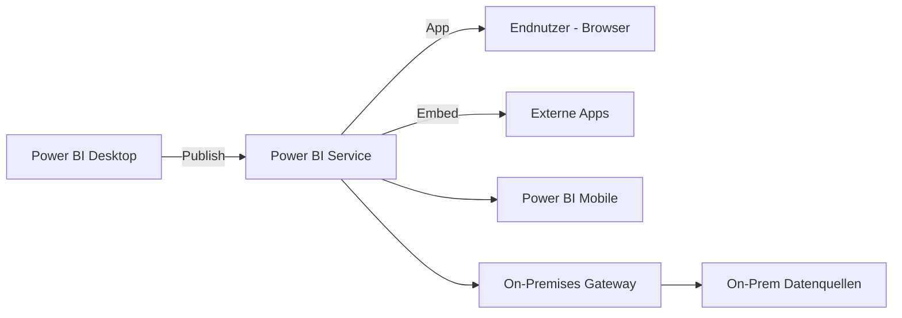
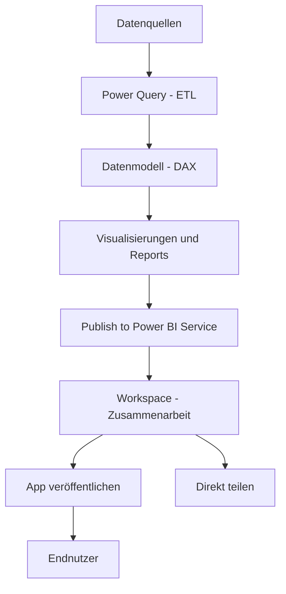
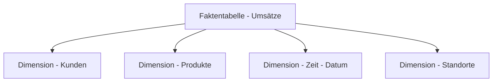
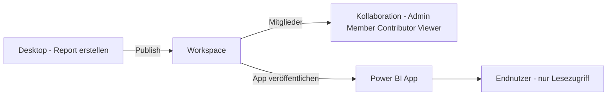

---
tags:
  - microsoft365
  - power-platform
  - power-bi
  - analytics
  - business-intelligence
  - microsoft-fabric
aliases:
  - Power BI Service
  - Business Intelligence
  - PBI
---

# Power BI

> [!ABSTRACT] TL;DR
> Power BI ist Microsofts Business-Intelligence-Plattform für Self-Service-Datenanalyse und interaktive Visualisierungen. Mit Power BI Desktop werden Reports erstellt (ETL via Power Query, Datenmodell, DAX-Measures), im Power BI Service veröffentlicht und mit Kollegen geteilt. Ab 2024 ist Power BI Teil von Microsoft Fabric und teilt sich die Plattform mit OneLake, Dataflows und weiteren Analytics-Diensten.

---

## Power BI Komponenten



| Komponente | Beschreibung | Einsatz |
|-----------|-------------|---------|
| **Power BI Desktop** | Windows-Anwendung zum Erstellen von Reports (kostenlos) | Entwicklung |
| **Power BI Service** | Cloud-Plattform (app.powerbi.com) für Sharing und Verwaltung | Collaboration, Sharing |
| **Power BI Mobile** | iOS/Android-App für unterwegs | Konsum, Dashboards |
| **Power BI Report Server** | On-Premises-Variante (für lokale Deployments) | Regulatorische Anforderungen |
| **Power BI Embedded** | API-basiertes Einbetten in eigene Anwendungen | ISV, Kundenportale |

---

## Typischer Workflow



---

## Datenquellen und Verbindungsmodi

### Verbindungsmodi

| Modus | Beschreibung | Vorteile | Nachteile |
|-------|-------------|---------|-----------|
| **Import** | Daten werden ins Modell geladen und gespeichert | Schnell, flexibel, offline verfügbar | Datengröße begrenzt, Refresh nötig |
| **DirectQuery** | Jede Abfrage geht live zur Quelle | Immer aktuell, kein Speicherlimit | Langsamer, Quelllast, eingeschränkte Power Query-Transformationen |
| **Live Connection** | Verbindung zu Analysis Services oder Power BI Dataset | Zentrales Semantic Model | Kein eigenes Modell möglich |
| **Composite Model** | Import + DirectQuery gemischt | Flexibel | Komplex, Performance-Tuning nötig |

### Häufige Datenquellen
- Excel, CSV, Text-Dateien
- SQL Server, Azure SQL, Azure Synapse
- SharePoint-Listen und -Bibliotheken
- Microsoft Dataverse
- Salesforce, Google Analytics, Dynamics 365
- REST-APIs und OData-Feeds
- Power BI Dataflows (wiederverwendbare ETL-Schicht)

---

## Power Query (ETL)

Power Query ist die Datentransformations-Engine in Power BI Desktop (und auch in Excel). Alle Transformationen werden als M-Code gespeichert.

### Häufige Transformationen

| Transformation | Verwendung |
|---------------|------------|
| **Filtern** | Zeilen nach Bedingung entfernen |
| **Spalten entfernen/umbenennen** | Datenmodell bereinigen |
| **Datentypen setzen** | Konsistente Typen sicherstellen (Zahl, Datum, Text) |
| **Zusammenführen (Merge)** | JOINs zwischen Tabellen |
| **Anfügen (Append)** | UNION zwischen Tabellen |
| **Pivotieren / Entpivotieren** | Spalten → Zeilen und umgekehrt |
| **Benutzerdefinierte Spalten** | Berechnete Spalten in Power Query (M-Syntax) |
| **Gruppieren** | Aggregationen (SUM, COUNT, AVG) |

### M-Sprache Grundstruktur

```
let
    Quelle = Excel.Workbook(File.Contents("C:\Daten\Umsatz.xlsx"), true),
    Tabelle = Quelle{[Item="Umsatz",Kind="Sheet"]}[Data],
    GeförderteSpalten = Table.PromoteHeaders(Tabelle),
    GefiltertZeilen = Table.SelectRows(GeförderteSpalten,
        each [Jahr] >= 2023),
    TypAngepasst = Table.TransformColumnTypes(GefiltertZeilen,
        {{"Umsatz", type number}, {"Datum", type date}})
in
    TypAngepasst
```

> [!TIP] Query Folding aktivieren
> Wenn möglich, sollte Power Query die Transformationen an die Datenquelle delegieren (Query Folding) — nur dann werden Transformationen serverseitig ausgeführt und beschleunigen den Refresh deutlich. SQL Server und OData unterstützen Query Folding, Excel nicht.

---

## Datenmodell

Das Datenmodell in Power BI Desktop ist das Herzstück jedes Reports. Ein gutes Modell ist die Voraussetzung für korrekte und performante DAX-Berechnungen.

### Stern-Schema (empfohlen)



- **Faktentabelle**: Enthält die Messwerte (Umsatz, Menge, Kosten) mit Foreign Keys
- **Dimensionstabellen**: Beschreibende Attribute (Kundenname, Produktkategorie, Monat)
- **Vorteile**: Klare Struktur, optimale DAX-Performance, einfache Erweiterbarkeit

### Beziehungen

| Eigenschaft | Optionen |
|------------|---------|
| **Kardinalität** | 1:n (häufigste), n:n (vermeiden wenn möglich), 1:1 |
| **Cross-Filter Direction** | Single (Standard), Both (bei n:n nötig, mit Bedacht einsetzen) |
| **Aktiv / Inaktiv** | Nur eine aktive Beziehung pro Tabellenpaar; inaktive via `USERELATIONSHIP()` |

---

## DAX-Grundlagen

DAX (Data Analysis Expressions) ist die Formelsprache für Measures und berechnete Spalten in Power BI.

### Measures vs. Berechnete Spalten

| Merkmal | Measure | Berechnete Spalte |
|---------|---------|------------------|
| **Berechnung** | Zur Laufzeit im Kontext | Beim Refresh für jede Zeile |
| **Speicherung** | Nicht gespeichert | In der Tabelle gespeichert |
| **Filterkontexte** | Reagiert auf Slicer/Filter | Fester Zeilenkontext |
| **Empfehlung** | Fast immer bevorzugen | Für Gruppierungsspalten |

### Wichtige DAX-Funktionen

```
// Einfache Aggregation
Umsatz Total = SUM(Umsätze[Betrag])

// Gefilterte Aggregation
Umsatz DE = CALCULATE(
    SUM(Umsätze[Betrag]),
    Standorte[Land] = "Deutschland"
)

// Alle Filter entfernen
Umsatz Gesamt = CALCULATE(SUM(Umsätze[Betrag]), ALL(Kunden))

// Anteil am Gesamtumsatz
Anteil = DIVIDE(
    SUM(Umsätze[Betrag]),
    CALCULATE(SUM(Umsätze[Betrag]), ALL(Kunden)),
    0
)

// Related (aus einer verbundenen Tabelle)
Produktkategorie = RELATED(Produkte[Kategorie])

// Time Intelligence
YTD Umsatz = TOTALYTD(SUM(Umsätze[Betrag]), Datum[Date])
Vorjahr = CALCULATE(SUM(Umsätze[Betrag]), SAMEPERIODLASTYEAR(Datum[Date]))
Vormonat = CALCULATE(SUM(Umsätze[Betrag]), PREVIOUSMONTH(Datum[Date]))
```

> [!IMPORTANT] Datumstabelle ist Pflicht für Time Intelligence
> Für korrekte Time Intelligence-Funktionen muss eine eigene Datumstabelle (Datum von 1.1.XXXX bis 31.12.XXXX, lückenlos) im Modell vorhanden und als Datumstabelle markiert sein.

---

## Visualisierungen und Reports

### Häufige Visual-Typen

| Visual | Geeignet für |
|--------|-------------|
| **Balken-/Säulendiagramm** | Kategorienvergleiche |
| **Liniendiagramm** | Zeitreihen, Trends |
| **Kreisdiagramm** | Anteile (max. 5–7 Segmente) |
| **Matrixtabelle** | Pivot-ähnliche Daten, Hierarchien |
| **Karte (Card)** | KPI-Einzelwert hervorheben |
| **KPI Visual** | Ziel vs. Istwert |
| **Karte (Map)** | Geografische Verteilungen |
| **Trichterdiagramm** | Sales Funnel, mehrstufige Prozesse |
| **Wasserfall** | Beiträge zu einer Gesamtveränderung |

### Interaktivität
- **Drill-Through**: Rechtsklick auf einen Datenpunkt → Detailseite
- **Bookmarks**: Gespeicherte Ansichten/Filter-Zustände
- **Tooltips**: Benutzerdefinierte Tooltip-Seiten mit detaillierten Informationen
- **Cross-Filtering**: Klick auf ein Visual filtert alle anderen Visuals

---

## Dashboards vs. Reports

| Merkmal | Report | Dashboard |
|---------|--------|-----------|
| **Erstellt in** | Power BI Desktop | Power BI Service |
| **Seiten** | Mehrere Seiten möglich | Eine Seite (Tiles) |
| **Interaktivität** | Hoch (Filter, Drill) | Gering (Navigation zu Report) |
| **Datenquellen** | Ein Semantic Model | Mehrere Semantic Models |
| **Echtzeit** | Nein | Ja (Streaming Datasets) |
| **Q&A** | Eingeschränkt | Direkt auf Dashboard |
| **Verwendung** | Analyse und Exploration | Übersicht und Monitoring |

---

## Arbeitsbereiche und Apps

### Workspace (Arbeitsbereich)

Ein Workspace ist ein Kollaborationsraum im Power BI Service.



- **Workspace-Rollen**: Admin, Member, Contributor, Viewer
- **Inhalt**: Reports, Semantic Models (Datasets), Dashboards, Dataflows, Scorecards

### Power BI App
Eine App bündelt Workspace-Inhalte für die breite Bereitstellung:
- Endnutzer erhalten eine vereinfachte Navigation
- Getrennte Berechtigungen vom Workspace (App-Nutzer können keine Workspace-Inhalte direkt bearbeiten)
- Ideal für abteilungsweite oder unternehmensweite Reports

---

## Row-Level Security (RLS)

RLS begrenzt den Datenzugriff auf Report-Ebene basierend auf dem eingeloggten Nutzer.

### Statische RLS
Feste Filterregeln pro Rolle in Power BI Desktop:

```
// Rolle "Deutschland" - nur deutsche Daten
Standorte[Land] = "Deutschland"

// Rolle "Norden" - nur bestimmte Regionen
Standorte[Region] IN {"Nord", "Nordwest"}
```

### Dynamische RLS

```
// Nutzer sieht nur seine eigenen Daten
Mitarbeiter[Email] = USERPRINCIPALNAME()

// Hierarchische RLS mit Manager-Sicht
Mitarbeiter[ManagerEmail] = USERPRINCIPALNAME()
    || Mitarbeiter[Email] = USERPRINCIPALNAME()
```

> [!TIP] RLS in der Produktionsumgebung testen
> Im Power BI Service können Admins "Als Rolle anzeigen" nutzen, um RLS zu testen ohne sich als anderer Benutzer einloggen zu müssen. In Desktop ist der "Rollenansicht"-Modus verfügbar.

---

## On-Premises Data Gateway

Das Gateway ermöglicht Verbindungen zwischen dem Power BI Service (Cloud) und On-Premises-Datenquellen.

| Gateway-Modus | Verwendung | Sharing |
|--------------|------------|---------|
| **Standard (Enterprise)** | Für Sharing und Enterprise-Nutzung | Mehrere Nutzer und Dienste |
| **Personal Mode** | Nur für eigene Refreshes | Kein Sharing möglich |

**Unterstützte Quellen**: SQL Server, Oracle, SAP, File System, Analysis Services, SharePoint On-Premises

> [!WARNING] Gateway-Verfügbarkeit
> Das Gateway muss auf einem **dauerhaft laufenden** Windows-Computer oder Server installiert sein. Bei Gateway-Ausfall schlagen alle abhängigen Refreshes fehl.

---

## Scheduled Refresh

| Eigenschaft | Details |
|------------|---------|
| **Intervall (Pro)** | 8 Refreshes pro Tag |
| **Intervall (Premium/PPU)** | 48 Refreshes pro Tag |
| **Incremental Refresh** | Nur neue/geänderte Daten werden geladen (Premium/PPU) |
| **Enhanced Refresh (API)** | Programmatischer Refresh via REST API |
| **Failure Notifications** | E-Mail-Benachrichtigung bei Fehlern konfigurierbar |

---

## Power BI Premium und Microsoft Fabric

### Lizenzierung 2024/2025

| Lizenz | Preis (ca.) | Umfang |
|--------|-------------|--------|
| **Free** | Kostenlos | Eigene Reports erstellen, kein Sharing |
| **Pro** | $14 / User / Monat | Sharing, Workspaces, Gateways |
| **Premium Per User (PPU)** | $24 / User / Monat | Alle Premium-Features inkl. Incremental Refresh, Deployment Pipelines |
| **Microsoft Fabric F4** | ~$730 / Monat | Dedizierte Kapazität, Fabric-Dienste |
| **Microsoft Fabric F8** | ~$1.460 / Monat | Mehr Compute, höhere Parallelität |

> [!IMPORTANT] Premium Capacity P-SKUs werden ersetzt
> Microsoft stellt die klassischen Power BI Premium P-SKUs für Neukunden ein. Ab 2024/2025 ist **Microsoft Fabric** (F-SKUs) der empfohlene Weg für dedizierte Kapazitäten. Fabric bietet neben Power BI auch:
> - OneLake (einheitlicher Data Lake)
> - Data Factory (ETL/ELT Pipelines)
> - Synapse Analytics
> - Real-Time Intelligence

### Deployment Pipelines (Premium/PPU)
Integriertes CI/CD in Power BI Service:


---

## Via Power BI Service (UI)

### Arbeitsbereich (Workspace) erstellen

1. Öffne den **Power BI Service** unter [app.powerbi.com](https://app.powerbi.com)
2. Navigiere im linken Menü zu **Arbeitsbereiche**
3. Klicke auf **+ Neuer Arbeitsbereich**
4. Vergib einen **Namen** und eine optionale Beschreibung
5. Konfiguriere unter **Erweitert** die Lizenz (Pro, Premium Per User oder Premium-Kapazität)
6. Füge **Mitglieder** hinzu und weise Rollen zu (Betrachter, Mitwirkender, Mitglied, Administrator)
7. Klicke auf **Speichern**

### Bericht im Power BI Service erstellen und veröffentlichen

1. Öffne den **Power BI Service** unter [app.powerbi.com](https://app.powerbi.com)
2. Navigiere in den gewünschten **Arbeitsbereich**
3. Klicke auf **+ Neu** > **Bericht** (oder lade eine `.pbix`-Datei per **Hochladen** hoch)
4. Wähle eine **Datenquelle** aus (z.B. Excel, SharePoint, Dataverse)
5. Erstelle Visualisierungen per Drag & Drop aus dem Felder-Panel
6. Klicke auf **Speichern** und vergib einen Berichtsnamen
7. Klicke auf **Veröffentlichen**, um den Bericht im Arbeitsbereich verfügbar zu machen

> [!TIP] Power BI Desktop vs. Service
> Komplexe Datenmodelle und DAX-Berechnungen werden typischerweise in **Power BI Desktop** erstellt und dann über **Datei → Veröffentlichen** in den Service hochgeladen. Einfache Berichte können direkt im Service erstellt werden.

### Power BI App erstellen und verteilen

1. Öffne den **Power BI Service** unter [app.powerbi.com](https://app.powerbi.com)
2. Navigiere in den Arbeitsbereich mit den fertigen Berichten
3. Klicke oben rechts auf **App erstellen**
4. Vergib **Name**, **Beschreibung** und lade ein **Logo** hoch
5. Wähle unter **Navigation** die Berichte und Dashboards aus, die in der App erscheinen sollen
6. Definiere die **Reihenfolge** und erstelle optionale Abschnitte (Sections)
7. Unter **Berechtigungen** festlegen, wer die App sehen darf (Einzelpersonen, Gruppen oder gesamte Organisation)
8. Klicke auf **App veröffentlichen**

### Gateways und geplante Aktualisierung konfigurieren

1. Öffne das **Power BI Admin Center** unter [admin.powerbi.com](https://admin.powerbi.com)
2. Navigiere zu **Verbindungen und Gateways** > **On-Premises-Datengateways**
3. Überprüfe den Status der registrierten Gateways
4. Für die Aktualisierung: Wähle im Arbeitsbereich das Dataset aus > **Einstellungen** > **Geplante Aktualisierung**
5. Aktiviere den Schalter und konfiguriere Häufigkeit und Uhrzeit
6. Klicke auf **Übernehmen**

---

## Power BI Embedding

| Variante | Beschreibung | Lizenz |
|---------|-------------|--------|
| **Embed for your org** | Nutzer haben Power BI-Lizenzen, werden via Entra ID authentifiziert | Pro/PPU pro Nutzer |
| **Embed for customers** | Nutzer haben keine Power BI-Lizenzen (App owns data via Service Principal) | Premium/Fabric Kapazität |

---

## Verwandte Notizen

- [[Power Platform Grundlagen]]
- [[Microsoft Dataverse]]
- [[Power Platform Governance]]
