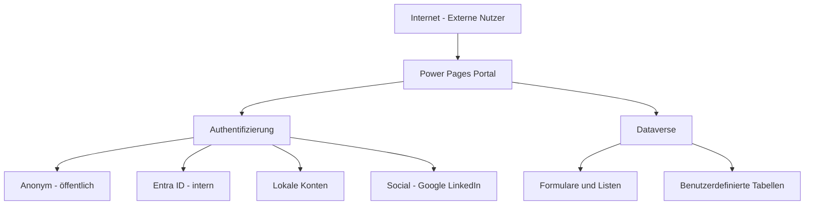
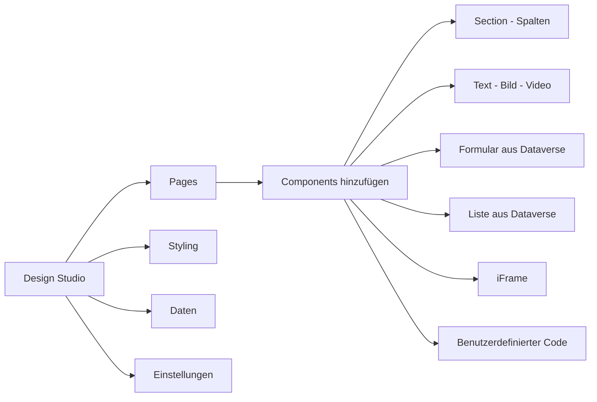
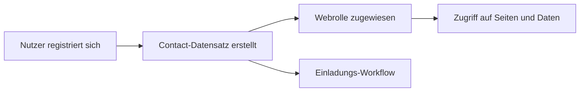

---
tags:
  - microsoft365
  - power-platform
  - power-pages
  - portal
  - web
  - externe-nutzer
aliases:
  - Power Apps Portals
  - Power Pages Portal
  - Portale
---

# Power Pages

> [!ABSTRACT] TL;DR
> Power Pages (ehemals Power Apps Portals) ist die Low-Code-Plattform für externe Webportale auf Basis von Microsoft Dataverse. Unternehmen erstellen damit öffentlich zugängliche oder authentifizierte Self-Service-Portale für Kunden, Partner und Lieferanten — ohne umfangreiche Webentwicklungs-Kenntnisse, aber mit der Möglichkeit zur Code-Erweiterung via Liquid Templates und JavaScript.

---

## Was ist Power Pages?

Power Pages ist eine eigenständige Säule der Microsoft Power Platform seit Mai 2022 (vorher als "Power Apps Portals" Teil von Power Apps). Es ermöglicht die Erstellung von responsiven, datenbankgestützten Webportalen, die **extern** zugänglich sind — ohne Microsoft-Konto oder Azure AD-Anmeldung für öffentliche Bereiche.



---

## Anwendungsfälle

| Portal-Typ | Beschreibung | Beispiele |
|-----------|-------------|---------|
| **Self-Service-Portal** | Kunden verwalten eigene Anfragen | Supporttickets, Bestellstatus, FAQ |
| **Partner-Portal** | Händler und Distributoren | Preislisten, Bestellungen, Ressourcen |
| **Kunden-Portal** | B2B Kundenportal | Vertragsmanagement, Abrechnungen, Onboarding |
| **Mitarbeiter-Portal** | Externe/BYOD-Mitarbeiter | HR-Self-Service, Schichtpläne, Schulungen |
| **Community-Portal** | Forum und Wissensdatenbank | Produktforum, Dokumentation, Blog |
| **Event-Portal** | Registrierung und Agenda | Konferenz-Registrierung, Session-Auswahl |

---

## Design Studio

Das Power Pages Design Studio ist die zentrale Entwicklungsumgebung (im Browser, keine Installation nötig).



### Bereiche des Design Studios

| Bereich | Inhalt |
|---------|--------|
| **Pages** | Seitenstruktur, Navigation, neue Seiten anlegen |
| **Styling** | Design-Token: Farben, Schriften, Abstände, Themes |
| **Data** | Dataverse-Tabellen und -Formulare direkt verwalten |
| **Security** | Webrollen und Tabellenberechtigungen konfigurieren |
| **Settings** | Authentication, SEO, Custom Domain, Caching |
| **Set up** | Site-weite Konfiguration, Paketverwaltung |

### Visual Studio Code Integration
Für Pro Developer ist eine direkte Verbindung zum Code-Editor möglich:
- **Power Pages VS Code Extension**: Lokale Entwicklung mit Echtzeit-Sync zum Portal
- **Portal Management App**: Erweiterte Verwaltung aller Portal-Metadaten in Dataverse

---

## Seitenerstellung

### No-Code (Design Studio)
- Drag & Drop von Sections, Columns und Components
- Vorgefertigte Page Templates (Blank, Business, Non-Profit, etc.)
- Responsive Layouts (Desktop, Tablet, Mobile Vorschau)
- Component Library mit Text, Bilder, Video, Spacer, Button, iFrame

### Low-Code (Liquid Templates)
Liquid ist eine Server-seitige Template-Sprache für dynamischen Content:

```html
<!-- Variable ausgeben -->
<h1>Willkommen, {{ user.fullname }}!</h1>

<!-- Bedingung -->

  <p>Bitte <a href="/signin">melden Sie sich an</a>.</p>

  <p>Sie sind als {{ user.email }} angemeldet.</p>


<!-- Schleife über Dataverse-Daten -->


  <div class="anfrage-card">
    <h3>{{ anfrage.contoso_titel }}</h3>
    <p>Status: {{ anfrage.contoso_status }}</p>
  </div>

```

### Pro-Code (JavaScript/CSS)
- Benutzerdefinierte JavaScript für Client-seitige Logik
- Custom CSS für Design-Anpassungen über Theme hinaus
- Web-API-Aufrufe direkt aus JavaScript

---

## Authentifizierung

Power Pages unterstützt verschiedene Authentifizierungsmethoden, die kombiniert werden können:

| Methode | Beschreibung | Einsatz |
|---------|-------------|---------|
| **Anonym** | Keine Anmeldung erforderlich | Öffentliche Inhalte, FAQs |
| **Lokale Konten** | Eigene Registrierung mit E-Mail/Passwort | Kunden ohne Microsoft-Konto |
| **Microsoft Entra ID** | SSO via Azure AD (OAuth 2.0) | Interne Mitarbeiter |
| **Google** | Google-Account Login | B2C-Szenarien |
| **LinkedIn** | LinkedIn-Profil Login | B2B und professionelle Portale |
| **Facebook** | Facebook-Account Login | Consumer-Portale |
| **SAML 2.0** | Enterprise SSO (AD FS, Okta, PingFederate) | Eigene Identity Provider |
| **OpenID Connect** | OAuth 2.0 + OIDC (beliebige Provider) | Custom Identity Provider |

> [!TIP] Azure AD B2C für komplexe Szenarien
> Für Portale mit externen Nutzern und mehreren Identity Providern empfiehlt sich **Azure AD B2C** als Identity Broker — es unterstützt Social Logins, Custom Policies und MFA in einem zentralen Service.

---

## Externe Benutzerverwaltung

Externe Portalnutzer werden als **Contact-Datensätze** in Dataverse gespeichert:



- **Einladungsmanagement**: Codes per E-Mail senden, vordefinierte Webrolle bei Registrierung zuweisen
- **Profilseiten**: Nutzer können ihr Profil (Contact-Felder) selbst bearbeiten
- **Account-Hierarchie**: Contacts können einem Account (Firma) zugeordnet werden — ermöglicht Firmen-übergreifende Sichten

---

## Formulare und Listen aus Dataverse

### Basic Form (Einzeldatensatz)

Ein Basic Form zeigt einen einzelnen Dataverse-Datensatz an (Lesen, Erstellen oder Bearbeiten):
- **Source Type**: Neuer Datensatz, Query String (ID in URL), aktuell angemeldeter Nutzer
- **Mode**: Insert (Neu), Edit (Bearbeiten), ReadOnly (Anzeigen)
- **On Success**: Weiterleitung nach erfolgreichem Submit (URL oder Nachricht)

### Multistep Form (mehrstufige Formulare)

Mehrseitige Formulare für komplexe Eingabeprozesse:
- Jeder Schritt ist ein eigenes Basic Form (Step 1 → Step 2 → Step 3 → Abschluss)
- Fortschrittsanzeige konfigurierbar
- Daten werden nach jedem Schritt gespeichert (kein Datenverlust bei Abbruch)
- Verzweigungen möglich (abhängig von Eingabe → anderer nächster Schritt)

### List (Tabellenansicht)

Eine List zeigt mehrere Dataverse-Datensätze in einer Tabellenübersicht:
- Basiert auf Dataverse-Ansichten (Views)
- Konfigurierbare Spalten, Sortierung und Filter
- Suche innerhalb der Liste
- Aktionen: Detailansicht, Bearbeiten, Löschen (jeweils durch Tabellenberechtigungen gesteuert)

---

## Sicherheitsmodell

Das Power Pages-Sicherheitsmodell bestimmt, welche Nutzer auf welche Seiten und Daten zugreifen dürfen.

### Webrollen (Web Roles)

Webrollen gruppieren Nutzer und steuern den Zugriff auf Seiten und Daten:

| Webrolle | Typischer Einsatz |
|---------|-----------------|
| **Authenticated Users** | Alle angemeldeten Nutzer (Standard) |
| **Anonymous Users** | Nicht angemeldete Besucher |
| **Administrator** | Vollzugriff (nur intern) |
| **Benutzerdefinierte Rollen** | Kunden, Partner, Händler, etc. |

### Seitenberechtigungen (Page Permissions)

Für jede Seite und jeden Seitenbereich:
- **Lesen**: Seite sichtbar
- **Bearbeiten**: Seiteninhalte bearbeiten (nur für Autoren)

### Tabellenberechtigungen (Table Permissions)

Steuern den Datenzugriff auf Dataverse-Tabellenebene:

| Zugriffstyp | Beschreibung |
|------------|-------------|
| **Global** | Alle Zeilen der Tabelle (z.B. öffentliche Produktkatalog) |
| **Contact** | Nur Zeilen, die dem eingeloggten Contact gehören |
| **Account** | Alle Zeilen im Account des eingeloggten Contacts |
| **Self** | Nur der eigene Contact-Datensatz |
| **Parent/Child** | Vererbung von Berechtigungen über Beziehung |

> [!DANGER] Tabellenberechtigungen sind Pflicht
> Ohne konfigurierte Tabellenberechtigungen haben Webnutzer standardmäßig **keinen** Datenzugriff (kein Lesen, kein Schreiben). Das ist sicher per default, kann aber zu leeren Formularen und Listen führen, wenn vergessen wird, die Berechtigungen zu konfigurieren.

---

## Via Power Pages (UI)

### Neue Website erstellen

1. Öffne **Power Pages** unter [make.powerpages.microsoft.com](https://make.powerpages.microsoft.com)
2. Wähle oben rechts die gewünschte **Dataverse-Umgebung** aus
3. Klicke auf **+ Website erstellen** (Create a site)
4. Wähle zwischen einer **Vorlage** (z.B. Leer, After School, Community) oder einem leeren Layout
5. Vergib einen **Namen** für die Website und lege die **Webadresse** fest (Subdomain)
6. Wähle die **Sprache** und klicke auf **Fertig** — die Website wird bereitgestellt (ca. 1–3 Minuten)

### Seiten erstellen und Navigation konfigurieren

1. Öffne die Website im **Design Studio** über [make.powerpages.microsoft.com](https://make.powerpages.microsoft.com)
2. Wechsle in den Arbeitsbereich **Seiten** (Pages)
3. Klicke auf **+ Neue Seite**, vergib einen Namen und wähle ein **Seitenlayout**
4. Gestalte den Inhalt per Drag & Drop: Abschnitte, Text, Bilder, Schaltflächen hinzufügen
5. Passe die **Navigation** an: Im Seitenbaum Seiten per Drag & Drop umordnen oder verschachteln (Unterseiten erstellen)
6. Klicke auf **Vorschau** (Desktop / Mobil), um das Ergebnis zu prüfen
7. Klicke auf **Synchronisieren** und dann **Website veröffentlichen**

### Dataverse-Formular auf einer Seite einbetten

1. Öffne die gewünschte Seite im **Design Studio**
2. Klicke in einen Abschnitt und wähle im Komponentenmenü **Formular**
3. Klicke auf **+ Neues Formular** oder wähle ein vorhandenes Dataverse-Formular aus
4. Wähle die **Dataverse-Tabelle** (z.B. Anfragen) und das **Formular** (Erstellen / Bearbeiten)
5. Konfiguriere **Weiterleitungsseite** nach dem Absenden
6. Stelle sicher, dass für die Tabelle **Tabellenberechtigungen** (Table Permissions) konfiguriert sind
7. Klicke auf **OK** und dann auf **Website veröffentlichen**

> [!IMPORTANT] Tabellenberechtigungen konfigurieren
> Ohne konfigurierte Tabellenberechtigungen können Webbenutzer standardmäßig keine Daten lesen oder schreiben. Navigiere dazu im Design Studio zu **Sicherheit** > **Tabellenberechtigungen**.

### Authentifizierung für externe Benutzer einrichten

1. Öffne das **Power Pages Admin Center** über das Design Studio > **Einstellungen** > **Administratorcenter**
2. Navigiere zu **Authentifizierung** > **Identitätsanbieter**
3. Klicke auf **+ Anbieter hinzufügen** und wähle den gewünschten Typ (Azure AD, Microsoft Account, lokale Anmeldung)
4. Trage die **Client-ID** und das **Client-Secret** aus der Azure App Registration ein
5. Klicke auf **Konfigurieren** und **Speichern**

---

## Web-API in Power Pages

Power Pages bietet eine client-seitige JavaScript-Web-API für direkten Dataverse-Zugriff ohne Server-Roundtrip:

```javascript
// Alle Anfragen eines Kunden lesen
shell.ajaxSafePost({
  type: "GET",
  url: "/_api/contoso_anfragen?$select=contoso_titel,createdon&$filter=statecode eq 0",
  success: function(data) {
    console.log(data.value);
  }
});

// Neuen Datensatz erstellen
shell.ajaxSafePost({
  type: "POST",
  url: "/_api/contoso_anfragen",
  data: JSON.stringify({
    "contoso_titel": "Neue Anfrage",
    "contoso_beschreibung": "Inhalt der Anfrage"
  }),
  contentType: "application/json",
  success: function() {
    // Erfolgsmeldung
  }
});
```

> [!NOTE] Tabellenberechtigung für Web-API aktivieren
> Die Web-API muss pro Tabelle **explizit aktiviert** werden (in der Tabellenkonfiguration im Design Studio → Daten). Zudem müssen Tabellenberechtigungen mit der entsprechenden Webrolle verknüpft sein.

---

## ALM für Power Pages

- Power Pages-Portale sind in **Solutions** verpackbar (seit 2022 vollständige Solution-Unterstützung)
- Transport via Managed/Unmanaged Solutions zwischen Environments
- Umgebungsvariablen für portal-spezifische Konfigurationen (z.B. externe API-URLs)
- **Managed Environments** für zusätzliche Governance (Pipeline-Enforcement, Solution Checker)

---

## Copilot in Power Pages

| Feature | Beschreibung |
|---------|-------------|
| **KI-gestützte Seitenerstellung** | Prompt → Power Pages generiert Seiteninhalt, Sections und Layout |
| **Copilot Chat-Widget** | Fertig konfigurierbares Chat-Widget für Portalbesucher (nutzt Copilot Studio) |
| **Formular-Assistent** | Formularfelder aus Dataverse via Prompt hinzufügen |
| **Code-Assistent** | Liquid-Code und JavaScript via Prompt generieren |

---

## Lizenzierung

| Lizenzvariante | Preis (ca.) | Beschreibung |
|---------------|------------|-------------|
| **Authenticated Users** | $200 / 100 Logins/Monat | Pro 100 unique Logins authentifizierter Nutzer |
| **Anonymous Users** | $75 / 100.000 Anfragen/Monat | Pro 100.000 anonyme Page Views |
| **Pay-As-You-Go** | Nutzungsbasiert | Über Azure-Abonnement |

> [!NOTE] Lizenzierungs-Modell verstehen
> Authentifizierte Benutzer werden pro Login pro Monat gezählt (nicht pro aktiven Nutzer). Ein Nutzer, der sich 5x im Monat einloggt, zählt als 5 Logins. Plane das Kontingent entsprechend der erwarteten Login-Frequenz.

---

## Performance und Caching

| Mechanismus | Beschreibung |
|------------|-------------|
| **CDN (Content Delivery Network)** | Statische Inhalte (CSS, JS, Bilder) werden global gecacht |
| **Portal-Caching** | Server-seitiges Caching für Liquid-Seiten (konfigurierbar) |
| **Cache leeren** | Im Design Studio → Settings → Clear Cache oder via Portal Management App |
| **Performance-Analyzer** | Browser DevTools für Client-seitige Analyse empfohlen |
| **Monitoring** | Azure Application Insights kann an Power Pages angebunden werden |

> [!TIP] Caching bei Entwicklung deaktivieren
> Aktiviere während der Entwicklung den **Entwicklermodus** (URL + `?developer=true` anhängen oder im Portal Management konfigurieren), um das Server-seitige Caching zu deaktivieren und Änderungen sofort zu sehen.

---

## Verwandte Notizen

- [[Power Platform Grundlagen]]
- [[Microsoft Dataverse]]
- [[Power Apps]]
- [[Power Platform Governance]]
