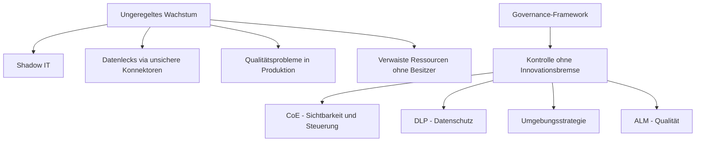
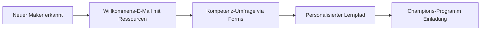
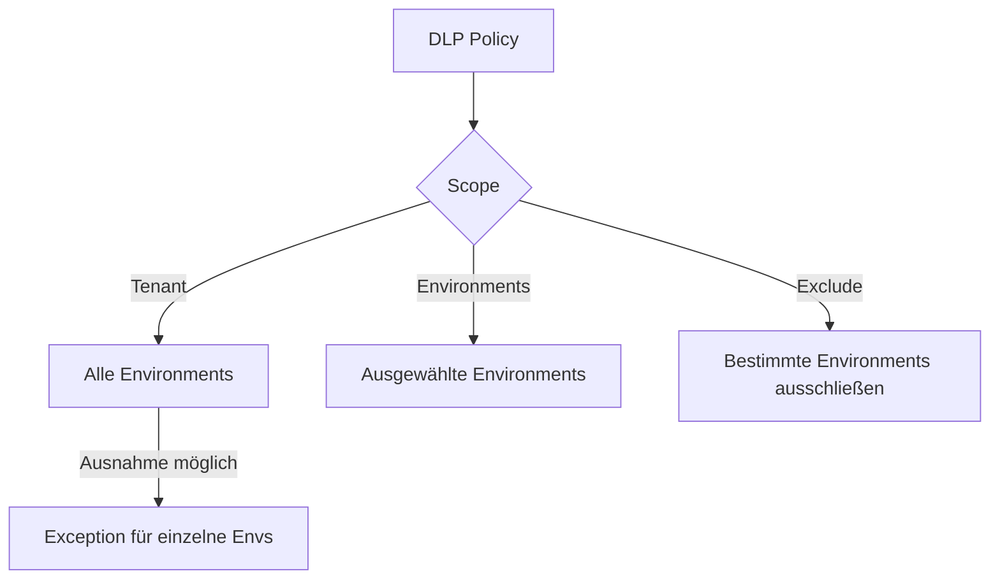
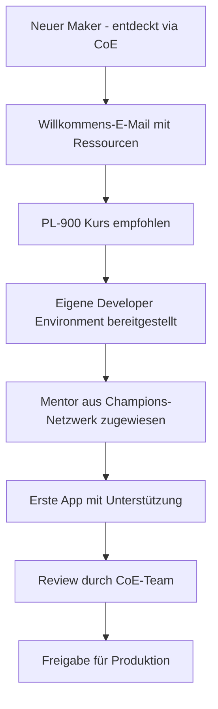
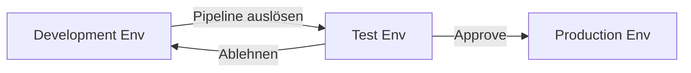

---
tags:
  - microsoft365
  - power-platform
  - governance
  - coe
  - dlp
  - alm
  - sicherheit
aliases:
  - PP Governance
  - CoE
  - Center of Excellence
  - Power Platform Administration
---

# Power Platform Governance

> [!ABSTRACT] TL;DR
> Power Platform Governance umfasst alle Maßnahmen, um die unkontrollierte Ausbreitung von Low-Code-Anwendungen (Shadow IT) zu verhindern, ohne die Innovationsfähigkeit einzuschränken. Kernelemente sind das Center of Excellence Starter Kit (Inventory, Nurture, Governance, Audit), DLP-Policies für Connector-Kontrolle, eine strukturierte Umgebungsstrategie sowie ALM-Pipelines für professionelle Deployments.

---

## Warum Governance?

Ohne Governance wächst die Power Platform in Unternehmen schnell unkontrolliert:

- **Shadow IT**: Jeder M365-Nutzer kann in der Default-Environment Apps und Flows erstellen
- **Datenlecks**: Flows verbinden Business-Daten mit Consumer-Diensten (Gmail, Dropbox)
- **Qualitätsprobleme**: Kritische Prozesse laufen auf nicht getesteten, nicht dokumentierten Apps
- **Lizenzrisiken**: Premium-Connector-Nutzung ohne entsprechende Lizenzen
- **Orphaned Resources**: Apps ohne bekannte Besitzer, niemand wartet oder aktualisiert sie



### Die 3 Säulen der Power Platform Governance

| Säule | Inhalt |
|-------|--------|
| **People** | Maker Community aufbauen, schulen und befähigen (Champions, CoE-Botschafter) |
| **Process** | Policies definieren, ALM-Prozesse etablieren, Genehmigungsworkflows |
| **Technology** | CoE Starter Kit, DLP-Policies, Admin Center, Managed Environments, Monitoring |

---

## Center of Excellence Starter Kit

Das CoE Starter Kit ist Microsofts kostenfreie Referenz-Implementierung für Power Platform Governance (auf GitHub: `microsoft/coe-starter-kit`).

### Installation

> [!NOTE] Voraussetzungen
> - Dedizierte Admin-Environment (kein Default Environment)
> - Service-Account mit Power Platform Admin-Rechten (kein persönlicher Account)
> - Power Platform Premium-Lizenzen für den Service-Account
> - Installationsdauer: 4–8 Stunden für Ersteinrichtung

```powershell
# Power Platform CLI installieren
dotnet tool install --global Microsoft.PowerApps.CLI.Tool

# Authentifizierung für Admin Environment
pac auth create --url https://[admin-env].crm.dynamics.com

# CoE Starter Kit herunterladen (von GitHub Releases)
# Import der Core Solution zuerst, dann Nurture, Governance, Audit
pac solution import --path CenterOfExcellenceCoreComponents_managed.zip
```

### Komponente 1: Core / Inventory

Tägliche Synchronisation aller Tenant-Ressourcen:

| Inventarisierte Ressource | Details |
|--------------------------|---------|
| **Environments** | Alle Environments, Dataverse-Status, Region |
| **Apps** | Alle Canvas und Model-Driven Apps, Besitzer, letzte Nutzung |
| **Flows** | Alle Cloud und Desktop Flows, Verbindungen, Laufstatus |
| **Makers** | Alle Ersteller, Abteilung, Lizenz, Aktivität |
| **Connectors** | Genutzte Connectors pro App/Flow, Premium-Status |
| **Verbindungen** | Alle Verbindungen, verbundener Account |
| **Dataverse-Kapazität** | Verbrauch pro Environment |

Power BI Dashboard im CoE zeigt:
- Wachstumstrend (Maker, Apps, Flows pro Monat)
- Top Maker und aktivste Environments
- Premium Connector-Nutzung ohne Lizenz (Risikobericht)

### Komponente 2: Nurture (Maker Onboarding)

Automatisierter Onboarding-Prozess für neue Maker:



- **Willkommens-E-Mail**: Automatisch beim ersten App/Flow-Erstellen
- **Template-Bibliothek**: Genehmigte App-Templates für häufige Szenarien
- **Champions-Programm**: Erfahrene Maker als Multiplikatoren in der Organisation
- **Schulungsplan**: Links zu Microsoft Learn, internen Kursen, Zertifizierungen (PL-900, PL-200)

### Komponente 3: Governance

Automatisierte Compliance-Durchsetzung:

| Governance-Flow | Auslöser | Aktion |
|----------------|---------|--------|
| **App-Überwachung** | App mit vielen Nutzern ohne Business Justification | E-Mail an App-Besitzer anfordern |
| **Connector-Compliance** | Premium Connector ohne Lizenz | Benachrichtigung, ggf. Quarantäne |
| **App-Quarantäne** | Compliance-Verletzung oder verwaiste App | App pausieren, Besitzer benachrichtigen |
| **Environment-Requests** | Nutzer beantragt neue Environment | Genehmigungsworkflow an Admin |
| **Bulk-Delete** | Alte Test-Apps und Flows aufräumen | Archivierung oder Löschung nach Freigabe |

### Komponente 4: Audit und Reporting

- **Power BI Governance-Dashboard**: Vollständige Übersicht über alle Aktivitäten
- **DLP-Verletzungen tracken**: Welche Flows/Apps verstoßen gegen DLP-Policies?
- **Risk-Report**: Apps mit kritischen Connectors, verwaiste Ressourcen, alte Versionen
- **License Usage**: Tatsächliche Premium-Connector-Nutzung vs. verfügbare Lizenzen

> [!TIP] CoE Starter Kit monatlich aktualisieren
> Das CoE Starter Kit wird vom Microsoft Power CAT-Team aktiv weiterentwickelt (ca. alle 4–6 Wochen neue Version). Halte das Kit aktuell, um von neuen Funktionen und Bugfixes zu profitieren. Neue Versionen als Managed Solution importieren.

---

## Via Power Platform Admin Center (UI)

### DLP Policy erstellen

1. Öffne das **Power Platform Admin Center** unter [admin.powerplatform.microsoft.com](https://admin.powerplatform.microsoft.com)
2. Navigiere zu **Sicherheit** > **Daten- und Datenschutzrichtlinien** (Data Policies)
3. Klicke auf **+ Neue Richtlinie**
4. Vergib einen **Namen** für die Policy (z.B. „Tenant-Basis-DLP")
5. Wähle den **Geltungsbereich**: Alle Environments, ausgewählte Environments oder bestimmte ausschließen
6. Ordne jeden Connector der richtigen Gruppe zu: **Business**, **Non-Business** oder **Gesperrt**
   - Nutze die Suchfunktion, um Connectors schnell zu finden
   - Per Drag & Drop oder Kontextmenü zwischen den Gruppen verschieben
7. Optional: Einzelne **Connector Actions** (z.B. nur bestimmte API-Endpunkte) fein konfigurieren
8. Klicke auf **Weiter**, prüfe die Zusammenfassung und klicke auf **Erstellen**

> [!WARNING] DLP Impact-Analyse vor Rollout
> Prüfe im **CoE Starter Kit DLP Impact Report**, welche bestehenden Apps und Flows von der neuen Policy betroffen wären, bevor du sie aktivierst.

### Managed Environment aktivieren

1. Öffne das **Power Platform Admin Center** unter [admin.powerplatform.microsoft.com](https://admin.powerplatform.microsoft.com)
2. Navigiere zu **Umgebungen** und wähle die gewünschte Umgebung aus
3. Klicke auf **Managed Environments aktivieren** in der Detailansicht
4. Konfiguriere die gewünschten Einschränkungen (Maker-Onboarding, Solution-Checks, Sharing-Limits)
5. Klicke auf **Speichern**

### Umgebungsstrategie konfigurieren

1. Öffne das **Power Platform Admin Center** unter [admin.powerplatform.microsoft.com](https://admin.powerplatform.microsoft.com)
2. Navigiere zu **Umgebungen** > **+ Neu**
3. Wähle den **Typ** (Produktion, Sandbox, Developer) entsprechend der Strategie
4. Vergib eine klare Namenskonvention (z.B. `[Org]-[Projekt]-[Typ]`)
5. Weise über **Rollen** die Environment Admins und Maker zu
6. Klicke auf **Speichern**

---

## Data Loss Prevention (DLP) Policies

DLP-Policies sind der wichtigste technische Kontrollmechanismus für Datensicherheit in der Power Platform.

### Connector-Gruppen

Jeder Connector muss einer von drei Gruppen zugeordnet werden:

| Gruppe | Bedeutung | Empfohlene Connectors |
|--------|-----------|----------------------|
| **Business** | Genehmigte Unternehmensdienste — können kombiniert werden | SharePoint, Teams, Dataverse, Exchange, SQL Server, SAP, Azure-Dienste |
| **Non-Business** | Consumer-Dienste — können kombiniert werden, aber NICHT mit Business | Gmail, Dropbox, Twitter/X, Facebook, Google Sheets |
| **Blocked** | Vollständig gesperrt — kein Einsatz möglich | Spezifisch für Compliance-Anforderungen |

> [!WARNING] Business und Non-Business nicht mischbar
> Ein Flow oder eine App darf **keine** Connectors aus der Business-Gruppe und der Non-Business-Gruppe gleichzeitig verwenden. Ziel: Verhindert, dass Unternehmensdaten (aus SharePoint/Dataverse) zu Consumer-Diensten (Gmail/Dropbox) fließen.

### DLP Policy-Scopes



### DLP Best Practices

1. **Tenant-weite Basis-DLP**: Minimalrestriktive Richtlinie für alle Environments
2. **Produktions-DLP**: Strenger, nur genehmigten Connectors
3. **Developer DLP**: Lockerer für Developer Environments (z.B. HTTP erlaubt)
4. **Ausnahmen dokumentieren**: Jede Ausnahme begründen und im Ticketsystem tracken

```powershell
# DLP Policies auflisten (PowerShell)
Get-DlpPolicy -ApiVersion "2016-11-01"

# DLP Policy für Environment anzeigen
Get-DlpPolicy | Where-Object {$_.environments -contains "environmentId"}

# Power Platform Admin Module installieren
Install-Module -Name Microsoft.PowerApps.Administration.PowerShell

# Alle Connector-Klassifizierungen einer Policy anzeigen
Get-DlpPolicy | Select-Object DisplayName, Connectors
```

> [!TIP] DLP Impact-Analyse vor Rollout
> Bevor eine neue DLP Policy aktiviert wird, analysiere mit dem **CoE Starter Kit DLP Impact Report**, welche Apps und Flows durch die neue Policy betroffen wären. Kommuniziere Änderungen rechtzeitig an Maker.

---

## Umgebungsstrategie

### Default Environment: Die wichtigste Einstellung

> [!DANGER] Default Environment sofort absichern
> Die Default-Environment ist für alle M365-Nutzer zugänglich. Ohne Einschränkungen kann jeder Mitarbeiter Apps und Flows erstellen. Empfehlungen:
> 1. Maker-Rechte einschränken (nur bestimmte Gruppen dürfen erstellen)
> 2. Strikte DLP-Policy zuweisen (nur M365-Standardconnectors)
> 3. **Niemals** für produktive Lösungen verwenden

### Environment-Routing

Environment-Routing leitet neue Maker automatisch in eine dedizierte "Welcome"-Environment statt in die Default-Environment:

- Konfigurierbar im Power Platform Admin Center → Policies → Environment routing
- Neue Maker erhalten automatisch Zugriff auf die konfigurierte Welcome-Environment
- Verhindert unkontrolliertes Wachstum in der Default-Environment

### Empfohlene Environment-Struktur

| Environment | Zweck | DLP | Managed |
|------------|-------|-----|---------|
| **Default** | Beschränkt auf M365-Standardnutzung | Streng | Nein |
| **Developer** | Persönliche Sandbox (1 pro Entwickler) | Moderat | Nein |
| **Development** | Team-Integrationsumgebung | Moderat | Optional |
| **Test / UAT** | User Acceptance Testing | Wie Produktion | Ja |
| **Production** | Produktive Lösungen | Streng | Ja |
| **CoE Admin** | Für CoE Starter Kit | Speziell | Nein |

### Naming Convention

Empfehlung für konsistente Benennung:
```
[Org]-[Team/Produkt]-[Zweck]-[Stage]
Beispiele:
  Contoso-HR-Reiskosten-Dev
  Contoso-HR-Reiskosten-Test
  Contoso-HR-Reiskosten-Prod
  Contoso-IT-HelpDesk-Prod
  Contoso-Global-CoE-Admin
```

---

## Maker-Onboarding und Community

### Schulungspfade

| Zertifizierung | Level | Inhalt |
|---------------|-------|--------|
| **PL-900** | Fundamentals | Power Platform Überblick, Einsatzszenarien |
| **PL-100** | Associate | Power Virtual Agents (Copilot Studio) |
| **PL-200** | Associate | Power Apps, Dataverse, Automatisierung |
| **PL-300** | Associate | Power BI Data Analyst |
| **PL-400** | Professional | Power Apps Developer (ALM, Plug-ins, PCF) |
| **PL-500** | Associate | Power Automate RPA Developer |
| **PL-600** | Expert | Power Platform Solution Architect |

### Maker-Onboarding-Prozess



---

## App-Quarantäne

Das CoE Starter Kit enthält einen Quarantäne-Mechanismus für non-konforme Apps:

1. **Erkennung**: CoE-Flow identifiziert App (z.B. Premium Connector ohne Lizenz, kein Besitzer)
2. **Benachrichtigung**: App-Besitzer erhält E-Mail mit Begründung und Frist
3. **Quarantäne**: App wird nach Fristablauf pausiert (deaktiviert für alle Nutzer außer Besitzer)
4. **Review**: Besitzer behebt Problem oder beantragt Ausnahme
5. **Freigabe**: Admin reaktiviert die App

---

## ALM Best Practices

### Goldene Regeln

1. **Alles in Solutions**: Keine Ressource außerhalb einer Solution entwickeln
2. **Source Control**: Alle Solutions per `pac solution unpack` in Git versionieren
3. **Managed in Production**: Nur Managed Solutions in Test und Production importieren
4. **Nie direkt in Production**: Änderungen immer via ALM-Pipeline deployen

### Power Platform Pipelines

Integriertes CI/CD direkt in Power Platform (kein Azure DevOps nötig):



- Im Power Platform Admin Center konfigurierbar
- Requires Managed Environments für Source und Ziel
- Automatische Solution-Checker-Ausführung vor Deployment
- Approval-Workflows für Deployment-Genehmigungen

### GitHub Actions für Power Platform

```yaml
# .github/workflows/deploy.yml
name: Deploy to Production

on:
  push:
    branches: [main]

jobs:
  deploy:
    runs-on: ubuntu-latest
    steps:
      - uses: actions/checkout@v3
      
      - name: Pack Solution
        uses: microsoft/powerplatform-actions/pack-solution@v1
        with:
          solution-folder: src/MeineSolution
          solution-file: MeineSolution_managed.zip
          solution-type: Managed
          
      - name: Import to Production
        uses: microsoft/powerplatform-actions/import-solution@v1
        with:
          environment-url: ${{ secrets.PROD_ENVIRONMENT_URL }}
          app-id: ${{ secrets.CLIENT_ID }}
          client-secret: ${{ secrets.CLIENT_SECRET }}
          tenant-id: ${{ secrets.TENANT_ID }}
          solution-file: MeineSolution_managed.zip
```

---

## Managed Environments

Managed Environments ist ein Premium-Governance-Feature für erweiterte Kontrolle:

| Feature | Beschreibung |
|---------|-------------|
| **Sharing-Limits** | Maximale Anzahl Nutzer bei App-Freigabe (z.B. max. 20 ohne Admin-Freigabe) |
| **Solution Checker Enforcement** | Automatische Code-Qualitätsprüfung vor jedem Deployment |
| **IP-Firewall** | Nur bestimmte IP-Adressen dürfen auf Dataverse zugreifen |
| **Weekly Digest** | Wöchentliche E-Mail mit Nutzungsstatistiken an Admins |
| **Maker Welcome** | Individuelle Willkommensseite für die Environment konfigurieren |
| **Pipeline-Integration** | Nur Deployments via Pipelines erlaubt (keine manuellen Imports in Prod) |

---

## Power Platform Advisor

Der Power Platform Advisor (im Admin Center integriert) gibt proaktive Empfehlungen:
- Environments ohne DLP-Policy
- Apps mit veralteten Connectors
- Environments mit überschrittenem Kapazitätslimit
- Sicherheits-Empfehlungen (z.B. Managed Environments aktivieren)

---

## Tenant-Isolation

Verhindert Cross-Tenant-Datenflüsse:

| Einstellung | Beschreibung |
|------------|-------------|
| **Inbound blocked** | Andere Tenants dürfen keine Connectors zum eigenen Tenant aufbauen |
| **Outbound blocked** | Eigene Nutzer dürfen keine Connectors zu anderen Tenants aufbauen |
| **Allow-List** | Vertrauenswürdige Tenants explizit erlauben (z.B. Partner, Tochtergesellschaften) |

> [!NOTE] Tenant-Isolation bei M&A
> Bei Fusionen und Übernahmen ist die Tenant-Isolation-Konfiguration kritisch — ohne Anpassung können Connector-Verbindungen zwischen den Tenants blockiert sein.

---

## Monitoring und Alerting

| Tool | Zweck |
|------|-------|
| **CoE Power BI Dashboard** | Adoption, Risiken, Wachstum, Maker-Aktivität |
| **Azure Monitor** | Diagnose-Logs für Dataverse, API-Anfragen, Fehler |
| **Microsoft Purview** | Compliance-Anforderungen (DSGVO, ISO 27001, SOC 2) |
| **Power Platform Admin Center Analytics** | Echtzeit-Nutzungsdaten, Connector-Aufrufe |
| **Microsoft Sentinel** | SIEM-Integration für sicherheitskritische Ereignisse |

```powershell
# Power Platform Diagnose-Daten zu Azure Monitor senden
# (Im Admin Center: Settings → Diagnostics → Azure Monitor konfigurieren)

# Alle Environments mit ihrem Typ auflisten
Get-AdminPowerAppEnvironment | Select-Object DisplayName, EnvironmentType, Region

# Apps ohne Besitzer identifizieren
Get-AdminPowerApp | Where-Object {$_.Owner -eq $null}

# Alle Premium-Connector-Nutzungen auflisten
Get-AdminPowerAppConnection | Where-Object {$_.ConnectionStatus -eq "Connected"}
```

---

## Verwandte Notizen

- [[Power Platform Grundlagen]]
- [[Power Apps]]
- [[Power Automate]]
- [[Microsoft Dataverse]]
