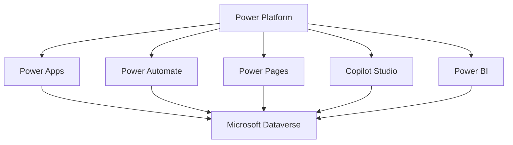
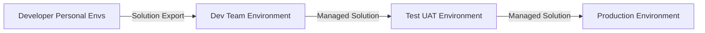
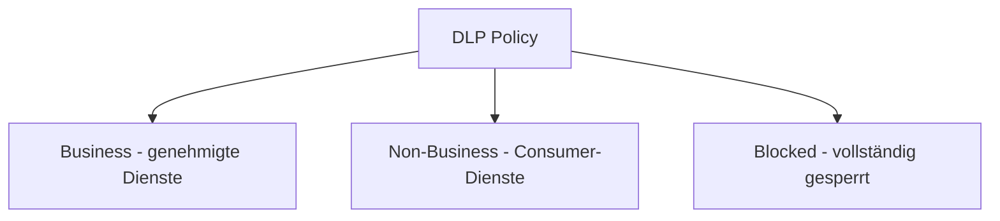

---
tags:
  - microsoft365
  - power-platform
  - grundlagen
aliases:
  - PP Grundlagen
  - Power Platform Überblick
---

# Power Platform Grundlagen

> [!ABSTRACT] TL;DR
> Die Microsoft Power Platform ist eine Low-Code/No-Code-Suite bestehend aus fünf integrierten Diensten: Power Apps, Power Automate, Power BI, Power Pages und Copilot Studio. Auf Basis von Microsoft Dataverse und tief integriert in Microsoft 365 und Azure ermöglicht sie Fachanwendern und Entwicklern, Geschäftsprozesse zu automatisieren, Daten zu analysieren und individuelle Anwendungen ohne umfangreiche Programmierkenntnisse zu erstellen.

---

## Was ist die Power Platform?

Die Microsoft Power Platform ist eine integrierte Suite von Cloud-Diensten, die Unternehmen dabei unterstützt, Geschäftsprozesse zu digitalisieren, zu automatisieren und zu analysieren. Im Mittelpunkt steht der **Low-Code/No-Code-Ansatz**: Statt monatelanger Softwareentwicklung können sogenannte *Maker* — Fachanwender mit minimalem Programmieraufwand — eigenständig Lösungen erstellen.

Microsoft positioniert die Power Platform als strategische Ergänzung zu Dynamics 365 und Microsoft 365:

- **Tief in Microsoft 365 integriert** — SharePoint, Teams und Outlook sind native Datenquellen und Einstiegspunkte
- **Azure-basiert** — Microsoft Entra ID-Authentifizierung, Azure-Ressourcen als Connectors
- **Marktführend im Low-Code-Segment** — Gartner Magic Quadrant Leader für Enterprise Low-Code Application Platforms

> [!NOTE] Citizen Developer vs. Pro Developer
> Die Power Platform richtet sich an beide Zielgruppen: **Citizen Developer** (Fachanwender) nutzen Canvas Apps und automatisierte Flows ohne Code, während **Pro Developer** mit der Power Platform CLI, ALM-Pipelines und PCF-Komponenten professionelle Enterprise-Lösungen aufbauen.

---

## Die 5 Säulen der Power Platform



| Säule | Zweck | Zielgruppe |
|-------|-------|------------|
| **Power Apps** | Canvas Apps, Model-Driven Apps, Mobile-Anwendungen | Citizen & Pro Developer |
| **Power Automate** | Prozessautomatisierung, RPA, Cloud Flows | Citizen Developer, Business Analyst |
| **Power BI** | Business Intelligence, Dashboards, Self-Service-Reports | Business Analyst, Data Engineer |
| **Power Pages** | Externe Webportale für Kunden und Partner | Pro Developer, Web Designer |
| **Copilot Studio** | Conversational AI, Chatbots, Copilot-Erweiterungen | Citizen Developer, AI Engineer |

### Power Apps
- **Canvas Apps**: Pixel-genaues UI-Design, verbindet bis zu 500 Datenquellen gleichzeitig, ideal für mobile Szenarien
- **Model-Driven Apps**: Formularbasiert auf Dataverse-Tabellen, automatisch responsiv, für komplexe Datenmodelle

### Power Automate
- **Cloud Flows**: Event-basierte Automatisierung über Connectors (Trigger + Actions)
- **Desktop Flows (RPA)**: Robotergestützte Prozessautomatisierung für Legacy-Systeme ohne API
- **Business Process Flows**: Geführte Prozessphasen für strukturierte Arbeitsabläufe

### Power BI
- Verbindet hunderte Datenquellen (Dataverse, SQL, Excel, Salesforce, Google Analytics)
- Interaktive Dashboards mit Drill-Down und natürlichsprachlichen Abfragen (Q&A)
- Direkte Integration in Teams, SharePoint und Power Apps

### Power Pages
- Externe, öffentlich zugängliche Webportale auf Basis von Dataverse
- Kunden- und Partnerportale, Self-Service-Formulare, Fallverfolgung
- Eigenständige Säule seit 2022 (vorher: Power Apps Portals)

### Copilot Studio
- No-Code Bot-Builder mit grafischem Dialog-Designer und Themenstruktur
- Integration in Teams, Power Apps und Microsoft 365 Copilot
- Eigene Wissensdatenbanken via Generative Answers (RAG-Prinzip)

---

## Microsoft Dataverse als gemeinsame Datenbasis

Microsoft Dataverse (ehemals Common Data Service) ist die zentrale, relationale Cloud-Datenbank der Power Platform.

- **Tabellenmodell**: Vorgefertigte Standard-Tabellen (Account, Contact, Task) und benutzerdefinierte Tabellen
- **Rollenbasierte Sicherheit**: Sicherheitsrollen, Business Units, Column-Level Security
- **Geschäftsregeln**: Validierungslogik ohne Code direkt auf Tabellenebene
- **APIs**: OData REST-API, Webhooks, .NET-Plug-ins
- **Dataverse for Teams**: Eingeschränkte Variante in Teams-Environments ohne Premium-Lizenz

> [!NOTE] Dataverse vs. SharePoint als Datenbasis
> SharePoint-Listen reichen für einfache Canvas Apps (Standard Connector, in M365 enthalten). Für Model-Driven Apps, komplexe Beziehungen und feingranulare Berechtigungen ist Dataverse erforderlich — benötigt aber eine Power Apps Premium-Lizenz.

---

## Environments

Environments sind isolierte Container für Ressourcen (Apps, Flows, Daten). Jede Power Platform-Ressource lebt in genau einer Environment.

| Environment-Typ | Beschreibung | Dataverse | Empfohlen für |
|-----------------|-------------|-----------|---------------|
| **Default** | Automatisch erstellt, pro Tenant eine | Optional | Schnelle Tests — NICHT für Produktion |
| **Sandbox** | Kopierbar und zurücksetzbar | Optional | Entwicklung, Integration, UAT |
| **Production** | Maximaler SLA, keine automatischen Resets | Empfohlen | Produktive Lösungen |
| **Developer** | Kostenlos für Einzelentwickler, begrenzter Speicher | Inklusive | Persönliche Entwicklung, Lernen |
| **Trial** | 30 Tage, danach automatisch gelöscht | Inklusive | Proof of Concept, Demos |

> [!WARNING] Default Environment unkontrolliert lassen ist gefährlich
> Die Default-Environment ist für alle Tenant-Nutzer zugänglich — unkontrollierte App- und Flow-Erstellung ist möglich. Schränke Erstellungsrechte über das Admin Center ein und nutze für produktive Lösungen ausschließlich dedizierte Environments.

### Empfohlene Environment-Strategie



- **Developer Environments**: Jeder Entwickler besitzt eine eigene persönliche Sandbox (kostenfrei via Developer Plan)
- **Development Environment**: Gemeinsame Integrationsumgebung für das Team
- **Test / UAT Environment**: Für User Acceptance Tests — keine direkten manuellen Änderungen
- **Production Environment**: Wird ausschließlich über Managed Solutions aktualisiert

> [!TIP] Immer innerhalb einer Solution entwickeln
> Entwickle ausnahmslos innerhalb einer **Solution**, um den Transport zwischen Environments zu ermöglichen. Ressourcen außerhalb von Solutions sind nicht transportierbar.

---

## Lizenzierung 2024/2025

Die Power Platform-Lizenzierung ist mehrschichtig. M365-Lizenzen gewähren eingeschränkten Zugang (Standard Connectors, kein vollwertiges Dataverse). Für Premium-Features sind separate Lizenzen erforderlich.

### Power Apps

| Lizenz | Preis (ca.) | Umfang |
|--------|-------------|--------|
| **Per User** | $20 / User / Monat | Unbegrenzte Apps, Premium Connectors, Dataverse |
| **Per App** | $5 / User / App / Monat | Zugang zu einer spezifischen App |
| **Pay-As-You-Go** | $10 / aktiver User / Monat | Nutzungsbasierte Abrechnung via Azure |
| **M365-Inkludiert** | Im M365-Abo enthalten | Nur Standard Connectors, kein Dataverse-Vollzugriff |

### Power Automate

| Lizenz | Preis (ca.) | Umfang |
|--------|-------------|--------|
| **Premium** | $15 / User / Monat | Cloud Flows, Premium Connectors, Attended RPA |
| **Process** | $150 / Bot / Monat | Unattended RPA, Desktop Flows ohne angemeldeten Nutzer |
| **M365-Inkludiert** | Im M365-Abo enthalten | Nur Standard Connectors, kein RPA |

### Power BI

| Lizenz | Preis (ca.) | Umfang |
|--------|-------------|--------|
| **Free** | Kostenlos | Nur eigene Reports, kein Sharing |
| **Pro** | $14 / User / Monat | Sharing, Zusammenarbeit, Workspaces |
| **Premium Per User** | $24 / User / Monat | Alle Premium-Features für Einzelpersonen |
| **Microsoft Fabric (F-SKUs)** | Kapazitätsbasiert | Ersetzt klassische Premium Capacity P-SKUs |

### Copilot Studio

| Lizenz | Preis (ca.) | Umfang |
|--------|-------------|--------|
| **Tenant License** | $200 / Monat | 25.000 Messages / Monat inklusive |
| **Message Add-On** | $0,01 / Message | Zusätzliche Messages über das Kontingent |

> [!IMPORTANT] Was M365-Lizenzen beinhalten
> Microsoft 365 (Business/Enterprise) enthält:
> - **Power Apps**: Standard Connectors, **kein Dataverse-Vollzugriff**, **keine Premium Connectors**
> - **Power Automate**: Standard Connectors, **kein RPA**, **keine Premium Connectors**
> - **Power BI**: Free-Tier — kein Sharing ohne Pro-Lizenz
>
> Sobald eine App oder ein Flow einen **Premium Connector** verwendet, benötigt **jeder Endbenutzer** eine Premium-Lizenz.

> [!IMPORTANT] Microsoft Fabric ersetzt Premium Capacity
> Seit 2024 lösen Microsoft Fabric F-SKUs die klassischen Power BI Premium Capacity P-SKUs ab. Fabric F-SKUs bieten neben Power BI auch Data Factory, Synapse Analytics und weitere Datendienste.

---

## Power Platform Admin Center

Das Admin Center (`https://admin.powerplatform.microsoft.com`) ist die zentrale Verwaltungsoberfläche.

| Bereich | Inhalt |
|---------|--------|
| **Environments** | Erstellen, verwalten, kopieren und zurücksetzen von Environments |
| **Analytics** | Nutzungsberichte für Power Apps, Power Automate und Dataverse |
| **Resources → Capacity** | Dataverse-Speicherübersicht, Add-On-Lizenzen zuweisen |
| **Policies → DLP** | Data Loss Prevention-Richtlinien erstellen und verwalten |
| **Policies → Tenant Isolation** | Cross-Tenant-Connector-Verbindungen steuern |
| **Settings** | Tenant-weite Einstellungen, Feature-Flags, Erstellerrechte |
| **Billing** | Pay-As-You-Go-Verknüpfungen mit Azure-Abonnements |

---

## Data Loss Prevention (DLP) Policies

DLP-Richtlinien steuern, welche Connectors in einem Flow oder einer App kombiniert werden dürfen. Sie verhindern, dass sensible Unternehmensdaten über nicht genehmigte Dienste nach außen gelangen.

### Connector-Gruppen

| Gruppe | Bedeutung | Beispiele |
|--------|-----------|-----------|
| **Business** | Genehmigte Unternehmensdienste | SharePoint, Teams, Dataverse, SQL, SAP, Exchange |
| **Non-Business** | Konsumenten-Dienste | Gmail, Dropbox, Twitter/X, Facebook |
| **Blocked** | Vollständig gesperrt | Kein Flow/App darf diese nutzen |

> [!WARNING] Kombinationsverbot
> Connectors aus Business und Non-Business dürfen **nicht in derselben** App oder demselben Flow kombiniert werden. DLP gilt tenant-weit oder für ausgewählte Environments.



---

## Center of Excellence Starter Kit

Das CoE Starter Kit ist eine kostenfreie Sammlung von Power Platform-Lösungen von Microsoft (auf GitHub verfügbar), um Governance und Adoption zu steuern.

| Komponente | Zweck |
|-----------|-------|
| **Core / Inventory** | Inventarisierung aller Environments, Apps, Flows und Maker im Tenant |
| **Nurture** | Maker-Onboarding, Schulungen, Community-Management, Champions-Programm |
| **Governance** | Compliance-Checks, App-Quarantäne, Richtlinien-Durchsetzung |
| **Audit** | Power BI-Dashboards für Nutzung, Risiken und Adoption-Metriken |

> [!TIP] CoE Starter Kit frühzeitig einsetzen
> Auch wenn nicht alle Komponenten sofort gebraucht werden: Die **Core-Komponente** sollte in jedem größeren Tenant von Beginn an eingesetzt werden, um den Überblick zu behalten.

---

## Connector-Typen

| Typ | Beschreibung | Beispiele | Lizenz |
|-----|-------------|-----------|--------|
| **Standard** | Weit verbreitete Alltagsdienste | SharePoint, Outlook, Teams, Excel, OneDrive, Planner | M365 inkludiert |
| **Premium** | Erweiterte oder kommerzielle Dienste | Dataverse, HTTP, SQL Server direkt, Salesforce, SAP | Premium-Lizenz nötig |
| **Custom** | Selbst erstellte Connectors via OpenAPI/Swagger | Interne APIs, Legacy-Systeme | Premium-Lizenz nötig |

> [!IMPORTANT] Ein Premium Connector macht alles Premium
> Sobald ein einziger Premium Connector in einer App oder einem Flow verwendet wird, benötigt **jeder Benutzer** eine Premium-Lizenz.

---

## Power Platform CLI

Die Power Platform CLI (`pac`) ist das offizielle Kommandozeilenwerkzeug für ALM und Administration.

```powershell
# Installation via .NET Tool
dotnet tool install --global Microsoft.PowerApps.CLI.Tool

# Authentifizierung
pac auth create --url https://[tenant].crm.dynamics.com
pac auth list

# Environments anzeigen
pac env list

# Solution exportieren (Unmanaged)
pac solution export --path ./solutions --name MeineSolution --managed false

# Managed Solution importieren
pac solution import --path ./solutions/MeineSolution_managed.zip

# Solution aus Quellcode packen
pac solution pack --zipfile MeineSolution.zip --folder ./src/MeineSolution

# Solution in Quellcode entpacken (für Git)
pac solution unpack --zipfile MeineSolution.zip --folder ./src/MeineSolution
```

> [!TIP] pac in CI/CD-Pipelines
> Microsoft stellt offizielle GitHub Actions (`microsoft/powerplatform-actions`) und Azure DevOps Tasks für Power Platform-Pipelines bereit. Die einfachste Methode ist der native **Pipelines for Power Platform**-Service direkt im Admin Center.

---

## Verwandte Notizen

- [[Power Apps]]
- [[Power Automate]]
- [[Power BI]]
- [[Copilot Studio]]
- [[Microsoft Dataverse]]
- [[Power Pages]]
- [[Power Platform Governance]]
