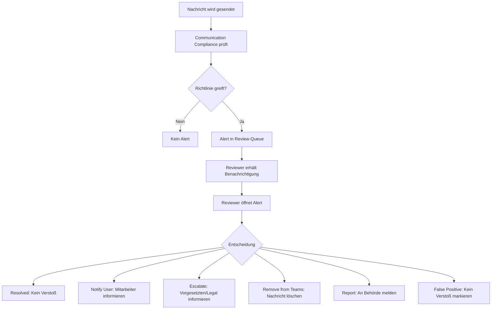
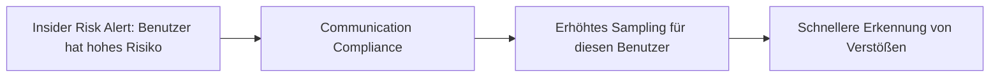

---
tags:
  - microsoft365
  - compliance
  - purview
  - communication-compliance
  - richtlinienüberwachung
aliases:
  - Communication Compliance
  - Richtlinienüberwachung
  - Kommunikations-Compliance
---

# Communication Compliance

> [!ABSTRACT] TL;DR
> Communication Compliance in Microsoft Purview überwacht Kommunikation (Teams, Exchange, Viva Engage) auf Verstöße gegen Unternehmensrichtlinien und regulatorische Anforderungen — mithilfe von ML-Klassifizierern und Review-Workflows. Reviewer können auffällige Nachrichten prüfen, eskalieren oder entfernen.

---

## Was ist Communication Compliance?

Communication Compliance ermöglicht die systematische Überwachung von Kommunikation auf:
- Verstöße gegen Verhaltenskodex (Beleidigungen, Diskriminierung)
- Regulatorische Anforderungen (Finanzaufsicht, Datenschutz)
- Insider-Risiken (verdächtige externe Kommunikation)
- Datenschutzverletzungen (sensible Daten in Nachrichten)

> [!IMPORTANT]
> Communication Compliance ist **kein** Monitoring-Tool für Produktivität. Es dient ausschließlich Compliance- und Risk-Management-Zwecken. Mitarbeiter müssen über Monitoring informiert werden (rechtliche Anforderungen in DE/EU).

---

## Anwendungsfälle

| Anwendungsfall | Beschreibung | Regulierung |
|----------------|-------------|-------------|
| **Finanzaufsicht** | Erkennung von Insider Trading, unerlaubte Kommunikation | FINRA, MiFID II, MAR |
| **Code of Conduct** | Beleidigungen, Diskriminierung, Bedrohungen | Arbeitsrecht |
| **Datenschutz** | Sensible Daten (IBAN, Passwörter) in Nachrichten | DSGVO |
| **Interessenkonflikte** | Kommunikation über vertrauliche Informationen | Compliance-Richtlinien |
| **Insider Risk** | Verdächtige externe Kommunikation vor Austritt | Risikomanagement |

---

## Richtlinien-Typen

### Vorab definierte Templates
| Template | Beschreibung |
|---------|-------------|
| **Offensive Language** | ML-Erkennung von Beleidigungen, Bedrohungen, Profanität |
| **Sensitive Information** | SIT-basierte Erkennung (IBAN, Kreditkarten, etc.) |
| **Regulatory Compliance** | Finanzspezifische Ausdrücke (Insiderhandel, Kursmanipulation) |
| **Conflicts of Interest** | Kommunikation zwischen bestimmten Gruppen |

### Custom Policies
Eigene Richtlinien mit:
- **Keywords und Phrases**: Liste von überwachten Wörtern
- **Sensitive Information Types**: SIT-basierte Trigger
- **ML-Classifiers**: Trainierbare oder vordefinierte Klassifizierer
- **Sampling Rate**: % aller Nachrichten, die geprüft werden (z.B. 10%)

---

## Kommunikationsquellen

| Quelle | Überwachte Inhalte |
|--------|------------------|
| **Microsoft Teams** | 1:1-Chats, Gruppen-Chats, Kanal-Nachrichten, Meeting-Chat |
| **Exchange Online** | E-Mails, E-Mail-Anhänge |
| **Viva Engage (Yammer)** | Community-Nachrichten, Direktnachrichten |
| **Teams Private Channels** | Private Kanal-Kommunikation |
| **Third-Party Connectors** | Bloomberg Terminal, ICE Chat, Slack, Zoom, etc. |

---

## ML-Klassifizierungen (Trainable Classifiers)

### Vordefinierte Klassifizierer für Communication Compliance

| Klassifizierer | Erkennungsbereich |
|---------------|------------------|
| **Harassment** | Belästigung, Mobbing |
| **Threat** | Bedrohungen, Einschüchterung |
| **Profanity** | Vulgäre und anstößige Sprache |
| **Targeted Harassment** | Gezielte Belästigung einer Person |
| **Discrimination** | Diskriminierung aufgrund von Merkmalen |
| **Adult Content** | Unangemessene sexuelle Inhalte |
| **Corporate Sabotage** | Sabotage von Unternehmenseigentum/-prozessen |
| **Regulatory Collusion** | Kollusionssprache (Preisabsprachen, etc.) |
| **Customer Complaints** | Kundenbeschwerden erkennen |

---

## Reviewer-Workflow



### Alert-Typen
| Typ | Beschreibung |
|-----|-------------|
| **Active** | Neuer Alert, noch nicht bearbeitet |
| **In Progress** | Reviewer nimmt den Alert in Bearbeit |
| **Resolved** | Kein Handlungsbedarf |
| **Dismissed** | False Positive, ignoriert |
| **Escalated** | An höhere Instanz weitergeleitet |

---

## Remediation-Aktionen

| Aktion | Beschreibung | Wann anwenden? |
|--------|-------------|----------------|
| **Notify** | Feedback an Benutzer senden | Erstes Vorkommen, Aufklärung |
| **Escalate** | An Vorgesetzten oder Legal weitergeben | Schwerwiegende Verstöße |
| **Remove from Teams** | Teams-Nachricht entfernen | Sofortige Entfernung nötig |
| **Report** | Für externe Meldepflicht dokumentieren | Regulatorische Anforderungen |
| **False Positive** | Alert schließen, kein Verstoß | Fehlalarme |
| **Tag** | Kategorie vergeben | Für Reporting und Analyse |

---

## Near-Duplicate-Erkennung

Communication Compliance gruppiert ähnliche Nachrichten:
- Erkennt semantisch ähnliche Nachrichten
- Reduziert Review-Aufwand durch Bündelung
- Reviewers kann mehrere ähnliche Nachrichten gemeinsam reviewen

---

## Thread-Rekonstruktion

Für besseren Kontext werden Nachrichten im Thread-Kontext angezeigt:
- Vorherige und nachfolgende Nachrichten sichtbar
- Teams-Konversationsansicht
- E-Mail-Thread-Ansicht

---

## Datenschutz und Pseudonymisierung

> [!NOTE]
> Um Datenschutzbedenken zu adressieren, können **anonymisierte Anzeigenamen** aktiviert werden:
> - Reviewer sehen zunächst `User1`, `User2` statt echter Namen
> - Erst bei konkretem Verdacht kann der Admin die Identität aufdecken
> - Zwei-Augen-Prinzip möglich (zweiter Admin muss bestätigen)

```powershell
# Pseudonymisierung aktivieren
Update-ComplianceFrameworkConfig -AnonymousUsers $true
```

---

## Berichte und Dashboards

### Verfügbare Berichte
| Bericht | Inhalt |
|---------|--------|
| **Policy Health** | Anzahl Alerts pro Policy, Trend |
| **Pending Actions** | Offene Review-Aufgaben |
| **Reviewer Activity** | Workload und Performance der Reviewer |
| **Sensitive Information** | Welche SITs wurden am häufigsten erkannt? |
| **Classifier Performance** | Accuracy-Metriken der ML-Klassifizierer |

---

## Konfiguration — Schritt für Schritt

### 1. Rollen zuweisen
```powershell
# Communication Compliance Admin-Rolle
Add-RoleGroupMember -Identity "Communication Compliance" -Member "compliance.admin@contoso.com"

# Reviewer-Rolle
Add-RoleGroupMember -Identity "Communication Compliance Analysts" -Member "reviewer1@contoso.com"
```

### 2. Policy erstellen (PowerShell)
```powershell
# Verbinden
Connect-IPPSSession

# Neue Policy erstellen
New-SupervisoryReviewPolicyV2 -Name "Offensive Language Policy" `
    -Reviewers "reviewer1@contoso.com","reviewer2@contoso.com" `
    -Comment "Automatische Überwachung auf offensive Sprache"

# Regel zur Policy hinzufügen
New-SupervisoryReviewRule -Name "Teams Offensive Language" `
    -Policy "Offensive Language Policy" `
    -SamplingRate 20 `
    -Conditions "MessageType:Teams AND (OffensiveLanguage:True)"
```

---

## Integration mit Insider Risk Management

Communication Compliance und Insider Risk Management ergänzen sich:



---

## Lizenzierung

| Lizenz | Communication Compliance |
|--------|--------------------------|
| Microsoft 365 E5 | ✅ Enthalten |
| Microsoft 365 E5 Compliance | ✅ Enthalten |
| Microsoft 365 E3 | ❌ Nicht enthalten |
| Communication Compliance Add-on | ✅ Separat kaufbar |

> [!NOTE]
> Alle **überwachten Benutzer** und alle **Reviewer** benötigen eine entsprechende Lizenz.

---

## Verwandte Notizen
- [[Microsoft Purview Grundlagen]]
- [[Insider Risk Management]]
- [[Information Barriers]]
- [[Data Loss Prevention DLP]]
