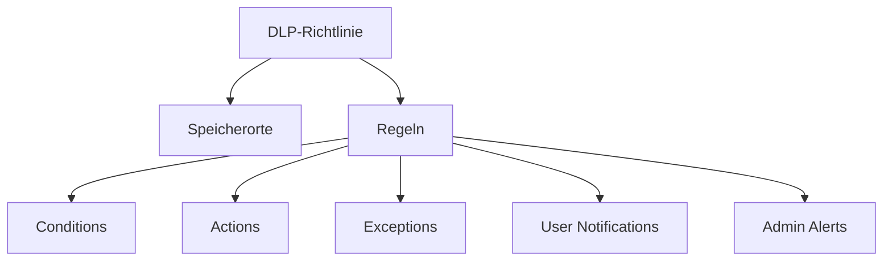
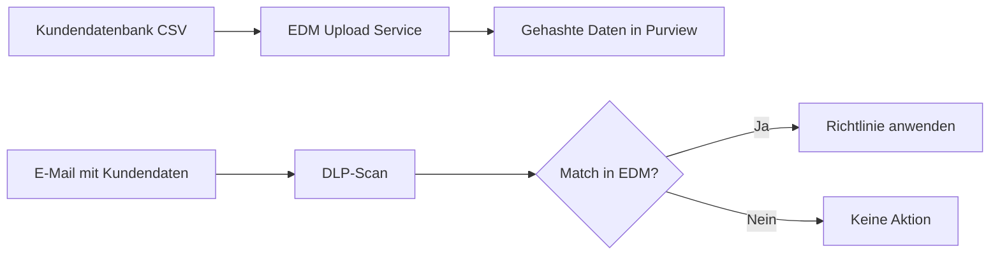
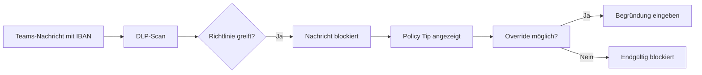
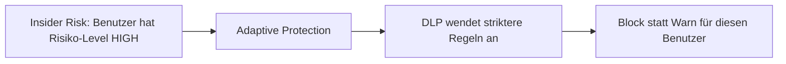

---
tags:
  - microsoft365
  - compliance
  - purview
  - dlp
  - datenverlust
  - endpoint-dlp
aliases:
  - DLP
  - Data Loss Prevention
  - Datenverlustprävention
---

# Data Loss Prevention DLP

> [!ABSTRACT] TL;DR
> Data Loss Prevention (DLP) in Microsoft Purview erkennt und verhindert das unbeabsichtigte Teilen sensibler Daten. DLP-Richtlinien überwachen E-Mails, SharePoint, OneDrive, Teams und Windows-Endgeräte — und können Aktionen wie Blockieren, Benachrichtigen oder Verschlüsseln automatisch auslösen.

---

## Was ist DLP?

DLP schützt sensible Daten vor unbeabsichtigtem oder absichtlichem Verlust durch:
- **Erkennung**: Sensible Informationen in Inhalten identifizieren
- **Benachrichtigung**: Benutzer über Richtlinien informieren (Policy Tips)
- **Aktion**: Senden blockieren, Verschlüsseln, Quarantäne, Alert

---

## DLP-Richtlinien-Komponenten



### Conditions (Bedingungen)

| Condition-Typ | Beispiel |
|--------------|---------|
| **Sensitive Information Types** | IBAN, Kreditkartennummer, Sozialversicherungsnummer |
| **Sensitivity Labels** | Dokument mit Label "Streng Vertraulich" |
| **Keywords** | "streng vertraulich", "nicht weiterleiten" |
| **Document Properties** | SharePoint-Metadaten |
| **Sender/Recipient** | Externe Empfänger, bestimmte Domänen |
| **Message Size** | E-Mail größer als X MB |
| **Attachment Type** | .exe, .zip, bestimmte Dateitypen |

### Actions (Aktionen)

| Aktion | Beschreibung | Speicherort |
|--------|-------------|------------|
| **Block** | Senden/Hochladen blockieren | Alle |
| **Block with Override** | Blockieren, Benutzer kann überschreiben | Alle |
| **Encrypt** | Nachricht verschlüsseln | Exchange |
| **Apply Label** | Sensitivity Label anwenden | Exchange, SharePoint |
| **Notify Admin** | Admin-Alert generieren | Alle |
| **Quarantine** | Datei in Quarantäne verschieben | SharePoint, OneDrive |
| **Restrict Access** | Sharing einschränken | SharePoint, OneDrive |
| **Audit Only** | Nur protokollieren | Alle |

---

## Sensitive Information Types (SITs)

### Built-in SITs
Microsoft liefert **700+ vordefinierte SITs**:

| SIT-Kategorie | Beispiele |
|--------------|---------|
| **Finanzdaten** | Kreditkartennummern, IBAN, SWIFT-Codes |
| **Personenbezogen (EU)** | Deutsche Personalausweisnummer, Reisepass, Steuer-ID |
| **US-Spezifisch** | SSN, Driver's License, US Bank Account |
| **Medizinisch** | ICD-Codes, Medikamentennamen (Named Entities) |
| **Passwörter** | Passwort-Pattern-Erkennung |

### Custom SITs erstellen
```powershell
# Custom SIT mit Regex
New-DlpSensitiveInformationType -Name "Mitarbeiter-ID" `
    -Description "Contoso Mitarbeiter-ID im Format MA-12345" `
    -Pattern @{
        Pattern = "MA-\d{5}"
        MinConfidenceLevel = 75
    }
```

### Exact Data Match (EDM)
EDM vergleicht Inhalte gegen eine **strukturierte Datenbank** (z.B. Kundendaten):



### Named Entities (ML-basiert)
Named Entities erkennen Personen, Orte und medizinische Begriffe via Machine Learning — ohne Regex.

---

## DLP-Speicherorte

| Speicherort | Überwacht | Endpunkt DLP nötig? |
|-------------|----------|---------------------|
| **Exchange Online** | E-Mails, Anhänge | ❌ |
| **SharePoint Online** | Dokumente, Dateien | ❌ |
| **OneDrive for Business** | Dateien | ❌ |
| **Microsoft Teams** | Chat- und Kanal-Nachrichten | ❌ |
| **Devices (Windows)** | Dateioperationen, Aktivitäten | ✅ (MDE Onboarding) |
| **Power BI** | Berichte, Datasets | ❌ |
| **Microsoft 365 Copilot** | Copilot-Interaktionen | ❌ |

---

## Endpoint DLP

Endpoint DLP überwacht und kontrolliert Aktivitäten auf **Windows 10/11-Geräten**.

### Voraussetzungen
- Windows 10 RS5+ oder Windows 11
- Microsoft Defender for Endpoint onboarded
- M365 E5 Compliance oder Endpoint DLP Add-on

### Überwachte Aktivitäten

| Aktivität | Beschreibung | Mögliche Aktion |
|-----------|-------------|----------------|
| **Copy to USB** | Datei auf USB-Stick kopieren | Block, Audit, Warn |
| **Print** | Dokument drucken | Block, Audit, Warn |
| **Upload to Cloud** | Hochladen in Browser | Block, Audit, Warn |
| **Copy to Clipboard** | In Zwischenablage kopieren | Block, Audit, Warn |
| **Copy to Network Share** | Auf Netzlaufwerk kopieren | Block, Audit, Warn |
| **Screenshot** | Bildschirmaufnahme | Block, Audit, Warn |
| **Open with Unallowed App** | Mit nicht genehmigter App öffnen | Block, Audit |
| **Remote Desktop** | RDP-Dateiübertragung | Block, Audit |

### Sensitive App Groups
Bestimmte Browser oder Apps können als "unerlaubt" markiert werden (z.B. Dropbox-Client, persönliche Dropbox-Web-Uploads).

```powershell
# Endpoint DLP-Einstellungen konfigurieren
# (über Purview-Portal: Policies → Endpoint DLP Settings)
# Oder PowerShell:
Set-PolicyConfig -EndpointDlpGlobalSettings @{
    "AdvancedClassificationEnabled" = $true
    "MacOsEndpointDlpEnabled" = $true
}
```

---

## Teams DLP

DLP kann Chat- und Kanal-Nachrichten in Microsoft Teams überwachen:

- **Scope**: Privatchats, Kanal-Nachrichten, private Kanäle
- **Aktion**: Nachricht blockieren (Benutzer sieht Policy Tip)
- **Einschränkung**: Keine Anhang-Kontrolle in Teams (dafür SharePoint DLP)



---

## Policy Tips

Policy Tips informieren Benutzer **sofort** beim Erstellen problematischer Inhalte:

- **Outlook**: Gelbes Banner mit Hinweis
- **SharePoint/OneDrive**: Warnmeldung beim Hochladen
- **Teams**: Hinweis unter der Nachricht

### Policy Tip anpassen
```powershell
# Policy Tip Text anpassen
Set-DlpComplianceRule -Identity "DSGVO-Regel" `
    -NotifyUser Owner `
    -NotifyUserType NotifyOnly `
    -NotifyPolicyTipCustomText "Diese E-Mail enthält möglicherweise personenbezogene Daten. Bitte prüfe, ob das Senden erlaubt ist."
```

---

## Simulation Mode

Vor der Aktivierung einer Richtlinie: **Simulation Mode** testen.

1. Richtlinie im Testmodus erstellen
2. Aktivitäts-Explorer zeigt, was die Richtlinie tun würde
3. False Positives identifizieren und Ausnahmen hinzufügen
4. Richtlinie aktivieren

> [!TIP]
> Starte IMMER im Simulation Mode. Eine zu aggressive DLP-Richtlinie kann den Geschäftsbetrieb beeinträchtigen.

---

## DLP für DSGVO

Microsoft bietet GDPR-spezifische Templates:

```powershell
# DSGVO-Richtlinie aus Template erstellen
New-DlpCompliancePolicy -Name "EU GDPR" `
    -Template "EU General Data Protection Regulation (GDPR)" `
    -ExchangeLocation All `
    -SharePointLocation All `
    -OneDriveLocation All
```

**Erkannte EU-Personenbezogene Daten:**
- EU-Kreditkartennummern
- EU-Sozialversicherungsnummern (je nach Land)
- EU-Bankkontodaten
- EU-Reisepassnummern
- EU-Steueridentifikationsnummern

---

## Adaptive Protection

Adaptive Protection verknüpft DLP mit **Insider Risk Management**:



| Risiko-Level | DLP-Profil |
|-------------|-----------|
| **Elevated** | Block + Admin Alert |
| **Moderate** | Warn + Override + Audit |
| **Minor** | Audit Only |

---

## DLP Alerts und Aktivitäts-Explorer

### DLP Alert Management
Alerts werden im Purview-Portal unter **Alerts** angezeigt:
- Severity: Low, Medium, High
- Status: Active, Investigating, Dismissed, Resolved
- Details: Welche Regel? Welche Aktion? Welcher Benutzer?

### Aktivitäts-Explorer
Der Aktivitäts-Explorer zeigt alle DLP-relevanten Aktivitäten:
```
Filter: Speicherort, Benutzer, Aktivitätstyp, Label, SIT
Zeitraum: Letzte 30 Tage
Export: CSV für SIEM-Integration
```

---

## Via Microsoft Purview Compliance Portal (UI)

### DLP-Richtlinie einrichten

1. Öffne **Microsoft Purview Compliance Portal** unter [purview.microsoft.com](https://purview.microsoft.com)
2. Navigiere zu **Datenverlust-Prävention → Richtlinien**
3. Klicke auf **+ Richtlinie erstellen**
4. Wähle eine Vorlage (z.B. **DSGVO**, **Kreditkarten**) oder **Benutzerdefiniert** und klicke auf **Weiter**
5. Konfiguriere:
   - **Name und Beschreibung:** Aussagekräftigen Namen vergeben
   - **Speicherorte:** Exchange, SharePoint, OneDrive, Teams, Endpoints auswählen
   - **Bedingungen:** Sensitive Information Types (SITs) hinzufügen
   - **Aktionen:** Zugriff blockieren, Benachrichtigung senden, Bericht generieren
   - **Policy Tips:** Benutzerbenachrichtigungen aktivieren
   - **Simulation:** Richtlinie zunächst im Simulation Mode testen
6. Klicke auf **Speichern**

> [!TIP]
> Aktiviere **Simulation Mode**, bevor du die Richtlinie erzwingst, um False Positives zu identifizieren und die Auswirkungen zu bewerten.

---

## PowerShell-Verwaltung

```powershell
# Verbinden
Connect-IPPSSession

# DLP-Richtlinie erstellen
New-DlpCompliancePolicy -Name "Kreditkarten-Schutz" `
    -ExchangeLocation All `
    -SharePointLocation All `
    -OneDriveLocation All `
    -TeamsLocation All `
    -Mode Enable

# DLP-Regel zur Richtlinie hinzufügen
New-DlpComplianceRule -Name "Kreditkarte erkannt" `
    -Policy "Kreditkarten-Schutz" `
    -ContentContainsSensitiveInformation @{Name="Credit Card Number"; minCount=1; minConfidence=75} `
    -BlockAccess $true `
    -NotifyUser Owner `
    -GenerateIncidentReport SiteAdmin

# Alle aktiven Richtlinien anzeigen
Get-DlpCompliancePolicy | Where-Object Mode -eq "Enable"
```

---

## Verwandte Notizen
- [[Microsoft Purview Grundlagen]]
- [[Sensitivity Labels]]
- [[Insider Risk Management]]
- [[Retention Policies und Labels]]
- [[Microsoft Secure Score]]
