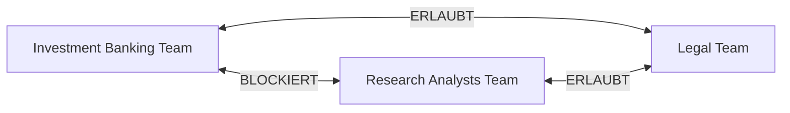
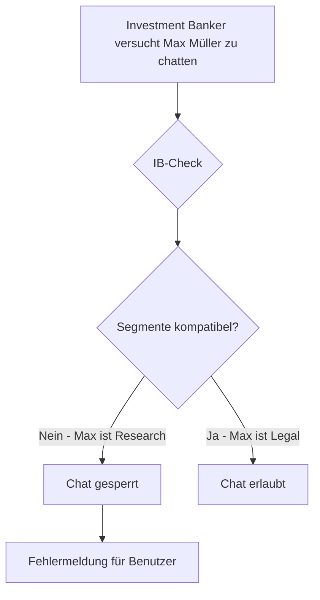
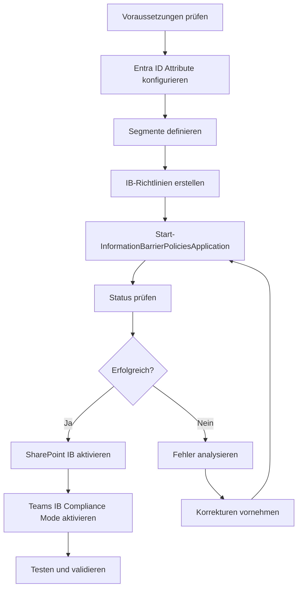

---
tags:
  - microsoft365
  - compliance
  - purview
  - information-barriers
  - kommunikationsbeschränkungen
aliases:
  - IB
  - Information Barriers M365
  - Chinese Wall M365
---

# Information Barriers

> [!ABSTRACT] TL;DR
> Information Barriers (IB) in Microsoft Purview beschränken die Kommunikation zwischen definierten Benutzergruppen (Segmenten) — ein klassisches "Chinese Wall"-Szenario für Finanzinstitute oder andere regulierte Branchen. IB wirkt auf Teams, SharePoint, OneDrive und Exchange.

---

## Was sind Information Barriers?

Information Barriers ermöglichen es, bestimmte Benutzergruppen am Kommunizieren zu hindern — z.B. um Interessenkonflikte und Insider Trading zu verhindern.

**Klassisches Szenario — Finanzinstitut:**


---

## Anwendungsfälle

| Branche | Szenario | Rechtsgrundlage |
|---------|---------|----------------|
| **Finanzdienstleistungen** | Investment Banking vs. Research vs. Trading | FINRA, MiFID II, SEC |
| **Anwaltskanzleien** | Mandantenteams dürfen nicht kommunizieren | Berufsrecht |
| **Pharmaunternehmen** | R&D vs. Vertrieb bei laufenden Studien | FDA-Richtlinien |
| **Technologieunternehmen** | Akquisitionsteam vs. Rest der Organisation | M&A-Regeln |
| **Öffentliche Verwaltung** | Verschiedene Behörden im gleichen Tenant | Behördenrecht |

---

## IB-Modi

### Single Segment Mode (aktuell empfohlen)
- Jeder Benutzer kann nur einem Segment angehören
- Einfachere Konfiguration
- Klare Segmentgrenzen

### Multi-Segment Mode (Legacy)
- Benutzer können mehreren Segmenten angehören
- Komplexere Richtlinien erforderlich
- Wird durch Single Segment Mode abgelöst

---

## Segmente definieren

Segmente basieren auf **Entra ID-Attributen** der Benutzer:

```powershell
# Verbinden
Connect-IPPSSession

# Segment basierend auf Abteilung
New-OrganizationSegment -Name "InvestmentBanking" `
    -UserGroupFilter "Department -eq 'Investment Banking'"

New-OrganizationSegment -Name "Research" `
    -UserGroupFilter "Department -eq 'Research'"

New-OrganizationSegment -Name "Compliance" `
    -UserGroupFilter "Department -eq 'Compliance'"

New-OrganizationSegment -Name "HR" `
    -UserGroupFilter "Department -eq 'Human Resources'"

# Alle Segmente anzeigen
Get-OrganizationSegment | Select-Object Name, UserGroupFilter
```

### Verfügbare Entra ID-Attribute für Segmente
- `Department`
- `CompanyName`
- `MemberOf` (Gruppenmitgliedschaft)
- `ExtensionAttribute1–15`
- `JobTitle`
- `Office`
- `UsageLocation`

---

## IB-Richtlinien

### Block-Richtlinie (Kommunikation verhindern)
```powershell
# Block: Investment Banking darf NICHT mit Research kommunizieren
New-InformationBarrierPolicy -Name "IB-IBanking-Blocks-Research" `
    -AssignedSegment "InvestmentBanking" `
    -SegmentsBlocked "Research" `
    -State Active

# Block: Research darf NICHT mit Investment Banking kommunizieren (bidirektional!)
New-InformationBarrierPolicy -Name "IB-Research-Blocks-IBanking" `
    -AssignedSegment "Research" `
    -SegmentsBlocked "InvestmentBanking" `
    -State Active
```

> [!IMPORTANT]
> Information Barriers sind **unidirektional**. Um eine bidirektionale Blockierung zu erreichen, müssen ZWEI Richtlinien erstellt werden (A blockiert B UND B blockiert A).

### Allow-Richtlinie (Nur bestimmte Kommunikation erlauben)
```powershell
# Allow: Compliance darf NUR mit HR und Legal kommunizieren
New-InformationBarrierPolicy -Name "IB-Compliance-Allow-HR-Legal" `
    -AssignedSegment "Compliance" `
    -SegmentsAllowed "HR","Legal" `
    -State Active
```

---

## IB-Richtlinien anwenden

```powershell
# Richtlinien aktivieren (NOTWENDIG nach Erstellung/Änderung)
Start-InformationBarrierPoliciesApplication

# Status der Anwendung prüfen
Get-InformationBarrierPoliciesApplicationStatus

# Einzelnen Benutzer prüfen
Get-InformationBarrierRecipientStatus -Identity "user@contoso.com" `
    -InformationBarrierPolicyTag "IB-IBanking-Blocks-Research"
```

> [!NOTE]
> `Start-InformationBarrierPoliciesApplication` muss nach JEDER Änderung ausgeführt werden. Die Anwendung kann mehrere Stunden dauern.

---

## IB in Microsoft Teams

### Auswirkungen auf Teams
- **Neue Chats**: Benutzer aus blockierten Segmenten können nicht als Chat-Partner ausgewählt werden
- **Bestehende Chats**: Wenn IB auf bestehende Chat-Verbindungen angewendet wird, werden diese Chat-Verbindungen ggf. unterbrochen
- **Kanäle**: Benutzer aus inkompatiblen Segmenten können nicht in den gleichen Kanal eingeladen werden
- **People Picker**: In Teams-Suche werden IB-inkompatible Benutzer nicht angezeigt



### Bestehende Teams und Kanäle
- Wenn ein Team Mitglieder aus inkompatiblen Segmenten hat und IB aktiviert wird:
  - IB-Compliance Mode aktivieren (Teams Admin Center)
  - Bestehende Teams werden auf Konformität geprüft
  - Nicht-konforme Mitglieder müssen entfernt werden

---

## IB in SharePoint

IB schränkt Site-Zugriff und Suche ein:

- Benutzer können keine Sites besuchen, auf die Segmentregeln sie einschränken
- SharePoint-Suche filtert Ergebnisse basierend auf IB-Segmenten
- Site-Sharing respektiert IB-Richtlinien (externe Freigabe an inkompatible Benutzer blockiert)

```powershell
# IB in SharePoint aktivieren (erforderlich!)
Set-SPOTenant -InformationBarriersSuspension $false
```

---

## IB in OneDrive

- Sharing-Einschränkungen basierend auf Segmenten
- Benutzer aus blockierten Segmenten können keine Inhalte erhalten

---

## IB in Exchange

- E-Mail-Kontakte zwischen inkompatiblen Segmenten werden aus dem Adressbuch ausgeblendet
- **Achtung**: Exchange-E-Mails werden von IB **nicht blockiert** (nur ausgeblendet im Adressbuch und Empfänger-Auswahl)
- E-Mail-Blockierung erfordert zusätzliche Maßnahmen (z.B. Mail Flow Rules)

---

## Vollständiger Einrichtungs-Workflow



---

## Voraussetzungen

| Anforderung | Details |
|-------------|---------|
| **Lizenz** | Microsoft 365 E5 oder Microsoft 365 E5 Compliance |
| **Entra ID P1** | Für dynamische Gruppen / Attribut-basierte Segmente |
| **Audit Log** | Muss aktiviert sein |
| **Directory-Sync** | Attribute müssen aus HR-System synchronisiert sein |
| **Exchange Online** | Erforderlich für Address Book Policy |
| **Teams Admin** | IB Compliance Mode in Teams konfigurieren |

---

## IB vs. Conditional Access

| Aspekt | Information Barriers | Conditional Access |
|--------|---------------------|-------------------|
| **Kontrolle** | Intra-Tenant-Kommunikation | Authentifizierung/Zugriff |
| **Granularität** | Benutzer-Gruppen | Benutzer, Geräte, Apps |
| **Anwendungsfall** | Kommunikationstrennung | Zugangskontrolle |
| **Konfiguration** | Segmente + Policies | Named Locations, Risk |
| **Blockiert** | Chat, Sharing, Sites | Login, App-Zugriff |

---

## Fehlerbehebung

```powershell
# IB-Policy-Status prüfen
Get-InformationBarrierPolicy | Select-Object Name, State, AssignedSegment

# Anwendungsstatus prüfen
Get-InformationBarrierPoliciesApplicationStatus | 
    Select-Object Status, SegmentsProcessed, ErrorMessage

# IB-Konfiguration eines Benutzers prüfen
Get-InformationBarrierRecipientStatus -Identity "user@contoso.com"

# Segmentzuweisung eines Benutzers prüfen
Get-InformationBarrierRecipientStatus -Identity "user@contoso.com" | 
    Select-Object AssignedSegments
```

### Häufige Fehler

| Fehler | Ursache | Lösung |
|--------|---------|--------|
| Policy Application hängt | Zu viele Benutzer | Segmente verkleinern, erneut ausführen |
| Segment-Konflikt | Benutzer in mehreren Segmenten (Single Segment Mode) | Doppelt zugewiesene Benutzer entfernen |
| Teams-Einschränkung wirkt nicht | IB Compliance Mode nicht aktiviert | Teams Admin Center: IB Compliance Mode aktivieren |
| SharePoint zeigt falsche Ergebnisse | SharePoint IB nicht aktiviert | Set-SPOTenant -InformationBarriersSuspension $false |

---

## Verwandte Notizen
- [[Microsoft Purview Grundlagen]]
- [[Communication Compliance]]
- [[Data Loss Prevention DLP]]
