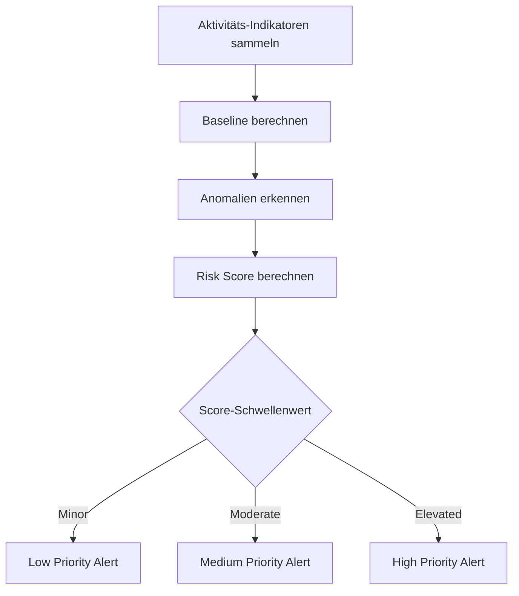
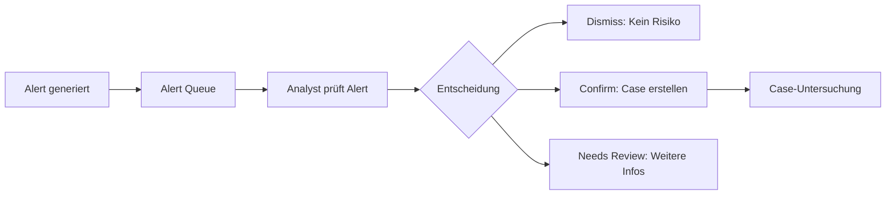
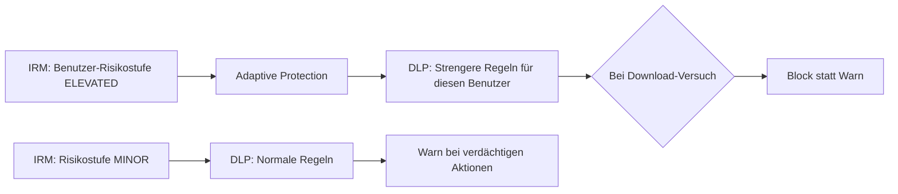
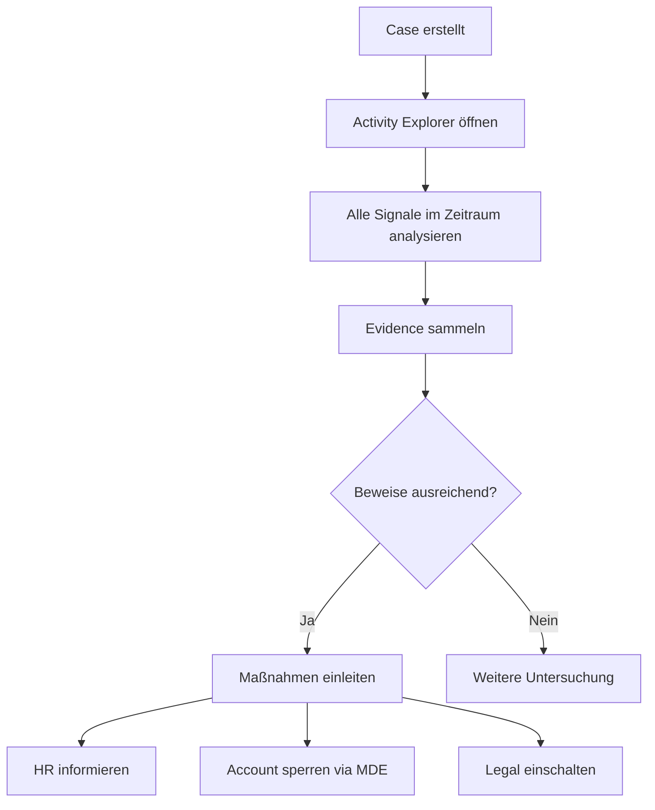

---
tags:
  - microsoft365
  - compliance
  - purview
  - insider-risk
  - irm
  - datenleck
aliases:
  - IRM
  - Insider Risk
  - Insider Risk Management M365
---

# Insider Risk Management

> [!ABSTRACT] TL;DR
> Microsoft Purview Insider Risk Management (IRM) erkennt Risiken durch interne Mitarbeiter — Datenlecks, Diebstahl, Sabotage. Aktivitäts-Indikatoren aus M365-Diensten werden zu Risk Scores aggregiert, Alerts werden generiert und Cases für Untersuchungen geöffnet. Adaptive Protection verknüpft IRM dynamisch mit DLP-Richtlinien.

---

## Was ist Insider Risk Management?

Insider Risk Management erkennt und reagiert auf Risiken, die von Mitarbeitern ausgehen — absichtlich oder versehentlich. Im Gegensatz zu externen Angriffen sind Insider-Risiken besonders schwer zu erkennen, da legitime Zugriffsrechte missbraucht werden.

> [!NOTE]
> IRM ist **kein** Mitarbeiter-Überwachungstool. Es ist ein risikobasiertes System, das anonymisiert arbeitet und auf statistischen Anomalien basiert. Datenschutz und lokale Arbeitsrechtbestimmungen müssen beachtet werden.

---

## Insider Risk Kategorien

| Kategorie | Beschreibung | Beispiel |
|-----------|-------------|---------|
| **Datenleck (Data Leaks)** | Sensible Daten unerlaubt weitergegeben | Mitarbeiter schickt Kundenliste an privat-E-Mail |
| **Datediebstahl** | Datendiebstahl vor dem Austritt | Mitarbeiter kopiert alles kurz vor Kündigung |
| **Sicherheitsverletzungen** | Deaktivierung von Schutzmaßnahmen | Antivirus deaktiviert, DLP-Policies umgangen |
| **Sabotage** | Vorsätzliche Schädigung | Dateien löschen, Systeme beschädigen |
| **Interessenkonflikte** | Vertrauliche Informationen für Konkurrenten | Strategiepapiere an Wettbewerber |

---

## Risikorichtlinien (Policy Templates)

IRM bietet spezialisierte Templates für verschiedene Szenarien:

| Template | Trigger | Beschreibung |
|---------|---------|-------------|
| **Data theft by departing users** | HR-Connector: Kündigung | Mitarbeiter, die das Unternehmen verlassen |
| **Data leaks** | DLP Policy Match | DLP-Treffer als Risk-Indikator |
| **Data leaks by priority users** | DLP + Priority User | Hochriskante Benutzer (VIPs, Admins) |
| **Security policy violations** | MDE Alert | Security-Verletzungen auf Endgeräten |
| **Security policy violations by departing users** | HR + MDE | Departing User + Security Violations |
| **Security policy violations by disgruntled users** | HR + MDE | Unzufriedene Mitarbeiter (HR-Eskalation) |
| **Risky browser usage** | Endpoint | Zugriff auf riskante Websites |
| **Patient data misuse** | Healthcare | Gesundheitsdaten-Missbrauch |

---

## Aktivitäts-Indikatoren (Signale)

IRM sammelt Aktivitäts-Signale aus verschiedenen M365-Diensten:

### Exfiltrations-Indikatoren
| Indikator | Quelle | Beschreibung |
|-----------|--------|-------------|
| **File downloads from SharePoint** | SharePoint | Massenhafter Download |
| **Copy to USB drive** | MDE (Endpoint) | USB-Kopieraktivität |
| **Email with attachments to external** | Exchange | E-Mail mit Anhang an externe Empfänger |
| **Upload to personal cloud** | MDE Browser Extension | Dropbox, Google Drive, WeTransfer |
| **Print sensitive documents** | MDE (Endpoint) | Drucken von Labels/SITs |
| **Copy to network share** | MDE (Endpoint) | Kopie auf Netzlaufwerk |
| **Teams sharing to external** | Teams | Datei an externe Personen |
| **Screenshot** | MDE (Endpoint) | Bildschirmfotos sensibler Inhalte |

### Security Violation-Indikatoren
| Indikator | Quelle |
|-----------|--------|
| MDE Alert: Malware erkannt | MDE |
| MDE Alert: Suspicious PowerShell | MDE |
| MDE Alert: Tamper Protection deaktiviert | MDE |
| Risky Browser Usage | MDE + Browsing-Richtlinien |

### Sequence-Indikatoren
Kombinationen von Aktivitäten erhöhen den Risk Score stärker:
```
Beispiel Hochrisiko-Sequenz:
1. Benutzer sendet Kündigung (HR-Connector)
2. Massendownload von SharePoint-Dateien
3. Copy to USB drive
4. E-Mail mit Anhängen an externe Adressen
→ Sehr hoher Cumulative Exfiltration Score
```

---

## Risk Scoring-Mechanismus



### Risk Score Boosters
Bestimmte Faktoren erhöhen den Score automatisch:
- **Bevorstehende Kündigung** (HR-Connector)
- **Disziplinarmaßnahme** (HR-Connector)
- **Privilegiertes Konto** (Admin, IT)
- **Vorsätzliche DLP-Umgehung**
- **Bekannte Insider-Risk-Warnzeichen**

---

## Alerts

### Alert-Verwaltung


### Alert-Informationen
- **Risk Score**: Numerische Bewertung
- **Policy**: Welche Richtlinie hat ausgelöst?
- **Aktivitäten**: Liste der erkannten Aktivitäten
- **Zeitraum**: Wann wurden Aktivitäten erkannt?
- **User Context**: Normales Verhalten vs. aktuelles Verhalten

---

## Adaptive Protection

Adaptive Protection verbindet IRM-Risikostufen mit DLP-Richtlinien:



### Risikostufen und DLP-Profile

| IRM-Risikostufe | DLP-Profil | Beschreibung |
|----------------|-----------|-------------|
| **Elevated** | Block + Justification | Strengste DLP-Regeln |
| **Moderate** | Warn + Override | Mittlere DLP-Regeln |
| **Minor** | Audit | Nur protokollieren |
| **No Risk** | Default DLP | Normale Richtlinien |

> [!TIP]
> Adaptive Protection ist einer der wertvollsten Features von IRM — es verhindert proaktiv Datenlecks, während gleichzeitig eine Untersuchung läuft.

---

## Cases und Investigations

### Case-Erstellung
Cases werden aus bestätigten Alerts erstellt und beinhalten:

- **Activity Explorer**: Alle Aktivitäten des Benutzers im Zeitraum
- **Content Explorer**: Dateien, auf die zugegriffen wurde
- **User Timeline**: Chronologische Aktivitätsübersicht
- **Contributor**: Andere Benutzer im gleichen Fall



---

## Notice Templates

Notice Templates ermöglichen standardisierte Benachrichtigungen an Mitarbeiter:

```
Betreff: Hinweis auf Unternehmensrichtlinien

Wir haben festgestellt, dass in letzter Zeit Aktivitäten auf Ihrem Account
registriert wurden, die unsere Richtlinien zu sensiblen Daten berühren...

Diese Benachrichtigung ist vertraulich. Bitte kontaktieren Sie Ihren Vorgesetzten...
```

---

## Forensic Evidence (Screen Captures)

> [!WARNING]
> Forensic Evidence ist ein optionales Feature, das **Screen Captures** von Geräten erstellt. Es unterliegt strengen Datenschutzanforderungen:
> - Explizite Zustimmung der Mitarbeiter oder Betriebsrat-Zustimmung erforderlich
> - Nur für bestimmte Risikorichtlinien aktivierbar
> - In Deutschland durch Mitbestimmungsrecht eingeschränkt

---

## Integration mit HR-Connector

Der HR-Connector überträgt HR-Ereignisse in IRM:

### Unterstützte HR-Systeme
- SAP SuccessFactors
- Workday
- CSV-Import (für andere Systeme)

### Übertragene Ereignisse
| Ereignis | Auswirkung auf IRM |
|---------|------------------|
| **Kündigung eingereicht** | Triggert "Departing User"-Policy |
| **Kündigung wirksam** | Setzt Ablaufdatum für Überwachung |
| **Disziplinarmaßnahme** | Risk Score Booster |
| **Performance Warning** | Risk Score Booster |
| **Versetzung** | Scope-Anpassung |

---

## Datenschutz und Pseudonymisierung

IRM bietet Datenschutz-Features:

```powershell
# Anonymized Display Names aktivieren
Update-InsiderRiskPolicySetting -EnableAnonymization $true
```

- **Anonymized Names**: Analystsieht `Benutzer A` statt echtem Namen
- **Pseudonymization**: Echter Name nur für autorisierte Admins sichtbar
- **Privacy Notice**: Benutzer können über Überwachung informiert werden

---

## Via Microsoft Purview Compliance Portal (UI)

### Richtlinie für Insider-Risikomanagement erstellen

1. Öffne **Microsoft Purview Compliance Portal** unter [purview.microsoft.com](https://purview.microsoft.com)
2. Navigiere zu **Insider-Risikomanagement → Richtlinien**
3. Klicke auf **+ Richtlinie erstellen**
4. Wähle ein **Policy Template** (z.B. „Datenlecks", „Sicherheitsverstöße") und klicke auf **Weiter**
5. Konfiguriere:
   - **Name und Beschreibung:** Aussagekräftigen Namen vergeben
   - **Benutzer und Gruppen:** Alle oder spezifische Benutzer überwachen
   - **Indikatoren:** Relevante Aktivitätssignale aktivieren (z.B. Datei-Downloads, USB-Nutzung)
   - **Erkennung:** Schwellenwerte für Risk Scores festlegen
   - **Warnungsschwelle:** Trigger für Alerts konfigurieren
6. Überprüfe die Zusammenfassung und klicke auf **Erstellen**
7. Überwache Alerts unter **Insider-Risikomanagement → Warnungen**

> [!TIP]
> Aktiviere **Adaptive Protection** unter **Adaptive Protection**, um DLP-Richtlinien dynamisch basierend auf dem Risikoniveau der Benutzer anzupassen.

---

## Lizenzierung

| Lizenz | IRM-Abdeckung |
|--------|--------------|
| Microsoft 365 E5 | ✅ Enthalten |
| Microsoft 365 E5 Compliance | ✅ Enthalten |
| Microsoft 365 E3 | ❌ Nicht enthalten |
| Insider Risk Management Add-on | ✅ Separat kaufbar |

> [!NOTE]
> Alle **überwachten Benutzer** benötigen eine IRM-Lizenz. Das können potenziell alle Mitarbeiter sein — Lizenzplanung ist wichtig.

---

## Verwandte Notizen
- [[Microsoft Purview Grundlagen]]
- [[Communication Compliance]]
- [[Data Loss Prevention DLP]]
- [[Microsoft Defender for Endpoint]]
- [[Microsoft Secure Score]]
