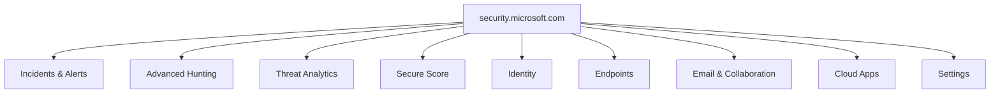
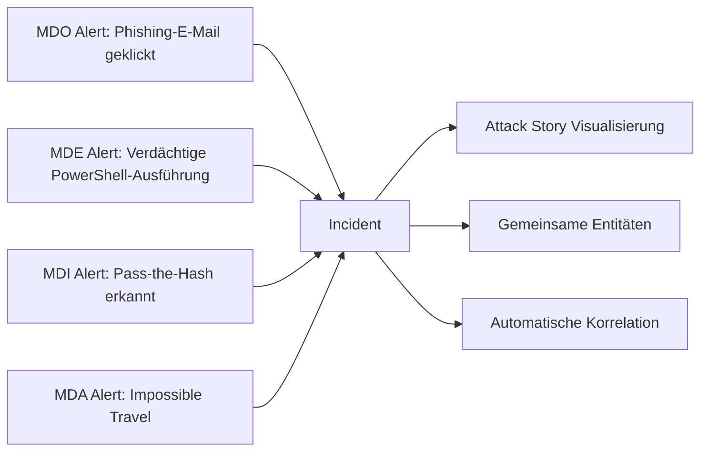
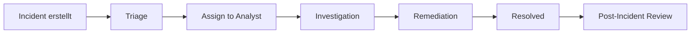
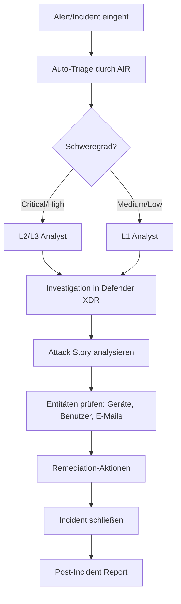

---
tags:
  - microsoft365
  - security
  - defender
  - xdr
  - soc
  - incident-response
aliases:
  - Defender XDR
  - Microsoft 365 Defender
  - M365 Defender
---

# Microsoft Defender XDR

> [!ABSTRACT] TL;DR
> Microsoft Defender XDR (Extended Detection and Response) ist die Unified Security Operations Platform von Microsoft, die alle Defender-Workloads (Endpoint, Office 365, Identity, Cloud Apps, Entra ID) in einem einzigen Portal korreliert. Es ermöglicht cross-workload Incident-Analyse, Advanced Hunting mit KQL und automatisierte Incident-Reaktion.

---

## Was ist Microsoft Defender XDR?

Defender XDR (früher Microsoft 365 Defender) ist das zentrale Security-Portal unter `security.microsoft.com`. Es bündelt Signale aller integrierten Defender-Workloads und korreliert sie zu einheitlichen Incidents.

**Integrierte Workloads:**
- **Microsoft Defender for Endpoint (MDE)** — Geräteschutz
- **Microsoft Defender for Office 365 (MDO)** — E-Mail-Schutz
- **Microsoft Defender for Identity (MDI)** — AD/Identitätsschutz
- **Microsoft Defender for Cloud Apps (MDA)** — Cloud-App-Schutz
- **Microsoft Entra ID Protection** — Identity Risk Detection
- **Microsoft Defender for Cloud** — Azure/Multi-Cloud-Schutz

---

## Unified Portal — security.microsoft.com

Das Portal bietet eine einheitliche Oberfläche für alle Security-Aktivitäten:



---

## Incident-Korrelation

Das Kernmerkmal von Defender XDR: Einzelne Alerts aus verschiedenen Workloads werden automatisch zu einem **Incident** zusammengefasst.

### Korrelationslogik


### Korrelations-Grundlage
- Gemeinsamer **Benutzer** (gleiche E-Mail, gleicher Account)
- Gemeinsames **Gerät** (Hostname, IP-Adresse)
- Gemeinsame **URL/Datei** (Hash, Domain)
- Zeitliche **Nähe** der Ereignisse

---

## Incident-Verwaltung

### Incident-Queue
Die Incident-Queue zeigt alle aktiven Incidents sortiert nach Schweregrad und Zeit:

| Feld | Beschreibung |
|------|-------------|
| **Severity** | Critical, High, Medium, Low, Informational |
| **Status** | Active, In Progress, Resolved |
| **Categories** | Credential Access, Lateral Movement, Execution, etc. |
| **Assigned to** | SOC-Analyst zugewiesen |
| **Tags** | Eigene Tags für Workflow |

### Incident-Lifecycle


### Incident-Seite enthält
- **Attack Story**: Visuelle Darstellung der Angriffskette
- **Alerts**: Alle korrelierte Alerts
- **Assets**: Betroffene Geräte, Benutzer, Postfächer
- **Investigations**: Laufende AIR-Untersuchungen
- **Evidence**: Gesammelte Artefakte
- **Response**: Empfohlene Maßnahmen

---

## Advanced Hunting — KQL

Advanced Hunting ermöglicht proaktive Bedrohungssuche über alle Daten der letzten **30 Tage**.

### Verfügbare Tabellen (Schemas)

| Schema | Tabelle | Inhalt |
|--------|---------|--------|
| **Endpoint** | `DeviceEvents` | Geräteereignisse |
| **Endpoint** | `DeviceProcessEvents` | Prozess-Starts |
| **Endpoint** | `DeviceNetworkEvents` | Netzwerkverbindungen |
| **Endpoint** | `DeviceFileEvents` | Dateioperationen |
| **Endpoint** | `DeviceLogonEvents` | Anmeldeereignisse |
| **Endpoint** | `DeviceRegistryEvents` | Registry-Änderungen |
| **Email** | `EmailEvents` | E-Mail-Metadaten |
| **Email** | `EmailUrlInfo` | URLs in E-Mails |
| **Email** | `EmailAttachmentInfo` | Anhang-Informationen |
| **Email** | `EmailPostDeliveryEvents` | Post-Delivery-Aktionen |
| **Identity** | `IdentityLogonEvents` | Authentifizierungen |
| **Identity** | `IdentityQueryEvents` | AD-Abfragen |
| **Identity** | `IdentityDirectoryEvents` | AD-Änderungen |
| **Cloud Apps** | `CloudAppEvents` | Cloud-App-Aktivitäten |
| **Alerts** | `AlertInfo` | Alert-Metadaten |
| **Alerts** | `AlertEvidence` | Alert-Evidenz |

### Beispielabfragen

```kusto
// Phishing-E-Mails der letzten 7 Tage mit Klick-Daten
EmailEvents
| where Timestamp > ago(7d)
| where ThreatTypes has "Phish"
| join EmailUrlInfo on NetworkMessageId
| where UrlChain has "clicked"
| project Timestamp, SenderFromAddress, RecipientEmailAddress, Subject, Url
| limit 50

// Verdächtige Prozess-Ausführungen (encoded PowerShell)
DeviceProcessEvents
| where Timestamp > ago(24h)
| where ProcessCommandLine has_any ("-enc", "-EncodedCommand", "IEX", "Invoke-Expression")
| project Timestamp, DeviceName, AccountName, ProcessCommandLine, InitiatingProcessFileName

// Lateral Movement via PsExec
DeviceEvents
| where Timestamp > ago(7d)
| where ActionType == "ServiceInstalled"
| where FileName =~ "PSEXESVC.exe" or InitiatingProcessFileName =~ "psexec.exe"
| project Timestamp, DeviceName, AccountName, RemoteIP

// Benutzer mit Impossible Travel (MDA)
CloudAppEvents
| where Timestamp > ago(7d)
| where ActionType == "Login" and Application == "Microsoft Teams"
| summarize Locations = make_set(CountryCode), LoginCount = count() by AccountDisplayName
| where array_length(Locations) > 2
```

---

## Custom Detection Rules

Custom Detection Rules basieren auf Advanced Hunting-Abfragen und generieren automatisch Alerts.

```kusto
// Beispiel: Regel für USB-Massendownload erkennen
DeviceEvents
| where ActionType == "UsbDriveMounted"
| join (
    DeviceFileEvents
    | where ActionType == "FileCreated"
    | where FolderPath startswith "E:\\" or FolderPath startswith "F:\\"
    | summarize FileCount = count(), TotalSize = sum(FileSize) by DeviceId, bin(Timestamp, 1h)
    | where FileCount > 50
) on DeviceId
| project Timestamp, DeviceName, AccountName, FileCount, TotalSize
```

---

## Threat Analytics

Threat Analytics bietet kuratierte Threat Intelligence Reports zu aktuellen Bedrohungen.

### Report-Typen
- **Threat Actor Reports**: Profile bekannter APT-Gruppen
- **Campaign Reports**: Laufende Angriffskampagnen
- **Vulnerability Reports**: Kritische CVEs und Ausnutzung
- **Technique Reports**: MITRE ATT&CK Techniken

### Report-Inhalte
- Analyst-Bericht: Hintergrundinformationen
- Indicators of Compromise (IOCs)
- MITRE ATT&CK-Mapping
- Mitigation-Empfehlungen
- **Impact Assessment**: Wie viele Geräte/Benutzer im Tenant betroffen?

---

## Automated Investigation and Response (AIR) — Cross-Workload

AIR reagiert automatisch auf Incidents über alle Workloads:

| Trigger | Workload | Automatische Aktion |
|---------|----------|---------------------|
| Phishing erkannt | MDO | E-Mails aus Postfächern entfernen |
| Malware auf Gerät | MDE | Gerät isolieren, Datei in Quarantäne |
| Kompromittiertes Konto | MDI | Benutzer-Passwort-Reset anfordern |
| Verdächtige OAuth-App | MDA | App-Berechtigungen widerrufen |

---

## Microsoft Secure Score

Secure Score bewertet die Sicherheitskonfiguration des Tenants auf einer Skala von 0–100%:

- **Improvement Actions**: Konkrete Maßnahmen mit Punktwert
- **Kategorien**: Identity, Devices, Apps, Data, Infrastructure
- **Vergleich**: Branchenvergleich und Zeitverlauf

---

## Unified RBAC

Defender XDR nutzt ein einheitliches Role-Based Access Control System:

| Rolle | Berechtigung |
|-------|-------------|
| Security Administrator | Voller Zugriff auf alle Security-Features |
| Security Operator | Incidents verwalten, keine Konfiguration |
| Security Reader | Nur-Lesen-Zugriff |
| Global Administrator | Alles (sollte vermieden werden) |
| Custom Roles | Granulare Berechtigungen definierbar |

> [!WARNING]
> Verwende **Least Privilege**: Weise Analysten nur die Rollen zu, die sie für ihre Aufgaben benötigen. Nutze **PIM** (Privileged Identity Management) für zeitgebundene Rollen-Aktivierung.

---

## SOC-Workflow mit Defender XDR



---

## Via Microsoft Defender Portal (UI)

### Incident untersuchen und verwalten

1. Öffne **Microsoft Defender Portal** unter [security.microsoft.com](https://security.microsoft.com)
2. Navigiere zu **Incidents & Warnungen → Incidents**
3. Klicke auf ein Incident für die Detailansicht:
   - **Übersicht:** Betroffene Assets, Schweregrad, Status
   - **Angriffsverlauf:** Visueller Attack Graph
   - **Warnungen:** Alle zugehörigen Alerts
   - **Assets:** Betroffene Geräte, Benutzer, Postfächer
4. Weise den Incident einem Analysten zu über **Zuweisen**
5. Setze den Status auf **In Bearbeitung** und wähle eine Klassifizierung

### Custom Detection Rule erstellen

1. Navigiere zu **Hunting → Benutzerdefinierte Erkennungen**
2. Klicke auf **+ Regel erstellen**
3. Gib eine **KQL-Abfrage** ein und klicke auf **Ergebnisse ausführen**
4. Konfiguriere:
   - **Häufigkeit:** Ausführungsintervall festlegen
   - **Aktionen:** Alert erstellen, Datei isolieren, etc.
5. Klicke auf **Speichern**

> [!TIP]
> Nutze **Threat Analytics** unter **Bedrohungsanalyse**, um aktuelle Bedrohungsberichte von Microsoft Research zu lesen und eigene Exposure-Bewertungen einzusehen.

---

## Lizenzierung

| Lizenz | Defender XDR-Abdeckung |
|--------|------------------------|
| Microsoft 365 E5 | Vollständig (MDE P2 + MDO P2 + MDI + MDA) |
| Microsoft 365 E5 Security | Vollständig |
| Microsoft 365 E3 | Nur eingeschränkte Features (MDO P1, MDE P1) |
| Microsoft 365 Business Premium | Defender for Business (vereinfacht) |

---

## Verwandte Notizen
- [[Microsoft Defender for Endpoint]]
- [[Microsoft Defender for Office 365]]
- [[Microsoft Defender for Identity]]
- [[Microsoft Defender for Cloud Apps]]
- [[Microsoft Sentinel]]
- [[Microsoft Secure Score]]
