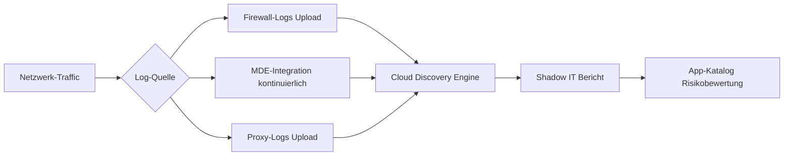
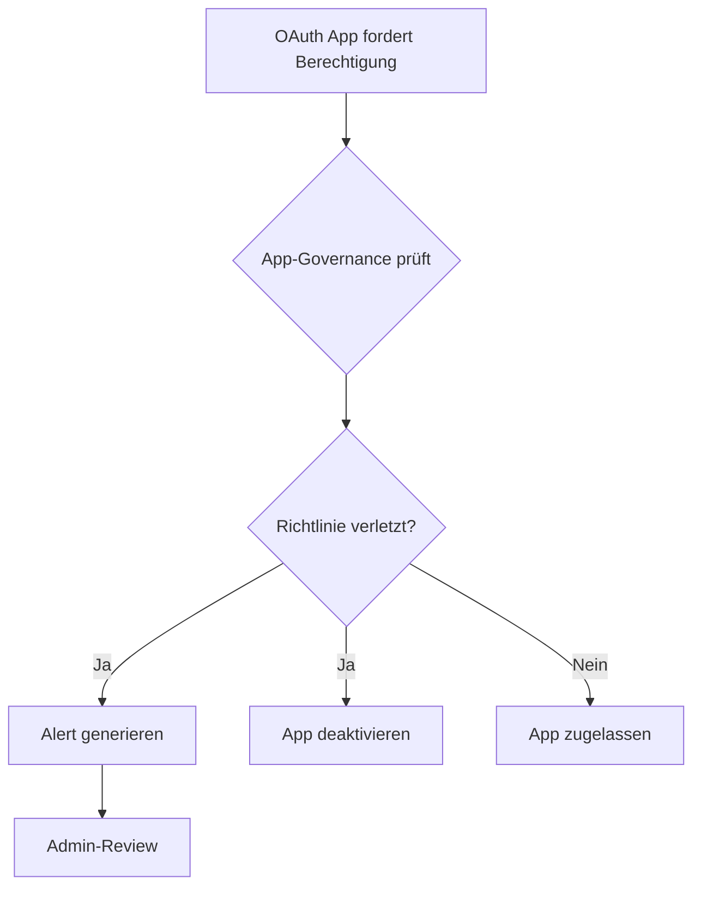
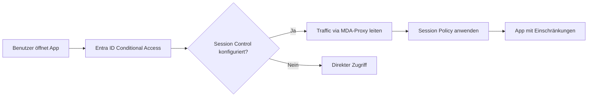
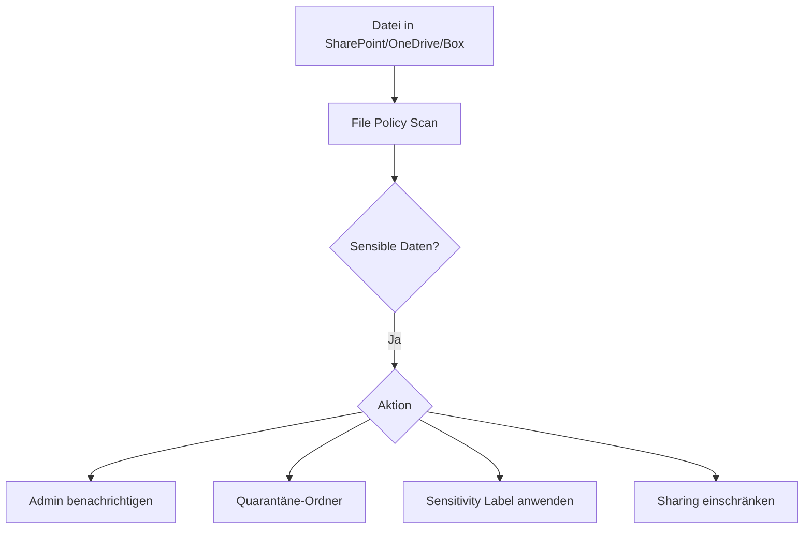

---
tags:
  - microsoft365
  - security
  - defender
  - casb
  - cloud-apps
  - shadow-it
aliases:
  - MCAS
  - MDA
  - Defender for Cloud Apps
---

# Microsoft Defender for Cloud Apps

> [!ABSTRACT] TL;DR
> Microsoft Defender for Cloud Apps (MDA, früher MCAS) ist Microsofts Cloud Access Security Broker (CASB). Es bietet Sichtbarkeit über Shadow IT, kontrolliert OAuth-Apps, schützt Daten in Cloud-Diensten und ermöglicht Session-Kontrollen über Conditional Access App Control.

---

## Was ist Microsoft Defender for Cloud Apps?

MDA ist ein CASB (Cloud Access Security Broker), der zwischen Cloud-Diensten und Benutzern vermittelt. Es löst das Problem der unkontrollierten Cloud-Nutzung (Shadow IT) und schützt Unternehmensdaten in genehmigten Cloud-Anwendungen.

**Vier CASB-Säulen:**

| Säule | Beschreibung |
|-------|-------------|
| **Visibility** | Alle Cloud-Dienste sehen, auch ungenehmigt |
| **Compliance** | Datenschutz und regulatorische Anforderungen |
| **Data Security** | DLP in Cloud Apps, Dateischutz |
| **Threat Protection** | Anomalie-Erkennung, Malware-Schutz |

---

## Cloud Discovery — Shadow IT

### Funktionsweise
Cloud Discovery analysiert Traffic-Logs, um alle genutzten Cloud-Dienste zu identifizieren.



### Traffic-Analyse-Methoden
1. **Log-Upload** (manuell oder automatisch): Logs von Firewall/Proxy
2. **MDE-Integration**: Kontinuierliche automatische Entdeckung über MDE-Agenten (empfohlen)
3. **API-Verbindung**: Direkte Integration mit Network Appliances

### App-Katalog
- **30.000+ Cloud-Apps** katalogisiert
- **Risiko-Score** (0–10) basierend auf 90+ Faktoren:
  - GDPR-Compliance
  - ISO 27001 Zertifizierung
  - SOC 2
  - Datenverschlüsselung
  - Zugriffskontrolle
  - Unternehmensstandort

### App-Status setzen
| Status | Beschreibung |
|--------|-------------|
| **Genehmigt** | Explizit erlaubt, MDE blockiert nicht |
| **Nicht genehmigt** | Blockiert (bei MDE-Integration) |
| **Nicht markiert** | Keine Aktion |
| **Überwacht** | Aktivitäten werden protokolliert |

---

## App-Governance

App-Governance überwacht und steuert OAuth-Apps in Microsoft 365.

### OAuth-App-Verwaltung
- Inventar aller genehmigten OAuth-Apps im Tenant
- Berechtigungs-Analyse (welche Apps haben zu viele Rechte?)
- Consent-Überwachung (wer hat welcher App zugestimmt?)
- Automatische Richtlinien für App-Verhalten

### App-Governance-Richtlinien


---

## Cloud App Connector (API-Integration)

App-Connectors stellen eine direkte API-Verbindung zu unterstützten Diensten her und ermöglichen tiefere Sichtbarkeit.

### Unterstützte Connectors (Auswahl)
| Service | Funktionen |
|---------|-----------|
| **Microsoft 365** | Exchange, SharePoint, Teams, OneDrive, Entra ID |
| **Salesforce** | CRM-Aktivitäten, Dateizugriff |
| **AWS** | S3-Buckets, IAM, CloudTrail |
| **GitHub** | Repository-Aktivitäten, Code-Zugriff |
| **Google Workspace** | Drive, Gmail, Admin-Aktivitäten |
| **Dropbox** | Dateiaktivitäten, Sharing |
| **ServiceNow** | Ticket-Aktivitäten |
| **Okta** | Authentifizierungsereignisse |
| **Box** | Dateioperationen |

---

## Conditional Access App Control

Conditional Access App Control nutzt Entra ID Conditional Access als Reverse Proxy für Session-Kontrollen.

### Funktionsweise


### Voraussetzungen
- Entra ID P1/P2
- Conditional Access Policy mit Session Control
- App als "Conditional Access App Control App" konfiguriert

---

## Session Policies

Session Policies kontrollieren, was Benutzer in einer App-Session tun dürfen.

| Richtlinientyp | Beschreibung |
|----------------|-------------|
| **Block Download** | Download von Dateien blockieren (z.B. auf nicht-verwalteten Geräten) |
| **Block Upload** | Upload zu Cloud-Apps blockieren |
| **Protect on Download** | Sensitivity Label beim Download anwenden |
| **Inspect Content** | DLP-Scan von hochgeladenen/heruntergeladenen Dateien |
| **Block Cut/Copy/Paste** | Zwischenablage-Aktionen verhindern |
| **Block Print** | Drucken verhindern |
| **Monitor** | Alle Aktivitäten protokollieren |

### Beispiel: Unmanaged Device Policy
```
Wenn: Benutzer greift auf SharePoint über unbekanntes Gerät zu
Dann: Download blockieren, Kopieren blockieren
Ziel: Daten auf unbekannten Geräten schützen
```

---

## Access Policies

Access Policies blockieren den Zugriff auf bestimmte Apps basierend auf Kontextbedingungen.

**Bedingungen:**
- Gerät: Managed/Unmanaged, Compliance-Status
- Benutzer: Gruppe, Rolle, Risikostufe
- App: Risiko-Score, Kategorie
- Netzwerk: IP-Adresse, Land
- Tag: Real-time erkannte Aktivität

---

## Activity Policies

Activity Policies erkennen anomale Aktivitäten in verbundenen Apps.

**Beispiele:**
- Massenzugriff auf Dateien in SharePoint
- Admin-Aktivitäten von ungewöhnlichem Standort
- Mehrere fehlgeschlagene Logins gefolgt von Erfolg
- Download von großen Datenmengen

---

## File Policies (DLP in Cloud Apps)

File Policies scannen Dateien in verbundenen Cloud-Apps auf sensible Inhalte.



**Erkennbare Daten:**
- Sensitivity Labels
- Sensitive Information Types (IBAN, Kreditkarten, etc.)
- Freigabe-Status (öffentlich zugänglich)

---

## Anomaly Detection

MDA erkennt automatisch verdächtiges Verhalten ohne Richtlinien-Konfiguration:

| Erkennung | Beschreibung |
|-----------|-------------|
| **Impossible Travel** | Login von zwei Orten, die physisch unmöglich sind |
| **Activity from anonymous IP** | Tor, VPN-Exit-Node |
| **Malware Detection** | Schädliche Dateien in Cloud-Speicher |
| **Ransomware Activity** | Massenweise Dateiverschlüsselung/-löschung |
| **Impossible Travel for Admin** | Admin-Aktivität von unmöglichem Ort |
| **OAuth App anomalies** | Ungewöhnliches App-Verhalten |
| **Mass Download** | Massendownload von Dateien |
| **Unusual ISP** | Login von unbekanntem ISP |

---

## Integration mit Defender XDR

MDA ist vollständig in security.microsoft.com integriert:

- **Cloud App Events** in Advanced Hunting (`CloudAppEvents`)
- **MDA-Alerts** werden in Defender XDR-Incidents korreliert
- **User Investigation**: Alle Cloud-App-Aktivitäten im Benutzer-Profil
- **MCAS-Portal** (legacy) → Wird zu Defender XDR migriert

```kusto
// MDA - Impossible Travel Detection
CloudAppEvents
| where Timestamp > ago(7d)
| where ActionType == "ImpossibleTravel"
| project Timestamp, AccountId, AccountDisplayName, CountryCode, City, IPAddress
| limit 50
```

---

## Via Microsoft Defender Portal (UI)

### App-Richtlinie erstellen

1. Öffne **Microsoft Defender Portal** unter [security.microsoft.com](https://security.microsoft.com)
2. Navigiere zu **Cloud-Apps → Richtlinien → Richtlinienverwaltung**
3. Klicke auf **+ Richtlinie erstellen** und wähle den Richtlinientyp:
   - **Aktivitätsrichtlinie:** Zur Überwachung spezifischer Cloud-Aktivitäten
   - **Dateirichtlinie:** Für DLP in Cloud-Apps
   - **Sitzungsrichtlinie:** Für Echtzeit-Kontrolle via CASB
4. Konfiguriere:
   - **Name:** Aussagekräftiger Richtlinienname
   - **Filter:** App, Benutzer, IP-Adresse, Aktivitätstyp festlegen
   - **Schweregrad:** Niedrig, Mittel oder Hoch
   - **Aktionen:** Blockieren, Benachrichtigung, Governanceaktion
5. Klicke auf **Erstellen**

### Shadow IT entdecken

1. Navigiere zu **Cloud-Apps → Cloud Discovery → Dashboard**
2. Überprüfe entdeckte Apps und kategorisiere sie
3. Klicke auf eine App und wähle **Als genehmigt markieren** oder **Als nicht genehmigt markieren**

> [!TIP]
> Aktiviere die **Microsoft Defender for Endpoint Integration** unter **Einstellungen → Cloud Apps → Microsoft Defender for Endpoint**, um Shadow IT auch auf verwalteten Endpunkten zu erkennen.

---

## Lizenzierung

| Lizenz | MDA-Abdeckung |
|--------|--------------|
| Microsoft 365 E5 | ✅ Vollständig enthalten |
| Microsoft 365 E5 Security | ✅ Vollständig enthalten |
| Enterprise Mobility + Security E5 | ✅ Vollständig enthalten |
| Microsoft 365 E3 | ❌ Nicht enthalten |
| Defender for Cloud Apps (Standalone) | ✅ Separat kaufbar |

> [!NOTE]
> Conditional Access App Control benötigt zusätzlich **Entra ID P1** für Conditional Access.

---

## Verwandte Notizen
- [[Microsoft Defender XDR]]
- [[Sensitivity Labels]]
- [[Data Loss Prevention DLP]]
- [[Microsoft Secure Score]]
