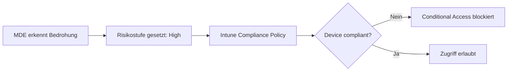

---
tags:
  - microsoft365
  - security
  - defender
  - endpoint
  - edr
aliases:
  - MDE
  - Defender for Endpoint
---

# Microsoft Defender for Endpoint

> [!ABSTRACT] TL;DR
> Microsoft Defender for Endpoint (MDE) ist eine Enterprise-Endpoint-Security-Plattform mit EDR, Next-Gen-Antivirus, Attack Surface Reduction und Threat & Vulnerability Management. Plan 2 bietet vollständige EDR-Funktionalität, automatisierte Untersuchungen und Advanced Hunting via KQL.

---

## Was ist Microsoft Defender for Endpoint?

MDE ist eine cloud-native Endpoint Detection and Response (EDR)-Lösung, die Windows, macOS, Linux, iOS und Android-Geräte schützt. Sie bietet:

- **Präventive Maßnahmen**: Next-Gen Antivirus, ASR-Rules, Network Protection
- **Erkennung**: EDR, Verhaltensanalyse, ML-basierte Erkennung
- **Reaktion**: Automatisierte Untersuchung, Live Response, Isolierung
- **Übersicht**: Threat & Vulnerability Management, Secure Score for Devices

---

## Plan-Vergleich

| Feature | Defender for Business | Plan 1 (MDE P1) | Plan 2 (MDE P2) |
|---------|----------------------|-----------------|-----------------|
| Next-Gen Antivirus | ✅ | ✅ | ✅ |
| Attack Surface Reduction | ✅ | ✅ | ✅ |
| Device Control | ❌ | ✅ | ✅ |
| Network Protection | ✅ | ✅ | ✅ |
| Web Content Filtering | ❌ | ✅ | ✅ |
| EDR (Endpoint Detection & Response) | Vereinfacht | ❌ | ✅ |
| Threat & Vulnerability Management | Vereinfacht | ❌ | ✅ |
| Automated Investigation & Remediation | Vereinfacht | ❌ | ✅ |
| Advanced Hunting (KQL) | ❌ | ❌ | ✅ |
| Live Response | ❌ | ❌ | ✅ |
| Threat Analytics | ❌ | ❌ | ✅ |
| Microsoft Secure Score for Devices | ❌ | ❌ | ✅ |
| Zielgruppe | SMB (bis 300 User) | Enterprise | Enterprise |

---

## Onboarding-Methoden

### Unterstützte Plattformen
- Windows 10/11, Windows Server 2012 R2+
- macOS 11+, Linux (RHEL, Ubuntu, Debian, etc.)
- iOS, Android (via Intune)

### Methode 1: Microsoft Intune (empfohlen)
```powershell
# Wird über Intune-Gerätekonfigurationsprofil gesteuert
# Endpoint Security → Endpoint Detection and Response → Onboarding
```

### Methode 2: Group Policy Object (GPO)
```
Paket herunterladen aus: security.microsoft.com → Settings → Endpoints → Onboarding
GPO-Pfad: Computer Configuration → Administrative Templates → Windows Components → Microsoft Defender Antivirus → MAPS
```

### Methode 3: Microsoft Configuration Manager (SCCM/MEM)
- Über Compliance Policy und Endpoint Protection Profil
- Unterstützt Massendeployment in großen Umgebungen

### Methode 4: Lokales Skript (Test/Einzelgeräte)
```powershell
# WindowsDefenderATPOnboardingScript.cmd ausführen (als Admin)
# Aus dem Defender-Portal heruntergeladen
```

### Methode 5: VDI (Virtual Desktop Infrastructure)
- Goldimage onboarden, dann Klon-Konfiguration
- Persistent vs. Non-Persistent VDI unterschiedliche Vorgehensweise
- `VDIClientResources.zip` aus dem Portal für Non-Persistent VDIs

---

## Endpoint Detection and Response (EDR) — Plan 2

EDR erfasst Geräte-Telemetrie und ermöglicht Incident-Analyse und Response.

### Alerts und Incidents
- **Alerts**: Einzelne Erkennungsereignisse (z.B. Malware-Ausführung)
- **Incidents**: Korrelierte Sammlung von Alerts auf mehreren Geräten/Benutzern
- **Severity**: Informational, Low, Medium, High

### Machine Timeline
Die Timeline zeigt chronologisch alle Aktivitäten auf einem Gerät:
- Prozess-Starts und -Beendigungen
- Netzwerkverbindungen
- Registry-Änderungen
- Dateioperationen
- Anmeldeereignisse


---

## Attack Surface Reduction (ASR Rules)

ASR-Rules blockieren risikobehaftete Verhaltensweisen, die häufig bei Angriffen genutzt werden.

### Betriebsmodi
| Modus | Beschreibung |
|-------|-------------|
| **Audit** | Ereignisse werden protokolliert, keine Blockierung |
| **Block** | Aktionen werden blockiert |
| **Warn** | Benutzer erhält Warnung, kann Override nutzen |
| **Disabled** | Regel deaktiviert |

### Wichtige ASR-Regeln

| Regelname | GUID | Beschreibung |
|-----------|------|-------------|
| Block Office apps from creating child processes | `D4F940AB-401B-4EFC-AADC-AD5F3C50688A` | Verhindert Office-Makro-Malware |
| Block credential stealing from LSASS | `9E6C4E1F-7D60-472F-BA1A-A39EF669E4B0` | Schützt vor Credential Harvesting |
| Block executable content from email | `BE9BA2D9-53EA-4CDC-84E5-9B1EEEE46550` | Blockiert Ausführung aus E-Mail-Anhängen |
| Block Office macros from Win32 API calls | `92E97FA1-2EDF-4476-BDD6-9DD0B4DDDC7B` | Verhindert Makro-Missbrauch |
| Block abuse of exploited vulnerable signed drivers | `56A863A9-875E-4185-98A7-B882C64B5CE5` | Blockiert verwundbare Treiber |
| Use advanced protection against ransomware | `C1DB55AB-C21A-4637-BB3F-A12568109D35` | Ransomware-Schutz |
| Block process creations from PSExec and WMI | `D1E49AAC-8F56-4280-B9BA-993A6D77406C` | Verhindert Lateral Movement |
| Block JavaScript or VBScript from launching downloaded content | `D3E037E1-3EB8-44C8-A917-57927947596D` | Script-Missbrauch |

```powershell
# ASR-Regel im Audit-Modus aktivieren (Intune Alternative: via PowerShell)
Set-MpPreference -AttackSurfaceReductionRules_Ids D4F940AB-401B-4EFC-AADC-AD5F3C50688A `
                 -AttackSurfaceReductionRules_Actions AuditMode

# Alle ASR-Regeln anzeigen
Get-MpPreference | Select-Object AttackSurfaceReductionRules_Ids, AttackSurfaceReductionRules_Actions
```

---

## Threat & Vulnerability Management (TVM) — Plan 2

TVM inventarisiert installierte Software und Konfigurationen, bewertet Schwachstellen und priorisiert Remediations.

### Schlüsselkonzepte
- **Exposure Score**: Gesamtrisiko-Score des Unternehmens (0–100, niedriger = besser)
- **Microsoft Secure Score for Devices**: Konfigurations-Score
- **Security Recommendations**: Priorisierte Liste von Verbesserungen
- **Remediation Activities**: Verfolgt Patch- und Konfigurationsänderungen

### Schwachstellen-Priorisierung
TVM nutzt:
- CVE-Score (CVSS)
- Exploit-Verfügbarkeit (Exploit in the Wild)
- Betroffene Geräte im Tenant
- Auswirkung auf Exposure Score

---

## Next-Gen Protection

### Antivirus-Komponenten
| Komponente | Beschreibung |
|------------|-------------|
| **Echtzeit-Schutz** | Kontinuierliche Dateiüberwachung |
| **Cloud-basierter Schutz** | Microsoft Active Protection Service (MAPS) |
| **Verhaltensüberwachung** | Erkennt schädliches Verhalten |
| **PUA Protection** | Potentially Unwanted Applications |
| **Netzwerk-Inspektion** | Network Behavior Analysis |
| **AMSI** | Antimalware Scan Interface für Scripts |

---

## Device Control (USB-Richtlinien)

Kontrolliert den Zugriff auf Wechseldatenträger:

```powershell
# Removable Storage blockieren (über Intune oder PowerShell)
# Intune: Endpoint Security → Attack Surface Reduction → Device control

# PowerShell (lokal testen)
Set-MpPreference -DisableRemovableDriveScanning $false
```

### Kontroll-Optionen
- **Read Only**: Nur Lesen erlaubt
- **Block**: Vollständige Blockierung
- **Allow**: Zugriff erlaubt
- **Audit**: Protokollierung ohne Blockierung

---

## Network Protection

Schützt Geräte vor webbasierten Bedrohungen auf Netzwerkebene:

- Blockiert Verbindungen zu bösartigen IP-Adressen/Domains
- Verhindert Drive-by-Downloads
- Integration mit Microsoft Threat Intelligence

```powershell
# Network Protection aktivieren
Set-MpPreference -EnableNetworkProtection Enabled
# Audit-Modus für Tests
Set-MpPreference -EnableNetworkProtection AuditMode
```

---

## Web Content Filtering

Ermöglicht kategoriebasierte Web-Filterung:

| Kategorie | Beispiele |
|-----------|----------|
| Adult Content | Pornografie, Datierung |
| High Bandwidth | Video-Streaming, Downloads |
| Legal Liability | Hacking, illegale Software |
| Leisure | Social Media, Gaming |
| Uncategorized | Unbekannte Seiten |

---

## Automated Investigation & Remediation (AIR) — Plan 2

AIR untersucht automatisch Alerts und führt Gegenmaßnahmen durch:

1. Alert ausgelöst (z.B. Malware erkannt)
2. AIR analysiert Entitäten (Prozesse, Dateien, Netzwerkverbindungen)
3. Automatische Remediation (Datei in Quarantäne, Prozess beenden)
4. Genehmigung durch Admin bei einigen Aktionen

---

## Live Response — Plan 2

Remote-Shell-Verbindung zu Endpunkten für forensische Analyse:

```powershell
# In Live Response Session:
# Prozessliste anzeigen
processes

# Datei aus Gerät herunterladen
getfile C:\Windows\System32\suspicious.dll

# Datei in Quarantäne
quarantine C:\Users\user\Downloads\malware.exe

# Skript ausführen
run malware_triage.ps1

# Registry-Wert lesen
registry HKLM\SOFTWARE\Microsoft\Windows\CurrentVersion\Run
```

---

## Advanced Hunting — KQL Beispiele — Plan 2

### Wichtige Tabellen
| Tabelle | Inhalt |
|---------|--------|
| `DeviceEvents` | Allgemeine Geräteereignisse |
| `DeviceProcessEvents` | Prozess-Starts und -Beendigungen |
| `DeviceNetworkEvents` | Netzwerkverbindungen |
| `DeviceFileEvents` | Dateioperationen |
| `DeviceRegistryEvents` | Registry-Änderungen |
| `DeviceLogonEvents` | Anmeldeereignisse |
| `DeviceAlertEvents` | Generierte Alerts |

```kusto
// Powershell-Ausführungen der letzten 24h
DeviceProcessEvents
| where Timestamp > ago(24h)
| where FileName =~ "powershell.exe"
| where ProcessCommandLine contains "-enc" or ProcessCommandLine contains "-EncodedCommand"
| project Timestamp, DeviceName, AccountName, ProcessCommandLine
| limit 50

// Netzwerkverbindungen zu unbekannten IPs
DeviceNetworkEvents
| where Timestamp > ago(7d)
| where RemotePort in (4444, 1337, 31337)
| project Timestamp, DeviceName, RemoteIP, RemotePort, InitiatingProcessFileName
| limit 100

// USB-Gerät angeschlossen
DeviceEvents
| where Timestamp > ago(7d)
| where ActionType == "UsbDriveMounted"
| project Timestamp, DeviceName, AccountName, AdditionalFields
```

---

## Integration mit Intune (MDE-Connector)

Der MDE-Connector ermöglicht:
1. **Compliance-basierter bedingter Zugriff**: Nicht-konforme Geräte blockieren
2. **Risikosignal in Intune**: MDE-Risikostufe als Bedingung in Compliance-Richtlinien
3. **App Protection Policies**: Mobile Geräte basierend auf MDE-Risiko einschränken



---

## Lizenzierung

| Lizenz | MDE-Abdeckung |
|--------|--------------|
| Microsoft 365 Business Premium | Defender for Business |
| Microsoft 365 E3 | MDE Plan 1 |
| Microsoft 365 E5 | MDE Plan 2 |
| Microsoft 365 E5 Security | MDE Plan 2 |
| Windows E5 | MDE Plan 2 |
| MDE Plan 1 Add-on | Plan 1 |
| MDE Plan 2 Add-on | Plan 2 |

---

## Verwandte Notizen
- [[Microsoft Defender XDR]]
- [[Microsoft Secure Score]]
- [[Insider Risk Management]]
