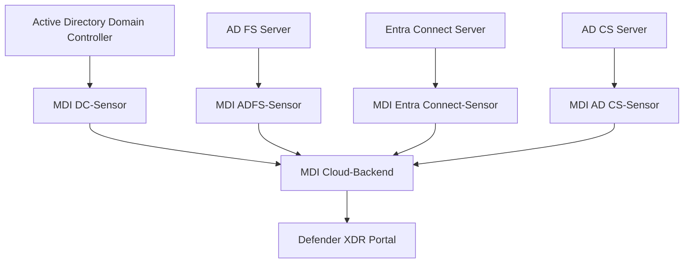
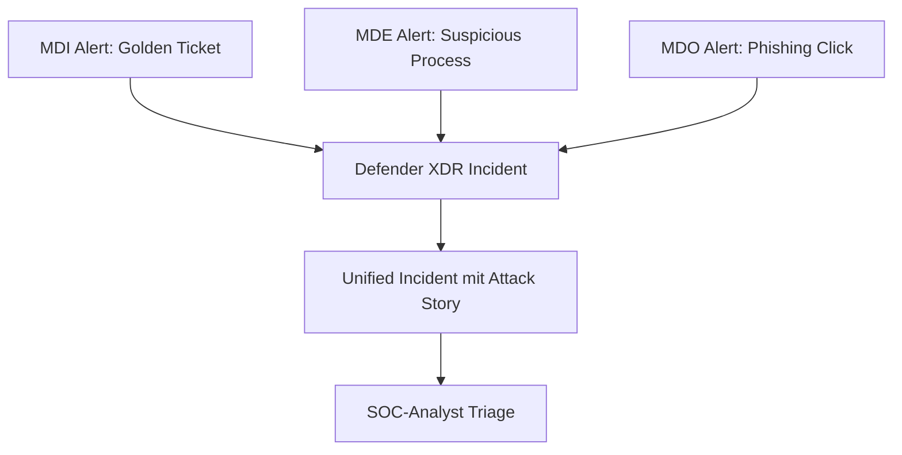

---
tags:
  - microsoft365
  - security
  - defender
  - identity
  - active-directory
aliases:
  - MDI
  - Defender for Identity
---

# Microsoft Defender for Identity

> [!ABSTRACT] TL;DR
> Microsoft Defender for Identity (MDI) schützt Active Directory-Umgebungen vor identitätsbasierten Angriffen. Leichtgewichtige Sensoren auf Domain Controllern erkennen Techniken wie Pass-the-Hash, DCSync, Kerberoasting und Lateral Movement — und integrieren sich vollständig in Microsoft Defender XDR.

---

## Was ist Microsoft Defender for Identity?

MDI (früher Azure Advanced Threat Protection / Azure ATP) ist ein cloudbasierter Sicherheitsdienst zum Schutz von On-Premises Active Directory-Infrastrukturen. Es überwacht AD-Ereignisse und Netzwerkverkehr, um Angriffe auf Identitäten zu erkennen und darauf zu reagieren.

**Kernfunktionen:**
- Erkennung von Identitätsangriffen (Credential Theft, Lateral Movement, Domain Dominance)
- Verhaltensbaseline für Benutzer und Geräte
- ITDR (Identity Threat Detection and Response)
- Integration in Defender XDR für unified Incidents
- Security Posture Assessments für AD-Konfiguration

---

## Sensor-Architektur



### Domain Controller Sensor
- Direktinstallation auf dem DC (kein separater Server nötig)
- Analysiert Windows Event Logs, ETW-Traces und Netzwerkverkehr
- Nutzt Windows Filtering Platform (WFP) für Netzwerk-Monitoring
- Minimaler Impact auf DC-Performance (empfohlen: max. 15% CPU-Auslastung)

### AD FS Sensor
- Erkennt Authentifizierungsangriffe gegen AD FS
- Überwacht Federation Service Events

### Entra Connect Sensor (neu 2024)
- Überwacht Synchronisierungsaktivitäten zwischen AD und Entra ID
- Erkennt verdächtige Writeback-Operationen

### AD CS Sensor
- Überwacht Active Directory Certificate Services
- Erkennt missbräuchliche Zertifikatsausstellung (ESC-Techniken)

---

## Installation und Konfiguration

### Voraussetzungen
| Komponente | Anforderung |
|------------|-------------|
| Betriebssystem | Windows Server 2012 R2+ |
| .NET Framework | 4.7+ |
| Speicher | min. 2 GB RAM für Sensor |
| Netzwerk | Port 443 zu `*.atp.azure.com` |
| Service Account | gMSA (Group Managed Service Account) empfohlen |
| Windows Event Log | Event IDs 4776, 4724, 4625, 4768, 4769, 7045, 8004 |

### gMSA einrichten
```powershell
# gMSA erstellen
New-ADServiceAccount -Name "MDISvc" `
    -DNSHostName "MDISvc.contoso.com" `
    -PrincipalsAllowedToRetrieveManagedPassword "Domain Controllers" `
    -KerberosEncryptionType AES256

# gMSA auf DC installieren
Install-ADServiceAccount -Identity "MDISvc"

# Sensor-Installation (auf DC ausführen)
.\Azure ATP sensor Setup.exe /quiet NetFrameworkCommandLineArguments="/q"
```

### Sensor-Konfiguration in Defender XDR
1. `security.microsoft.com` → Settings → Identities
2. Workspace erstellen oder auswählen
3. Onboarding-Paket herunterladen
4. Sensor-Setup auf DC ausführen
5. Service Account konfigurieren (gMSA oder Domänenbenutzer)

---

## Erkannte Angriffstechniken

### Reconnaissance (Erkundungsphase)

| Angriff | Beschreibung | MITRE |
|---------|-------------|-------|
| **LDAP Reconnaissance** | Massenabfragen des AD via LDAP | T1018 |
| **SMB Session Enumeration** | Auflistung offener SMB-Sessions | T1049 |
| **SAMR Enumeration** | Benutzer/Gruppen via SAM Remote Protocol | T1069 |
| **DNS Reconnaissance** | Massenzonen-Transfers oder DNS-Abfragen | T1018 |
| **Network Mapping** | Port-Scans und Service Discovery | T1046 |

### Credential Access (Zugangsdaten stehlen)

| Angriff | Beschreibung | MITRE |
|---------|-------------|-------|
| **Pass-the-Hash (PtH)** | NTLM-Hash statt Passwort verwenden | T1550.002 |
| **Pass-the-Ticket (PtT)** | Kerberos-Ticket stehlen und wiederverwenden | T1550.003 |
| **Kerberoasting** | Service Ticket anfordern, offline knacken | T1558.003 |
| **AS-REP Roasting** | Pre-Auth deaktiviert → Hash ohne Passwort | T1558.004 |
| **DCSync** | Domänen-Replikation vortäuschen, Hashes extrahieren | T1003.006 |
| **NTLM Relay** | NTLM-Authentifizierung abfangen und weiterleiten | T1557.001 |

### Lateral Movement

| Angriff | Beschreibung | MITRE |
|---------|-------------|-------|
| **Remote Execution (PSExec/WMI)** | Ungewöhnliche Remoteausführung | T1569.002 |
| **Pass-the-Ticket Lateral Movement** | Kerberos-Ticket für anderen Host | T1550.003 |
| **Remote Desktop (anomal)** | RDP von ungewöhnlichem Quellhost | T1021.001 |

### Domain Dominance (Domänen-Übernahme)

| Angriff | Beschreibung | MITRE |
|---------|-------------|-------|
| **Golden Ticket** | Gefälschtes Kerberos TGT mit KRBTGT-Hash | T1558.001 |
| **Silver Ticket** | Gefälschtes Service Ticket | T1558.002 |
| **Skeleton Key** | Malware injiziert Generalschlüssel in LSASS | T1556.001 |
| **DCShadow** | Bösartiger Domain Controller vorgetäuscht | T1207 |
| **AdminSDHolder Manipulation** | SDHolder-Objekt für Persistence | T1078.002 |
| **SID History Injection** | Privilegien über SID-History-Attribut | T1134.005 |

---

## Alert-Phasen

MDI kategorisiert Alerts in Attack-Kill-Chain-Phasen:


| Phase | Schweregrad | Beispiel-Alerts |
|-------|-------------|----------------|
| Reconnaissance | Medium | LDAP-Enumeration, SAMR-Scan |
| Credential Access | High | Kerberoasting, Pass-the-Hash |
| Lateral Movement | High | Pass-the-Ticket, Remote Execution |
| Domain Dominance | Critical | Golden Ticket, DCSync, DCShadow |

---

## Verhaltensbaseline (UEBA)

MDI erstellt automatisch Verhaltensprofile für Benutzer und Geräte:

- **Normale Anmeldezeiten** (z.B. Mo–Fr 8–18 Uhr)
- **Typische Quell-Hosts** für Authentifizierungen
- **Ressourcen**, auf die regulär zugegriffen wird
- **Netzwerkverhalten** (Protokolle, Verbindungen)

Abweichungen von der Baseline erhöhen den **Investigation Priority Score**.

---

## Integration mit Defender XDR

MDI ist vollständig in security.microsoft.com integriert:

- **Identity-Tab** in Incidents: Zeigt alle beteiligten Benutzerkonten
- **User Account-Seite**: Timeline aller Aktivitäten eines Benutzers
- **Unified Incidents**: MDI-Alerts werden mit MDE/MDO-Alerts korreliert
- **Identity Timeline**: Chronologische Ansicht aller Authentifizierungsereignisse



---

## Honey Tokens

Honey Tokens sind Köder-Konten, die keine legitimen Dienste nutzen. Jede Aktivität mit diesen Konten löst sofort einen Alert aus.

```powershell
# Honey Token in Defender XDR konfigurieren
# Settings → Identities → Honey Tokens
# Benutzer oder Computer-Objekte als Honey Token markieren
```

**Best Practices:**
- Kontonamen wählen, die attraktiv für Angreifer sind (z.B. `admin_backup`, `svc_sql`)
- Konto darf NICHT für legitime Dienste verwendet werden
- SPN kann gesetzt werden, um Kerberoasting anzulocken

---

## ITDR (Identity Threat Detection and Response)

MDI ist Microsofts primäre ITDR-Lösung:

- **Erkennung**: Alle oben genannten Angriffstechniken
- **Untersuchung**: Unified Investigation Experience in Defender XDR
- **Reaktion**: Benutzer sperren, Passwort zurücksetzen, Konto deaktivieren
- **Prävention**: Security Posture Assessments (Schwachstellen in AD erkennen)

### Security Posture Assessments
MDI bewertet AD-Konfiguration und gibt Empfehlungen:
- Pre-Auth deaktiviert (AS-REP Roasting Risiko)
- Kerberoastable Service Accounts (schwache Passwörter)
- Ungeschützte Konten im Adminbereich
- Veraltete Protokolle (NTLM v1)
- AdminSDHolder-Probleme

---

## Diagnose und Troubleshooting

### Sensor-Status prüfen
```powershell
# Sensor-Dienst Status
Get-Service -Name "AATPSensor"

# Logs lesen
Get-Content "C:\Program Files\Azure Advanced Threat Protection Sensor\version\Logs\Microsoft.Tri.Sensor.log" -Tail 100
```

### Häufige Probleme

| Problem | Ursache | Lösung |
|---------|---------|--------|
| Sensor verbindet sich nicht | Proxy/Firewall blockiert | Port 443 zu `*.atp.azure.com` freigeben |
| Fehlende Events | Audit-Policy nicht konfiguriert | Advanced Audit Policy aktivieren |
| Hohe CPU-Auslastung | Zu viele Events | Exclusions konfigurieren |
| Sensor veraltet | Automatisches Update deaktiviert | Auto-Update in Einstellungen aktivieren |

### Erforderliche Windows-Audit-Policies
```
Account Logon:
  - Audit Credential Validation: Success, Failure
  - Audit Kerberos Authentication Service: Success, Failure
Account Management:
  - Audit Computer Account Management: Success
  - Audit User Account Management: Success, Failure
DS Access:
  - Audit Directory Service Access: Success, Failure
  - Audit Directory Service Changes: Success
```

---

## Lizenzierung

| Lizenz | MDI-Abdeckung |
|--------|--------------|
| Microsoft 365 E5 | ✅ Enthalten |
| Microsoft 365 E5 Security | ✅ Enthalten |
| Enterprise Mobility + Security E5 | ✅ Enthalten |
| MDI Standalone | ✅ Als Add-on |
| Microsoft 365 E3 | ❌ Nicht enthalten |

---

## Verwandte Notizen
- [[Microsoft Defender XDR]]
- [[Microsoft Defender for Endpoint]]
- [[Microsoft Secure Score]]
