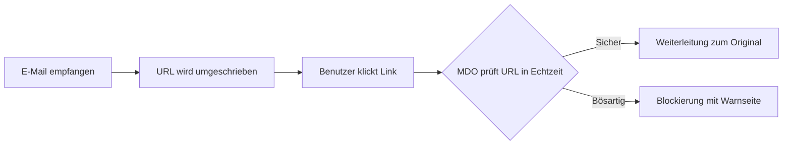
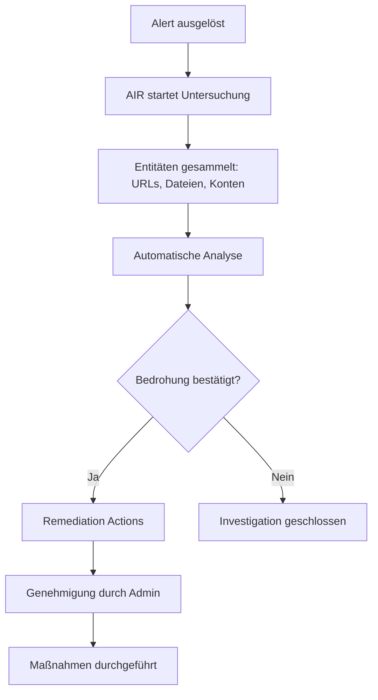

---
tags:
  - microsoft365
  - security
  - defender
  - email-security
  - anti-phishing
aliases:
  - MDO
  - Defender for Office 365
---

# Microsoft Defender for Office 365

> [!ABSTRACT] TL;DR
> Microsoft Defender for Office 365 (MDO) schützt E-Mail, Teams und Office-Kollaboration vor Phishing, Malware und Zero-Day-Bedrohungen. Es ergänzt Exchange Online Protection um Safe Links, Safe Attachments, Anti-Phishing-Richtlinien und — in Plan 2 — automatisierte Untersuchung, Angriffssimulation und Threat Hunting.

---

## Was ist Microsoft Defender for Office 365?

Microsoft Defender for Office 365 ist ein cloudbasierter E-Mail-Security-Dienst, der auf Exchange Online Protection (EOP) aufbaut. Während EOP Standard-Spam- und Malware-Filterung bietet, fügt MDO erweiterte Bedrohungsschutz-Schichten hinzu:

- **Safe Links** – URL-Umschreibung und Echtzeit-Prüfung bei Klick
- **Safe Attachments** – Sandbox-Analyse von E-Mail-Anhängen
- **Anti-Phishing** – Impersonation-Schutz und Spoof Intelligence
- **Threat Explorer** – Forensische Analyse von Bedrohungen
- **Automated Investigation & Response (AIR)** – Automatisierte Reaktion auf Vorfälle

MDO schützt: Exchange Online, SharePoint, OneDrive, Microsoft Teams und Office-Apps.

---

## Plan 1 vs. Plan 2

| Feature | EOP (Basis) | Plan 1 | Plan 2 |
|---------|------------|--------|--------|
| Anti-Spam | ✅ | ✅ | ✅ |
| Anti-Malware | ✅ | ✅ | ✅ |
| Safe Links | ❌ | ✅ | ✅ |
| Safe Attachments | ❌ | ✅ | ✅ |
| Anti-Phishing (Impersonation) | ❌ | ✅ | ✅ |
| Spoof Intelligence | ✅ | ✅ | ✅ |
| Real-time Detections | ❌ | ✅ | ✅ |
| Threat Explorer | ❌ | ❌ | ✅ |
| Automated Investigation (AIR) | ❌ | ❌ | ✅ |
| Attack Simulator | ❌ | ❌ | ✅ |
| Priority Account Protection | ❌ | ❌ | ✅ |
| Campaign Views | ❌ | ❌ | ✅ |

> [!NOTE]
> **Plan 1** ist in Microsoft 365 Business Premium enthalten. **Plan 2** ist Teil von Microsoft 365 E5 oder als Add-on erhältlich.

---

## Safe Links

Safe Links schützt Benutzer vor bösartigen URLs — sowohl in E-Mails als auch in Office-Dokumenten und Teams-Nachrichten.

### Funktionsweise



### Wichtige Einstellungen
- **URL-Umschreibung**: Alle URLs werden durch `*.safelinks.protection.outlook.com` ersetzt
- **Real-time URL detonation**: Unbekannte URLs werden in einer Sandbox analysiert
- **Do not rewrite list**: URLs, die nicht umgeschrieben werden sollen
- **Click-through**: Benutzer können Warnung umgehen (deaktivierbar)
- **URL tracking**: Klicks auf sichere Links werden protokolliert

```powershell
# Safe Links Policy erstellen
New-SafeLinksPolicy -Name "Unternehmen Safe Links" `
    -EnableSafeLinksForEmail $true `
    -EnableSafeLinksForTeams $true `
    -EnableSafeLinksForOffice $true `
    -TrackUserClicks $true `
    -AllowClickThrough $false `
    -ScanUrls $true

# Policy einer Regel zuweisen
New-SafeLinksRule -Name "Alle Benutzer" `
    -SafeLinksPolicy "Unternehmen Safe Links" `
    -RecipientDomainIs "contoso.com"
```

---

## Safe Attachments

Safe Attachments analysiert E-Mail-Anhänge in einer virtuellen Sandbox (Detonation), bevor sie den Empfänger erreichen.

### Dynamic Delivery
Mit **Dynamic Delivery** erhält der Benutzer die E-Mail sofort — der Anhang wird als Platzhalter eingefügt und erst nach der Analyse ersetzt. Das minimiert die Verzögerung.

### Aktionen bei Befund
| Aktion | Beschreibung |
|--------|-------------|
| Off | Kein Safe Attachments Scan |
| Monitor | Anhang wird geliefert, Bedrohungen werden protokolliert |
| Block | Bösartige Anhänge werden blockiert |
| Replace | Anhang wird durch Platzhalter ersetzt |
| Dynamic Delivery | E-Mail sofort, Anhang nach Scan |

```powershell
# Safe Attachments Policy
New-SafeAttachmentPolicy -Name "Unternehmen Safe Attachments" `
    -Enable $true `
    -Action DynamicDelivery `
    -QuarantineTag "AdminOnlyAccessPolicy"

New-SafeAttachmentRule -Name "Alle Domänen" `
    -SafeAttachmentPolicy "Unternehmen Safe Attachments" `
    -RecipientDomainIs "contoso.com"
```

---

## Anti-Phishing Richtlinien

### Impersonation Protection
Schützt vor Angriffen, bei denen Angreifer wichtige Personen oder Domänen imitieren:

- **User Impersonation**: Schutz für bis zu 350 bestimmte Benutzer (z.B. CEO, CFO)
- **Domain Impersonation**: Schutz für eigene und ähnliche Domänen (z.B. `c0ntoso.com`)
- **Mailbox Intelligence**: ML-basiertes Lernverhalten aus E-Mail-Kommunikationsmustern
- **First Contact Safety Tip**: Hinweis bei E-Mails von unbekannten Absendern

### Spoof Intelligence
Erkennt und blockiert E-Mail-Spoofing (gefälschte Absender-Domains).

- **DMARC-Enforcement**: Erzwingt DMARC-Richtlinien
- **Composite Authentication**: Kombiniert SPF, DKIM und DMARC
- **Implicit Email Authentication**: Reputationsbasierte Prüfung

### DMARC/DKIM/SPF
```
Prüfreihenfolge: SPF → DKIM → DMARC → Composite Authentication
```

---

## Anti-Malware

- **Zero-Hour Auto Purge (ZAP)** für Malware: Nachträglich erkannte Malware-E-Mails werden aus dem Posteingang entfernt
- **Common Attachment Filter**: Blockiert gefährliche Dateitypen (.exe, .js, .vbs, etc.)
- **Admin Quarantine**: Quarantänisierte Nachrichten verwalten

---

## Zero-Hour Auto Purge (ZAP)

ZAP erkennt und entfernt **nachträglich** als bösartig eingestufte Nachrichten aus Benutzerpostfächern.

| ZAP-Typ | Bedingung | Aktion |
|---------|-----------|--------|
| Malware ZAP | Anhang nachträglich als Malware erkannt | In Quarantäne verschieben |
| Phishing ZAP | Nachricht nachträglich als Phishing erkannt | In Quarantäne verschieben |
| Spam ZAP | High-confidence Spam | In Junk-Ordner verschieben |

> [!IMPORTANT]
> ZAP funktioniert nur für Nachrichten der letzten **48 Stunden** und nur wenn die Nachricht noch nicht gelesen oder weitergeleitet wurde.

---

## Attack Simulator (Plan 2)

Der **Attack Simulation Training**-Dienst ermöglicht kontrollierte Phishing-Simulationen zur Schulung von Mitarbeitern.

### Simulationstypen
- **Credential Harvest** – Gefälschte Login-Seiten
- **Malware Attachment** – Simulierte Schad-Anhänge
- **Link in Attachment** – Link in Dokument, das zu Phishing führt
- **Link to Malware** – Direktlink zu Malware
- **Drive-by URL** – URL lädt automatisch Payload herunter
- **OAuth Consent Grant** – Gefälschte OAuth-App-Anfragen

### Trainingsmodule
Nach einer Simulation können Benutzer automatisch Trainingsmodule zugewiesen bekommen.

---

## Threat Explorer vs. Real-time Detections

| Feature | Real-time Detections (Plan 1) | Threat Explorer (Plan 2) |
|---------|------------------------------|--------------------------|
| E-Mail-Analyse | ✅ | ✅ |
| URL-Analyse | ✅ | ✅ |
| Datei-Analyse | ✅ | ✅ |
| Zeitraum | 7 Tage | 30 Tage |
| E-Mail-Aktionen | Eingeschränkt | Vollständig |
| Campaign Views | ❌ | ✅ |
| Hunting | ❌ | ✅ |

---

## Automated Investigation and Response (AIR) — Plan 2

AIR untersucht automatisch Sicherheitswarnungen und ergreift Gegenmaßnahmen.

### AIR-Trigger
- Benutzer meldet Phishing (Report Message Add-in)
- ZAP-Ereignis
- Manuelle Untersuchung durch Admin

### Typische AIR-Aktionen
- E-Mails in Quarantäne verschieben
- Übermittlungsregel (Weiterleitung) deaktivieren
- Postfach im Defender XDR markieren



---

## Priority Account Protection (Plan 2)

Hochwertige Konten (C-Suite, IT-Admins) erhalten erhöhten Schutz:

- Differenzierte E-Mail-Filterung
- Frühwarnung bei Angriffsversuchen
- Spezielle Berichte und Alerts
- Höhere Scan-Priorität

```powershell
# Prioritätskonto hinzufügen
Set-User -Identity "ceo@contoso.com" -PriorityAccountEnabled $true
```

---

## Preset Security Policies

Microsoft bietet zwei vorkonfigurierte Sicherheitsprofile:

| Richtlinie | Beschreibung | Empfehlung |
|------------|-------------|-----------|
| **Standard** | Ausgewogener Schutz, weniger falsch-positive | Allgemeine Benutzer |
| **Strict** | Maximaler Schutz, mehr falsch-positive | Hochwertige Ziele |

> [!TIP]
> Nutze **Standard** für alle Benutzer als Basis, und **Strict** für privilegierte Konten (Admins, Führungskräfte).

---

## Tenant Allow/Block List (TABL)

Die Tenant Allow/Block List ermöglicht es, bestimmte URLs, Dateien, Absender und Domänen global zu erlauben oder zu blockieren.

| Typ | Erlauben | Blockieren |
|-----|----------|-----------|
| URLs | ✅ (30 Tage max.) | ✅ (90 Tage) |
| Dateien (SHA256) | ✅ | ✅ |
| Absender | ✅ | ✅ |
| Domänen | ✅ | ✅ |

> [!WARNING]
> Allow-Einträge in der TABL umgehen Sicherheitsprüfungen. Nur verwenden, wenn sicher bekannt ist, dass es sich um Fehlalarme handelt.

---

## Quarantäne-Verwaltung

Quarantänisierte Nachrichten können im Purview-Portal oder per PowerShell verwaltet werden.

```powershell
# Quarantäne-Nachrichten anzeigen
Get-QuarantineMessage -RecipientAddress "user@contoso.com"

# Nachricht freigeben
Release-QuarantineMessage -Identity <MessageID> -ReleaseToAll

# Admin Quarantäne Policy
New-QuarantinePolicy -Name "AdminOnly" -EndUserQuarantinePermissions PermissionToViewHeader
```

---

## Integration mit Defender XDR

MDO-Incidents und -Alerts sind vollständig in das Microsoft Defender XDR-Portal (security.microsoft.com) integriert:

- E-Mail-Alerts werden mit Gerät- und Identitäts-Alerts korreliert
- Unified Incident Queue
- Advanced Hunting über `EmailEvents`, `EmailUrlInfo`, `EmailAttachmentInfo`, `EmailPostDeliveryEvents`

```kusto
// E-Mails mit bösartigen URLs der letzten 7 Tage
EmailUrlInfo
| where Timestamp > ago(7d)
| where ThreatTypes has "Phish"
| join EmailEvents on NetworkMessageId
| project Timestamp, SenderFromAddress, RecipientEmailAddress, Url, ThreatTypes
| limit 100
```

---

## Lizenzierung

| Lizenz | MDO-Abdeckung |
|--------|--------------|
| Exchange Online Plan 1/2 | EOP (kein MDO) |
| Microsoft 365 Business Basic | EOP (kein MDO) |
| Microsoft 365 Business Premium | MDO Plan 1 |
| Microsoft 365 E3 | EOP (kein MDO) |
| Microsoft 365 E5 | MDO Plan 2 |
| Office 365 E5 | MDO Plan 2 |
| MDO Plan 1 Add-on | Plan 1 Features |
| MDO Plan 2 Add-on | Plan 2 Features |

---

## Verwandte Notizen
- [[Microsoft Defender XDR]]
- [[Microsoft Secure Score]]
